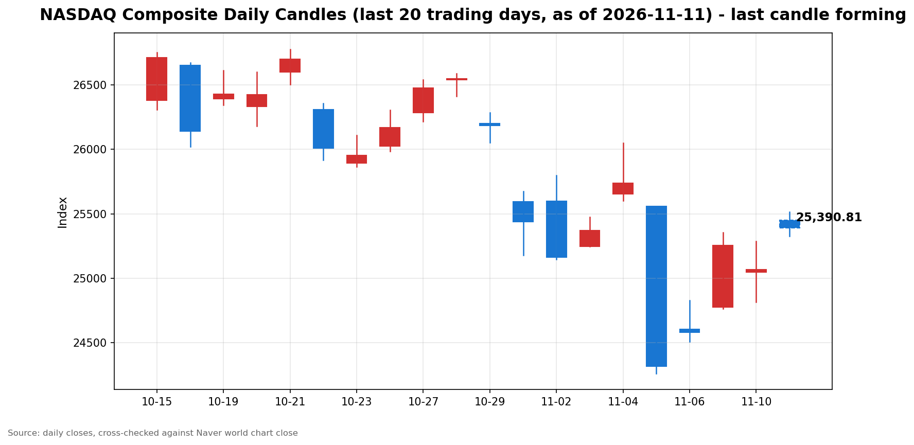

안녕하세요, [한국투자증권](https://securities.koreainvestment.com/main/Main.jsp)에서 [한투-한국투자증권](https://play.google.com/store/apps/details?id=com.truefriend.neosmartarenewal&hl=ko) 개발을 담당하고 있는 way입니다. 
2026년 11월 11일 나스닥 장 오픈 흐름을 수치 중심으로 정리합니다. 

## 개장 배경

전일인 11월 10일 미국 증시는 하락 마감했습니다. 
나스닥 종합은 25,065.87로 전 거래일 대비 0.74% 내렸습니다. 
스탠더드앤드푸어스 500 지수는 7,520.93으로 0.38% 내렸고, 다우존스 산업평균지수는 52,231.89로 0.30% 내렸습니다. 
하락의 직접적인 계기는 오전 8시 30분에 발표된 10월 소비자물가지수였습니다. 
10월 소비자물가지수는 전월 대비 0.4% 올라 시장 예상 0.3%를 웃돌았습니다. 
근원 소비자물가지수도 전월 대비 0.3% 올라 예상 0.2%를 웃돌았고, 3개월 연속 0.3% 상승을 기록했습니다. 
발표 직후 12월 연방준비제도 금리 인상 전망이 강화됐고, 미국 2년물 국채수익률은 17bp 넘게 급등했습니다. 
11월 11일 개장 전 흐름은 반전됐습니다. 
나스닥 100 선물은 1.6%에서 1.7% 올랐고, 스탠더드앤드푸어스 500 선물은 0.6%에서 0.9% 올랐습니다. 
다우 선물은 보합권에 머물렀습니다. 
반등의 중심에는 인공지능 클라우드 기업 코어위브의 실적이 있습니다. 
코어위브는 3분기 매출 36억6천만 달러를 기록해 전년 동기 대비 168% 늘었고, 2026년 매출 전망도 130억 달러에서 133억 달러로 상향했습니다. 
시간외 거래에서 코어위브 주가는 15% 넘게 올랐습니다. 
이날은 미국 재향군인의 날로, 미국 국채 현물 시장은 휴장합니다. 
주식 시장은 정상 개장합니다. 

## 오늘의 스냅샷

| 지수 | 현재가 | 전일 대비 | 등락률 | 전일 종가 | 장중 고가 | 장중 저가 | 스냅샷 기준 시각 |
| --- | --- | --- | --- | --- | --- | --- | --- |
| 나스닥 종합 | 25,405.48 | +339.61 | +1.36% | 25,065.87 | 25,513.93 | 25,326.69 | 미국 동부시간 2026-11-11 10:03, 한국시간 2026-11-12 00:03 |
| 스탠더드앤드푸어스 500 | 7,585.26 | +64.33 | +0.86% | 7,520.93 | 7,590.37 | 7,579.68 | 미국 동부시간 2026-11-11 10:04, 한국시간 2026-11-12 00:04 |
| 다우존스 산업평균지수 | 52,202.48 | -29.41 | -0.06% | 52,231.89 | 확인 필요 | 확인 필요 | 미국 동부시간 2026-11-11 10:03, 한국시간 2026-11-12 00:03 |

당일 수치는 형성 중인 수치로, 마감 전에는 계속 변합니다. 
나스닥 종합의 시가는 25,448.80이었습니다. 
전일 종가와 비교하면 시가 기준으로는 1.53% 상승 출발했습니다. 
장중 고가는 25,513.93으로 전일 대비 1.79%까지 올랐고, 장중 저가는 25,326.69로 전일 대비 1.04% 상승 수준이었습니다. 
스탠더드앤드푸어스 500 지수의 장중 고가와 저가는 한국투자증권 MTS 시계열의 최대값과 최소값으로 산출했습니다. 
한국투자증권 MTS 시계열은 표본 수가 적어, 실제 장중 고가와 저가보다 좁게 나타날 수 있습니다. 
다우존스 산업평균지수의 장중 고가와 저가는 네이버 월드 차트 페이지에서 확인되지 않아 확인 필요로 표기합니다. 
다우존스 산업평균지수는 네이버 월드 차트 페이지의 주요 지수 패널 기준 52,202.48이며, 같은 화면의 하단 티커는 52,210.73으로 갱신 시점 차이로 약간 다르게 표시됐습니다. 
나스닥 종합과 다우존스 산업평균지수 값은 네이버 월드 차트 페이지에서 직접 확인했습니다. 
스탠더드앤드푸어스 500 지수 값은 한국투자증권 MTS 해외 대시보드에서 확인했습니다. 
한국투자증권 MTS 기준 같은 시각 나스닥 종합은 25,390.50으로 네이버 값과 0.06% 이내에서 일치했습니다. 
원·달러 환율은 한국투자증권 MTS 기준 1,337.40원으로, 전일 1,344.00원보다 0.49% 낮은 수준입니다. 
장중에는 1,331.40원에서 1,343.50원 사이에서 움직였습니다. 
참고로 [네이버 월드 차트 나스닥 종합](https://finance.naver.com/world/sise.naver?symbol=NAS@IXIC)과 [네이버 월드 차트 나스닥 종합 가격](https://stock.naver.com/worldstock/index/.IXIC/price) 링크를 함께 둡니다. 

## 차트

최근 20거래일 일봉 차트입니다. 
빨간 봉은 종가가 시가보다 높은 날, 파란 봉은 종가가 시가보다 낮은 날입니다. 
당일 봉은 형성 중인 봉으로, 마감 전에는 계속 변합니다. 

## 원인·촉매 분석

표면적으로는 나스닥이 전일 대비 1.36% 상승 출발했습니다. 
근본 촉매는 코어위브의 실적 서프라이즈입니다. 
코어위브의 3분기 매출은 전년 동기 대비 168% 늘었고, 2026년 매출 전망도 상향됐습니다. 
인공지능 인프라 지출이 과도하다는 우려가 실적 수치로 일부 해소되면서, 저가 매수세가 기술주 쪽에서 먼저 들어왔습니다. 
엔비디아는 장 초반 4% 안팎으로 반등했고, 마이크론과 마벨도 상승했습니다. 
골드만삭스는 반도체주가 최근 조정으로 과매도 구간에 들어섰다는 평가를 내놨습니다. 
그런데 금리 인상 우려가 사라진 것은 아닙니다. 
10월 소비자물가지수 발표 이후 12월 금리 인상은 사실상 기정사실로 받아들여지고 있습니다. 
시장은 12월 0.25%포인트 인상을 90% 안팎으로 반영하고 있고, 0.5%포인트 인상 가능성도 11.5% 수준으로 보고 있습니다. 
미국 2년물 국채수익률은 전일 4.736%까지 올랐고, 10년물 국채수익률은 5.00%에 도달했습니다. 
이날 국채 현물 시장이 휴장이라, 금리 부담의 온전한 반영은 내일 이후에 확인됩니다. 
지수 간 방향 차이도 뚜렷합니다. 
나스닥이 1.36% 오르는 동안 스탠더드앤드푸어스 500 지수는 0.86% 올랐고, 다우는 0.06% 내렸습니다. 
상승이 기술주와 인공지능 체인에 집중되고, 경기민감주와 가치주 쪽은 따라오지 못하고 있음을 보여줍니다. 
전일 하락이 금리 재료로 시장 전반을 누른 것과 달리, 이날 반등은 인공지능 실적이라는 기술주 고유의 재료가 주도하고 있습니다. 
달러는 물가 발표 이후 주요 통화 대비 강세 흐름을 보인다는 보도가 있습니다. 
달러 지수 수치는 이번 스냅샷에서 별도로 확인되지 않아 단정하지 않습니다. 

## 핵심 사건 3가지

### 첫째, 10월 소비자물가지수 예상 상회와 12월 금리 인상 기정사실화입니다

10월 소비자물가지수는 전월 대비 0.4% 올랐습니다. 
근원 소비자물가지수는 전월 대비 0.3% 올라 시장 예상 0.2%를 웃돌았습니다. 
근원 소비자물가지수의 0.3% 상승은 3개월 연속입니다. 
이 사건이 중요한 이유는 연방준비제도의 12월 결정이 다시 물가 지표에 묶였기 때문입니다. 
시장은 12월 0.25%포인트 인상을 90% 안팎으로 반영하고 있고, 0.5%포인트 인상 가능성도 11.5% 수준으로 보고 있습니다. 
골드만삭스는 12월 두 번째 0.25%포인트 인상에 이어 2027년 3월 세 번째 인상까지 전망에 추가했습니다. 
물가 재가속이라기보다는 끈적한 물가 흐름이 이어지고 있다는 해석이 나옵니다. 
다만 금리 인상 기대가 유지되는 한 성장주 중심의 나스닥에는 부담이 이어질 수 있습니다. 
12월 연방공개시장위원회까지 남은 물가 지표와 연준 위원들의 발언이 방향을 가를 변수입니다. 

### 둘째, 연준 인사들의 매파 발언 릴레이입니다

크리스토퍼 월러 연방준비제도 이사는 소비자물가지수 발표 전에, 10월 근원 소비자물가지수가 0.3% 이상을 또 기록하면 12월 회의에서 0.5%포인트 금리 인상을 검토해야 한다는 입장을 밝혔습니다. 
이번 발표는 그 기준에 부합하는 결과입니다. 
로리 로건 댈러스 연방준비은행 총재는 최소 두 차례의 추가 인상이 필요하고, 더 빠른 속도로 움직일 여지도 있다고 말했습니다. 
오스탄 굴스비 시카고 연방준비은행 총재는 물가 상황을 경계가 필요한 수준이라고 표현했습니다. 
애나 폴슨 필라델피아 연방준비은행 총재는 점진적인 인상이 적절하지만, 물가 전망이 악화되면 더 공격적인 대응이 필요할 수 있다고 말했습니다. 
이 사건이 중요한 이유는 물가 지표 하나를 넘어 연준 내부의 논의 자체가 인상 속도를 높이는 쪽으로 기울고 있기 때문입니다. 
발표 당일 미국 2년물 국채수익률은 17bp 넘게 올라 4.736%를 기록했고, 10년물 국채수익률은 5.00%에 도달했습니다. 
2년물 국채수익률의 하루 상승폭은 19개월 만에 가장 컸습니다. 
금리 경로에 대한 재가격이 기술주 밸류에이션을 직접 압박하는 구조라, 발언 하나하나가 시장의 민감도를 높이고 있습니다. 

### 셋째, 코어위브 실적 서프라이즈와 인공지능 지출 우려 완화입니다

코어위브는 3분기 매출 36억6천만 달러를 기록해 전년 동기 대비 168% 늘었습니다. 
2026년 매출 전망은 130억 달러에서 133억 달러로 상향됐습니다. 
2028년 상반기에는 조정 기준 흑자 전환을 예상한다는 전망도 함께 제시됐습니다. 
시간외 거래에서 코어위브 주가는 15% 넘게 올랐습니다. 
이 사건이 중요한 이유는 인공지능 인프라 지출이 과도하다는 우려가 실적 수치로 반박됐기 때문입니다. 
최근 반도체와 인공지능 관련주는 밸류에이션 부담과 지출 지속 가능성에 대한 의문으로 조정을 받았습니다. 
실적이 기대를 웃돌자 나스닥 100 선물은 1.6%에서 1.7% 올랐고, 엔비디아는 4% 안팎으로 반등했습니다. 
다만 이는 개별 기업의 실적에 대한 평가이지, 인공지능 산업 전체의 투자 회수 기간이 검증됐다는 뜻은 아닙니다. 
실적 모멘텀이 이어지는지, 아니면 금리 부담에 다시 눌리는지가 장 후반의 관전 지점입니다. 

## 지수·섹터 영향 체인

금리 인상 경계는 성장주 밸류에이션을 통해 기술주에 가장 먼저 작용하는 것이 일반적입니다. 
그런데 이날은 기술주가 가장 많이 오릅니다. 
이는 금리 재료보다 인공지능 실적 재료가 당일 흐름을 주도하고 있음을 보여줍니다. 
반도체와 인공지능 인프라 체인에는 코어위브 실적이 직접적인 심리 변수로 작용합니다. 
엔비디아의 4% 안팎 반등과 마이크론, 마벨의 상승은 인공지능 체인 전반으로 온기가 번지고 있음을 시사합니다. 
골드만삭스의 과매도 평가도 반도체 체인의 저가 매수 심리를 뒷받침합니다. 
다우가 0.06% 내린 점은 상승이 시장 전반으로 확산되지 않았음을 보여줍니다. 
다우는 경기민감주와 금융, 산업재 비중이 높아, 금리 인상 경계와 경기 둔화 우려에 직접 노출되는 구조입니다. 
스탠더드앤드푸어스 500 지수가 0.86% 오른 것은 기술주 상승이 지수 전반을 끌어올리고 있으나, 다우 쪽의 약세가 상쇄하고 있음을 보여줍니다. 
금융 섹터는 금리 인상 기대가 순이자마진에는 우호적일 수 있으나, 경기 둔화 우려와 맞물려 방향이 엇갈릴 수 있습니다. 
에너지 섹터의 방향은 유가 수치가 이번 스냅샷에서 확인되지 않아 단정하지 않습니다. 
결국 이날의 차별화는 금리 경로라는 공통 변수 위에 인공지능 실적이라는 섹터 고유 변수가 얹힌 결과입니다. 

## 다우·S&P500 흐름

다우존스 산업평균지수는 52,202.48로 전일 대비 29.41포인트, 0.06% 내렸습니다. 
전일 종가는 52,231.89였습니다. 
개장 전 다우 선물도 보합권에 머물렀습니다. 
스탠더드앤드푸어스 500 지수는 7,585.26으로 전일 대비 64.33포인트, 0.86% 올랐습니다. 
전일 종가는 7,520.93였습니다. 
세 지수가 같은 방향으로 움직이지 않고 있다는 점은 이날 상승이 기술주에 집중된 반등임을 보여줍니다. 
다우의 약세가 장 후반에 좁혀지는지가 확인할 지점입니다. 
스탠더드앤드푸어스 500 지수가 0.86% 상승을 유지하는지도 함께 확인할 필요가 있습니다. 

## 단기·중기 전망과 장 초반 확인할 시나리오

단기적으로는 인공지능 실적 반등이 하루짜리 되돌림인지, 금리 부담을 이겨내는 흐름의 시작인지가 갈림길입니다. 
장 초반에 확인할 첫 번째 수치는 나스닥의 25,500선 안착 여부입니다. 
10:03 기준 나스닥은 25,405.48로, 장중 고가 25,513.93에서 밀려난 상태입니다. 
두 번째로 확인할 구간은 전일 종가 25,065.87과 11월 9일 종가 25,253.14입니다. 
상승폭이 되돌려지더라도 두 구간 위에서 버티면 반등 흐름이 이어지는 시나리오가 힘을 얻습니다. 
반대로 금리 부담이 다시 부각되면 전일 종가 테스트로 이어지는 시나리오를 염두에 둘 필요가 있습니다. 
스탠더드앤드푸어스 500 지수는 7,500선, 다우는 52,000선 안착 여부를 확인할 필요가 있습니다. 
다우는 52,202.48로 52,000선에 바짝 다가선 수준입니다. 
내일 재개되는 국채 시장의 반응도 확인할 사안입니다. 
10년물 국채수익률이 5.00%를 웃돌며 오르면 성장주 밸류에이션 부담이 다시 커질 수 있습니다. 
이날 국채 시장이 휴장이라 장중에는 금리 신호가 끊겨 있다는 점도 염두에 둘 필요가 있습니다. 
중기적으로는 12월 연방공개시장위원회까지 물가 지표와 연준 위원들의 발언이 방향을 정합니다. 
물가 상승률이 꺾이는 신호가 나오면 금리 부담이 완화되는 방향으로 해석될 수 있습니다. 
물가가 끈적하게 이어지면 금리 인상 기대가 유지되면서 변동성이 이어질 수 있습니다. 
이번 주 남은 거시지표와 연준 위원들의 발언도 함께 확인할 사안입니다. 
이 글은 지수와 섹터 단위의 흐름을 정리한 것으로, 특정 종목의 매수나 매도를 권유하지 않습니다. 

## 마치며

코어위브 실적에 힘입어 나스닥은 1.36% 상승 출발했으나, 금리 인상 경계는 여전히 남아 있습니다. 
내일 재개되는 국채 시장의 반응과 25,500선 안착 여부를 장 초반에 확인할 필요가 있습니다. 
이 글은 매수나 매도를 권유하지 않습니다. 
