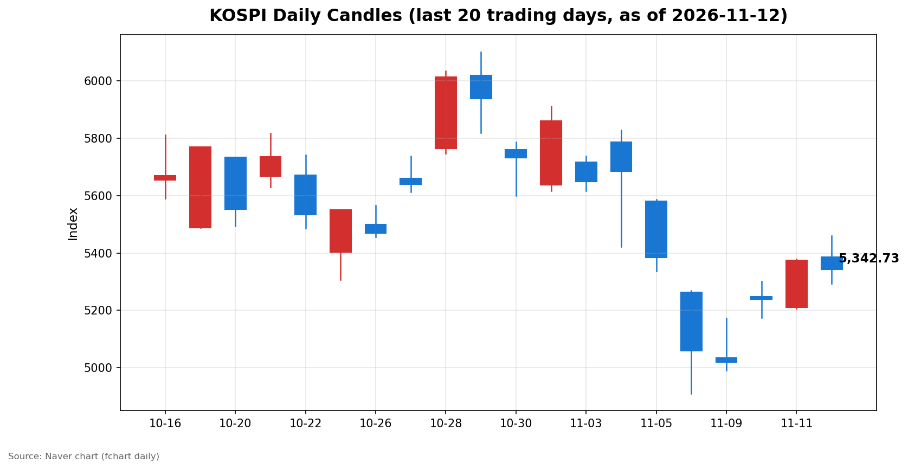
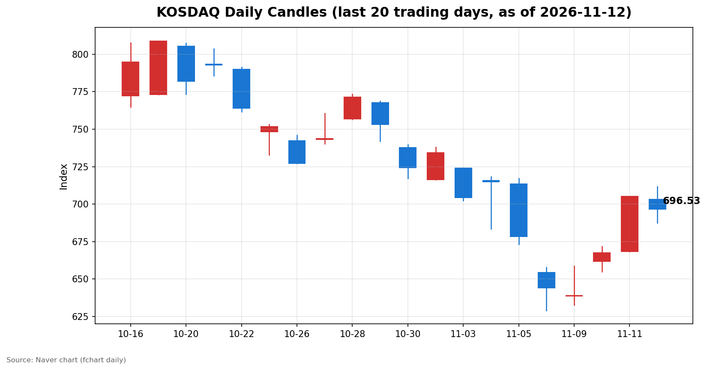

안녕하세요, [한국투자증권](https://securities.koreainvestment.com/main/Main.jsp)에서 [한투-한국투자증권](https://play.google.com/store/apps/details?id=com.truefriend.neosmartarenewal&hl=ko) 개발을 담당하고 있는 way입니다. 
오늘 국내 증시는 장중 상승분을 모두 반납하고 양 시장이 함께 하락 마감했습니다. 

## 마감 요약

코스피는 전일 대비 32.63포인트(0.61%) 하락한 5,342.73에 마감했습니다. 
코스닥은 전일 대비 8.57포인트(1.22%) 하락한 696.53에 마감했습니다. 
코스피는 장중 5,458.84까지 오르며 전일 종가 대비 1.55% 상승했으나, 오후 들어 상승분을 모두 되돌렸습니다. 
코스닥은 장중 711.86까지 올랐다가 700선을 다시 내주고 마감했습니다. 
이틀 연속 이어지던 반등 흐름이 하루 만에 꺾였고, 장중 고점과 종가의 괴리가 116포인트에 달할 만큼 오후 변동성이 컸습니다. 
간밤 미국 증시가 반등했음에도 국내 증시가 하락한 점이 오늘 장의 가장 큰 특징입니다. 

## 오늘의 마감 스냅샷

| 지수 | 종가 | 전일 대비 | 등락률 | 시가 | 고가 | 저가 | 거래량 | 거래대금 |
| --- | --- | --- | --- | --- | --- | --- | --- | --- |
| 코스피 | 5,342.73 | -32.63 | -0.61% | 5,385.94 | 5,458.84 | 5,293.05 | 2억 3,373만 주 | 20조 5,676억 원 |
| 코스닥 | 696.53 | -8.57 | -1.22% | 703.22 | 711.86 | 687.40 | 4억 4,511만 주 | 5조 5,630억 원 |

스냅샷 기준은 2026년 11월 12일 장 마감 수치이며, 전일 종가는 네이버 실시간 데이터 역산값으로 교차 검증했습니다. 
코스피 전일 종가 5,375.36, 코스닥 전일 종가 705.10이 일봉 데이터와 일치했습니다. 
원/달러 환율은 1,336.6원 수준(참고 환율 기준)으로 전일 1,333.6원 대비 약 3원 상승하며 원화 약세를 보였습니다. 
출처: [코스피](https://finance.naver.com/sise/sise_index.naver?code=KOSPI), [코스닥](https://finance.naver.com/sise/sise_index.naver?code=KOSDAQ) 

## 차트

최근 20거래일 일봉 차트입니다. 
빨간 봉은 종가가 시가보다 높은 날, 파란 봉은 종가가 시가보다 낮은 날입니다. 

## 원인·촉매 분석

오늘 하락의 첫 번째 촉매는 미국발 금리 공포의 지속입니다. 
미국 10월 소비자물가지수는 전월 대비 0.4%, 근원 0.3%로 시장 예상을 웃돌았고, 12월 연준 금리 인상 확률은 91%까지 치솟았습니다. 
미국 10년물 국채 금리는 19개월 만에 가장 큰 폭으로 올랐고, 간밤 나스닥은 0.74% 하락한 25,065.87에 마감했습니다. 
금리 인상 우려가 커지면 성장주 밸류에이션에 부담이 커지고, 반도체 중심의 국내 지수 구조상 상승 탄력이 제한될 수밖에 없습니다. 
두 번째 촉매는 엔비디아발 AI·반도체 투자심리 악화입니다. 
엔비디아는 젠슨 황 최고경영자(CEO)를 둘러싼 조사·승계 불확실성으로 미국 증시에서 5.47% 급락한 바 있고, 소프트뱅크가 엔비디아 지분 전량(약 58억 3천만 달러)을 매도한 사실도 알려졌습니다. 
여기에 11일(현지시간) 정규장에서 2.87% 반등한 뒤 시간외 거래에서 해임설이 다시 확산되며 8.61% 급락해 158.78달러에 거래됐고, 시가총액은 마이크로소프트에 밀려 3위로 내려앉았습니다. 
이 소식은 한국 시간 오후 장중에 확산됐고, 장중 고점까지 올랐던 코스피가 오후 들어 하락으로 돌아선 시간대와 맞물립니다. 
국내 증시가 AI·반도체 밸류체인에 깊이 연결돼 있는 만큼, 엔비디아발 심리 충격이 지수 전반으로 번지는 연결고리가 그대로 작동했습니다. 
다만 하락을 완충한 요인도 있었습니다. 
코어위브가 3분기 매출 36억 6천만 달러(전년 대비 168% 증가)라는 어닝 서프라이즈를 발표하며 시간외 주가가 16% 넘게 급등했고, 나스닥100 선물은 1.7% 반등했습니다. 
AI 수요 자체가 꺾인 것이 아니라 특정 기업을 둘러싼 불확실성이 문제라는 해석이 힘을 얻으면서, 낙폭이 제한되는 흐름도 함께 나타났습니다. 
원/달러 환율이 전일 대비 약 3원 상승하며 원화 약세를 보인 점도 외국인의 국내 증시 매수에는 우호적이지 않은 환경으로 작용했습니다. 

## 핵심 사건 3가지

### 1. 미국 10월 소비자물가지수 예상 상회와 12월 금리 인상 확률 91%

미국 10월 소비자물가지수가 전월 대비 0.4%, 근원 0.3%로 시장 예상을 웃돌면서 연준의 12월 금리 인상 가능성이 다시 부각됐습니다. 
월러 연준 이사는 인플레이션이 높게 유지된다면 12월에 0.5%포인트 금리 인상도 정당화할 수 있다고 밝혔습니다. 
미국 10년물 국채 금리는 19개월 만에 가장 큰 폭으로 올랐고, 12월 금리 인상 확률은 91%까지 치솟았습니다. 
국내 증시 입장에서는 물가 지표 자체보다 미국 증시와 환율의 추가 반응이 내일 장 초반 외국인 수급으로 이어지는 연결고리가 됩니다. 
연준 위원들의 추가 발언과 미국 국채 금리 움직임이 내일 확인할 첫 번째 수치입니다. 

### 2. 엔비디아 젠슨 황 해임설과 시간외 8.61% 급락, 소프트뱅크 지분 전량 매도

엔비디아는 11일(현지시간) 뉴욕증시 정규장에서 전 거래일보다 2.87% 오른 173.73달러에 거래를 마쳤습니다. 
그러나 장이 끝난 뒤 이사회가 젠슨 황 최고경영자의 해임을 준비하고 있다는 소식이 전해지며 시간외 거래에서 8.61% 급락해 158.78달러 선까지 밀렸습니다. 
시가총액은 약 481조 원 증발해 3조 8,340억 달러로 마이크로소프트에 밀려 3위로 내려앉았습니다. 
여기에 소프트뱅크가 보유 중이던 엔비디아 지분 전량(약 58억 3천만 달러)을 매도한 사실도 알려지며 투자심리 악화에 무게를 더했습니다. 
해임설의 사실 여부는 아직 확인되지 않았고, 보도된 의혹의 진위도 확정되지 않은 상태입니다. 
다만 시장이 이 소식을 AI·반도체 밸류체인 전반의 리스크로 받아들였다는 점이 오늘 국내 증시 오후 하락의 직접적인 배경으로 작용했습니다. 
엔비디아의 정규장 주가 반응과 추가 보도 여부가 내일 확인할 두 번째 수치입니다. 

### 3. 삼성전자 HBM 온양 패키징 공장 착공 1년 앞당김과 코어위브 어닝 서프라이즈

삼성전자가 충남 아산 온양에 고대역폭메모리(HBM) 첨단 패키징 공장을 착공하고 가동 목표를 2028년 6월로 당초 계획보다 1년 앞당겼습니다. 
46조 원 규모의 순차 투자를 통해 5개 라인을 구축하는 계획으로, 국내 반도체 공급망의 중장기 성장 기대를 뒷받침하는 재료입니다. 
코어위브도 3분기 매출 36억 6천만 달러(전년 대비 168% 증가)를 기록하며 연간 매출 전망을 130억 달러 이상으로 상향했고, 시간외 주가는 16% 넘게 급등했습니다. 
AI 수요 자체는 여전히 견조하다는 신호가 엔비디아발 불안과 같은 날에 나란히 전해진 셈입니다. 
오늘 국내 증시에서는 전력기기와 기판 관련 테마가 강세를 보이며 지수 하락을 일부 제한했고, AI 인프라 수요 기대가 살아 있다는 점이 확인됐습니다. 
악재와 호재가 같은 날에 교차한 만큼, 어느 쪽이 우위를 점하는지는 미국 증시의 밤사이 반응에서 가려질 것으로 보입니다. 

## 섹터·테마 영향 체인

오늘 장의 영향 체인은 금리와 AI 심리라는 두 개의 축으로 갈렸습니다. 
금리 인상 우려는 성장주 밸류에이션에 직접 부담을 주었고, 엔비디아발 심리 악화는 AI·반도체 밸류체인 전반으로 번지며 지수 하락을 이끌었습니다. 
반대로 AI 데이터센터발 전력 수요는 전력기기·에너지 섹터의 강세를 이끌었고, HBM 착공 소식은 기판·PCB 밸류체인으로 기대를 확산시켰습니다. 
전력기기 테마는 1.88% 상승했고, 에너지·전력 섹터에서는 HD현대일렉트릭이 3.70%, 효성중공업이 1.67%, LS ELECTRIC이 1.72% 올랐습니다. 
AI 데이터센터발 북미 전력 수요 폭증으로 주요 전력기기 업체들이 역대급 실적을 기록하며 설비 투자 확대에 나선 흐름이 배경입니다. 
FC-BGA·PCB·기판·반도체 섹터도 강세를 보였습니다. 
비아트론이 17.34%, 심텍홀딩스가 12.48%, 티엘비가 8.24% 올랐고, 대덕전자는 3분기 영업이익이 전년 동기 대비 259% 증가한 실적을 바탕으로 2.52% 상승했습니다. 
삼성전자의 HBM 패키징 공장 착공 1년 앞당김 소식이 기판 수요 기대를 자극했고, AI 서버용 기판 수요와 가격 상승 기대가 더해진 흐름입니다. 
엔터테인먼트 테마는 2.98% 올랐고, JYP Ent.가 16.54%, YG PLUS가 15.57%, 에스엠이 6.31%, 하이브가 4.94% 상승했습니다. 
3분기 실적 발표 이후 순이익 감소와 공개매수 불확실성 여파로 혼조세를 보였지만, 공연·아티스트 활동에 따른 실적 개선 기대가 이어지며 강세를 보였습니다. 
보안(물리) 테마는 2.17% 올랐고, 지니언스가 3분기 누적 영업이익 274% 증가를 바탕으로 21.04% 급등했습니다. 
연이은 해킹 사고와 보안 취약점 보도로 보안 강화 필요성이 커진 가운데 실적이 확인된 종목을 중심으로 매수세가 유입된 흐름입니다. 
국가재난 테마가 6.39%로 가장 큰 폭으로 올랐고, 지능형교통시스템 4.55%, 디지털음원 3.91%, 전장 3.08%, 음성인식 3.03%, SSD 2.99%, 광고 1.84%도 상승했습니다. 
지수 하락에도 강세 테마가 뚜렷했다는 점은, 오늘 장이 전면적인 매도 장세가 아니라 재료와 실적에 따른 선별 장세의 성격도 함께 지녔음을 보여줍니다. 

## 최근 5거래일 일봉

| 날짜 | 시가 | 고가 | 저가 | 종가 | 거래량(천주) |
| --- | --- | --- | --- | --- | --- |
| 11/06 | 5,263.26 | 5,269.10 | 4,911.28 | 5,059.69 | 323,267 |
| 11/09 | 5,034.20 | 5,172.94 | 4,990.66 | 5,018.85 | 248,140 |
| 11/10 | 5,247.22 | 5,300.92 | 5,174.55 | 5,239.13 | 253,917 |
| 11/11 | 5,209.71 | 5,377.99 | 5,207.44 | 5,375.36 | 234,732 |
| 11/12 | 5,385.94 | 5,458.84 | 5,293.05 | 5,342.73 | 233,733 |

| 날짜 | 시가 | 고가 | 저가 | 종가 | 거래량(천주) |
| --- | --- | --- | --- | --- | --- |
| 11/06 | 654.43 | 657.95 | 629.17 | 644.27 | 443,709 |
| 11/09 | 638.82 | 658.66 | 632.70 | 638.97 | 358,495 |
| 11/10 | 661.73 | 671.91 | 655.09 | 667.61 | 402,110 |
| 11/11 | 668.48 | 705.10 | 668.48 | 705.10 | 411,901 |
| 11/12 | 703.22 | 711.86 | 687.40 | 696.53 | 445,113 |

위 표의 첫 번째는 코스피, 두 번째는 코스닥의 최근 5거래일 일봉입니다. 
코스피는 11월 6일 서킷브레이커 이후 저점 4,911.28에서 이틀 연속 반등해 11월 11일 5,375.36까지 올랐으나, 오늘 5,342.73으로 되돌렸습니다. 
코스닥은 11월 11일 705.10으로 700선을 회복했으나 오늘 다시 700선을 내줬습니다. 

## 당일 수급

오늘 수급은 시장별로 정반대의 구도를 보였습니다. 
코스피에서는 외국인이 3,699억 원을 순매수했고, 개인이 2,053억 원, 기관이 6,889억 원을 순매도했습니다. 
기타법인은 코스피에서 5,243억 원을 순매수했습니다. 
기관 매도의 중심은 금융투자로, 9,729억 원을 순매도하며 기관 전체 매도를 주도했습니다. 
반면 사모펀드는 2,120억 원, 투신은 725억 원을 순매수하며 기관 내부에서도 엇갈린 움직임을 보였습니다. 
외국인이 순매수했음에도 지수가 하락한 점은, 금융투자 중심의 기관 매도 물량과 오후의 심리 악화가 외국인 매수세를 압도했음을 보여줍니다. 
코스닥에서는 외국인이 3,525억 원을 순매도했고, 개인이 3,076억 원, 기관이 436억 원을 순매수했습니다. 
기타법인은 코스닥에서 13억 원을 순매수했습니다. 
코스닥에서는 외국인이 팔고 개인이 받는 전형적인 구도가 나타났고, 개인 매수에도 낙폭이 코스피보다 컸습니다. 
외국인의 코스피 매수와 코스닥 매도가 엇갈린 점은, 외국인이 시장 전체가 아니라 시장별로 선별해 대응하고 있음을 보여줍니다. 
수급 수치는 네이버 시장동향 API 기준 당일 수치이며, 코스피와 코스닥을 각각 조회해 대조했습니다. 

## 강했던 테마와 흐름

오늘 가장 강했던 테마는 국가재난(6.39%), 지능형교통시스템(4.55%), 디지털음원(3.91%) 순이었습니다. 
전장(3.08%), 음성인식(3.03%), SSD(2.99%), 엔터테인먼트(2.98%), 보안(물리)(2.17%), 전력기기(1.88%), 광고(1.84%)도 상승했습니다. 
전력기기와 기판·PCB는 AI 데이터센터 수요라는 공통의 촉매를 공유하며 함께 강세를 보였습니다. 
전력기기는 북미 전력망 수요와 3분기 실적 호조가, 기판·PCB는 HBM 패키징 착공과 AI 서버용 기판 수요 기대가 각각의 상승 배경이 됐습니다. 
엔터테인먼트와 보안은 3분기 실적이 확인된 종목을 중심으로 강세를 보이며 실적 시즌의 선별 장세 성격을 드러냈습니다. 
지수 하락 속에서도 테마별 강세가 뚜렷했다는 점은, 자금이 지수 전체가 아니라 재료가 확인된 쪽으로 이동하고 있음을 보여줍니다. 

## 단기·중기 전망과 내일 확인할 시나리오

단기적으로는 엔비디아발 불확실성이 해소되는지가 관건입니다. 
엔비디아의 정규장 주가 반응과 해임설 관련 추가 보도가 밤사이 어떻게 나오는지에 따라 국내 AI·반도체 밸류체인의 심리도 함께 움직일 것으로 보입니다. 
코어위브의 어닝 서프라이즈가 보여준 AI 수요의 견조함이 엔비디아발 불안을 얼마나 상쇄할지도 함께 확인할 필요가 있습니다. 
코스피는 오늘 장중 고점 5,458.84를 저항 구간으로, 저점 5,293.05와 11월 9일 저점 4,990.66 부근의 5,000선을 지지 구간으로 확인할 수 있습니다. 
코스닥은 오늘 종가 696.53으로 700선을 내준 만큼, 700선 회복 여부와 오늘 저점 687.40이 단기 지지선으로 작용하는지가 관건입니다. 
외국인의 코스피 순매수가 내일도 이어지는지, 코스닥 순매도가 진정되는지도 수급 측면에서 확인할 수치입니다. 
중기적으로는 12월 연준 금리 결정 방향이 핵심 변수입니다. 
10월 CPI 쇼크 이후 금리 인상 확률이 91%까지 오른 만큼, 연준 위원들의 발언과 미국 국채 금리 움직임이 국내 증시의 밸류에이션 부담을 좌우할 것으로 보입니다. 
다만 AI 데이터센터발 전력·기판 수요처럼 실적이 뒷받침되는 쪽의 강세가 이어지고 있어, 지수 하락과 테마별 강세가 공존하는 선별 장세는 당분간 이어질 가능성이 있습니다. 
브렌트유가 배럴당 93달러를 웃돌고 있는 점도 유가와 운송·화학 섹터의 비용 부담 측면에서 함께 지켜볼 필요가 있습니다. 
내일 확인할 시나리오는 엔비디아 정규장 주가, 미국 국채 금리와 연준 위원 발언, 외국인의 코스피·코스닥 수급 방향, 코스피 5,400선과 코스닥 700선 회복 여부입니다. 

## 마치며

오늘 국내 증시는 장중 상승분을 모두 반납하며 이틀간의 반등 흐름이 꺾였습니다. 
금리 공포와 엔비디아발 불확실성이 겹친 하루였고, 전력·기판·엔터 등 재료가 확인된 테마의 강세가 지수 하락을 일부 제한했습니다. 
이 글은 시황 해설을 목적으로 작성됐으며, 특정 종목의 매수나 매도를 권유하는 내용이 아닙니다. 
