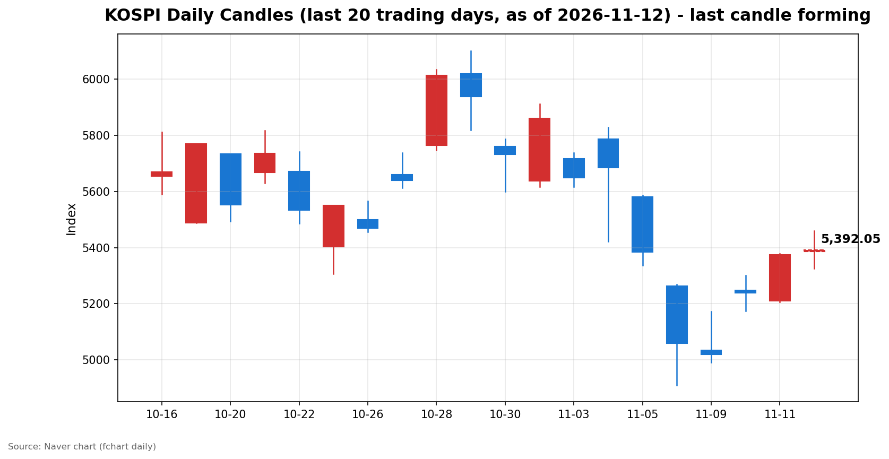
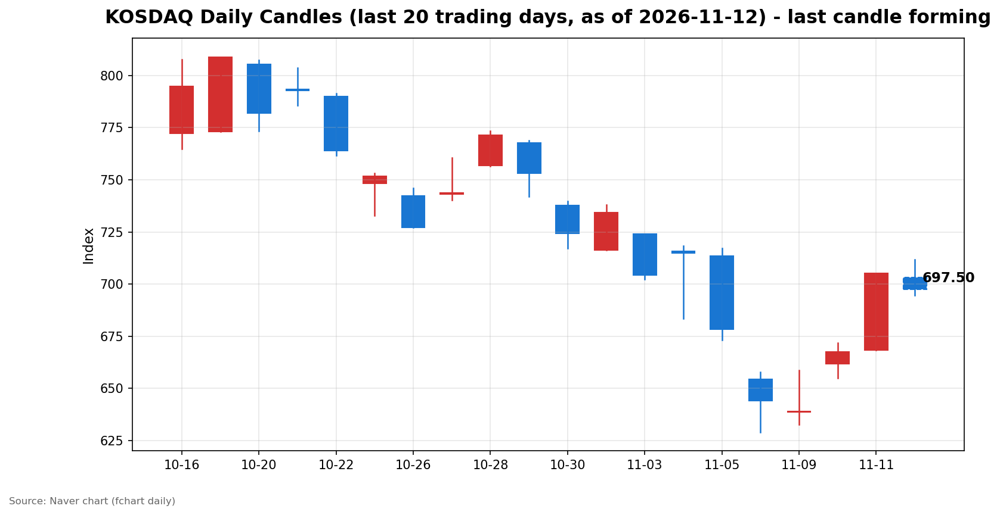

안녕하세요, [한국투자증권](https://securities.koreainvestment.com/main/Main.jsp)에서 [한투-한국투자증권](https://play.google.com/store/apps/details?id=com.truefriend.neosmartarenewal&hl=ko) 개발을 담당하고 있는 way입니다. 
오늘 오전 국내 증시는 코스피와 코스닥이 엇갈린 흐름을 보였습니다. 

## 오전장 요약

코스피는 전일 대비 0.20% 오른 5,385.94에 출발한 뒤 상승폭을 키워 장중 고가 5,458.84까지 올랐습니다. 
이후 상승폭을 줄이며 정오 무렵에는 5,396.36으로 전일 대비 0.39% 상승한 수준에서 거래되고 있습니다. 
코스닥은 703.22로 소폭 하락 출발한 뒤 장중 고가 711.86까지 올랐으나 방향을 바꿔 하락 전환했습니다. 
정오 무렵에는 697.55로 전일 대비 1.07% 하락한 수준에서 거래되고 있으며, 전날 회복했던 700선 아래로 되돌아왔습니다. 
코스피가 장중 고점 이후 되돌림을 보인 반면, 코스닥은 고점 이후 하락 전환이 더 뚜렷했습니다. 

## 오늘의 스냅샷

| 지수 | 현재가 | 전일 대비 | 등락률 | 시가 | 고가 | 저가 | 거래량 | 거래대금 |
| --- | --- | --- | --- | --- | --- | --- | --- | --- |
| 코스피 | 5,396.36 | +21.00 | +0.39% | 5,385.94 | 5,458.84 | 5,326.30 | 121,343천주 | 9조 4,188억 원 |
| 코스닥 | 697.55 | -7.55 | -1.07% | 703.22 | 711.86 | 694.76 | 297,102천주 | 3조 5,486억 원 |

스냅샷 기준 시각은 2026년 11월 12일 12시 27분(KST)입니다. 
당일 봉은 형성 중인 봉으로, 종가는 마감 전에는 계속 변합니다. 
전일 종가는 네이버 실시간 데이터에서 역산한 값으로 교차 검증했습니다. 
코스피 전일 종가는 5,375.36, 코스닥 전일 종가는 705.10입니다. 
지수별 차트는 [코스피](https://finance.naver.com/sise/sise_index.naver?code=KOSPI)와 [코스닥](https://finance.naver.com/sise/sise_index.naver?code=KOSDAQ)에서 확인할 수 있습니다. 

## 차트

최근 20거래일 일봉 차트입니다. 
빨간 봉은 종가가 시가보다 높은 날, 파란 봉은 종가가 시가보다 낮은 날입니다. 
당일 봉은 형성 중인 봉으로, 마감 전에는 계속 변합니다. 

## 원인·촉매 분석

오늘 오전 장의 출발점은 간밤 뉴욕증시에서 엇갈린 두 가지 신호였습니다. 
코어위브의 호실적에 힘입어 나스닥은 25,466.19로 1.60% 상승 마감했고, 필라델피아 반도체지수도 급등했습니다. 
반면 월스트리트저널이 엔비디아 이사회가 젠슨 황 최고경영자의 해임을 준비 중이라고 보도하면서 엔비디아 주가는 시간외 거래에서 8% 넘게 급락했습니다. 
AI 인프라 수요에 대한 기대와 AI 대장주의 거버넌스 불확실성이 같은 밤에 나온 셈입니다. 
국내 증시는 이 엇갈린 신호를 대형 반도체 중심의 코스피와 성장주 중심의 코스닥으로 나눠 반영했습니다. 
전일 수급 구도도 오늘 흐름의 바탕이 됐습니다. 
전일 코스피에서는 외국인이 6,729억 원을 순매수하며 이틀 연속 매수 우위를 보였고, 기타법인이 5,450억 원을 순매수했습니다. 
반면 개인은 7,145억 원, 기관은 5,034억 원을 순매도했습니다. 
외국인의 매수가 이어진 점은 코스피 하단을 받치는 요인이 됐으나, 기관이 차익 실현에 나선 점은 상승폭이 장중 고점에서 되돌려진 배경으로 볼 수 있습니다. 
코스닥에서는 전일 기관이 3,130억 원을 순매수한 반면 외국인은 1,355억 원, 개인은 1,839억 원을 순매도했습니다. 
기관의 받침에도 외국인과 개인의 매도가 이어진 구도로, 이틀 연속 급등했던 코스닥의 되돌림 압력을 키웠습니다. 
여기에 삼성의 충청권 144조 원 투자와 온양 HBM 패키징 공장 착공 소식이 반도체 밸류체인에 대한 기대를 더했습니다. 
원/달러 환율은 1,332.90으로 전일 대비 4.60원 하락해 원화 강세 흐름을 보였고, 이 역시 지수 하단에 우호적인 환경이 됐습니다. 
결국 오늘 오전은 간밤 호재와 악재가 엇갈린 가운데 외국인의 매수 지속과 국내 투자 재료가 코스피를 받치고, 단기 급등 부담과 AI 심리 경계가 코스닥을 누른 형태로 정리됩니다. 

## 핵심 사건 3가지

### 1. 엔비디아 젠슨 황 해임 준비 보도, 시간외 주가 8% 급락

월스트리트저널은 11일 현지 시간 기준으로 엔비디아 이사회가 젠슨 황 최고경영자의 해임을 준비 중이며 이르면 이날 회의를 열어 거취를 결정할 예정이라고 보도했습니다. 
보도 이후 엔비디아 주가는 시간외 거래에서 8% 넘게 급락했습니다. 
이사회가 황 최고경영자에 대한 신뢰를 공개적으로 표명한 지 불과 사흘 만에 해임을 검토하는 단계로 입장을 바꾼 셈이라는 점이 시장의 충격을 키웠습니다. 
다만 이사회의 최종 결정 여부는 아직 확인되지 않았습니다. 
이 사건이 중요한 이유는 AI 반도체 대장주의 거버넌스 불확실성이 AI 밸류체인 전반의 심리에 직접적인 영향을 주기 때문입니다. 
국내 증시에서도 AI와 반도체 관련 심리가 오전 내내 경계감을 유지한 배경이 됐습니다. 

### 2. 나스닥 1.60% 상승 마감, 코어위브 호실적에 AI 인프라 우려 완화

간밤 뉴욕증시는 AI 클라우드 기업 코어위브의 호실적에 힘입어 기술주 중심으로 반등했습니다. 
코어위브는 20%대 급등했고, 나스닥은 25,466.19로 1.60% 상승 마감했습니다. 
필라델피아 반도체지수도 급등하며 반도체주가 동반 강세를 보였습니다. 
이 반등은 전면적인 위험자산 선호라기보다 AI 인프라와 반도체 업종에 매수세가 집중된 차별화 장세로 풀이됩니다. 
미국 물가 경계감과 금리 인상 우려가 여전한 가운데 나온 반등이라, 상승의 성격은 제한적입니다. 
그럼에도 AI 인프라 수요가 실적과 주가로 확인됐다는 점에서 국내 반도체 밸류체인의 오전 흐름을 받치는 재료가 됐습니다. 

### 3. 삼성 충청권 144조 원 투자, 온양 HBM 패키징 공장 착공

삼성전자는 12일 충남 아산 온양캠퍼스에서 반도체 첨단 패키징 팹 착공식을 열었습니다. 
삼성전자가 충청권에 투자하는 60조 원을 포함해 삼성 계열사 전체의 충청권 투자 규모는 144조 원에 달합니다. 
온양 HBM 패키징 공장은 당초 계획보다 1년 앞당겨 2028년 가동될 예정입니다. 
이 사건은 AI 반도체 수요 확대에 대응하는 국내 생산능력 확충이 실제 투자로 이어지고 있음을 보여줍니다. 
수출과 실적 기대에 이어 설비 투자라는 실물 재료가 더해지면서 반도체 밸류체인에 대한 관심은 오전 내내 이어졌습니다. 

## 섹터·테마 영향 체인

오늘 오전의 흐름은 반도체 밸류체인을 중심으로 퍼졌습니다. 
한국투자증권 MTS의 12시 시장 브리핑은 HBM과 기판이 주도권을 유지하고, AI 데이터 사업과 전력 인프라로 관심이 확산되고 있다고 설명했습니다. 
테마별로는 전력기기가 3.35%, SSD가 3.06%, 인공지능이 2.12% 상승했습니다. 
연결고리는 AI 수요의 확산 경로입니다. 
AI 데이터센터 확충이 HBM과 기판, SSD 같은 반도체 후방 밸류체인 수요로 이어지고, 데이터센터 가동에 필요한 전력 인프라 수요가 전력기기 테마로 확산되는 구조입니다. 
삼성의 온양 패키징 투자와 나스닥 반도체 강세가 이 연결고리를 같은 방향으로 밀어준 셈입니다. 
네이버의 3분기 실적도 플랫폼과 AI 쪽 관심으로 이어졌습니다. 
네이버는 3분기 매출 3조 4,700억 원대로 6분기 연속 최대 매출을 기록했고, AI 팩토리 사업에 2조 원을 투자해 내년부터 이익 창출을 목표로 하고 있습니다. 
다만 3분기 영업이익은 전년 동기 대비 20.9% 감소해 수익성 악화가 함께 확인됐습니다. 
매출 성장과 수익성 악화가 동시에 나온 만큼, 플랫폼과 AI 테마의 강세는 실적 확인보다는 기대감이 앞선 측면이 있습니다. 
반면 코스닥 약세의 중심에는 단기 급등 이후의 차익 실현 압력이 있습니다. 
코스닥은 11월 10일 4.48%, 11월 11일 5.62% 연속 급등한 뒤 오늘 되돌림을 보이고 있습니다. 
엔비디아발 불확실성이 성장주 심리에 부담을 더하면서, 이틀간 가파르게 오른 중소형 성장주에서 매물이 나온 것으로 볼 수 있습니다. 
엔터테인먼트와 디지털음원이 3%대 상승한 점은 콘텐츠 쪽에도 관심이 퍼졌음을 보여주나, 오전 흐름의 중심은 반도체와 전력 인프라 쪽에 머물렀습니다. 

## 최근 5거래일 일봉

| 날짜 | 코스피 종가 | 코스피 시가 | 코스피 고가 | 코스피 저가 | 코스닥 종가 |
| --- | --- | --- | --- | --- | --- |
| 2026-11-05 | 5,383.80 | 5,580.09 | 5,586.46 | 5,336.88 | 678.41 |
| 2026-11-06 | 5,059.69 | 5,263.26 | 5,269.10 | 4,911.28 | 644.27 |
| 2026-11-09 | 5,018.85 | 5,034.20 | 5,172.94 | 4,990.66 | 638.97 |
| 2026-11-10 | 5,239.13 | 5,247.22 | 5,300.92 | 5,174.55 | 667.61 |
| 2026-11-11 | 5,375.36 | 5,209.71 | 5,377.99 | 5,207.44 | 705.10 |

11월 6일 급락 이후 11월 9일 5,018.85까지 밀렸던 코스피는 11월 10일 4.39%, 11월 11일 2.60% 반등하며 5,375.36까지 회복했습니다. 
코스닥도 11월 9일 638.97에서 저점을 확인한 뒤 11월 10일 4.48%, 11월 11일 5.62% 연속 급등했습니다. 
오늘 오전 코스피는 반등 흐름을 이어가고 있으나, 코스닥은 이틀 연속 급등 이후 되돌림 구간에 들어섰습니다. 
당일 봉은 형성 중이며, 위 표에는 확정된 종가만 실었습니다. 

## 오전 강했던 테마와 흐름 변화

시가 대비 방향 전환이 오늘 오전의 가장 큰 특징입니다. 
코스피는 시가 5,385.94로 출발해 장중 고가 5,458.84까지 오른 뒤 상승폭을 줄였습니다. 
코스닥은 시가 703.22로 출발해 장중 고가 711.86까지 올랐다가 하락 전환해 700선 아래로 내려왔습니다. 
양 지수 모두 장중 고점을 찍은 뒤 되돌림을 보였으나, 코스닥의 되돌림 폭이 더 컸습니다. 
한국투자증권 MTS의 12시 시장 브리핑이 꼽은 오전 강세 축은 HBM과 기판, AI 데이터 사업, 전력 인프라입니다. 
테마 등락률에서는 전력기기 3.35%, SSD 3.06%, 인공지능 2.12%가 강세를 보였습니다. 
이들 테마의 강세는 삼성 투자 소식과 간밤 나스닥 반도체 강세라는 재료와 맞물려 있습니다. 
반면 엔비디아발 불확실성은 AI 관련 심리에 경계감을 남겼고, 오후에도 변동성의 원인이 될 수 있습니다. 

## 오후 전망과 확인할 시나리오

오전 흐름은 확인된 재료에 기반한 반등과 단기 급등 부담이 섞인 상태입니다. 
코스피는 외국인의 이틀 연속 순매수와 반도체 투자 재료가 하단을 받치고 있으나, 장중 고점에서 되돌려진 점은 상방이 가볍지 않음을 보여줍니다. 
코스닥은 이틀 연속 급등 이후 되돌림 구간에 들어섰고, 엔비디아발 불확실성이 해소되지 않는 한 오후에도 경계감이 이어질 수 있습니다. 
오후에 확인할 첫 번째 수치는 지수 레벨입니다. 
코스피는 5,400선 안착 여부와 장중 고가 5,458.84 회복 여부, 장중 저가 5,326.30 방어 여부가 관건입니다. 
코스닥은 종가 기준 700선 회복 여부가 관건입니다. 
두 번째로 확인할 것은 엔비디아 이사회 관련 소식입니다. 
젠슨 황 최고경영자의 거취 결정이 전해지는지와 엔비디아 시간외 주가의 추가 움직임이 국내 AI와 반도체 심리에 영향을 줄 수 있습니다. 
세 번째로 확인할 것은 수급 방향입니다. 
장중 수급 확정치는 아직 나오지 않았으며, 외국인의 매수세가 오후에도 이어지는지는 마감 후 수급에서 확인해야 합니다. 
리스크 관리 관점에서는 단기 급등 이후 변동성 확대 가능성에 유의할 필요가 있습니다. 
코스닥이 이틀간 10% 넘게 오른 뒤 되돌림을 보이는 만큼, 오후에는 차익 매물이 추가로 나올 수 있는 구간입니다. 

## 마치며

오늘 오전 국내 증시는 코스피와 코스닥이 엇갈린 흐름을 보였습니다. 
오후에는 5,400선과 700선 안착 여부, 그리고 엔비디아 관련 소식과 수급 방향을 확인하며 변동성에 유의할 필요가 있습니다. 
본 글은 교육과 해설 목적의 시장 정리이며, 특정 종목의 매수나 매도 권유가 아닙니다. 
