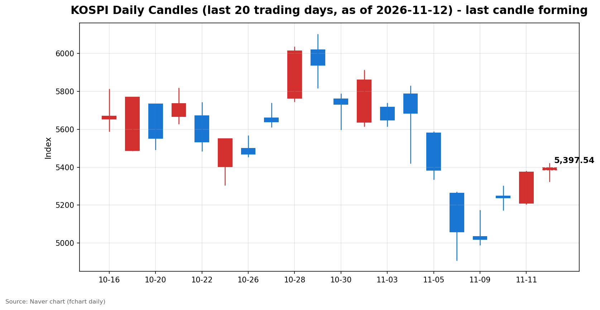
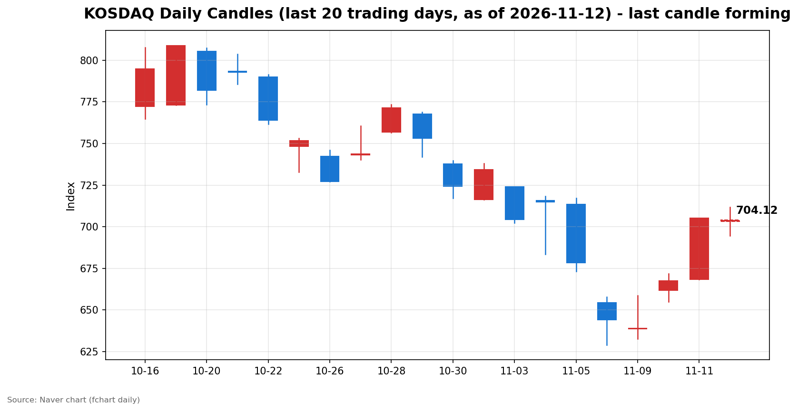

안녕하세요, [한국투자증권](https://securities.koreainvestment.com/main/Main.jsp)에서 [한투-한국투자증권](https://play.google.com/store/apps/details?id=com.truefriend.neosmartarenewal&hl=ko) 개발을 담당하고 있는 way입니다. 
간밤 뉴욕 증시는 코어위브 호실적에 힘입어 반등했고, 국내 증시는 코스피 상승과 코스닥 약세가 엇갈린 채 출발했습니다. 

## 배경: 간밤 미국 증시와 개장 전 이슈

간밤 뉴욕 증시는 3대 지수가 일제히 상승했습니다. 
나스닥 종합지수는 25,466.19로 400.32포인트, 1.60% 상승했습니다. 
S&amp;P500지수는 7,619.38로 98.45포인트, 1.31% 상승했습니다. 
상승의 직접적인 계기는 인공지능 클라우드 기업 코어위브의 호실적이었습니다. 
코어위브 주가는 20%대 급등했고, 엔비디아도 정규장에서 반등하며 반도체주가 동반 강세를 보였습니다. 
필라델피아 반도체지수도 큰 폭으로 올랐습니다. 
다만 이번 반등은 전면적인 위험자산 선호보다는 인공지능 인프라와 반도체 업종에 매수세가 집중된 차별화 장세로 풀이됩니다. 
CPI 충격과 금리 인상 우려가 여전히 남아 있다는 점도 함께 전해졌습니다. 

원/달러 환율은 1,333.00원으로 전일 대비 4.50원, 0.34% 하락했습니다. 
원화 강세 흐름이 이어지는 점은 외국인 수급 측면에서 우호적인 신호입니다. 

전일 국내 증시는 강한 반등으로 마감했습니다. 
코스피는 5,375.36으로 2.60% 올랐고, 코스닥은 705.10으로 5.62% 올랐습니다. 
외국인이 코스피에서 2거래일 연속 순매수에 나선 날이었습니다. 

## 오늘의 스냅샷

| 지수 | 현재가 | 전일 대비 | 등락률 | 시가 | 고가 | 저가 | 거래량 | 거래대금 |
| --- | --- | --- | --- | --- | --- | --- | --- | --- |
| [코스피](https://finance.naver.com/sise/sise_index.naver?code=KOSPI) | 5,398.24 | +22.88 | +0.43% | 5,385.94 | 5,419.88 | 5,326.30 | 36,933천 주 | 3조 1,236억 원 |
| [코스닥](https://finance.naver.com/sise/sise_index.naver?code=KOSDAQ) | 704.20 | -0.90 | -0.13% | 703.22 | 711.86 | 694.76 | 116,696천 주 | 1조 3,321억 원 |

스냅샷 기준 시각은 2026년 11월 12일 09시 28분 KST입니다. 
전일 종가는 네이버 실시간 API 등락률로 역산한 값이며, 코스피 5,375.12, 코스닥 705.12로 네이버 일봉 전일 종가와 소수점 반올림 범위에서 일치합니다. 
코스피200지수는 844.12로 5.80포인트, 0.69% 올랐습니다. 

## 차트

최근 20거래일 일봉 차트입니다. 
빨간 봉은 종가가 시가보다 높은 날, 파란 봉은 종가가 시가보다 낮은 날입니다. 
당일 봉은 형성 중인 봉으로, 마감 전에는 계속 변합니다. 

## 원인·촉매 분석

오늘 장 초반의 가장 큰 촉매는 간밤 미국 인공지능 인프라주의 반등입니다. 
코어위브 호실적이 인공지능 인프라 투자 우려를 완화하면서 나스닥이 1.60% 올랐고, 이 흐름이 국내 인공지능 하드웨어 테마로 이어졌습니다. 
한투 MTS 오전 집계에서 PCB 테마가 4.24%, 온디바이스AI 테마가 3.04%, SSD 테마가 2.99%, CXL 테마가 2.67% 오르며 관련 테마가 동반 강세를 보였습니다. 
인공지능 인프라 수요가 유지된다는 신호가 국내 밸류체인으로 확산되는 모습입니다. 

다만 상승의 천장에는 엔비디아 변수가 자리하고 있습니다. 
엔비디아는 정규장에서 2%대 상승했지만, 젠슨 황 최고경영자 해임설 보도가 나온 뒤 시간외 거래에서 8% 안팎 급락했습니다. 
국내 반도체주도 장 초반 상승폭을 일부 반납하며 출발했습니다. 
호실적에 따른 위험 선호 회복과 대장주 경영 불확실성이 동시에 작용하는 구간입니다. 

전일 수급 구도도 오늘 출발을 떠받치는 요인입니다. 
외국인은 코스피에서 6,729억 원을 순매수하며 2거래일 연속 매수세를 이어갔습니다. 
전일 개인이 7,145억 원을 순매도한 물량을 외국인과 기타법인 5,450억 원이 받아낸 구도였습니다. 
기관은 5,034억 원을 순매도했는데, 금융투자가 5,419억 원을 순매도한 영향이 컸습니다. 
외국인의 연속 매수는 단기 수급의 방향이 매수 쪽으로 기울고 있음을 보여줍니다. 
다만 기관의 매도가 이어지는 점은 상승의 속도를 제한하는 요인으로 작용합니다. 

코스닥의 약세는 다른 결에서 읽힙니다. 
전일 코스닥에서는 외국인이 1,354억 원, 개인이 1,838억 원을 순매도했고, 기관이 3,129억 원을 순매수했습니다. 
기관 매수의 중심은 투신 1,431억 원, 사모 607억 원, 연기금 506억 원이었습니다. 
코스피에서는 외국인이 사고 기관이 판 반면, 코스닥에서는 기관이 사고 외국인과 개인이 판 엇갈린 구도입니다. 
대형주 중심의 코스피가 오르는 사이 중소형주 중심의 코스닥으로 자금이 고르게 확산되지 못하고 있습니다. 
원/달러 환율이 1,333원대로 내려온 점은 외국인 매도 압력을 완화하는 요인입니다. 

## 핵심 사건 3가지

### 1. 코어위브 호실적과 뉴욕 증시 반등

인공지능 클라우드 기업 코어위브가 호실적을 발표하면서 주가가 20%대 급등했습니다. 
나스닥 종합지수는 1.60%, S&amp;P500지수는 1.31% 올랐고, 필라델피아 반도체지수도 큰 폭으로 상승했습니다. 
인공지능 인프라 투자 둔화 우려가 완화되면서 반도체와 인공지능 관련 종목에 매수세가 집중됐습니다. 
다만 CPI 충격과 금리 인상 우려가 여전하다는 지적도 함께 나왔습니다. 
이번 반등이 전면적인 위험 선호 회복인지, 인공지능 인프라 중심의 차별화 장세인지는 추가 지표를 보고 판단해야 합니다. 

### 2. 엔비디아 젠슨 황 해임설 보도

월스트리트저널은 엔비디아 이사회가 젠슨 황 최고경영자의 해임을 검토하고 있다고 보도했습니다. 
엔비디아는 정규장에서 2%대 상승했지만, 보도 이후 시간외 거래에서 8% 안팎 급락했습니다. 
해임 검토의 배경으로는 황 최고경영자를 둘러싼 각종 의혹이 거론됐습니다. 
국내 반도체주도 장 초반 상승폭을 일부 축소하며 출발했습니다. 
인공지능 대장주의 경영 불확실성은 국내 밸류체인 전반의 변동성을 키우는 요인입니다. 
후속 보도와 이사회의 공식 입장이 확인되기 전까지는 불확실성이 이어집니다. 

### 3. 금융지주 회장 3연임 문턱 강화 논의

금융지주 회장 3연임을 어렵게 하는 지배구조 개선 방안이 논의되고 있습니다. 
주주총회와 임원후보추천위원회에서 75% 동의가 필요하다는 내용이 거론됐습니다. 
딥서치 트렌딩 집계에서 관련 보도가 57건으로 경제 섹션 1위를 기록했습니다. 
금융지주 지배구조는 단기 주가 방향보다는 중기적인 주주환원과 경영 안정성 논의에 영향을 주는 사안입니다. 
금융 섹터의 투자 심리에는 지배구조 개선 기대와 회장 연임 불확실성이 함께 작용합니다. 

## 섹터·테마 영향 체인

인공지능 인프라 호실적은 국내 하드웨어 밸류체인으로 직접 연결됩니다. 
코어위브 실적이 인공지능 인프라 투자 지속 신호로 읽히면서 PCB, 온디바이스AI, SSD, CXL 테마가 동반 강세를 보였습니다. 
인공지능 서버와 데이터센터 수요가 유지된다는 기대가 기판과 메모리 주변 부품, 온디바이스 인공지능으로 확산되는 모습입니다. 
다만 엔비디아 해임설이 같은 밸류체인의 반대쪽 무게추로 작용합니다. 
대장주 한 종목의 경영 불확실성이 밸류체인 전체의 변동성을 키우는 구조입니다. 

금리 경로도 섹터 방향을 가르는 변수로 남아 있습니다. 
CPI 충격 이후 12월 연방공개시장위원회에서 금리 인상 가능성이 거론되는 상황입니다. 
할인율 상승은 미래 이익의 현재가치를 낮추기 때문에 성장주 밸류에이션에 부담을 줍니다. 
이번 반등이 인공지능 인프라 중심으로 나타난 점은 금리 부담 속에서도 수요가 확인된 분야로 자금이 모이는 선별 장세를 보여줍니다. 

원/달러 환율 하락은 외국인 수급과 수입 물가 안정에 우호적입니다. 
환율이 1,330원 초반에서 안정되면 외국인의 매도 압력이 완화되고, 원화 표시 자산의 매력도가 높아집니다. 
금융지주 지배구조 논의는 금융 섹터에 중기적인 영향을 줍니다. 
지배구조 개선 기대가 주주환원 강화로 이어질지, 연임 불확실성이 부담으로 작용할지는 후속 논의를 지켜봐야 합니다. 
유가와 원자재 쪽은 확인된 큰 변동이 없어 운송과 화학 섹터에 미치는 영향은 제한적입니다. 

## 최근 5거래일 일봉

| 날짜 | 시가 | 고가 | 저가 | 종가 | 거래량 |
| --- | --- | --- | --- | --- | --- |
| 2026-11-05 | 5,580.09 | 5,586.46 | 5,336.88 | 5,383.80 | 277,253천 주 |
| 2026-11-06 | 5,263.26 | 5,269.10 | 4,911.28 | 5,059.69 | 323,267천 주 |
| 2026-11-09 | 5,034.20 | 5,172.94 | 4,990.66 | 5,018.85 | 248,140천 주 |
| 2026-11-10 | 5,247.22 | 5,300.92 | 5,174.55 | 5,239.13 | 253,917천 주 |
| 2026-11-11 | 5,209.71 | 5,377.99 | 5,207.44 | 5,375.36 | 234,732천 주 |
| 2026-11-12 | 5,385.94 | 5,419.88 | 5,326.30 | 5,398.24 | 36,933천 주 |

위 표는 코스피 기준입니다. 
2026년 11월 12일 행은 스냅샷 기준 형성 중인 봉으로, 종가와 거래량은 마감 전 계속 변합니다. 

| 날짜 | 시가 | 고가 | 저가 | 종가 | 거래량 |
| --- | --- | --- | --- | --- | --- |
| 2026-11-05 | 713.49 | 717.06 | 673.38 | 678.41 | 434,307천 주 |
| 2026-11-06 | 654.43 | 657.95 | 629.17 | 644.27 | 443,709천 주 |
| 2026-11-09 | 638.82 | 658.66 | 632.70 | 638.97 | 358,495천 주 |
| 2026-11-10 | 661.73 | 671.91 | 655.09 | 667.61 | 402,110천 주 |
| 2026-11-11 | 668.48 | 705.10 | 668.48 | 705.10 | 411,901천 주 |
| 2026-11-12 | 703.22 | 711.86 | 694.76 | 704.20 | 116,696천 주 |

위 표는 코스닥 기준입니다. 
2026년 11월 12일 행은 스냅샷 기준 형성 중인 봉으로, 종가와 거래량은 마감 전 계속 변합니다. 

## 전일 수급

전일인 11월 11일 코스피 수급은 외국인이 사고 개인과 기관이 판 구도였습니다. 
외국인은 6,729억 원을 순매수하며 2거래일 연속 매수세를 이어갔습니다. 
개인은 7,145억 원을 순매도했고, 기관은 5,034억 원을 순매도했습니다. 
기관 매도는 금융투자 5,419억 원 순매도가 주도했고, 연기금도 990억 원을 순매도했습니다. 
반면 투신 753억 원, 사모 381억 원, 보험 190억 원은 순매수였습니다. 
기타법인은 5,450억 원을 순매수하며 개인 매도 물량을 함께 받아냈습니다. 
외국인의 연속 매수가 지수 반등의 동력이 됐고, 개인의 차익 매도와 기관의 매도가 상승폭을 조절하는 구도입니다. 

코스닥 수급은 코스피와 정반대였습니다. 
외국인은 1,354억 원을 순매도했고, 개인도 1,838억 원을 순매도했습니다. 
기관이 3,129억 원을 순매수하며 양쪽 매도 물량을 받아냈습니다. 
기관 매수의 중심은 투신 1,431억 원, 사모 607억 원, 연기금 506억 원이었습니다. 
코스피에서는 외국인이 주도하고, 코스닥에서는 기관이 주도하는 엇갈린 수급이 나타나고 있습니다. 
자금이 대형주와 중소형주에 고르게 확산되지 못하고 선별적으로 움직이는 모습입니다. 

## 단기·중기 전망과 확인할 시나리오

단기적으로 코스피는 5,400선 공방이 이어질 전망입니다. 
당일 고가 5,419.88이 1차 저항 구간이고, 전일 종가 5,375.36이 1차 지지 구간입니다. 
5,400선을 종가 기준으로 지켜내면 반등 흐름이 이어질 여지가 있습니다. 
반대로 5,375선 아래로 밀리면 단기 차익 매물이 나올 수 있습니다. 
코스닥은 700선 공방이 관건입니다. 
당일 저가 694.76이 1차 지지 구간이고, 당일 고가 711.86이 1차 저항 구간입니다. 
700선을 지켜내지 못하면 중소형주 약세가 이어질 수 있습니다. 

흐름 지속과 일시적 노이즈를 가르는 기준은 외국인 수급과 엔비디아 후속 소식입니다. 
외국인의 코스피 순매수가 3거래일 연속 이어지면 단기 반등의 동력이 유지됩니다. 
엔비디아 해임설이 추가 보도로 확산되면 인공지능 밸류체인 전반의 변동성이 커질 수 있습니다. 
반대로 이사회에서 공식 해명이 나오면 불확실성이 완화될 수 있습니다. 

중기적으로는 12월 연방공개시장위원회의 금리 결정과 물가 경로가 변수입니다. 
CPI가 예상을 웃돌면서 금리 인상 우려가 다시 부각된 상황입니다. 
인공지능 인프라 투자 지속성과 금융지주 지배구조 논의도 중기 방향에 영향을 줍니다. 
지수 단위에서는 5,500선 회복 여부와 5,300선 지지 여부가 다음 분기점으로 보입니다. 
코스닥은 700선 안착 여부가 단기 추세 판단의 기준입니다. 

## 장 초반 확인할 점

외국인의 장중 수급 방향을 확인해야 합니다. 
전일 6,729억 원 순매수가 오늘 장중에도 이어지는지가 관건입니다. 
엔비디아 관련 후속 보도가 나오는지도 지켜봐야 합니다. 
미국 선물 지수와 아시아 증시의 흐름도 함께 확인해야 합니다. 
원/달러 환율이 1,330원 초반에서 안정되는지 확인해야 합니다. 
코스닥이 700선을 지켜내는지, PCB와 온디바이스AI 등 인공지능 하드웨어 테마의 강세가 이어지는지도 확인할 점입니다. 

## 마치며

나스닥 반등과 외국인 연속 매수가 코스피 5,400선 공방의 배경이 되고 있습니다. 
다만 엔비디아 해임설이라는 변수가 남아 있어, 장중 수급과 후속 소식을 확인하며 흐름을 지켜보는 것이 필요합니다. 
이 글은 시장 해설을 위한 교육 목적의 정리이며, 특정 종목의 매수나 매도를 권유하는 내용이 아닙니다. 
