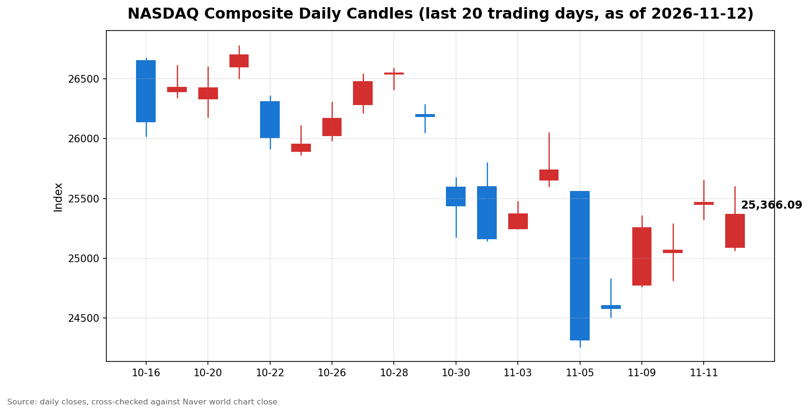

안녕하세요, [한국투자증권](https://securities.koreainvestment.com/main/Main.jsp)에서 [한투-한국투자증권](https://play.google.com/store/apps/details?id=com.truefriend.neosmartarenewal&hl=ko) 개발을 담당하고 있는 way입니다. 
2026년 11월 12일 나스닥 장 마감 흐름을 수치 중심으로 정리합니다. 

## 마감 요약

나스닥 종합은 전일 대비 0.39% 하락해 25,366.09로 마감했습니다. 
하락 폭은 100.10이었습니다. 
전일 400.31 상승분의 4분의 1가량을 하루 만에 되돌렸습니다. 
나스닥은 장 초반 1.6% 넘게 밀렸다가 낙폭을 줄이며 마감했습니다. 
종가는 지난주 금요일 종가 24,579.43보다 3.20% 높은 수준입니다. 
나스닥은 지난 10월 6일 기록한 사상 최고 종가 27,599.89 대비 8.09% 낮은 수준으로, 여전히 조정 구간에 머물렀습니다. 
S&P500은 0.35% 하락해 7,592.40으로 마감했고, 다우지수는 0.36% 하락해 52,297.09로 마감했습니다. 
세 지수가 모두 내렸지만 하락 폭은 0.4% 안팎으로 제한됐습니다. 
이 글은 교육과 해설 목적으로 작성되었으며 특정 종목의 매수나 매도를 권유하지 않습니다. 

## 오늘의 마감 스냅샷

| 지수 | 종가 | 전일 대비 | 등락률 | 전일 종가 | 당일 고가 | 당일 저가 |
| --- | --- | --- | --- | --- | --- | --- |
| 나스닥 종합 | 25,366.09 | -100.10 | -0.39% | 25,466.19 | 25,597.23 | 25,068.28 |
| S&P500 | 7,592.40 | -26.98 | -0.35% | 7,619.38 | 7,649.21 | 7,576.30 |
| 다우지수 | 52,297.09 | -189.40 | -0.36% | 52,486.49 | 52,751.22 | 52,271.16 |

스냅샷 기준 시각은 미국 동부시간 2026년 11월 12일 16시 20분, 한국시간 2026년 11월 13일 06시 20분입니다. 
나스닥과 다우지수 수치는 네이버 월드 차트 페이지에서 직접 확인했습니다. 
한투 MTS 해외 대시보드의 나스닥 종가도 25,366.09로 네이버 값과 일치합니다. 
S&P500 수치는 한투 MTS 해외 대시보드에서 확인했습니다. 
S&P500의 당일 고가와 저가는 한투 MTS 장중 시계열의 최대값과 최소값입니다. 
나스닥 당일 시가는 25,092.11, 다우지수 당일 시가는 52,427.94입니다. 
나스닥 거래량은 1,553,010천주, 다우지수 거래량은 1,008,214천주였습니다. 
원/달러 환율은 한투 MTS 해외 대시보드 기준 1,335.50원으로 전일 대비 2.00원, 0.15% 하락했습니다. 
네이버 월드 차트 출처는 [네이버 금융 월드 시세](https://finance.naver.com/world/sise.naver?symbol=NAS@IXIC)와 [네이버 월드 차트](https://stock.naver.com/worldstock/index/.IXIC/price)에서 확인할 수 있습니다. 

## 차트

최근 20거래일 일봉 차트입니다. 
빨간 봉은 종가가 시가보다 높은 날, 파란 봉은 종가가 시가보다 낮은 날입니다. 

## 원인·촉매 분석

이날 하락의 가장 직접적인 촉매는 엔비디아의 최고경영자 사임 소식입니다. 
엔비디아는 11월 12일 젠슨 황 최고경영자가 사임했고 최고재무책임자 콜레트 크레스가 임시 최고경영자를 맡는다고 발표했습니다. 
이 소식에 엔비디아 주가는 장 초반 14% 넘게 급락했고, 나스닥도 개장 직후 1.6% 넘게 밀렸습니다. 
다만 엔비디아 낙폭이 장중 축소되면서 지수도 저점에서는 되돌렸습니다. 
종가 기준 엔비디아 하락 폭은 5% 안팎으로 확인됩니다. 
두 번째로 작용한 요인은 금리 부담입니다. 
10년물 국채금리는 화요일 종가 4.99% 수준에서 5.1% 안팎까지 올랐습니다. 
채권시장은 11월 11일 재향군인의 날로 휴장했고, 이날 재개되자마자 금리가 뛰었습니다. 
10월 소비자물가지수가 예상을 웃돈 뒤 12월 기준금리 인상은 기정사실로 받아들여지고 있고, 0.5%포인트 인상 가능성도 거론됩니다. 
금리가 오르면 성장주 밸류에이션 부담이 커지는 만큼, 기술주 비중이 높은 나스닥이 장 초반 가장 크게 밀렸습니다. 
세 번째 요인은 전일 급등에 대한 되돌림입니다. 
전일 나스닥은 코어위브 실적 호조에 1.60% 올랐고, 이날은 새로운 상승 재료가 없었습니다. 
금리 상승과 엔비디아 악재가 겹치자 차익 매물이 기술주 중심으로 나왔습니다. 
달러는 같은 방향이 아니었습니다. 
원/달러 환율은 1,335.50원으로 전일 대비 0.15% 하락해 달러가 약세를 보였습니다. 
금리 상승에도 달러가 강해지지 않았다는 점은, 이날 하락이 달러 강세 때문이 아니라 금리와 개별 악재 때문이었음을 보여줍니다. 
유가도 이날은 지수 하락과 따로 움직였습니다. 
브렌트유는 3.3% 올라 95.82달러를 기록했고, 서부텍사스산 원유도 2.7% 올랐습니다. 
금 선물은 2.90% 하락했습니다. 
비트코인도 1.4% 안팎 하락해 7만3,500달러 안팎을 기록했습니다. 
유가 상승과 금 하락은 물가 압력이 쉽게 가라앉지 않는다는 신호로 읽힙니다. 

## 핵심 사건 3가지

첫째, 엔비디아 최고경영자 젠슨 황이 사임했습니다. 
엔비디아는 11월 12일 황 최고경영자가 즉시 사임했고, 콜레트 크레스 최고재무책임자가 임시 최고경영자를 맡는다고 발표했습니다. 
하비 존스가 창사 이래 첫 이사회 의장으로 선임됐습니다. 
황 최고경영자는 33년간 회사를 이끌어 온 창업자입니다. 
사임 배경으로는 개인 신상 관련 의혹과 국가안보 관련 조사 보도가 거론됐으나, 해당 의혹이 독립적으로 확인된 것은 아닙니다. 
엔비디아 이사회는 11월 8일 외부 법률 자문을 받아 독립 조사를 시작한다고 밝힌 바 있습니다. 
이 사건은 AI 대장주 한 종목의 문제가 아니라 AI 투자 테마 전반의 심리를 흔든 사건입니다. 
엔비디아는 11월 17일 분기 실적 발표를 예정하고 있어, 리더십 공백이 실적 해석에도 영향을 줄 수 있습니다. 

둘째, 10년물 국채금리가 5.1% 안팎까지 올랐습니다. 
10월 근원 소비자물가지수는 전월 대비 0.3% 올라 3개월 연속 예상치를 웃돌았습니다. 
10월 소비자물가지수 충격 이후 대형 은행들은 연준 인상 전망을 잇달아 높였습니다. 
골드만삭스는 12월 0.25%포인트 인상에 더해 2027년 3월 추가 인상을 전망했고, 첫 금리 인하 시점은 2027년 12월로 늦췄습니다. 
도이체방크는 12월과 3월에 더해 2027년 1월 인상까지 전망해 목표금리를 4.50%에서 4.75% 구간으로 제시했습니다. 
시티그룹은 12월 0.25%포인트 인상을 기본 전망으로 유지하면서도 0.5%포인트 인상 위험을 경고했습니다. 
시카고상품거래소 페드워치 기준 12월 인상은 사실상 확실시되고, 0.5%포인트 인상 확률은 13% 안팎으로 반영됐습니다. 
금리가 5%를 넘어서면 성장주와 중소형주 밸류에이션에 직접적인 압박이 됩니다. 
이날 러셀2000 지수가 1.4% 안팎 하락해 중소형주가 대형주보다 크게 밀린 점도 같은 맥락입니다. 

셋째, 미국 연방정부 셧다운이 종료됐습니다. 
하원은 11월 11일 저녁 찬성 222표 대 반대 209표로 정부 자금 법안을 통과시켰고, 트럼프 대통령이 같은 날 밤 9시 45분 안팎에 서명했습니다. 
10월 1일 시작된 셧다운은 43일간 이어져 미국 역사상 최장 기록을 남겼습니다. 
법안은 대부분 연방기관의 자금을 2027년 1월 30일까지 연장합니다. 
셧다운 종료는 행정 공백 해소라는 점에서 우호적이지만, 이날 장에서는 이미 전일 기대에 반영된 재료였습니다. 
건강보험 보조금 연장 문제는 법안에 포함되지 않았고, 12월 중 상원 표결이 약속된 상태입니다. 
지표 공백이 해소되면서 11월 13일 생산자물가지수 등 경제지표 발표가 정상화되는 점이 더 중요합니다. 

## 지수·섹터 영향 체인

이날 하락은 엔비디아발 충격이 기술주에 집중된 형태였습니다. 
나스닥은 장 초반 1.6% 넘게 밀렸다가 0.39% 하락으로 마감했고, S&P500과 다우지수는 0.35%와 0.36% 하락했습니다. 
장 초반에는 나스닥이 가장 크게 밀렸지만, 종가 기준 세 지수의 하락 폭은 거의 같았습니다. 
이는 엔비디아 충격이 지수 전체로 번지지 않고 반도체 안에서 종목 간 이동으로 흡수됐음을 보여줍니다. 
반도체 섹터 안에서는 명암이 갈렸습니다. 
엔비디아가 급락한 반면 AMD와 브로드컴은 각각 5% 안팎 올라 S&P500 상승 종목을 이끌었습니다. 
AI 칩 수요 자체가 꺾인 것이 아니라, 엔비디아 한 종목의 리더십 리스크가 경쟁사로 수요 기대를 옮긴 흐름으로 볼 수 있습니다. 
알파벳도 2% 안팎 올랐고, 애플도 전일 사상 최고 종가 이후 상승세를 이어갔습니다. 
대형 기술주 안에서도 엔비디아를 제외한 종목들은 상대적으로 견조했습니다. 
에너지 섹터는 유가 상승의 수혜를 입었습니다. 
브렌트유가 3.3% 오르면서 에너지 관련 종목에는 우호적인 환경이었습니다. 
다만 지수 전체가 하락한 날이라 에너지 강세가 지수를 끌어올리지는 못했습니다. 
금융 섹터는 금리 상승의 양면을 안고 있습니다. 
금리 상승은 순이자마진을 높이지만, 경기 둔화 우려가 커지면 대출 수요와 자산 건전성에 부담이 됩니다. 
이날 중소형주가 1.4% 안팎 하락한 점은 금리 민감도가 높은 쪽이 먼저 타격을 받았음을 보여줍니다. 
금 선물 2.90% 하락은 실질금리 상승이 안전자산 선호보다 강하게 작용했음을 보여줍니다. 

## 다우·S&P500 마감 흐름

다우지수는 전일 대비 0.36% 하락해 52,297.09로 마감했습니다. 
다우지수는 장중 52,751.22까지 올랐다가 52,271.16까지 밀렸습니다. 
하락 폭은 189.40이었습니다. 
다우지수는 기술주 비중이 낮아 엔비디아 충격의 직접적인 영향이 상대적으로 작았습니다. 
다만 금리 상승 부담은 경기 민감주 전반에 작용해 지수를 끌어내렸습니다. 
S&P500은 전일 대비 0.35% 하락해 7,592.40으로 마감했습니다. 
S&P500은 장중 7,649.21까지 올랐다가 7,576.30까지 밀렸습니다. 
하락 폭은 26.98이었습니다. 
S&P500 안에서는 AMD와 브로드컴, 알파벳 강세가 엔비디아 하락을 일부 상쇄했습니다. 
세 지수가 나란히 0.4% 안팎 하락했다는 점은 이날 하락이 특정 지수의 문제가 아니라 금리 부담이라는 공통 요인에 엔비디아 악재가 더해진 결과임을 보여줍니다. 

## 단기·중기 전망과 다음 거래일 확인할 시나리오

다음 거래일인 11월 13일에는 10월 생산자물가지수가 발표됩니다. 
생산자물가지수가 예상을 웃돌면 물가 압력이 이어진다는 신호로 받아들여져 금리 상승 압력이 커질 수 있습니다. 
반대로 예상을 밑돌면 10월 소비자물가지수 충격을 일부 되돌리는 계기가 될 수 있습니다. 
가격 레벨로는 나스닥 25,068.28이 단기 지지선입니다. 
이날 저점인 25,068.28이 깨지면 11월 10일 종가 25,065.87 부근이 다음 지지 구간이 됩니다. 
위로는 전일 종가 25,466.19와 이날 고가 25,597.23이 저항 구간입니다. 
S&P500은 7,600선이 지지선으로 거론되고, 7,700선이 저항선으로 거론됩니다. 
중기적으로는 11월 17일 엔비디아 분기 실적이 분기점입니다. 
실적이 예상을 웃돌면 리더십 공백 우려가 실적 모멘텀으로 상쇄될 수 있고, 예상을 밑돌면 AI 테마 전반의 조정 압력이 커질 수 있습니다. 
12월 연방공개시장위원회까지는 물가 지표와 연준 인사 발언이 방향을 정할 가능성이 큽니다. 
리스크 관리 관점에서는 금리 5% 구간 안착 여부를 먼저 확인할 필요가 있습니다. 
10년물 국채금리가 5.1% 안팎에서 더 오르면 성장주 밸류에이션 부담이 커지고, 5% 아래로 되돌리면 부담이 완화됩니다. 
단기적으로는 엔비디아 악재가 일시적 노이즈인지, AI 테마 전반의 신뢰 문제로 번지는지를 가르는 구간입니다. 
AMD와 브로드컴 강세가 이어지면 종목 간 이동으로 그치고, 반도체 전반이 함께 밀리면 테마 조정으로 번질 수 있습니다. 

## 마치며

나스닥은 엔비디아 최고경영자 사임과 10년물 국채금리 5.1% 안팎 상승이라는 두 가지 악재 속에서도 하락 폭을 0.39%로 제한했습니다. 
다음 거래일 생산자물가지수와 11월 17일 엔비디아 실적이 단기 방향을 가를 핵심 변수입니다. 
이 글은 교육과 해설 목적으로 작성되었으며 특정 종목의 매수나 매도를 권유하지 않습니다. 
