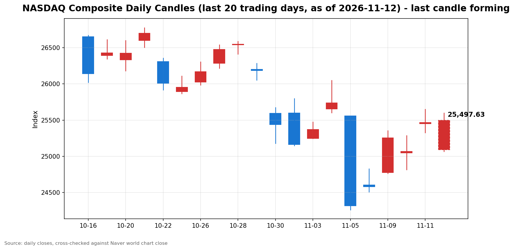

안녕하세요, [한국투자증권](https://securities.koreainvestment.com/main/Main.jsp)에서 [한투-한국투자증권](https://play.google.com/store/apps/details?id=com.truefriend.neosmartarenewal&hl=ko) 개발을 담당하고 있는 way입니다. 
2026년 11월 12일 나스닥 장중 흐름을 수치 중심으로 정리합니다. 

## 장중 요약

나스닥 종합은 젠슨 황 엔비디아 최고경영자 사임 소식에 전일 종가보다 1.47% 낮은 25,092.11로 갭다운 출발했습니다. 
장 초반 저가 25,068.28을 찍은 뒤 낙폭을 줄였고, 장중 고가 25,597.23까지 올라 전일 종가를 웃돌았습니다. 
정오 무렵에는 25,474.35로 전일 종가보다 0.03% 높은 보합권에서 움직이고 있습니다. 
다우존스 산업평균지수는 0.35% 올랐고, 스탠더드앤드푸어스 500 지수는 0.21% 올랐습니다. 
미국 10년물 국채수익률은 5.11%로 전일 5.00%보다 0.11%포인트 올랐습니다. 

## 오늘의 스냅샷

| 지수 | 현재가 | 전일 대비 | 등락률 | 전일 종가 | 장중 고가 | 장중 저가 | 스냅샷 기준 시각 |
| --- | --- | --- | --- | --- | --- | --- | --- |
| 나스닥 종합 | 25,474.35 | +8.16 | +0.03% | 25,466.19 | 25,597.23 | 25,068.28 | 미국 동부시간 2026-11-12 12:59, 한국시간 2026-11-13 02:59 |
| 스탠더드앤드푸어스 500 | 7,635.51 | +16.13 | +0.21% | 7,619.38 | 7,649.21 | 7,576.30 | 미국 동부시간 2026-11-12 12:55, 한국시간 2026-11-13 02:55 |
| 다우존스 산업평균지수 | 52,670.26 | +183.77 | +0.35% | 52,486.49 | 52,751.22 | 52,363.55 | 미국 동부시간 2026-11-12 12:57, 한국시간 2026-11-13 02:57 |

당일 수치는 형성 중인 수치로, 마감 전에는 계속 변합니다. 
나스닥 종합의 시가는 25,092.11이었습니다. 
전일 종가와 비교하면 시가 기준으로는 1.47% 하락 출발했습니다. 
장중 고가는 25,597.23으로 전일 대비 0.51% 상승 수준까지 올랐고, 장중 저가는 25,068.28로 전일 대비 1.56% 하락 수준이었습니다. 
나스닥 종합 값은 [네이버 월드 차트 나스닥 종합](https://finance.naver.com/world/sise.naver?symbol=NAS@IXIC)과 [네이버 월드 차트 나스닥 종합 가격](https://stock.naver.com/worldstock/index/.IXIC/price)에서 직접 확인했습니다. 
한국투자증권 MTS 해외 대시보드에서 12시 55분 무렵 확인한 나스닥 종합은 25,501.71로, 네이버 값과 0.11% 이내에서 일치했습니다. 
스탠더드앤드푸어스 500 지수 값은 한국투자증권 MTS 해외 대시보드에서 확인했습니다. 
스탠더드앤드푸어스 500 지수의 장중 고가와 저가는 한국투자증권 MTS 시계열의 최대값과 최소값으로 산출했습니다. 
한국투자증권 MTS 시계열은 표본 수가 적어, 실제 장중 고가와 저가보다 좁게 나타날 수 있습니다. 
다우존스 산업평균지수 값은 야후 파이낸스 시세에서 확인했습니다. 
원·달러 환율은 한국투자증권 MTS 기준 1,336.80원으로, 전일 1,337.50원보다 0.70원 낮은 수준입니다. 

## 차트

최근 20거래일 일봉 차트입니다. 
빨간 봉은 종가가 시가보다 높은 날, 파란 봉은 종가가 시가보다 낮은 날입니다. 
당일 봉은 형성 중인 봉으로, 마감 전에는 계속 변합니다. 

## 원인·촉매 분석

표면적으로는 나스닥이 전일 대비 0.03% 상승한 보합권에 머물고 있습니다. 
근본 촉매는 두 가지 힘의 충돌입니다. 
첫 번째 힘은 엔비디아 거버넌스 충격입니다. 
젠슨 황 최고경영자의 사임이 장 마감 뒤가 아니라 장중에 확정되면서, 엔비디아 주가는 시가 기준 13.09% 낮은 150.99달러로 출발했습니다. 
나스닥에서 인공지능 체인의 비중이 크다 보니, 단일 종목의 거버넌스 소식이 지수 전체의 갭다운 출발로 이어졌습니다. 
두 번째 힘은 인공지능 인프라 수요의 실체입니다. 
코어위브 실적이 수치로 확인되면서 전일 나스닥은 1.60% 반등했고, 이날 장 초반 저가에서도 매수세가 받쳐주는 흐름이 이어졌습니다. 
낙폭이 시가 기준 1.47%에서 정오 무렵 0.03% 상승으로 바뀐 점은 충격이 일부 흡수되고 있음을 보여줍니다. 
다만 회복의 상단은 금리 부담이 누르고 있습니다. 
미국 10년물 국채수익률은 전일 5.00%에서 이날 5.11%로 0.11%포인트 올랐습니다. 
10월 소비자물가지수 예상 상회 이후 굳어진 금리 인상 경계가 성장주 밸류에이션에 부담으로 작용하는 국면입니다. 
지수 간 방향 차이도 뚜렷합니다. 
나스닥이 0.03% 오르는 동안 스탠더드앤드푸어스 500 지수는 0.21% 올랐고, 다우는 0.35% 올랐습니다. 
하락 충격이 기술주와 인공지능 체인에 집중되고, 경기민감주와 가치주 쪽은 상대적으로 버티고 있음을 보여줍니다. 
다우가 장중 고가 52,751.22로 전일 종가를 웃돈 점도 같은 맥락입니다. 

## 핵심 사건 3가지

### 첫째, 젠슨 황 엔비디아 최고경영자의 전격 사임입니다

33년간 엔비디아를 이끌어온 젠슨 황 최고경영자가 11월 12일 현지시간에 전격 사임했습니다. 
1993년 공동창업 이후 33년 만의 퇴장입니다. 
엔비디아는 13년간 최고재무책임자를 맡아온 콜레트 크레스를 임시 최고경영자로 선임했습니다. 
엔비디아 주가는 시가 150.99달러로 전일 종가 173.73달러보다 13.09% 낮게 출발했습니다. 
장중 저가는 148.80달러로, 52주 저가와 같은 수준까지 내려갔습니다. 
정오 무렵에는 164.80달러로 전일 대비 5.14% 하락까지 낙폭을 줄였습니다. 
엔비디아 시가총액은 4조달러 아래로 내려갔다고 아시아경제는 전했습니다. 
황 전 최고경영자는 추수감사절 전 미국 의회에 출석해 중국 스파이로 의심받는 앨리스 황과의 관계 등에 대해 증언하기로 합의했다고 뉴시스는 전했습니다. 
미 하원 3개 공화당 위원장은 18일 비공개 브리핑 출석을 요청한 상태입니다. 
이 사건이 중요한 이유는 인공지능 사이클의 상징인 기업에서 경영진 거버넌스 리스크가 불거졌기 때문입니다. 
실적이나 수요가 아니라 인물과 지배구조라는 변수가 지수를 움직이는 국면입니다. 
중앙일보 GMC 허브의 11월 12일 G프터눈 제목도 젠슨 황 관련 소식을 다루고 있어, 이날 시장의 화두였음이 확인됩니다. 
기사 본문은 유료라 제목 수준에서만 참고했습니다. 
공식 해명이나 후임 인선 관련 추가 입장이 나오는지가 장 후반의 관전 지점입니다. 

### 둘째, 코어위브 실적 서프라이즈와 11월 11일 반등입니다

코어위브는 3분기 매출 36억6천만 달러를 기록해 전년 동기 대비 168% 늘었습니다. 
2026년 매출 전망은 130억 달러에서 133억 달러로 상향됐습니다. 
실적 발표 이후 코어위브 주가는 24.71% 급등했고, 필라델피아 반도체지수는 5.7% 올랐습니다. 
나스닥은 11월 11일 1.60% 올랐고, 엔비디아도 정규장에서 2.9% 반등했습니다. 
중앙일보 GMC 허브의 11월 12일 G모닝 제목도 코어위브 실적을 다루고 있어, 전날 반등의 중심 재료였음이 확인됩니다. 
기사 본문은 유료라 제목 수준에서만 참고했습니다. 
이 사건이 중요한 이유는 인공지능 인프라 지출이 과도하다는 우려가 실적 수치로 반박됐기 때문입니다. 
최근 반도체와 인공지능 관련주는 밸류에이션 부담과 지출 지속 가능성에 대한 의문으로 조정을 받았습니다. 
다만 이는 개별 기업의 실적에 대한 평가이지, 인공지능 산업 전체의 투자 회수 기간이 검증됐다는 뜻은 아닙니다. 
하룻만에 거버넌스 악재가 같은 체인을 누른 점이 이를 보여줍니다. 

### 셋째, 10월 소비자물가지수 예상 상회와 금리 인상 경계입니다

10월 소비자물가지수는 전월 대비 0.4% 올랐습니다. 
근원 소비자물가지수는 전월 대비 0.3% 올라 시장 예상 0.2%를 웃돌았습니다. 
근원 소비자물가지수의 0.3% 상승은 3개월 연속입니다. 
이 사건이 중요한 이유는 연방준비제도의 12월 결정이 다시 물가 지표에 묶였기 때문입니다. 
11월 11일 기준 시장은 12월 0.25%포인트 인상을 90% 안팎으로 반영하고 있고, 0.5%포인트 인상 가능성도 11.5% 수준으로 보고 있습니다. 
크리스토퍼 월러 연방준비제도 이사는 10월 근원 소비자물가지수가 0.3% 이상을 또 기록하면 12월 회의에서 0.5%포인트 금리 인상을 검토해야 한다는 입장을 밝혔습니다. 
이번 발표는 그 기준에 부합하는 결과입니다. 
로리 로건 댈러스 연방준비은행 총재는 최소 두 차례의 추가 인상이 필요하다고 말했습니다. 
물가 재가속이라기보다는 끈적한 물가 흐름이 이어지고 있다는 해석이 나옵니다. 
이날 미국 10년물 국채수익률이 5.00%에서 5.11%로 오른 점도 금리 부담이 장중에 이어지고 있음을 보여줍니다. 
다만 금리 인상 기대가 유지되는 한 성장주 중심의 나스닥에는 부담이 이어질 수 있습니다. 
12월 연방공개시장위원회까지 남은 물가 지표와 연준 위원들의 발언이 방향을 가를 변수입니다. 

## 지수·섹터 영향 체인

금리 인상 경계는 성장주 밸류에이션을 통해 기술주에 가장 먼저 작용하는 것이 일반적입니다. 
그런데 이날 하락의 직접적인 계기는 금리가 아니라 인공지능 체인 내부의 거버넌스 소식입니다. 
반도체와 인공지능 인프라 체인에는 엔비디아 사임 소식이 직접적인 심리 변수로 작용합니다. 
전일 필라델피아 반도체지수가 5.7% 올랐던 것과 같은 체인이 하룻만에 반대 방향으로 흔들리고 있습니다. 
실적 서프라이즈로 오른 체인이 거버넌스 악재로 눌리는 모습이라, 체인 내부의 변동성이 커진 상태입니다. 
다만 엔비디아 주가가 시가 대비 낙폭을 절반 이상 줄인 점은 체인 내부의 수요 전제가 완전히 무너지지 않았음을 보여줍니다. 
다우가 0.35% 오르는 데 그치지 않고 장중 고가로 전일 종가를 웃돈 점은 하락이 시장 전반으로 확산되지 않았음을 보여줍니다. 
다우는 경기민감주와 금융, 산업재 비중이 높아, 인공지능 체인 악재에 직접 노출되는 정도가 낮습니다. 
스탠더드앤드푸어스 500 지수가 0.21% 오른 것은 기술주 하락이 지수 전반을 끌어내리고 있으나, 다우 쪽의 상대적 선방이 상쇄하고 있음을 보여줍니다. 
금융 섹터는 금리 인상 기대가 순이자마진에는 우호적일 수 있으나, 경기 둔화 우려와 맞물려 방향이 엇갈릴 수 있습니다. 
에너지 섹터의 방향은 유가 수치가 이번 스냅샷에서 확인되지 않아 단정하지 않습니다. 
섹터별 지수 등락 수치는 이번 스냅샷에서 확인되지 않아 확인 필요로 표기합니다. 
결국 이날의 차별화는 금리 경로라는 공통 변수 위에 인공지능 체인 고유의 변수가 얹힌 결과입니다. 

## 다우·S&P500 흐름

다우존스 산업평균지수는 52,670.26으로 전일 대비 183.77포인트, 0.35% 올랐습니다. 
전일 종가는 52,486.49였습니다. 
장중 고가는 52,751.22로 전일 종가를 웃돌았고, 장중 저가는 52,363.55였습니다. 
스탠더드앤드푸어스 500 지수는 7,635.51로 전일 대비 16.13포인트, 0.21% 올랐습니다. 
전일 종가는 7,619.38였습니다. 
세 지수가 모두 상승하고 있으나 상승폭이 다르다는 점은 이날 충격이 인공지능 체인에 집중된 흐름이었음을 보여줍니다. 
다우의 장중 고가가 전일 종가를 웃돈 점은 가치주 쪽의 매수세가 버티고 있음을 시사합니다. 
스탠더드앤드푸어스 500 지수가 0.21% 상승을 유지하는지도 함께 확인할 필요가 있습니다. 

## 오전과 오후 흐름 변화

나스닥은 시가 25,092.11로 전일 종가보다 1.47% 낮게 출발했습니다. 
장 초반 저가 25,068.28을 찍은 뒤에는 낙폭을 줄였습니다. 
10시 1분 기준 25,343.24로 전일 대비 0.48% 하락 수준까지 회복했습니다. 
장중 고가 25,597.23까지 올라 전일 종가보다 0.51% 높은 수준을 기록했습니다. 
정오 무렵에는 25,474.35로 전일 종가보다 0.03% 높은 보합권으로 되돌아왔습니다. 
시가 대비 현재가는 382.24포인트 올랐고, 개장 갭 374.08포인트를 완전히 메운 수준입니다. 
방향 전환은 오전 중에 이미 이뤄졌고, 오후 들어서는 전일 종가 안착 여부를 다투는 흐름입니다. 
엔비디아 주가도 시가 150.99달러에서 정오 164.80달러까지 낙폭을 줄이며 같은 방향 전환을 보여줍니다. 

## 마감까지 전망과 확인할 시나리오

단기적으로는 엔비디아 사임 충격이 하루짜리 되돌림인지, 인공지능 체인 전반으로 번지는 흐름의 시작인지가 갈림길입니다. 
장 후반에 확인할 첫 번째 수치는 전일 종가 25,466.19 안착 여부입니다. 
12시 59분 기준 나스닥은 25,474.35로, 전일 종가보다 8.16포인트 높은 상태입니다. 
두 번째로 확인할 구간은 장중 고가 25,597.23과 장중 저가 25,068.28입니다. 
상승폭이 커져 장중 고가를 웃돌면 전일 종가 위 안착 흐름이 이어지는 시나리오가 힘을 얻습니다. 
반대로 낙폭이 다시 커져 저가를 밑돌면 25,000선 테스트로 이어지는 시나리오를 염두에 둘 필요가 있습니다. 
세 번째로 확인할 사안은 엔비디아 측의 추가 입장입니다. 
공식 해명이나 후임 인선 관련 소식이 나오면 보도발 불확실성이 줄어들 수 있고, 소식이 늦어지면 불확실성이 이어질 수 있습니다. 
미국 10년물 국채수익률이 5.11% 수준을 유지하는지도 확인할 필요가 있습니다. 
스탠더드앤드푸어스 500 지수는 7,600선, 다우는 52,400선 안착 여부를 확인할 필요가 있습니다. 
중기적으로는 12월 연방공개시장위원회까지 물가 지표와 연준 위원들의 발언이 방향을 정합니다. 
물가 상승률이 꺾이는 신호가 나오면 금리 부담이 완화되는 방향으로 해석될 수 있습니다. 
물가가 끈적하게 이어지면 금리 인상 기대가 유지되면서 변동성이 이어질 수 있습니다. 
인공지능 체인에서는 실적 모멘텀과 거버넌스 리스크가 번갈아 가격을 움직이는 국면이라, 체인 단위의 변동성에 유의할 필요가 있습니다. 
이 글은 지수와 섹터 단위의 흐름을 정리한 것으로, 특정 종목의 매수나 매도를 권유하지 않습니다. 

## 마치며

젠슨 황 사임 충격에 나스닥은 갭다운 출발했으나, 장중 전일 종가를 회복하며 25,474.35까지 올라섰습니다. 
전일 종가 안착 여부와 엔비디아 측의 추가 입장을 마감까지 확인할 필요가 있습니다. 
이 글은 매수나 매도를 권유하지 않습니다. 
