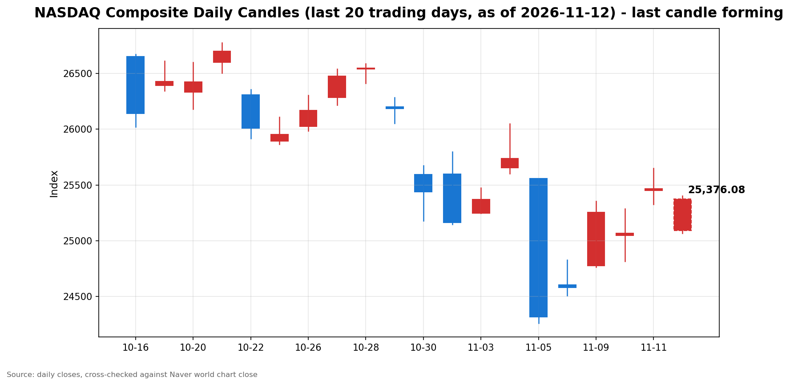

안녕하세요, [한국투자증권](https://securities.koreainvestment.com/main/Main.jsp)에서 [한투-한국투자증권](https://play.google.com/store/apps/details?id=com.truefriend.neosmartarenewal&hl=ko) 개발을 담당하고 있는 way입니다. 
2026년 11월 12일 나스닥 장 오픈 흐름을 수치 중심으로 정리합니다. 

## 개장 배경

전일인 11월 11일 미국 증시는 상승 마감했습니다. 
나스닥 종합은 25,466.19로 전 거래일 대비 1.60% 올랐습니다. 
스탠더드앤드푸어스 500 지수는 7,619.38로 1.31% 올랐고, 다우존스 산업평균지수는 52,486.49로 0.49% 올랐습니다. 
상승의 중심에는 인공지능 클라우드 기업 코어위브의 실적 서프라이즈가 있습니다. 
코어위브 주가는 24.71% 급등했고, 필라델피아 반도체지수는 5.7% 올랐습니다. 
그런데 장 마감 뒤 흐름이 바뀌었습니다. 
월스트리트저널 보도에 따르면 엔비디아 이사회가 젠슨 황 최고경영자(CEO)의 해임을 준비하고 있습니다. 
보도 이후 엔비디아 주가는 시간외 거래에서 8% 급락했고, 나스닥 100 선물은 0.6% 내렸습니다. 
11월 12일 나스닥은 전일 종가보다 374.08포인트 낮은 25,092.11로 갭다운 출발했습니다. 
시가 기준 하락률은 1.47%입니다. 
장 초반 저가 25,068.28을 찍은 뒤에는 낙폭을 줄이고 있습니다. 

## 오늘의 스냅샷

| 지수 | 현재가 | 전일 대비 | 등락률 | 전일 종가 | 장중 고가 | 장중 저가 | 스냅샷 기준 시각 |
| --- | --- | --- | --- | --- | --- | --- | --- |
| 나스닥 종합 | 25,343.24 | -122.95 | -0.48% | 25,466.19 | 25,401.16 | 25,068.28 | 미국 동부시간 2026-11-12 10:01, 한국시간 2026-11-13 00:01 |
| 스탠더드앤드푸어스 500 | 7,586.66 | -32.72 | -0.43% | 7,619.38 | 7,604.08 | 7,576.30 | 미국 동부시간 2026-11-12 10:02, 한국시간 2026-11-13 00:02 |
| 다우존스 산업평균지수 | 52,408.91 | -77.58 | -0.15% | 52,486.49 | 52,617.07 | 52,382.95 | 미국 동부시간 2026-11-12 10:02, 한국시간 2026-11-13 00:02 |

당일 수치는 형성 중인 수치로, 마감 전에는 계속 변합니다. 
나스닥 종합의 시가는 25,092.11이었습니다. 
전일 종가와 비교하면 시가 기준으로는 1.47% 하락 출발했습니다. 
장중 고가는 25,401.16으로 전일 대비 0.26% 하락 수준까지 회복했고, 장중 저가는 25,068.28로 전일 대비 1.56% 하락 수준이었습니다. 
시가 대비 현재가는 251.13포인트 올랐고, 개장 갭의 약 67%를 되돌린 수준입니다. 
나스닥 종합 값은 네이버 월드 차트 페이지에서 직접 확인했습니다. 
스탠더드앤드푸어스 500 지수와 다우존스 산업평균지수 값은 야후 파이낸스 시세에서 확인했습니다. 
스탠더드앤드푸어스 500 지수의 장중 고가와 저가는 한국투자증권 MTS 시계열의 최대값과 최소값으로 산출했습니다. 
한국투자증권 MTS 시계열은 표본 수가 적어, 실제 장중 고가와 저가보다 좁게 나타날 수 있습니다. 
다우존스 산업평균지수의 장중 고가와 저가는 야후 파이낸스 당일 고가와 저가로 확인했습니다. 
한국투자증권 MTS 해외 대시보드에서 장 초반 확인한 나스닥 종합은 25,379.49로, 네이버 값과 0.14% 이내에서 일치했습니다. 
한국투자증권 MTS 기준 스탠더드앤드푸어스 500 지수는 7,601.47로, 야후 파이낸스 값과 0.20% 이내에서 일치했습니다. 
원·달러 환율은 한국투자증권 MTS 기준 1,333.50원으로, 전일 1,337.50원보다 0.30% 낮은 수준입니다. 
한국투자증권 MTS 시계열 기준 원·달러 환율은 1,327.80원에서 1,337.00원 사이에서 움직였습니다. 
참고로 [네이버 월드 차트 나스닥 종합](https://finance.naver.com/world/sise.naver?symbol=NAS@IXIC)과 [네이버 월드 차트 나스닥 종합 가격](https://stock.naver.com/worldstock/index/.IXIC/price) 링크를 함께 둡니다. 

## 차트

최근 20거래일 일봉 차트입니다. 
빨간 봉은 종가가 시가보다 높은 날, 파란 봉은 종가가 시가보다 낮은 날입니다. 
당일 봉은 형성 중인 봉으로, 마감 전에는 계속 변합니다. 

## 원인·촉매 분석

표면적으로는 나스닥이 전일 대비 0.48% 하락 출발했습니다. 
근본 촉매는 거시지표가 아니라 개별 기업 거버넌스 소식입니다. 
엔비디아 이사회가 젠슨 황 최고경영자의 해임을 준비하고 있다는 월스트리트저널 보도가 장 마감 뒤 나왔고, 시간외 거래에서 엔비디아 주가가 8% 급락했습니다. 
나스닥에서 인공지능 체인의 비중이 크다 보니, 단일 종목 소식이 지수 전체의 갭다운 출발로 이어졌습니다. 
다만 낙폭이 시가 기준 1.47%에서 0.48%까지 축소된 점은 충격이 일부 흡수되고 있음을 보여줍니다. 
전일 1.60% 반등으로 쌓인 저가 매수 심리가 개장 직후 저가에서 받쳐주는 흐름입니다. 
근본적으로는 두 가지 힘이 맞서고 있습니다. 
한쪽은 10월 소비자물가지수 예상 상회 이후 굳어진 금리 인상 경계입니다. 
다른 한쪽은 코어위브 실적이 보여준 인공지능 인프라 수요의 실체입니다. 
이날 개장은 거시지표가 아니라 인공지능 체인 내부의 악재가 지수를 누르는 모습입니다. 
지수 간 방향 차이도 뚜렷합니다. 
나스닥이 0.48% 내리는 동안 스탠더드앤드푸어스 500 지수는 0.43% 내렸고, 다우는 0.15% 내렸습니다. 
하락이 기술주와 인공지능 체인에 집중되고, 경기민감주와 가치주 쪽은 상대적으로 버티고 있음을 보여줍니다. 
다우가 장중 고가 52,617.07로 전일 종가를 웃돈 점도 같은 맥락입니다. 
미국 10년물 국채수익률의 이날 수치는 이번 스냅샷에서 별도로 확인되지 않아 단정하지 않습니다. 
11월 10일 기준 미국 2년물 국채수익률은 4.736%, 10년물 국채수익률은 5.00%를 기록했습니다. 

## 핵심 사건 3가지

### 첫째, 월스트리트저널의 엔비디아 이사회 해임 준비 보도입니다

월스트리트저널 보도에 따르면 엔비디아 이사회가 젠슨 황 최고경영자(CEO)의 해임을 준비하고 있습니다. 
보도 이후 엔비디아 주가는 시간외 거래에서 8% 급락했고, 나스닥 100 선물은 0.6% 내렸습니다. 
중국 정보기관 연계 의혹과 인공지능 칩 우회 공급 논란도 함께 거론되고 있습니다. 
이 사건이 중요한 이유는 인공지능 사이클의 상징인 기업에서 경영진 거버넌스 리스크가 불거졌기 때문입니다. 
실적이나 수요가 아니라 인물과 지배구조라는 변수가 지수를 움직이는 국면입니다. 
엔비디아 측의 공식 입장은 아직 확인되지 않아, 보도 내용의 사실 여부는 확인 필요로 표기합니다. 
중앙일보 GMC 허브의 11월 12일 G프터눈 제목도 젠슨 황 관련 소식을 다루고 있어, 이날 시장의 화두였음이 확인됩니다. 
기사 본문은 유료라 제목 수준에서만 참고했습니다. 
공식 해명이나 이사회 입장이 나오는지가 장 후반의 관전 지점입니다. 

### 둘째, 코어위브 실적 서프라이즈와 11월 11일 반등입니다

코어위브는 3분기 매출 36억6천만 달러를 기록해 전년 동기 대비 168% 늘었습니다. 
2026년 매출 전망은 130억 달러에서 133억 달러로 상향됐습니다. 
실적 발표 이후 코어위브 주가는 24.71% 급등했고, 필라델피아 반도체지수는 5.7% 올랐습니다. 
나스닥은 11월 11일 1.60% 올랐고, 엔비디아도 정규장에서 2.9% 반등했습니다. 
앤트로픽 기업공개 수요 예측 흥행 기대도 인공지능 투자심리를 뒷받침했습니다. 
이 사건이 중요한 이유는 인공지능 인프라 지출이 과도하다는 우려가 실적 수치로 반박됐기 때문입니다. 
최근 반도체와 인공지능 관련주는 밸류에이션 부담과 지출 지속 가능성에 대한 의문으로 조정을 받았습니다. 
중앙일보 GMC 허브의 11월 12일 G모닝 제목도 코어위브 실적을 다루고 있어, 전날 반등의 중심 재료였음이 확인됩니다. 
기사 본문은 유료라 제목 수준에서만 참고했습니다. 
다만 이는 개별 기업의 실적에 대한 평가이지, 인공지능 산업 전체의 투자 회수 기간이 검증됐다는 뜻은 아닙니다. 
하룻만에 거버넌스 악재가 같은 체인을 누른 점이 이를 보여줍니다. 

### 셋째, 10월 소비자물가지수 예상 상회와 금리 인상 경계입니다

10월 소비자물가지수는 전월 대비 0.4% 올랐습니다. 
근원 소비자물가지수는 전월 대비 0.3% 올라 시장 예상 0.2%를 웃돌았습니다. 
근원 소비자물가지수의 0.3% 상승은 3개월 연속입니다. 
이 사건이 중요한 이유는 연방준비제도의 12월 결정이 다시 물가 지표에 묶였기 때문입니다. 
11월 11일 기준 시장은 12월 0.25%포인트 인상을 90% 안팎으로 반영하고 있고, 0.5%포인트 인상 가능성도 11.5% 수준으로 보고 있습니다. 
크리스토퍼 월러 연방준비제도 이사는 10월 근원 소비자물가지수가 0.3% 이상을 또 기록하면 12월 회의에서 0.5%포인트 금리 인상을 검토해야 한다는 입장을 밝혔습니다. 
이번 발표는 그 기준에 부합하는 결과입니다. 
로리 로건 댈러스 연방준비은행 총재는 최소 두 차례의 추가 인상이 필요하다고 말했습니다. 
물가 재가속이라기보다는 끈적한 물가 흐름이 이어지고 있다는 해석이 나옵니다. 
다만 금리 인상 기대가 유지되는 한 성장주 중심의 나스닥에는 부담이 이어질 수 있습니다. 
12월 연방공개시장위원회까지 남은 물가 지표와 연준 위원들의 발언이 방향을 가를 변수입니다. 

## 지수·섹터 영향 체인

금리 인상 경계는 성장주 밸류에이션을 통해 기술주에 가장 먼저 작용하는 것이 일반적입니다. 
그런데 이날 하락의 직접적인 계기는 금리가 아니라 인공지능 체인 내부의 거버넌스 소식입니다. 
반도체와 인공지능 인프라 체인에는 엔비디아 보도가 직접적인 심리 변수로 작용합니다. 
전일 필라델피아 반도체지수가 5.7% 올랐던 것과 같은 체인이 하룻만에 반대 방향으로 흔들리고 있습니다. 
실적 서프라이즈로 오른 체인이 거버넌스 악재로 눌리는 모습이라, 체인 내부의 변동성이 커진 상태입니다. 
다우가 0.15% 내리는 데 그친 점은 하락이 시장 전반으로 확산되지 않았음을 보여줍니다. 
다우는 경기민감주와 금융, 산업재 비중이 높아, 인공지능 체인 악재에 직접 노출되는 정도가 낮습니다. 
스탠더드앤드푸어스 500 지수가 0.43% 내린 것은 기술주 하락이 지수 전반을 끌어내리고 있으나, 다우 쪽의 상대적 선방이 상쇄하고 있음을 보여줍니다. 
금융 섹터는 금리 인상 기대가 순이자마진에는 우호적일 수 있으나, 경기 둔화 우려와 맞물려 방향이 엇갈릴 수 있습니다. 
에너지 섹터의 방향은 유가 수치가 이번 스냅샷에서 확인되지 않아 단정하지 않습니다. 
결국 이날의 차별화는 금리 경로라는 공통 변수 위에 인공지능 체인 고유의 변수가 얹힌 결과입니다. 

## 다우·S&P500 흐름

다우존스 산업평균지수는 52,408.91로 전일 대비 77.58포인트, 0.15% 내렸습니다. 
전일 종가는 52,486.49였습니다. 
장중 고가는 52,617.07로 전일 종가를 웃돌았고, 장중 저가는 52,382.95였습니다. 
스탠더드앤드푸어스 500 지수는 7,586.66으로 전일 대비 32.72포인트, 0.43% 내렸습니다. 
전일 종가는 7,619.38였습니다. 
세 지수가 모두 하락하고 있으나 하락폭이 다르다는 점은 이날 하락이 인공지능 체인에 집중된 하락임을 보여줍니다. 
다우의 장중 고가가 전일 종가를 웃돈 점은 가치주 쪽의 저가 매수세가 버티고 있음을 시사합니다. 
스탠더드앤드푸어스 500 지수가 0.43% 하락을 유지하는지도 함께 확인할 필요가 있습니다. 

## 단기·중기 전망과 장 초반 확인할 시나리오

단기적으로는 엔비디아 보도발 충격이 하루짜리 되돌림인지, 인공지능 체인 전반으로 번지는 흐름의 시작인지가 갈림길입니다. 
장 초반에 확인할 첫 번째 수치는 전일 종가 25,466.19 회복 여부입니다. 
10:01 기준 나스닥은 25,343.24로, 전일 종가보다 122.95포인트 낮은 상태입니다. 
두 번째로 확인할 구간은 장중 저가 25,068.28과 25,000선입니다. 
낙폭이 다시 커져 저가를 밑돌면 25,000선 테스트로 이어지는 시나리오를 염두에 둘 필요가 있습니다. 
반대로 전일 종가를 회복하면 갭 메우기 흐름이 이어지는 시나리오가 힘을 얻습니다. 
11월 11일 장중 고가 25,649.85는 위쪽 저항 구간으로 확인할 수 있습니다. 
스탠더드앤드푸어스 500 지수는 7,600선, 다우는 52,400선 안착 여부를 확인할 필요가 있습니다. 
엔비디아 측의 공식 입장이 나오는지도 확인할 사안입니다. 
공식 해명이 나오면 보도발 불확실성이 줄어들 수 있고, 해명이 늦어지면 불확실성이 이어질 수 있습니다. 
중기적으로는 12월 연방공개시장위원회까지 물가 지표와 연준 위원들의 발언이 방향을 정합니다. 
물가 상승률이 꺾이는 신호가 나오면 금리 부담이 완화되는 방향으로 해석될 수 있습니다. 
물가가 끈적하게 이어지면 금리 인상 기대가 유지되면서 변동성이 이어질 수 있습니다. 
인공지능 체인에서는 실적 모멘텀과 거버넌스 리스크가 번갈아 가격을 움직이는 국면이라, 체인 단위의 변동성에 유의할 필요가 있습니다. 
이 글은 지수와 섹터 단위의 흐름을 정리한 것으로, 특정 종목의 매수나 매도를 권유하지 않습니다. 

## 마치며

엔비디아발 충격에 나스닥은 갭다운 출발했으나, 장 초반 낙폭을 줄이며 25,343.24까지 회복했습니다. 
전일 종가 회복 여부와 엔비디아 측의 공식 입장을 장 초반에 확인할 필요가 있습니다. 
이 글은 매수나 매도를 권유하지 않습니다. 
