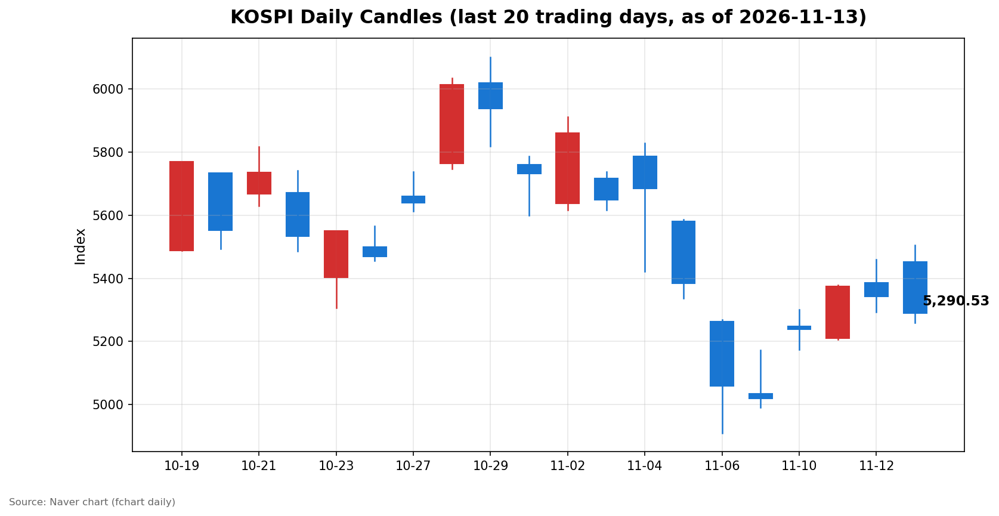
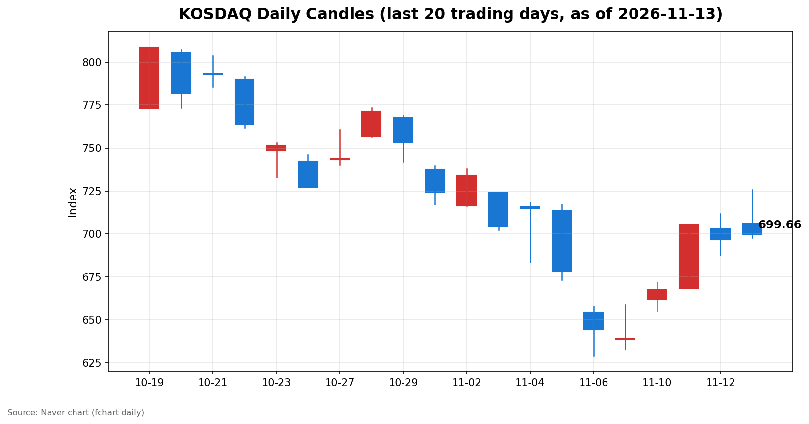

안녕하세요, [한국투자증권](https://securities.koreainvestment.com/main/Main.jsp)에서 [한투-한국투자증권](https://play.google.com/store/apps/details?id=com.truefriend.neosmartarenewal&hl=ko) 개발을 담당하고 있는 way입니다. 
오늘 국내 증시는 장중 5,500선을 돌파한 뒤 오후 외국인 매도에 밀려 하락 마감했습니다. 

## 마감 요약

코스피는 전일 대비 52.20포인트(0.98%) 하락한 5,290.53에 마감했습니다. 
코스닥은 전일 대비 3.13포인트(0.45%) 상승한 699.66에 마감했습니다. 
코스피는 장 초반 2%대 상승 출발로 장중 5,504.44까지 올랐으나, 오후 들어 외국인이 순매도로 돌아서며 상승분을 모두 반납했습니다. 
코스닥은 장중 725.81까지 올랐다가 상승폭을 줄였으나, 기관 순매수에 떠받쳐 상승 마감했습니다. 
장중 고점과 종가의 괴리가 코스피 기준 214포인트에 달할 만큼 오후 변동성이 컸습니다. 
간밤 미국 증시가 하락했음에도 국내 증시가 상승 출발한 점, 그리고 오후에 흐름이 뒤집힌 점이 오늘 장의 가장 큰 특징입니다. 

## 오늘의 마감 스냅샷

| 지수 | 종가 | 전일 대비 | 등락률 | 시가 | 고가 | 저가 | 거래량 | 거래대금 |
| --- | --- | --- | --- | --- | --- | --- | --- | --- |
| 코스피 | 5,290.53 | -52.20 | -0.98% | 5,452.41 | 5,504.44 | 5,259.09 | 2억 3,734만 주 | 15조 9,509억 원 |
| 코스닥 | 699.66 | +3.13 | +0.45% | 705.96 | 725.81 | 697.69 | 4억 1,684만 주 | 5조 4,206억 원 |

스냅샷 기준은 2026년 11월 13일 장 마감 수치이며, 전일 종가는 네이버 실시간 데이터 역산값으로 교차 검증했습니다. 
코스피 전일 종가 5,342.73, 코스닥 전일 종가 696.53이 일봉 데이터와 일치했습니다. 
원/달러 환율은 1,336.7원(15시 30분 기준가)으로 전일 1,330.7원 대비 6.0원 상승하며 원화 약세를 보였습니다. 
출처: [코스피](https://finance.naver.com/sise/sise_index.naver?code=KOSPI), [코스닥](https://finance.naver.com/sise/sise_index.naver?code=KOSDAQ) 

## 차트

최근 20거래일 일봉 차트입니다. 
빨간 봉은 종가가 시가보다 높은 날, 파란 봉은 종가가 시가보다 낮은 날입니다. 

## 원인·촉매 분석

오늘 하락의 첫 번째 촉매는 엔비디아발 AI·반도체 투자심리 악화입니다. 
엔비디아는 젠슨 황 최고경영자(CEO)의 사임이 확정되면서 미국 증시에서 4%대 하락한 166.27달러에 거래를 마쳤습니다. 
사임 배경에는 스캔들과 수사 압박, 의회 증언 요구 등이 거론되고 있으며, 중앙일보 GMC 허브의 당일 G모닝 브리핑도 이 소식을 첫 번째 주제로 다뤘습니다. 
국내 증시가 AI·반도체 밸류체인에 깊이 연결돼 있는 만큼, 엔비디아발 심리 충격이 지수 전반으로 번지는 연결고리가 그대로 작동했습니다. 
두 번째 촉매는 미국발 금리 인상 우려의 지속입니다. 
미국 10월 소비자물가지수는 전월 대비 0.4%로 시장 예상을 웃돌았고, 미국 10년물 국채 금리는 5%를 넘어 5.10% 수준까지 올랐습니다. 
금리 인상 우려가 커지면 성장주 밸류에이션에 부담이 커지고, 반도체 중심의 국내 지수 구조상 상승 탄력이 제한될 수밖에 없습니다. 
다만 하락을 완충한 요인도 있었습니다. 
엔비디아와 달리 AMD는 5.86%, 브로드컴은 5.54% 오르며 AI 수요 자체가 꺾인 것이 아니라 리더십 불확실성이 문제라는 해석에 힘을 실었습니다. 
국제 유가도 브렌트유 95.82달러(3.3% 상승), WTI 89.36달러(2.9% 상승)로 오르며 에너지 관련 심리를 떠받쳤습니다. 
원/달러 환율이 전일 대비 6.0원 상승하며 원화 약세를 보인 점도 외국인의 국내 증시 매수에는 우호적이지 않은 환경으로 작용했습니다. 

## 핵심 사건 3가지

### 1. 엔비디아 젠슨 황 CEO 사임 확정과 엔비디아 4%대 하락

엔비디아는 젠슨 황 최고경영자의 사임이 확정되면서 11월 12일(현지시간) 미국 증시에서 4%대 하락한 166.27달러에 거래를 마쳤습니다. 
사임 배경으로는 스캔들과 수사 압박, 법무부 수사와 의회 증언 요구 등이 거론되고 있으며, 사실관계의 전모는 아직 확인되지 않았습니다. 
같은 날 AMD는 5.86%, 브로드컴은 5.54% 오르며 AI 반도체 수요 자체는 견조하다는 신호도 함께 전해졌습니다. 
중앙일보 GMC 허브의 당일 G모닝 브리핑도 젠슨 황 사임을 첫 번째 주제로 다뤘고, 엔비디아 3분기 실적 발표를 앞두고 있다는 점도 함께 짚었습니다. 
국내 증시에서는 삼성전자(-0.36%)와 SK하이닉스(-3.43%)가 하락하며 반도체 대형주가 지수 하락을 이끌었습니다. 
엔비디아의 후속 주가 반응과 실적 발표 내용이 내일 확인할 첫 번째 수치입니다. 

### 2. 미국 10월 소비자물가지수 예상 상회와 10년물 금리 5% 돌파

미국 10월 소비자물가지수가 전월 대비 0.4%, 근원 0.3%로 시장 예상을 웃돌면서 연준의 12월 금리 인상 가능성이 다시 부각됐습니다. 
미국 10년물 국채 금리는 5%를 넘어 5.10% 수준까지 올랐고, 간밤 나스닥은 0.39% 하락한 25,366.09에 마감했습니다. 
S&P500은 0.35% 하락한 7,592.40, 다우지수는 0.36% 하락한 52,297.09에 마감했고, VIX는 18.70으로 올랐습니다. 
국내 증시 입장에서는 물가 지표 자체보다 미국 증시와 환율의 추가 반응이 내일 장 초반 외국인 수급으로 이어지는 연결고리가 됩니다. 
연준 위원들의 추가 발언과 미국 국채 금리 움직임이 내일 확인할 두 번째 수치입니다. 

### 3. 증시 안정 대책 논의와 증안펀드 가동 요구

급락장이 이어지면서 당국의 시장 안정 대책 논의가 이어지고 있고, 증안펀드 가동을 요구하는 목소리가 커지고 있습니다. 
딥서치 트렌딩 토픽에서도 증안펀드 긴급 가동과 코스닥 기업설명회(IR) 의무화 검토가 두 번째로 큰 이슈로 집계됐습니다. 
다만 증안펀드 가동 여부는 아직 확정되지 않았고, 검토와 요구 단계에 머물러 있어 확정된 정책으로 단정할 수는 없습니다. 
신용융자 담보비율 140% 유지 의무는 11월 9일부터 내년 1월 31일까지 한시 면제돼 반대매매가 유예되는 구간이 이어지고 있습니다. 
정책 논의가 실제 가동으로 이어지는지 여부가 시장의 심리적 하단을 가르는 변수가 될 수 있습니다. 
당국의 추가 발표 여부가 내일 확인할 세 번째 수치입니다. 

## 섹터·테마 영향 체인

오늘 장의 영향 체인은 금리와 AI 심리라는 두 개의 축으로 갈렸습니다. 
금리 인상 우려는 성장주 밸류에이션에 직접 부담을 주었고, 엔비디아발 심리 악화는 AI·반도체 밸류체인 전반으로 번지며 지수 하락을 이끌었습니다. 
반대로 AI 데이터센터발 수요 기대는 CXL 테마(6.92% 상승)와 온디바이스AI 테마(5.83% 상승), 시스템반도체 테마(3.91% 상승)의 강세로 이어졌습니다. 
전선업체 테마도 5.32% 오르며 AI 데이터센터발 전력 인프라 수요 기대가 이어지고 있음을 보여줬습니다. 
국제 유가 상승은 에너지 섹터로 온기를 확산시켰고, 금값이 2.8% 하락한 3,875달러에 거래된 점은 안전자산 선호가 다소 완화된 흐름과 맞물립니다. 
지수 하락에도 강세 테마가 뚜렷했다는 점은, 오늘 장이 전면적인 매도 장세가 아니라 재료와 실적에 따른 선별 장세의 성격도 함께 지녔음을 보여줍니다. 

## 최근 5거래일 일봉

| 날짜 | 시가 | 고가 | 저가 | 종가 | 거래량(천주) |
| --- | --- | --- | --- | --- | --- |
| 11/09 | 5,034.20 | 5,172.94 | 4,990.66 | 5,018.85 | 248,140 |
| 11/10 | 5,247.22 | 5,300.92 | 5,174.55 | 5,239.13 | 253,917 |
| 11/11 | 5,209.71 | 5,377.99 | 5,207.44 | 5,375.36 | 234,732 |
| 11/12 | 5,385.94 | 5,458.84 | 5,293.05 | 5,342.73 | 244,834 |
| 11/13 | 5,452.41 | 5,504.44 | 5,259.09 | 5,290.53 | 237,339 |

| 날짜 | 시가 | 고가 | 저가 | 종가 | 거래량(천주) |
| --- | --- | --- | --- | --- | --- |
| 11/09 | 638.82 | 658.66 | 632.70 | 638.97 | 358,495 |
| 11/10 | 661.73 | 671.91 | 655.09 | 667.61 | 402,110 |
| 11/11 | 668.48 | 705.10 | 668.48 | 705.10 | 411,901 |
| 11/12 | 703.22 | 711.86 | 687.40 | 696.53 | 465,951 |
| 11/13 | 705.96 | 725.81 | 697.69 | 699.66 | 416,839 |

## 당일 수급

코스피에서는 외국인이 5,505억 원 순매도하며 지수 하락을 주도했습니다. 
개인은 175억 원 순매수에 그쳤고, 기관은 20억 원 순매수로 사실상 중립에 가까웠습니다. 
기관 내부를 보면 연기금이 2,109억 원 순매수하며 금융투자(-1,145억 원)와 투신(-639억 원)의 매도를 상쇄한 구도입니다. 
기타법인은 5,310억 원 순매수로 가장 큰 매수 주체였으나, 지수 하락을 막기에는 역부족이었습니다. 
외국인의 오후 매도 전환이 장중 상승분을 모두 반납하게 만든 직접적인 수급 배경입니다. 
코스닥에서는 외국인이 755억 원 순매도했고, 개인도 563억 원 순매도했습니다. 
기관이 1,262억 원 순매수하며 매물을 받아냈고, 투신(622억 원)과 연기금(330억 원), 금융투자(218억 원)가 고르게 매수에 참여했습니다. 
코스피와 코스닥의 수급 구도가 정반대였다는 점이 양 시장의 등락이 갈린 배경입니다. 
외국인 매도가 진정되는지 여부가 다음 거래일 흐름을 가르는 첫 번째 관전 포인트입니다. 

## 강했던 테마와 흐름

CXL 테마가 6.92% 오르며 가장 강한 흐름을 보였고, 온디바이스AI 테마가 5.83%, 전선업체 테마가 5.32% 올랐습니다. 
TFT-LCD BLU 제조 테마가 5.11%, 도시재생사업 테마가 4.06%, 창업투자 테마가 3.99% 상승했습니다. 
시스템반도체 테마는 3.91%, 지능형교통시스템 테마는 3.87% 올랐습니다. 
AI 인프라와 데이터센터 관련 테마가 지수 하락 속에서도 강세를 유지했다는 점이 오늘 장의 특징입니다. 
엔비디아발 악재에도 AI 수요 기대가 꺾이지 않았다는 시장의 판단이 테마 강세로 드러난 셈입니다. 

## 단기·중기 전망과 내일 확인할 시나리오

단기적으로는 반등 흐름이 이어질지, 아니면 오후 되돌림이 반복될지를 가르는 구간입니다. 
코스피는 당일 저가 5,259.09와 5,200선 안착 여부가 첫 번째 지지 구간이고, 위로는 당일 고가 5,504.44와 5,458.84가 저항 구간입니다. 
코스닥은 700선 안착 여부와 당일 저가 697.69가 지지 구간이고, 위로는 당일 고가 725.81이 저항 구간입니다. 
외국인 매도가 진정되고 기관 매수가 이어지면 반등 흐름이 이어질 수 있고, 외국인 매도가 이어지면 5,200선 하단 시험이 이어질 수 있습니다. 
중기적으로는 미국 금리 인상 우려와 엔비디아발 불확실성이 해소되는 속도가 관건입니다. 
미국 10년물 국채 금리가 5% 위에서 안착하는지, VIX가 20 아래로 내려오는지, 필라델피아 반도체지수가 2일 연속 상승하는지가 단기 바닥 논의의 조건입니다. 
확인할 시나리오는 세 가지입니다. 
첫째, 엔비디아의 후속 주가 반응과 3분기 실적 발표 내용입니다. 
둘째, 미국 국채 금리와 연준 위원들의 추가 발언입니다. 
셋째, 증안펀드를 비롯한 당국의 시장 안정 대책 관련 추가 발표 여부입니다. 
이 글은 교육과 해설 목적의 시황 정리이며, 특정 종목의 매수나 매도를 권유하지 않습니다. 

## 마치며

오늘 국내 증시는 장중 5,500선을 돌파했으나 오후 외국인 매도에 밀려 하락 마감했습니다. 
내일 장에서는 외국인 수급 진정 여부와 미국 증시의 밤사이 반응을 함께 확인하는 것이 중요합니다. 
