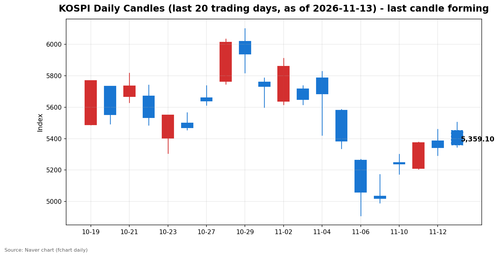
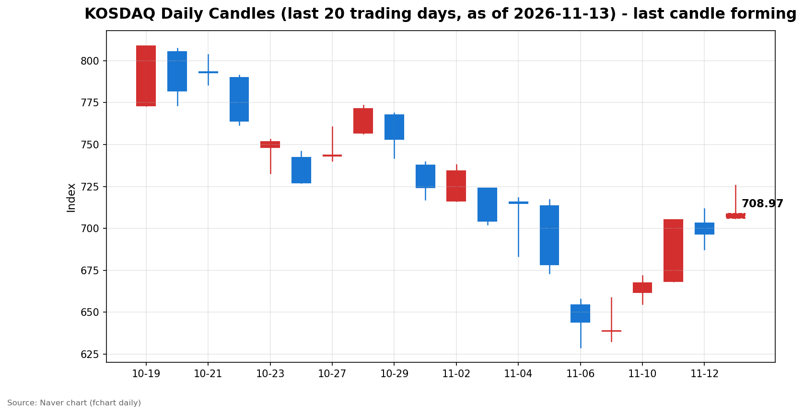

안녕하세요, [한국투자증권](https://securities.koreainvestment.com/main/Main.jsp)에서 [한투-한국투자증권](https://play.google.com/store/apps/details?id=com.truefriend.neosmartarenewal&hl=ko) 개발을 담당하고 있는 way입니다. 
11월 13일 국내 증시는 장 초반 반도체 강세로 코스피가 5,500선을 넘었다가 오전 흐름이 꺾이며 약보합으로 돌아섰습니다. 
오전장의 상승과 되돌림, 그 배경을 정리합니다. 

## 오전장 요약

코스피는 5,452.41에 출발해 장 초반 5,504.44까지 올랐으나, 오전 중 상승 폭을 모두 반납하고 12시 32분 기준 5,338.51로 전일 종가보다 4.22포인트 낮은 수준까지 밀렸습니다. 
장 초반 상승률이 2%를 넘었던 것과 비교하면, 오전 한때 고점 대비 165포인트가 넘는 되돌림이 나타난 셈입니다. 
코스닥은 705.96에 출발해 725.81까지 올랐다가 되돌렸지만, 708.01로 1.65% 상승을 지키며 700선을 유지하고 있습니다. 
어제(11월 12일)에도 코스피는 오전 5,458.84까지 올랐다가 오후에 무너져 0.61% 하락 마감한 바 있어, 이틀 연속으로 오전 강세 후 되돌림이라는 같은 패턴이 반복되고 있습니다. 

## 오늘의 스냅샷

| 지수 | 현재가 | 전일 대비 | 등락률 | 시가 | 고가 | 저가 | 거래량 | 거래대금 |
| --- | --- | --- | --- | --- | --- | --- | --- | --- |
| 코스피 | 5,338.51 | -4.22 | -0.08% | 5,452.41 | 5,504.44 | 5,338.51 | 143,241천주 | 8,809,150백만원 |
| 코스닥 | 708.01 | +11.48 | +1.65% | 705.96 | 725.81 | 705.96 | 285,428천주 | 3,735,084백만원 |

스냅샷 기준 시각은 2026년 11월 13일 12시 32분(KST)입니다. 
전일 종가는 코스피 5,342.73, 코스닥 696.53입니다. 
전일 종가는 네이버 실시간 데이터에서 현재가를 등락률로 역산한 값과 일치함을 확인했습니다. 
당일 봉은 형성 중인 봉으로, 마감 전에는 계속 변합니다. 
네이버 차트 출처: [코스피](https://finance.naver.com/sise/sise_index.naver?code=KOSPI), [코스닥](https://finance.naver.com/sise/sise_index.naver?code=KOSDAQ) 

## 차트

최근 20거래일 일봉 차트입니다. 
빨간 봉은 종가가 시가보다 높은 날, 파란 봉은 종가가 시가보다 낮은 날입니다. 
당일 봉은 형성 중인 봉으로, 마감 전에는 계속 변합니다. 

## 원인·촉매 분석

오늘 오전장의 출발은 국내 반도체 호재가 이끌었습니다. 
삼성전자가 11월 12일 충남 아산 온양캠퍼스에서 46조 원 규모의 신규 패키징 팹 착공식을 열고, 7세대 고대역폭메모리(HBM4E)의 내년 양산과 2028년 가동 계획을 전면에 내세웠습니다. 
HBM은 메모리뿐 아니라 패키징, 장비, 소재로 이어지는 밸류체인 전체의 투자 사이클과 직결되는 만큼, 온양 투자는 국내 반도체 밸류체인 전반에 중기적인 수요 신호로 작용했습니다. 
장 초반 코스피가 5,500선을 넘은 것도 이 호재가 지수 전반으로 확산된 결과로 읽힙니다. 
그러나 상승을 이끈 동력이 오전 내내 이어지지 못한 데에는 미국발 부담이 작용했습니다. 
엔비디아 최고경영자(CEO)의 전격 사임으로 AI 밸류체인의 리더십 불확실성이 커졌고, 유가 급등과 미국 국채금리 5% 재돌파가 인플레이션 우려를 자극했습니다. 
금리가 오르면 성장주 밸류에이션에 부담이 커지고, 유가가 오르면 운송·화학 등 원가 부담 업종의 마진이 압박을 받습니다. 
오늘 오전장은 국내 호재와 미국발 부담이 같은 반도체라는 축에서 충돌했고, 오전이 지나면서 부담 쪽의 무게가 커진 흐름입니다. 
원/달러 환율은 장 초반 1,337원대에서 1,331.90원까지 내려오며 원화 강세 방향으로 움직였습니다. 
환율이 안정되는 흐름은 외국인 수급에는 우호적이지만, 지수의 되돌림을 막기에는 역부족이었습니다. 
전일 수급 구도도 오늘 흐름의 배경을 설명합니다. 
전일(11월 12일) 최종값 기준 코스피에서는 외국인이 4,122억 원을 순매수했고, 개인이 2,689억 원을 순매도했으며, 기관이 6,626억 원을 순매도했고, 기타법인이 5,190억 원을 순매수했습니다. 
코스피가 하락 마감한 날 외국인이 매수 우위를 지켰다는 점은, 외국인이 단기 조정 국면에서도 국내 주식을 팔기보다 담는 쪽에 서 있었다는 의미입니다. 
기관 매도가 컸던 만큼 외국인과 기타법인의 매수가 하락 폭을 제한하는 구도였습니다. 
코스닥에서는 외국인이 3,549억 원을 순매도했고, 개인이 3,112억 원을 순매수했으며, 기관이 417억 원을 순매수했고, 기타법인이 15억 원을 순매수했습니다. 
코스닥은 외국인 매도를 개인과 기관이 받아낸 구도였습니다. 
다만 전일 수급은 어제의 구도일 뿐, 장중 수급 확정치는 확인이 필요하므로 오늘 오후 흐름을 수급으로 단정하지는 않습니다. 

## 핵심 사건 3가지

첫째, 엔비디아 CEO 젠슨 황의 전격 사임입니다. 
엔비디아 이사회는 11월 12일(현지시간) 창업자 젠슨 황 CEO의 즉시 사임을 발표했고, 최고재무책임자(CFO) 콜레트 크레스가 임시 CEO를 맡았습니다. 
33년 만의 교체이며, 배경은 중국 스파이 의심 인물과의 불륜 스캔들에 이은 사내 직원과의 추가 불륜 의혹입니다. 
미 법무부는 해당 인물에 대한 수사에 착수했고, 황 CEO는 이달 말 의회 증언을 앞두고 있습니다. 
엔비디아는 11월 17일 3분기 실적을 예정대로 발표합니다. 
간밤 뉴욕 증시에서 엔비디아는 4.34% 하락했고 장중에는 14%까지 밀렸으며, 네비우스는 16.55%, 코어위브는 6.89% 하락했습니다. 
반면 AMD는 5.86%, 브로드컴은 5.54% 올랐습니다. 
이 사건이 중요한 이유는 AI 산업의 상징적 인물이 물러나면서 AI 밸류체인 전반의 리더십 불확실성이 커졌기 때문입니다. 
다만 실적 발표가 사흘 앞으로 다가온 만큼, 시장은 사임 자체보다 11월 17일 실적에서 확인될 AI 수요의 실체를 더 주시하는 분위기입니다. 
딥서치 트렌딩 토픽에서도 이 이슈가 139건의 관련 문서로 1위를 차지했고, 중앙일보 GMC의 오늘자 G모닝과 트렌드 기사에서도 같은 내용을 교차 확인했습니다. 

둘째, 유가 급등과 미국 국채금리 5% 재돌파입니다. 
서부텍사스산원유(WTI) 12월물은 전장 대비 2.55% 오른 배럴당 88.74달러, 브렌트유 1월물은 3.30% 오른 배럴당 95.82달러에 마감했습니다. 
미국 국채 10년물 금리는 12.3bp 오른 5.106%로 5%대를 다시 넘어섰고, 2년물 금리도 14.6bp 오른 4.873%를 기록했습니다. 
금리선물 시장은 12월 0.25%포인트 인상 확률을 84.7%로 반영하고 있습니다. 
변동성지수(VIX)는 6.86% 오른 18.69를 기록했습니다. 
이 사건의 충격은 심리적인 측면과 구조적인 측면이 함께 있습니다. 
심리적으로는 물가 불안이 다시 고개를 들면서 긴축 전망이 강화됐고, 구조적으로는 고금리가 성장주 밸류에이션과 달러 강세를 통해 신흥국 증시에 부담을 줍니다. 
뉴욕 연방준비은행 총재가 인플레이션이 여전히 높다고 발언한 점도 금리 부담을 더하는 재료로 전해졌습니다. 
13일 발표되는 미국 10월 생산자물가지수(PPI)가 다음 변수입니다. 

셋째, 삼성전자의 온양 HBM 46조 원 투자 착공입니다. 
삼성전자는 11월 12일 충남 아산 온양캠퍼스 건설 현장에서 충청권 메가프로젝트 착공식을 열고, 46조 원 규모의 신규 패키징 팹 건설에 들어갔습니다. 
이재용 회장은 HBM4E를 전면에 내세우며 온양을 AI 반도체의 심장인 최첨단 HBM 거점으로 만들겠다고 밝혔습니다. 
2028년 신규 라인 가동에 맞춰 생산능력을 크게 늘리는 구상입니다. 
이 사건이 국내 시장에 중요한 이유는 HBM 주도권 경쟁이 한국 반도체 밸류체인 전체의 투자 사이클과 직결되기 때문입니다. 
오늘 장 초반 HBM 테마가 6.01% 오른 것도 이 맥락에서 읽힙니다. 
같은 날 삼성전자가 미국 데이터센터 냉각 솔루션 업체 모딘 매뉴팩처링 인수를 협상 중이라는 보도도 전해졌으나, 최종 결정 전이며 무산 가능성도 있어 확정된 사실로는 보지 않습니다. 

## 섹터·테마 영향 체인

오늘 오전 자금은 반도체 밸류체인에 집중되고 있습니다. 
한국투자증권 MTS 테마 기준으로 CXL은 6.76% 올랐고 구성 종목 9개 중 8개가 상승했습니다. 
온디바이스AI는 6.66% 올랐고 구성 종목 13개 중 10개가 상승했습니다. 
시스템반도체는 5.69%, HBM은 3.72% 올랐고, HBM 테마에서는 15개 종목 중 10개가 상승했습니다. 
이 흐름의 연결고리는 HBM 투자에서 출발합니다. 
HBM 수요가 늘면 패키징과 고대역폭 메모리 인터페이스가 필요해지고, CXL과 온디바이스AI 같은 차세대 인터페이스·엣지 AI 테마로 자금이 확산됩니다. 
전선업체가 4.95%, 도시재생사업이 4.59% 오른 것도 AI 인프라 투자 확대라는 큰 줄기에서 성장주 전반으로 온기가 퍼지는 구간으로 읽힙니다. 
반면 간밤 뉴욕 증시에서는 AI 관련주의 명암이 갈렸습니다. 
엔비디아 의존도가 높은 AI 인프라주가 흔들리는 동안, 대체 수혜주로 꼽히는 종목으로 자금이 이동한 것입니다. 
국내 시장에서도 같은 논리가 적용됩니다. 
엔비디아발 불확실성이 AI 수요 자체의 붕괴가 아니라 공급자 교체 국면으로 해석되면, 국내 반도체 밸류체인은 오히려 반사이익 기대를 받을 수 있습니다. 
다만 이 해석은 11월 17일 엔비디아 실적에서 AI 수요가 확인돼야 힘을 얻습니다. 
유가·금리 축의 영향은 업종별로 엇갈립니다. 
유가가 오르면 정유·에너지 업종은 수혜를 보지만, 운송·화학·항공 등 원가 부담 업종은 마진 압박을 받습니다. 
금리가 오르면 금융주는 순이자마진 기대를 받지만, 성장주와 부동산 관련 업종은 밸류에이션 부담이 커집니다. 
오늘 오전 반도체 강세가 이 부담을 덮고 있지만, 업종별로는 금리·유가에 민감한 쪽과 그렇지 않은 쪽의 온도 차가 벌어질 수 있습니다. 

## 최근 5거래일 일봉

| 날짜 | 시가 | 고가 | 저가 | 종가 | 거래량 |
| --- | --- | --- | --- | --- | --- |
| 2026-11-09 | 5,034.20 | 5,172.94 | 4,990.66 | 5,018.85 | 248,140천주 |
| 2026-11-10 | 5,247.22 | 5,300.92 | 5,174.55 | 5,239.13 | 253,917천주 |
| 2026-11-11 | 5,209.71 | 5,377.99 | 5,207.44 | 5,375.36 | 234,732천주 |
| 2026-11-12 | 5,385.94 | 5,458.84 | 5,293.05 | 5,342.73 | 244,834천주 |
| 2026-11-13(형성 중) | 5,452.41 | 5,504.44 | 5,338.51 | 5,338.51 | 143,241천주 |

당일 봉은 형성 중인 봉으로, 마감 전에는 계속 변합니다. 
코스피는 11월 9일 5,018.85에서 11월 11일 5,375.36까지 올랐고, 11월 12일 5,342.73으로 되돌린 뒤 오늘 장 초반 5,504.44까지 올랐으나 오전 중 상승 폭을 모두 반납했습니다. 

| 날짜 | 시가 | 고가 | 저가 | 종가 | 거래량 |
| --- | --- | --- | --- | --- | --- |
| 2026-11-09 | 638.82 | 658.66 | 632.70 | 638.97 | 358,495천주 |
| 2026-11-10 | 661.73 | 671.91 | 655.09 | 667.61 | 402,110천주 |
| 2026-11-11 | 668.48 | 705.10 | 668.48 | 705.10 | 411,901천주 |
| 2026-11-12 | 703.22 | 711.86 | 687.40 | 696.53 | 465,951천주 |
| 2026-11-13(형성 중) | 705.96 | 725.81 | 705.96 | 708.01 | 285,428천주 |

코스닥은 11월 11일 705.10까지 올랐다가 11월 12일 696.53으로 밀렸고, 오늘 700선을 되찾아 725.81까지 올랐으나 오전 중 상승 폭을 상당 부분 반납했습니다. 

## 오전 강했던 테마와 흐름 변화

오전 강했던 테마는 반도체 밸류체인입니다. 
장 초반 온디바이스AI는 9.18%, CXL은 9.07%, 시스템반도체는 7.07%, HBM은 6.01% 올랐습니다. 
12시 30분 기준으로는 온디바이스AI 6.66%, CXL 6.76%, 시스템반도체 5.69%, HBM 3.72%로 상승 폭이 2%포인트 안팎 줄었습니다. 
상승은 유지되고 있으나, 장 초반과 비교하면 테마의 열기도 한풀 꺾인 셈입니다. 
다만 테마의 되돌림 폭이 지수보다 상대적으로 작다는 점에서, 반도체 테마의 강세는 지수보다 오래 유지되고 있습니다. 
시가 대비 방향 전환 여부도 시장별로 갈립니다. 
코스피는 시가 5,452.41보다 아래인 5,338.51까지 밀려 시가 대비 음전환했습니다. 
코스닥은 시가 705.96 위인 708.01을 지키며 시가 대비 양의 흐름을 유지하고 있습니다. 
코스닥이 코스피보다 선방하는 것은 장 초반 상승 폭이 컸던 만큼 되돌림 이후에도 여유가 남아 있기 때문입니다. 

## 오후 전망과 확인할 시나리오

오후 흐름의 지속 여부를 가르는 분수령은 코스피가 전일 종가 5,342.73을 회복하는지 여부입니다. 
12시 32분 기준 코스피는 5,338.51로 전일 종가보다 소폭 아래에 있습니다. 
종가 기준으로 5,342.73을 되찾으면 오전 되돌림이 일시적 노이즈로 정리될 수 있고, 아래에 머물면 어제와 같은 되돌림 패턴이 이틀 연속 반복되는 셈입니다. 
위로는 시가 5,452.41과 5,500선이 저항 구간이고, 아래로는 11월 12일 저가 5,293.05가 가까운 지지 구간입니다. 
코스닥은 700선 유지 여부와 시가 705.96 회복 여부가 관전 포인트입니다. 
위로는 전일 고가 711.86과 당일 고가 725.81이 저항 구간입니다. 
단기적으로는 상승 흐름의 지속 여부를 가르는 분수령이 11월 17일 엔비디아 실적입니다. 
실적에서 AI 수요가 견조하게 확인되면 엔비디아발 불확실성은 경영진 교체라는 일회성 충격으로 정리되고, 국내 반도체 밸류체인의 상승 동력도 이어질 수 있습니다. 
반대로 실적에서 수요 둔화 신호가 나오면 오늘 오전 상승은 일시적 반등으로 정리될 수 있습니다. 
중기적으로는 금리·유가 축이 더 중요합니다. 
미 국채 10년물 금리가 5%를 웃도는 구간이 길어지면 성장주 밸류에이션 부담이 누적되고, WTI가 배럴당 88달러대에서 더 오르면 인플레이션 우려가 커집니다. 
13일 발표되는 미국 10월 생산자물가지수(PPI)와 12월 연방공개시장위원회(FOMC)를 향한 금리 전망이 중기 방향을 가를 변수입니다. 
반대로 PPI가 안정되고 금리가 5% 아래로 되돌리면, 반도체를 중심으로 한 상승 흐름이 이어질 여지가 커집니다. 
리스크 관리 관점에서는 엔비디아발 불확실성이 아직 끝나지 않았다는 점을 염두에 둬야 합니다. 
임시 CEO 체제에서 정식 CEO 선임까지는 시간이 걸리고, 미 법무부 수사와 의회 증언 등 조사 관련 일정이 남아 있습니다. 
오늘 오전 상승은 국내 호재가 미국발 악재를 앞선 결과이지만, 두 축이 다시 충돌하면 변동성이 커질 수 있습니다. 
이 글은 교육·해설 목적의 시황 정리이며, 특정 종목의 매수나 매도를 권유하지 않습니다. 

## 마치며

오전장은 반도체 호재로 강하게 출발했지만, 미국발 금리·유가 부담과 엔비디아발 불확실성이 되돌림을 만들었습니다. 
오후에는 전일 종가와 시가 회복 여부가 흐름의 지속 여부를 가를 관전 포인트입니다. 
이 글은 교육·해설 목적의 시황 정리이며, 특정 종목의 매수나 매도를 권유하지 않습니다. 
