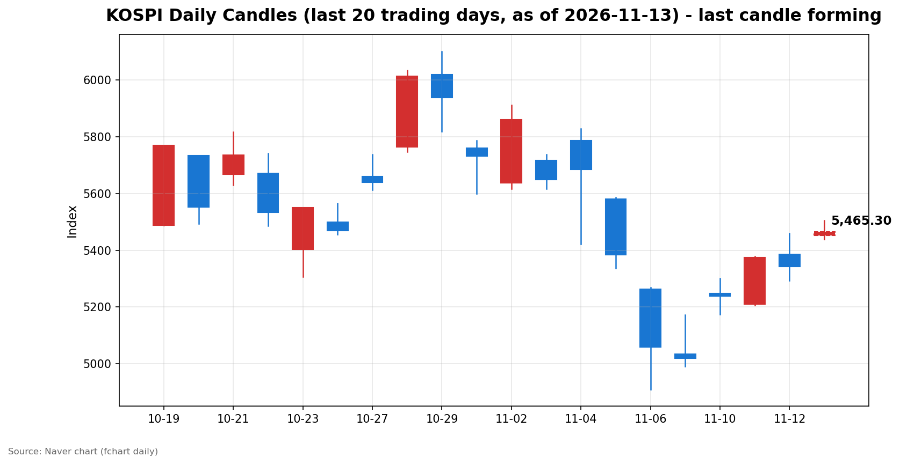
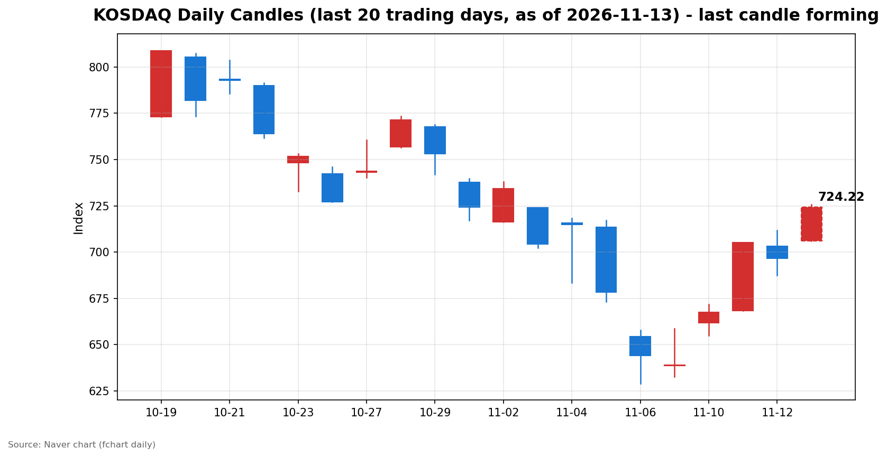

안녕하세요, [한국투자증권](https://securities.koreainvestment.com/main/Main.jsp)에서 [한투-한국투자증권](https://play.google.com/store/apps/details?id=com.truefriend.neosmartarenewal&hl=ko) 개발을 담당하고 있는 way입니다. 
간밤 뉴욕 증시는 엔비디아 최고경영자(CEO) 젠슨 황의 전격 사임과 유가 급등, 미국 국채금리 상승이 겹치며 3대 지수가 일제히 하락했습니다. 
그런데도 국내 증시는 11월 13일 장 초반 반도체를 중심으로 강한 상승세로 출발했습니다. 
오늘 장 오픈의 배경과 흐름을 정리합니다. 

## 배경

간밤 미국 증시는 11월 12일(현지시간) 3대 지수가 모두 하락 마감했습니다. 
다우존스30 산업평균지수는 전 거래일보다 189.40포인트(0.36%) 내린 52,297.09, 스탠더드앤드푸어스(S&P) 500지수는 26.98포인트(0.35%) 내린 7,592.40, 나스닥 종합지수는 101.00포인트(0.39%) 내린 25,366.09에 거래를 마쳤습니다. 
엔비디아는 장중 13% 이상 떨어졌다가 낙폭을 줄여 4.34% 하락한 166.19달러에 마감했습니다. 
주말 이후 엔비디아 시가총액 감소 규모는 약 8,000억 달러 수준으로 보도되었습니다. 
국제유가도 함께 올랐습니다. 
서부텍사스산원유(WTI) 12월물은 전장 대비 2.55% 오른 배럴당 88.74달러, 브렌트유 1월물은 3.30% 오른 배럴당 95.82달러에 마감했습니다. 
유가 상승이 인플레이션 우려를 자극하면서 미국 국채 10년물 금리는 12.3bp 오른 5.106%로 5%대를 재돌파했고, 2년물 금리도 14.6bp 오른 4.873%를 기록했습니다. 
금리선물 시장은 12월 0.25%포인트 인상 확률을 84.7%로 반영하고 있습니다. 
변동성지수(VIX)는 6.86% 오른 18.69를 기록했습니다. 
원/달러 환율은 1,337.10원으로 전일 대비 1.60원(0.12%) 올랐으며, 역외 차액결제선물환(NDF) 시장에서 원/달러 1개월물은 1,334원대에 최종 호가됐습니다. 

## 오늘의 스냅샷

| 지수 | 현재가 | 전일 대비 | 등락률 | 시가 | 고가 | 저가 | 거래량 | 거래대금 |
| --- | --- | --- | --- | --- | --- | --- | --- | --- |
| 코스피 | 5,463.77 | +121.04 | +2.27% | 5,452.41 | 5,504.44 | 5,438.90 | 64,840천주 | 3,901,055백만원 |
| 코스닥 | 724.17 | +27.64 | +3.97% | 705.96 | 725.81 | 705.96 | 130,854천주 | 1,814,510백만원 |

스냅샷 기준 시각은 2026년 11월 13일 09시 52분(KST)입니다. 
전일 종가는 코스피 5,342.73, 코스닥 696.53입니다. 
전일 종가는 네이버 실시간 데이터에서 현재가를 등락률로 역산한 값과 일치함을 확인했습니다. 
코스피는 장 초반 5,500선을 웃돌았다가 되돌림이 나타났고, 코스닥은 700선을 회복한 뒤 상승 폭을 키우고 있습니다. 
네이버 차트 출처: [코스피](https://finance.naver.com/sise/sise_index.naver?code=KOSPI), [코스닥](https://finance.naver.com/sise/sise_index.naver?code=KOSDAQ) 

## 차트

최근 20거래일 일봉 차트입니다. 
빨간 봉은 종가가 시가보다 높은 날, 파란 봉은 종가가 시가보다 낮은 날입니다. 
당일 봉은 형성 중인 봉으로, 마감 전에는 계속 변합니다. 

## 원인·촉매 분석

오늘 상승의 직접적인 촉매는 국내 반도체 업황에 대한 기대감입니다. 
간밤 뉴욕 증시에서 엔비디아발 악재가 AI 관련주 전반의 투자심리를 눌렀지만, 국내 시장에서는 오히려 반도체 밸류체인으로 자금이 몰렸습니다. 
삼성전자가 11월 12일 충남 아산 온양캠퍼스에서 46조 원 규모의 신규 패키징 팹 착공식을 열고, 7세대 고대역폭메모리(HBM4E)의 내년 양산과 2028년 가동 계획을 전면에 내세운 것이 대표적입니다. 
이재명 대통령이 참석한 착공식에서 삼성전자는 온양을 AI 반도체의 심장인 최첨단 HBM 거점으로 만들겠다는 계획을 밝혔습니다. 
미국발 악재와 국내발 호재가 같은 반도체라는 축에서 충돌한 셈입니다. 
시장이 국내 호재 쪽에 더 무게를 둔 것은, 엔비디아의 문제가 AI 수요 자체의 둔화가 아니라 경영진 교체라는 회사 고유의 불확실성으로 해석됐기 때문입니다. 
다올투자증권도 13일 보고서에서 사임이 단기적으로 업황에 영향을 줄 것은 없겠으나, 신규 경영진과 중장기 전략 방향에 대한 불확실성이 부각됐다고 진단했습니다. 
다만 금리와 유가라는 두 번째 축은 여전히 부담입니다. 
미 국채 10년물 금리가 5%를 다시 넘어섰고, WTI가 배럴당 88달러대로 올라서면서 인플레이션 우려가 커졌습니다. 
금리가 오르면 성장주 밸류에이션에 부담이 커지고, 유가가 오르면 운송·화학 등 원가 부담 업종의 마진이 압박을 받습니다. 
오늘 장 초반에는 반도체 강세가 이 부담을 덮고 있지만, 금리·유가 축이 꺾이지 않으면 상승의 지속력을 갉아먹는 요인으로 작용할 수 있습니다. 
전일 수급 구도도 오늘 흐름의 배경을 설명합니다. 
코스피에서 외국인은 4,122억 원을 순매수했고 개인은 2,689억 원, 기관은 6,626억 원을 순매도했습니다. 
전일 코스피가 0.62% 하락 마감한 날 외국인이 매수 우위를 지켰다는 점은, 외국인이 단기 조정 국면에서도 국내 주식을 팔기보다 담는 쪽에 서 있었다는 의미입니다. 
기관 매도가 컸던 만큼 외국인의 매수가 지수를 떠받치는 구도였고, 오늘 장 초반 상승은 그 연장선에서 외국인 매수세가 이어지는지를 확인하는 구간입니다. 
코스닥에서는 반대로 외국인이 3,549억 원을 순매도했고 개인이 3,112억 원, 기관이 417억 원을 순매수했습니다. 
코스닥은 외국인 매도에도 개인과 기관이 받으면서 전일 696.53으로 마감했고, 오늘은 700선을 회복하며 외국인 매도 압력을 되돌리는 흐름입니다. 

## 핵심 사건 3가지

첫째, 엔비디아 CEO 젠슨 황의 전격 사임입니다. 
엔비디아 이사회는 11월 12일(현지시간) 창업자 젠슨 황 CEO의 즉시 사임을 발표했고, 최고재무책임자(CFO) 콜레트 크레스가 임시 CEO를 맡았습니다. 
사임 배경은 중국 스파이 의심 인물과의 불륜 스캔들입니다. 
황 CEO는 지난 8일 직원들에게 보낸 이메일에서 배우자에게 충실하지 못했다고 인정했고, 이사회는 외국 정보기관의 표적이 됐는지 여부를 조사해 왔습니다. 
미 법무부는 해당 인물에 대한 수사에 착수했고, 황 CEO는 이달 말 의회 증언을 앞두고 있습니다. 
엔비디아는 11월 17일 3분기 실적을 예정대로 발표합니다. 
이 사건이 중요한 이유는 AI 산업의 상징적 인물이 물러나면서 AI 밸류체인 전반의 리더십 불확실성이 커졌기 때문입니다. 
다만 실적 발표가 사흘 앞으로 다가온 만큼, 시장은 사임 자체보다 11월 17일 실적에서 확인될 AI 수요의 실체를 더 주시하는 분위기입니다. 

둘째, 유가 급등과 미국 국채금리 5% 재돌파입니다. 
WTI는 2.55%, 브렌트유는 3.30% 올랐고, 미 국채 10년물 금리는 12.3bp 오른 5.106%를 기록했습니다. 
금리선물 시장은 12월 0.25%포인트 인상 확률을 84.7%로 반영하고 있습니다. 
이 사건의 충격은 심리적인 측면과 구조적인 측면이 함께 있습니다. 
심리적으로는 물가 불안이 다시 고개를 들면서 연준의 긴축 전망이 강화됐고, 구조적으로는 고금리가 성장주 밸류에이션과 달러 강세를 통해 신흥국 증시에 부담을 줍니다. 
오늘 국내 증시가 오름에도 환율이 1,337원대로 오른 것은 이 부담이 완전히 사라지지 않았음을 보여줍니다. 
13일 발표되는 미국 10월 생산자물가지수(PPI)가 다음 변수입니다. 

셋째, 삼성전자의 온양 HBM 46조 원 투자 착공입니다. 
삼성전자는 11월 12일 충남 아산 온양캠퍼스 건설 현장에서 충청권 메가프로젝트 착공식을 열고, 46조 원 규모의 신규 패키징 팹 건설에 들어갔습니다. 
이재용 회장은 HBM4E를 전면에 내세우며 온양을 AI 반도체의 심장인 최첨단 HBM 거점으로 만들겠다고 밝혔습니다. 
2028년 신규 라인 가동에 맞춰 생산능력을 크게 늘리는 구상입니다. 
이 사건이 국내 시장에 중요한 이유는 HBM 주도권 경쟁이 한국 반도체 밸류체인 전체의 투자 사이클과 직결되기 때문입니다. 
HBM은 메모리뿐 아니라 패키징, 장비, 소재로 이어지는 밸류체인을 동반하며, 온양 투자는 그 체인 전체에 중기적인 수요 신호로 작용합니다. 
오늘 장 초반 HBM 테마가 6.01% 오른 것도 이 맥락에서 읽힙니다. 

## 섹터·테마 영향 체인

오늘 장 초반 자금은 반도체 밸류체인에 집중되고 있습니다. 
한국투자증권 MTS 테마 기준으로 온디바이스AI가 9.18% 올랐고 구성 종목 13개가 모두 상승했습니다. 
CXL은 9.07% 올랐고 구성 종목 9개가 모두 상승했습니다. 
시스템반도체는 7.07%, HBM은 6.01%, 반도체재료는 4.26%, 반도체/반도체장비는 4.25% 올랐고, 반도체/반도체장비 테마에서는 101개 종목 중 90개가 상승했습니다. 
이 흐름의 연결고리는 HBM 투자에서 출발합니다. 
HBM 수요가 늘면 패키징과 고대역폭 메모리 인터페이스가 필요해지고, CXL과 온디바이스AI 같은 차세대 인터페이스·엣지 AI 테마로 자금이 확산됩니다. 
유리기판 테마가 4.62% 오른 것도 같은 체인입니다. 
첨단 패키징 기판 수요가 HBM 확대와 함께 커진다는 기대가 반영된 것으로 보입니다. 
로봇 테마도 5.02% 올랐습니다. 
로봇은 반도체와 직접 연결되지는 않지만, AI 하드웨어 투자 확대라는 큰 줄기에서 성장주 전반으로 온기가 퍼지는 구간에 함께 오르는 경향이 있습니다. 
반면 간밤 뉴욕 증시에서는 AI 관련주의 명암이 갈렸습니다. 
네비우스는 16.84%, 코어위브는 6.86% 하락한 반면, AMD는 5.86%, 브로드컴은 5.54% 올랐습니다. 
엔비디아 의존도가 높은 AI 인프라주가 흔들리는 동안, 대체 수혜주로 꼽히는 종목으로 자금이 이동한 것입니다. 
AMD의 경우 서버 CPU 에픽(EPYC) 매출이 전년 대비 2배 이상 늘었고, 2027년 서버 CPU 성장 전망이 상향된 점도 함께 작용했습니다. 
국내 시장에서도 같은 논리가 적용됩니다. 
엔비디아발 불확실성이 AI 수요 자체의 붕괴가 아니라 공급자 교체 국면으로 해석되면, 국내 반도체 밸류체인은 오히려 반사이익 기대를 받을 수 있습니다. 
다만 이 해석은 11월 17일 엔비디아 실적에서 AI 수요가 확인돼야 힘을 얻습니다. 
유가·금리 축의 영향은 업종별로 엇갈립니다. 
유가가 오르면 정유·에너지 업종은 수혜를 보지만, 운송·화학·항공 등 원가 부담 업종은 마진 압박을 받습니다. 
금리가 오르면 금융주는 순이자마진 기대를 받지만, 성장주와 부동산 관련 업종은 밸류에이션 부담이 커집니다. 
오늘 장 초반 반도체 강세가 이 부담을 덮고 있지만, 업종별로는 금리·유가에 민감한 쪽과 그렇지 않은 쪽의 온도 차가 벌어질 수 있습니다. 

## 최근 5거래일 일봉

| 날짜 | 시가 | 고가 | 저가 | 종가 | 거래량 |
| --- | --- | --- | --- | --- | --- |
| 2026-11-09 | 5,034.20 | 5,172.94 | 4,990.66 | 5,018.85 | 248,140천주 |
| 2026-11-10 | 5,247.22 | 5,300.92 | 5,174.55 | 5,239.13 | 253,917천주 |
| 2026-11-11 | 5,209.71 | 5,377.99 | 5,207.44 | 5,375.36 | 234,732천주 |
| 2026-11-12 | 5,385.94 | 5,458.84 | 5,293.05 | 5,342.73 | 244,834천주 |
| 2026-11-13(형성 중) | 5,452.41 | 5,504.44 | 5,438.90 | 5,465.30 | 64,381천주 |

당일 봉은 형성 중인 봉으로, 마감 전에는 계속 변합니다. 
코스피는 11월 9일 5,018.85에서 11월 11일 5,375.36까지 올랐고, 11월 12일 5,342.73으로 되돌린 뒤 오늘 다시 5,400선을 넘어섰습니다. 

| 날짜 | 시가 | 고가 | 저가 | 종가 | 거래량 |
| --- | --- | --- | --- | --- | --- |
| 2026-11-09 | 638.82 | 658.66 | 632.70 | 638.97 | 358,495천주 |
| 2026-11-10 | 661.73 | 671.91 | 655.09 | 667.61 | 402,110천주 |
| 2026-11-11 | 668.48 | 705.10 | 668.48 | 705.10 | 411,901천주 |
| 2026-11-12 | 703.22 | 711.86 | 687.40 | 696.53 | 465,951천주 |
| 2026-11-13(형성 중) | 705.96 | 725.81 | 705.96 | 724.22 | 129,877천주 |

코스닥은 11월 11일 705.10까지 올랐다가 11월 12일 696.53으로 밀렸고, 오늘 700선을 되찾아 720선을 웃돌고 있습니다. 

## 전일 수급

전일(11월 12일) 최종값 기준 코스피에서는 외국인이 4,122억 원을 순매수했고, 개인이 2,689억 원을 순매도했으며, 기관이 6,626억 원을 순매도했고, 기타법인이 5,190억 원을 순매수했습니다. 
코스피가 하락 마감한 날 외국인이 매수 우위를 지켰다는 점이 눈에 띕니다. 
기관 매도가 컸던 만큼 외국인의 매수가 하락 폭을 제한하는 구도였고, 오늘 장 초반 상승은 외국인이 조정 국면에서도 매수 기조를 유지하고 있음을 보여주는 흐름으로 읽힙니다. 
다만 기타법인 매수 5,190억 원이 포함된 만큼, 외국인 단독 매수로만 해석하기보다는 주체별 매수·매도가 엇갈린 가운데 외국인이 순매수 쪽에 섰다는 점에 무게를 두는 것이 정확합니다. 
코스닥에서는 외국인이 3,549억 원을 순매도했고, 개인이 3,112억 원을 순매수했으며, 기관이 417억 원을 순매수했고, 기타법인이 15억 원을 순매수했습니다. 
코스닥은 외국인 매도를 개인과 기관이 받아낸 구도였고, 오늘 700선 회복은 개인·기관의 매수세가 이어지는지를 확인하는 구간입니다. 
시장별로 주체가 엇갈린 만큼, 오늘 장중에는 코스피의 외국인 매수 지속 여부와 코스닥의 개인·기관 매수 지속 여부를 따로 확인해야 합니다. 

## 단기·중기 전망과 확인할 시나리오

단기적으로는 상승 흐름의 지속 여부를 가르는 분수령이 11월 17일 엔비디아 실적입니다. 
실적에서 AI 수요가 견조하게 확인되면 엔비디아발 불확실성은 경영진 교체라는 일회성 충격으로 정리되고, 국내 반도체 밸류체인의 상승 동력도 이어질 수 있습니다. 
반대로 실적에서 수요 둔화 신호가 나오면 오늘 상승은 일시적 반등으로 정리될 수 있습니다. 
오늘 확인할 가격 레벨은 코스피 5,500선과 전일 종가 5,342.73입니다. 
장 초반 5,504.44까지 올랐던 고점을 종가까지 지킬 수 있는지가 첫 번째 관전 포인트입니다. 
5,500선을 지켜내면 5,400선 안착 흐름으로 이어질 수 있고, 되돌려 5,342.73 아래로 밀리면 단기 조정 국면으로 다시 접어들 수 있습니다. 
코스닥은 700선 회복 여부와 전일 고가 711.86을 넘어서는지가 관전 포인트입니다. 
700선을 지켜내면 11월 11일 고점 705.10을 넘어서는 흐름으로 이어질 수 있습니다. 
중기적으로는 금리·유가 축이 더 중요합니다. 
미 국채 10년물 금리가 5%를 웃도는 구간이 길어지면 성장주 밸류에이션 부담이 누적되고, WTI가 배럴당 88달러대에서 더 오르면 인플레이션 우려가 커집니다. 
13일 발표되는 미국 10월 생산자물가지수(PPI)와 12월 연방공개시장위원회(FOMC)를 향한 금리 전망이 중기 방향을 가를 변수입니다. 
반대로 PPI가 안정되고 금리가 5% 아래로 되돌리면, 반도체를 중심으로 한 상승 흐름이 이어질 여지가 커집니다. 
리스크 관리 관점에서는 엔비디아발 불확실성이 아직 끝나지 않았다는 점을 염두에 둬야 합니다. 
임시 CEO 체제에서 정식 CEO 선임까지는 시간이 걸리고, 미 법무부 수사와 의회 증언 등 조사 관련 일정이 남아 있습니다. 
오늘 상승은 국내 호재가 미국발 악재를 앞선 결과이지만, 두 축이 다시 충돌하면 변동성이 커질 수 있습니다. 
이 글은 교육·해설 목적의 시황 정리이며, 특정 종목의 매수나 매도를 권유하지 않습니다. 

## 장 초반 확인할 점

첫째, 코스피가 장 초반 고점 5,504.44를 지켜내는지 확인해야 합니다. 
둘째, 외국인 매수세가 코스피에서 이어지는지, 코스닥에서는 개인·기관 매수가 유지되는지 확인해야 합니다. 
셋째, 반도체 테마의 상승이 HBM·CXL·온디바이스AI 등 밸류체인 전반으로 확산되는지, 일부 테마에만 머무는지 확인해야 합니다. 
넷째, 미 국채금리 5%대와 WTI 88달러대가 장중에 더 오르는지, 원/달러 환율이 1,337원대에서 안정되는지 확인해야 합니다. 

## 마치며

간밤 뉴욕 증시의 하락에도 국내 증시는 반도체 강세를 앞세워 상승 출발했습니다. 
다만 엔비디아발 불확실성과 금리·유가 부담이 남아 있는 만큼, 오늘은 상승의 지속 여부를 장중 흐름으로 확인하는 하루가 될 것으로 보입니다. 
이 글은 매수나 매도를 권유하는 글이 아니며, 시황을 정리한 교육·해설 목적의 글입니다. 
