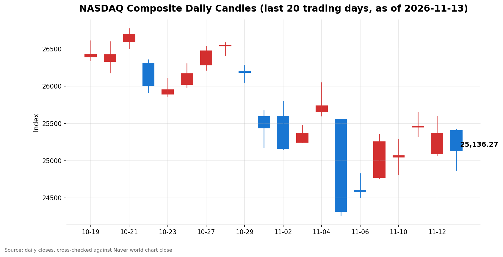

안녕하세요, [한국투자증권](https://securities.koreainvestment.com/main/Main.jsp)에서 [한투-한국투자증권](https://play.google.com/store/apps/details?id=com.truefriend.neosmartarenewal&hl=ko) 개발을 담당하고 있는 way입니다. 
2026년 11월 13일 나스닥 장 마감 흐름을 수치 중심으로 정리합니다. 

## 마감 요약

나스닥 종합은 25,136.27로 전일 종가보다 229.82포인트, 0.91% 내렸습니다. 
장중 저가 24,872.41까지 밀린 뒤 되돌렸지만, 하락으로 마감했습니다. 
스탠더드앤드푸어스 500 지수는 0.40% 내렸고, 다우존스 산업평균지수는 0.10% 오르며 혼조로 마감했습니다. 
하락이 기술주와 인공지능 체인에 집중된 장이었습니다. 
이날의 촉매는 10월 생산자물가의 4년 최고치와 엔비디아 사임 여파의 지속, 국채수익률 상승입니다. 

## 오늘의 마감 스냅샷

| 지수 | 종가 | 전일 대비 | 등락률 | 전일 종가 | 당일 고가 | 당일 저가 | 스냅샷 기준 시각 |
| --- | --- | --- | --- | --- | --- | --- | --- |
| 나스닥 종합 | 25,136.27 | -229.82 | -0.91% | 25,366.09 | 25,423.09 | 24,872.41 | 미국 동부시간 2026-11-13 16:25, 한국시간 2026-11-14 06:25 |
| 스탠더드앤드푸어스 500 | 7,561.67 | -30.73 | -0.40% | 7,592.40 | 7,601.30 | 7,510.34 | 미국 동부시간 2026-11-13 16:20 전후, 한국시간 2026-11-14 06:20 전후 |
| 다우존스 산업평균지수 | 52,347.55 | +50.46 | +0.10% | 52,297.09 | 확인 필요 | 확인 필요 | 미국 동부시간 2026-11-13 16:25 전후, 한국시간 2026-11-14 06:25 전후 |

나스닥 종합의 시가는 25,408.00이었습니다. 
전일 종가와 비교하면 시가 기준으로는 0.17% 상승 출발했습니다. 
시가 대비 종가는 271.73포인트 내렸고, 갭업 출발분을 모두 반납한 뒤 하락이 이어졌습니다. 
장중 저가는 24,872.41로 전일 대비 1.95% 하락 수준이었습니다. 
종가는 장중 저가보다 263.86포인트 높고, 저가 대비 1.06% 되돌린 상태입니다. 
장중 고가는 25,423.09로 시가와 비슷한 수준이었습니다. 
장중 흐름을 보면, 미국 동부시간 12시 58분 기준 25,063.94까지 내렸다가 마감까지 72.33포인트 되돌렸습니다. 
나스닥 종합 값은 네이버 월드 차트 페이지에서 직접 확인했습니다. 
한국투자증권 MTS 해외 대시보드 기준 나스닥 종합은 25,136.27로, 네이버 값과 정확히 일치했습니다. 
스탠더드앤드푸어스 500 지수 값은 한국투자증권 MTS 해외 대시보드에서 확인했습니다. 
스탠더드앤드푸어스 500 지수의 당일 고가와 저가는 한국투자증권 MTS 시계열의 최대값과 최소값으로 산출했습니다. 
한국투자증권 MTS 시계열은 표본 수가 적어, 실제 당일 고가와 저가보다 좁게 나타날 수 있습니다. 
다우존스 산업평균지수 값은 네이버 월드 차트 페이지 하단 시장지표에서 확인했습니다. 
다우존스 산업평균지수의 당일 고가와 저가는 이번 마감 시점에 확인하지 못했습니다. 
나스닥 선물은 한국투자증권 MTS 기준 27,941.75로 전일 대비 1.56% 내렸습니다. 
원·달러 환율은 한국투자증권 MTS 기준 1,337.60원으로, 전일 종가 1,335.50원보다 2.10원 올랐습니다. 
나스닥 종합 거래량은 1,429,046천주였습니다. 
참고로 [네이버 월드 차트 나스닥 종합](https://finance.naver.com/world/sise.naver?symbol=NAS@IXIC)과 [네이버 월드 차트 나스닥 종합 가격](https://stock.naver.com/worldstock/index/.IXIC/price) 링크를 함께 둡니다. 

## 차트

최근 20거래일 일봉 차트입니다. 
빨간 봉은 종가가 시가보다 높은 날, 파란 봉은 종가가 시가보다 낮은 날입니다. 

## 원인·촉매 분석

표면적으로는 나스닥이 0.91% 내렸습니다. 
근본 촉매는 세 갈래로 겹쳐 있습니다. 
첫째는 물가 지표의 재가속 우려입니다. 
미국 10월 생산자물가지수는 전월 대비 0.3% 올랐고, 전년 대비 6.5% 올랐습니다. 
전년 대비 상승률은 시장 예상 6.6%를 소폭 밑돌았지만, 2022년 11월 이후 약 4년 만에 가장 높은 수준입니다. 
9월 상승률 6.3%보다도 높아졌습니다. 
근원 생산자물가지수는 전월 대비 0.3%, 전년 대비 5.0% 올라 시장 예상에 부합했습니다. 
세부 항목을 보면 상품 물가가 전년 대비 10.2% 급등해 2022년 10월 이후 최대 상승폭을 기록했습니다. 
중간 가공재 가격도 전년 대비 14.6% 올라 2022년 7월 이후 최대 상승률입니다. 
식품 가격은 전월 대비 1.3% 올라 지난 2월 이후 최대 상승폭이었습니다. 
에너지 가격은 9월 10.0% 상승에서 10월 0.1% 하락으로 돌아섰습니다. 
전망치를 밑돌았다는 점보다, 전년 대비 상승률의 절대 수준이 4년 최고치라는 점이 금리 경로에 부담으로 작용합니다. 
둘째는 인공지능 체인의 거버넌스 충격이 이어지고 있다는 점입니다. 
엔비디아는 11월 12일 젠슨 황 최고경영자의 사임을 발표했고, 주가는 장 초반 14% 넘게 급락했습니다. 
13일에도 엔비디아는 2.01% 하락 마감했습니다. 
사임 발표 이후 이틀 동안 인공지능 체인 전반으로 불확실성이 번졌습니다. 
셋째는 금리 인상 경계의 재가격입니다. 
미국 국채 2년물 금리는 11월 12일 4.862%를 기록했습니다. 
최근 4거래일 동안 38.8bp 올랐고, 4거래일 기준 상승폭은 4년 5개월 만에 가장 큽니다. 
미국 10년물 국채수익률은 이날 장중 5.162%까지 올랐습니다. 
11월 12일 종가 5.103%보다 높고, 11월 10일 종가 4.983%보다 17.9bp 높은 수준입니다. 
주간 기준으로도 10년물 금리는 전주 금요일 4.86%에서 5.13%로 0.27%포인트 올랐습니다. 
존 윌리엄스 뉴욕 연방준비은행 총재는 인플레이션을 목표치인 2%로 낮추기 위해 추가 금리인상이 필요하다는 입장을 밝혔습니다. 
크리스토퍼 월러 연방준비제도 이사는 12월 회의에서 0.5%포인트 금리 인상 가능성을 시사한 바 있습니다. 
10월 소비자물가지수가 전월 대비 0.4% 오르고 근원 지수가 3개월 연속 0.3% 오른 데 이어, 생산자물가까지 높은 수준을 확인하면서 금리 부담이 커졌습니다. 
지수 간 방향 차이도 뚜렷합니다. 
나스닥이 0.91% 내리는 동안 스탠더드앤드푸어스 500 지수는 0.40% 내렸고, 다우는 0.10% 올랐습니다. 
기술주 비중이 낮은 다우가 선방한 것은, 하락이 인공지능 체인과 성장주 밸류에이션에 집중됐다는 뜻입니다. 
전일 흐름과 이어서 보면, 나스닥은 11월 11일 종가 25,466.19에서 이틀 동안 1.30% 내렸습니다. 
11월 12일에는 100.10포인트, 0.39% 내린 바 있습니다. 

## 핵심 사건 3가지

첫 번째 사건은 엔비디아 최고경영자 사임 여파의 확산입니다. 
젠슨 황 최고경영자는 11월 12일 사임을 발표했습니다. 
발표 당일 엔비디아 주가는 장 초반 14% 넘게 급락했습니다. 
13일에도 2.01% 하락 마감하며 내림세가 이어졌습니다. 
충격은 엔비디아에만 머물지 않았습니다. 
어드밴스트 마이크로 디바이시스(AMD)는 10.45% 내렸고, 브로드컴은 6.7% 내렸습니다. 
마이크론은 5.6% 내렸고, 코어위브는 10.8%, 네비우스는 12.1% 내렸습니다. 
필라델피아 반도체지수는 장중 6% 가까이 내렸습니다. 
나스닥100 지수도 장중 2% 넘게 내렸습니다. 
중요한 점은 방향이 하루 만에 뒤집혔다는 것입니다. 
11월 12일에는 AMD가 5.9%, 브로드컴이 5.5% 오르며 엔비디아의 빈자리를 메울 것이라는 기대가 반영됐습니다. 
13일에는 그 상승분을 모두 반납하고 더 내렸습니다. 
이는 거버넌스 충격이 개별 종목 문제가 아니라 인공지능 체인 전체의 밸류에이션 재평가로 번지고 있음을 보여줍니다. 
다음 단서는 11월 17일 화요일로 예정된 엔비디아 실적 발표입니다. 
앤트로픽의 상장 데뷔도 다음 주에 예정돼 있으며, 청약 수요가 약 6배 몰린 것으로 알려졌습니다. 
두 번째 사건은 10월 생산자물가의 4년 최고치입니다. 
전월 대비 상승률은 0.3%로 시장 예상을 밑돌았고, 장 초반에는 상승 출발했습니다. 
그러나 전년 대비 6.5%라는 절대 수준이 부각되면서 분위기가 바뀌었습니다. 
상품 물가와 중간 가공재 가격이 2022년 이후 최대 상승률을 기록한 점은, 물가 압력이 상류 단계에서 다시 커지고 있음을 뜻합니다. 
이는 연준의 금리 경로에 대한 부담으로 직결됩니다. 
10월 소비자물가도 전월 대비 0.4% 오르며 예상을 웃돈 바 있습니다. 
소비자물가와 생산자물가가 연달아 높은 수준을 확인하면서, 금리 인하 기대는 후퇴하고 인상 경계가 커졌습니다. 
세 번째 사건은 국채수익률 5%대의 고착과 12월 빅스텝 가능성입니다. 
10년물 국채수익률은 장중 5.162%까지 올랐고, 주간 기준으로도 0.27%포인트 올랐습니다. 
2년물 금리는 4거래일 만에 38.8bp 오르며 단기 금리 기대가 빠르게 되돌려졌습니다. 
시카고 상품거래소 금리 선물시장에서는 12월 연방공개시장위원회에서 50bp 금리 인상 전망이 9.1% 반영됐습니다. 
금리 동결 전망은 사라진 상태입니다. 
금리가 오르면 성장주의 미래 현금흐름 할인 부담이 커집니다. 
이날 기술주가 가장 크게 내린 것은 금리 경로 재가격과 직접 연결돼 있습니다. 
이 밖에 마이크로소프트는 글로벌 서비스 장애 여파로 0.4% 내렸습니다. 
브렌트유는 95달러에서 96달러 사이에서 움직였고, 비트코인은 7만 달러 아래로 움직였습니다. 

## 지수·섹터 영향 체인

하락의 중심은 기술과 반도체였습니다. 
기술 섹터 상장지수펀드는 장중 집계 기준 2.7% 내렸고, 반도체 상장지수펀드는 4.1% 내렸습니다. 
반도체는 엔비디아 사임이라는 직접 충격과 금리 상승이라는 간접 충격이 겹친 지점입니다. 
인공지능 체인에서는 네오클라우드가 가장 크게 흔들렸습니다. 
코어위브와 네비우스는 엔비디아 칩을 사서 빌려주는 사업 구조라, 엔비디아의 거버넌스 불확실성이 곧 사업 리스크로 연결됩니다. 
하이퍼스케일러도 대부분 내렸습니다. 
메타만 1.3% 올랐고, 오라클과 알파벳, 아마존, 마이크로소프트는 0.1%에서 3.6% 사이로 내렸습니다. 
금리 경로는 성장주 밸류에이션으로 이어집니다. 
10년물 수익률이 5%대를 유지하면 미래 이익의 현재가치가 낮아지고, 기술주의 하락 압력이 커집니다. 
반대로 다우가 0.10% 오른 것은 자금이 기술주에서 가치주와 방어주로 옮겨가고 있음을 보여줍니다. 
에너지 쪽은 상대적으로 버텼습니다. 
전일에는 엑손모빌이 1.8%, 매라톤 페트롤리엄이 2.5% 올랐고, 브렌트유가 95달러대를 유지하고 있습니다. 
유가 상승이 에너지 물가를 자극한다는 점은 물가 경로와도 연결됩니다. 
금융 쪽에서는 일부 종목이 강세를 보였습니다. 
누 홀딩스는 10.95% 올랐고, 모딘 매뉴팩처링은 삼성전자의 인수 검토 보도에 29.51% 급등했습니다. 
다만 이는 지수 전체 흐름을 바꾸지는 못했습니다. 
코스피도 같은 충격에 반응했습니다. 
코스피는 13일 0.98% 내린 5,290.53에 마감했습니다. 
장 초반 2.05% 오른 5,452.41에 출발해 장중 5,500선을 회복했지만, 오후 들어 하락 전환했습니다. 
젠슨 황 사임 여파가 국내 증시에도 번진 하루였습니다. 

## 다우·스탠더드앤드푸어스 500 마감 흐름

다우존스 산업평균지수는 52,347.55로 50.46포인트, 0.10% 올랐습니다. 
전일 종가는 52,297.09였습니다. 
장중에는 0.16% 내리는 수준까지 밀렸으나, 마감까지 되돌려 상승으로 돌아섰습니다. 
스탠더드앤드푸어스 500 지수는 7,561.67로 30.73포인트, 0.40% 내렸습니다. 
전일 종가는 7,592.40이었습니다. 
장중에는 0.69% 내리는 수준까지 밀렸으나, 마감까지 낙폭을 줄였습니다. 
세 지수의 낙폭 순서는 나스닥이 가장 크고, 스탠더드앤드푸어스 500 지수가 그다음이며, 다우가 유일하게 올랐습니다. 
이는 이날 하락이 지수 전반의 매도가 아니라 기술주와 인공지능 체인에 집중된 매도였음을 보여줍니다. 
다우의 상승 전환은 자금이 성장주에서 가치주로 이동하는 로테이션 흐름과 맞닿아 있습니다. 

## 단기·중기 전망과 다음 거래일 확인할 시나리오

단기적으로는 엔비디아 사임 여파가 이어질지, 아니면 실적 발표를 앞두고 진정될지가 갈림길입니다. 
11월 17일 화요일 엔비디아 실적 발표가 가장 큰 분기점입니다. 
실적 발표 전에는 불확실성이 유지될 가능성이 큽니다. 
앤트로픽 상장 데뷔도 다음 주 인공지능 투자심리를 가늠하는 단서가 됩니다. 
다음 거래일에 확인할 첫 번째 수치는 나스닥 장중 저가 24,872.41입니다. 
이 가격대를 다시 밑돌면 하락이 이어지는 흐름으로 볼 수 있습니다. 
반대로 전일 종가 25,366.09를 되찾으면 단기 되돌림 흐름으로 볼 수 있습니다. 
스탠더드앤드푸어스 500 지수는 전일 종가 7,592.40 회복 여부와 장중 저가 7,510.34 방어 여부를 함께 확인해야 합니다. 
두 번째로 확인할 것은 10년물 국채수익률입니다. 
5%대 초반에서 더 오르면 성장주 부담이 커지고, 5% 아래로 내려오면 부담이 덜어집니다. 
마감 종가는 확인이 필요해, 다음 거래일 장 초반 수치를 확인해야 합니다. 
12월 연방공개시장위원회에서 50bp 인상 전망이 반영되는 정도도 함께 확인해야 합니다. 
세 번째로 확인할 것은 반도체지수의 방향입니다. 
13일 장중 6% 가까이 내린 반도체지수가 다음 거래일에 되돌리는지, 아니면 낙폭을 이어가는지가 인공지능 체인의 바닥 여부를 가늠합니다. 
중기적으로는 물가 경로가 관건입니다. 
생산자물가 전년 대비 상승률이 6.5%로 4년 최고치에 오른 만큼, 다음 물가 지표가 꺾이는지 확인해야 합니다. 
물가 상승률이 꺾이지 않으면 금리 인상 경계가 이어지고, 기술주 밸류에이션 부담도 이어집니다. 
반대로 물가가 꺾이면 금리 부담이 덜어지며 기술주 되돌림 여지가 생깁니다. 
지수 단위에서 보면, 나스닥은 이틀 동안 1.30% 내리며 단기 조정 국면에 들어섰습니다. 
조정이 일시적 노이즈인지, 추세 전환의 시작인지는 다음 주 실적 발표와 물가 지표를 확인한 뒤에 판단해야 합니다. 
리스크 관리 관점에서는 지수 단위 흐름과 금리 수준을 함께 보는 것이 중요합니다. 
특정 종목에 대한 판단은 이 글의 범위를 벗어납니다. 

## 마치며

나스닥은 엔비디아 충격과 물가·금리 부담이 겹치며 0.91% 하락 마감했습니다. 
다음 거래일에는 저가 방어 여부와 국채수익률, 그리고 11월 17일 엔비디아 실적 발표를 향한 흐름을 확인해야 합니다. 
이 글은 교육과 해설을 위한 시황 정리이며, 매수나 매도를 권유하는 글이 아닙니다. 
