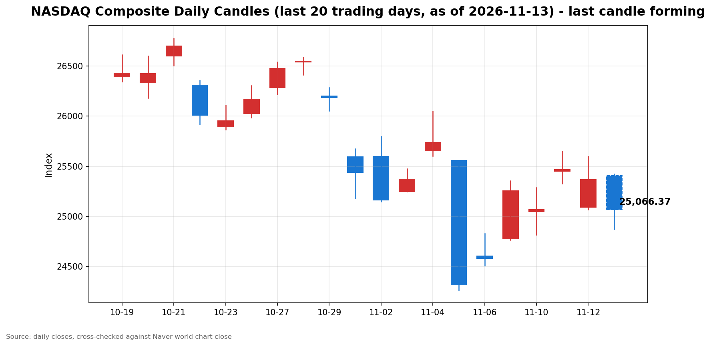

안녕하세요, [한국투자증권](https://securities.koreainvestment.com/main/Main.jsp)에서 [한투-한국투자증권](https://play.google.com/store/apps/details?id=com.truefriend.neosmartarenewal&hl=ko) 개발을 담당하고 있는 way입니다. 
2026년 11월 13일 나스닥 장중 흐름을 수치 중심으로 정리합니다. 

## 장중 요약

나스닥 종합은 미국 동부시간 12시 58분 기준 25,063.94로 전일 종가보다 302.16포인트, 1.19% 내렸습니다. 
시가 25,408.00으로 0.17% 상승 출발했으나, 장 초반 하락으로 돌아선 뒤 장중 저가 24,872.41까지 밀렸습니다. 
스탠더드앤드푸어스 500 지수는 0.69% 내렸고, 다우존스 산업평균지수는 0.16% 내리는 데 그쳤습니다. 
하락이 기술주와 인공지능 체인에 집중된 장중 흐름입니다. 
이날의 촉매는 10월 생산자물가의 4년 최고치와 엔비디아 사임 여파의 지속, 국채수익률 상승입니다. 

## 오늘의 스냅샷

| 지수 | 현재가 | 전일 대비 | 등락률 | 전일 종가 | 장중 고가 | 장중 저가 | 스냅샷 기준 시각 |
| --- | --- | --- | --- | --- | --- | --- | --- |
| 나스닥 종합 | 25,063.94 | -302.16 | -1.19% | 25,366.09 | 25,423.09 | 24,872.41 | 미국 동부시간 2026-11-13 12:58, 한국시간 2026-11-14 02:58 |
| 스탠더드앤드푸어스 500 | 7,539.78 | -52.62 | -0.69% | 7,592.40 | 7,601.30 | 7,510.34 | 미국 동부시간 2026-11-13 12:55 전후, 한국시간 2026-11-14 02:55 전후 |
| 다우존스 산업평균지수 | 52,212.97 | -84.12 | -0.16% | 52,297.09 | 52,521.48 | 52,017.86 | 미국 동부시간 2026-11-13 13:05 전후, 한국시간 2026-11-14 03:05 전후 |

당일 수치는 형성 중인 수치로, 마감 전에는 계속 변합니다. 
나스닥 종합의 시가는 25,408.00이었습니다. 
전일 종가와 비교하면 시가 기준으로는 0.17% 상승 출발했습니다. 
장중 고가는 25,423.09로 시가와 비슷한 수준이었고, 장중 저가는 24,872.41로 전일 대비 1.95% 하락 수준이었습니다. 
현재가는 장중 저가보다 191.53포인트 높고, 저가 대비 0.77% 되돌린 상태입니다. 
시가 대비 현재가는 344.06포인트 내렸고, 갭업 출발분을 모두 반납한 뒤 하락이 이어지고 있습니다. 
전일 장중 저가 25,068.28과 비교하면, 현재가는 전일 저가를 4.34포인트 밑돌고 있습니다. 
나스닥 종합 값은 네이버 월드 차트 페이지에서 직접 확인했습니다. 
한국투자증권 MTS 해외 대시보드 기준 나스닥 종합은 25,065.49로, 네이버 값과 0.01% 이내에서 일치했습니다. 
스탠더드앤드푸어스 500 지수 값은 한국투자증권 MTS 해외 대시보드에서 확인했습니다. 
스탠더드앤드푸어스 500 지수의 장중 고가와 저가는 한국투자증권 MTS 시계열의 최대값과 최소값으로 산출했습니다. 
한국투자증권 MTS 시계열은 표본 수가 적어, 실제 장중 고가와 저가보다 좁게 나타날 수 있습니다. 
다우존스 산업평균지수 값은 야후 파이낸스 시세에서 확인했습니다. 
다우존스 산업평균지수의 장중 고가와 저가는 야후 파이낸스 당일 고가와 저가로 확인했습니다. 
나스닥 선물은 한국투자증권 MTS 기준 27,914.25로 전일 대비 1.66% 내렸습니다. 
원·달러 환율은 한국투자증권 MTS 기준 1,337.60원으로, 전일 종가 1,335.50원보다 2.10원 올랐습니다. 
참고로 [네이버 월드 차트 나스닥 종합](https://finance.naver.com/world/sise.naver?symbol=NAS@IXIC)과 [네이버 월드 차트 나스닥 종합 가격](https://stock.naver.com/worldstock/index/.IXIC/price) 링크를 함께 둡니다. 

## 차트

최근 20거래일 일봉 차트입니다. 
빨간 봉은 종가가 시가보다 높은 날, 파란 봉은 종가가 시가보다 낮은 날입니다. 
당일 봉은 형성 중인 봉으로, 마감 전에는 계속 변합니다. 

## 원인·촉매 분석

표면적으로는 나스닥이 장중 1.19% 내리고 있습니다. 
근본 촉매는 세 갈래로 겹쳐 있습니다. 
첫째는 물가 지표의 재가속 우려입니다. 
미국 10월 생산자물가지수는 전월 대비 0.3% 올랐고, 전년 대비 6.5% 올랐습니다. 
전년 대비 상승률은 시장 예상 6.6%를 소폭 밑돌았지만, 2022년 11월 이후 약 4년 만에 가장 높은 수준입니다. 
9월 상승률 6.3%보다도 높아졌습니다. 
근원 생산자물가지수는 전월 대비 0.3%, 전년 대비 5.0% 올라 시장 예상에 부합했습니다. 
세부 항목을 보면 상품 물가가 전년 대비 10.2% 급등해 2022년 10월 이후 최대 상승폭을 기록했습니다. 
중간 가공재 가격도 전년 대비 14.6% 올라 2022년 7월 이후 최대 상승률입니다. 
식품 가격은 전월 대비 1.3% 올라 지난 2월 이후 최대 상승폭이었습니다. 
에너지 가격은 9월 10.0% 상승에서 10월 0.1% 하락으로 돌아섰습니다. 
전망치를 밑돌았다는 점보다, 전년 대비 상승률의 절대 수준이 4년 최고치라는 점이 금리 경로에 부담으로 작용합니다. 
둘째는 인공지능 체인의 거버넌스 충격이 이어지고 있다는 점입니다. 
엔비디아는 11월 12일 젠슨 황 최고경영자의 사임을 발표했고, 주가는 장중 14% 넘게 급락했습니다. 
13일 장중에도 엔비디아는 160.87달러로 전일 종가보다 3.20% 내리고 있습니다. 
필라델피아 반도체지수는 10,013.29로 전일 대비 4.70% 내리고 있습니다. 
11월 11일 반도체지수가 5.7% 올랐던 흐름이 이틀 만에 반대 방향으로 크게 흔들리고 있습니다. 
셋째는 금리 인상 경계의 재가격입니다. 
미국 국채 2년물 금리는 11월 12일 4.862%를 기록했습니다. 
최근 4거래일 동안 38.8bp 올랐고, 4거래일 기준 상승폭은 4년 5개월 만에 가장 큽니다. 
미국 10년물 국채수익률은 이날 장 초반 5.162%까지 올랐습니다. 
11월 12일 종가 5.103%보다 높고, 11월 10일 종가 4.983%보다 17.9bp 높은 수준입니다. 
존 윌리엄스 뉴욕 연방준비은행 총재는 인플레이션을 목표치인 2%로 낮추기 위해 추가 금리인상이 필요하다는 입장을 밝혔습니다. 
크리스토퍼 월러 연방준비제도 이사는 12월 회의에서 0.5%포인트 금리 인상 가능성을 시사한 바 있습니다. 
10월 소비자물가지수가 전월 대비 0.4% 오르고 근원 지수가 3개월 연속 0.3% 오른 데 이어, 생산자물가까지 높은 수준을 확인하면서 금리 부담이 커졌습니다. 
지수 간 방향 차이도 뚜렷합니다. 
나스닥이 1.19% 내리는 동안 스탠더드앤드푸어스 500 지수는 0.69% 내렸고, 다우는 0.16% 내리는 데 그쳤습니다. 
하락이 기술주와 인공지능 체인에 집중되고, 경기민감주와 가치주 쪽은 상대적으로 버티고 있음을 보여줍니다. 
셧다운 종료도 이날의 배경입니다. 
미국 하원은 11월 12일 저녁 찬성 222표, 반대 209표로 연방정부 임시예산안을 가결했습니다. 
도널드 트럼프 대통령은 같은 날 오후 9시 45분경 서명해 43일간의 셧다운을 종료했습니다. 
지연됐던 경제지표 발표가 재개되면서, 이날 생산자물가지수가 발표됐습니다. 
지표 공백이 해소되는 만큼, 연준의 금리 판단 재료가 다시 쌓이는 국면입니다. 
유가도 이날의 변수입니다. 
서부텍사스산원유는 장 초반 89.47달러까지 올랐으나, 장중 88.54달러로 전일 종가보다 0.23% 내린 상태입니다. 
에너지 가격 상승 압력은 장중 들어 누그러졌습니다. 
다만 상품 생산자물가가 전년 대비 10.2% 오른 점은, 원가 압력이 물가 지표에 이미 반영되고 있음을 보여줍니다. 

## 핵심 사건 3가지

### 첫째, 10월 생산자물가지수 전년 대비 6.5% 상승입니다

미국 노동부 노동통계국은 11월 13일 오전 8시 30분 미국 동부시간에 10월 생산자물가지수를 발표했습니다. 
전월 대비 0.3% 상승했고, 전년 대비 6.5% 올랐습니다. 
시장 예상치 6.6%를 소폭 밑돌았지만, 9월 상승률 6.3%보다 높아졌습니다. 
2022년 11월 7.4% 이후 약 4년 만에 가장 높은 전년 대비 상승률입니다. 
근원 생산자물가지수는 전월 대비 0.3%, 전년 대비 5.0% 올라 시장 예상에 부합했습니다. 
상품 물가는 전년 대비 10.2% 급등했고, 중간 가공재 가격은 전년 대비 14.6% 올랐습니다. 
식품 가격은 전월 대비 1.3% 올랐고, 에너지 가격은 0.1% 내렸습니다. 
이 사건이 중요한 이유는 한 주 안에 끈적한 물가 지표가 두 번 확인됐기 때문입니다. 
10월 소비자물가지수도 전월 대비 0.4% 올랐고, 근원 지수는 3개월 연속 0.3% 상승했습니다. 
물가 재가속이라기보다는, 물가 둔화가 정체된 흐름이 이어지고 있다는 해석이 나옵니다. 
로이터는 생산자물가 발표 뒤 연준 기준금리 추가인상에 힘이 실렸다고 전했습니다. 
시장 심리에 미치는 충격은 수치 자체보다 금리 경로에 대한 불확실성입니다. 
12월 연방공개시장위원회까지 남은 물가 지표와 연준 위원들의 발언이 방향을 가를 변수입니다. 

### 둘째, 젠슨 황 사임 여파의 지속입니다

엔비디아는 11월 12일 젠슨 황 최고경영자의 사임을 발표했습니다. 
사임은 대표이사, 사장, 이사회 구성원 자리에서 모두 즉시 효력이 발생합니다. 
콜레트 크레스 최고재무책임자가 임시 최고경영자를 맡고, 이사회는 내외부 후보를 대상으로 후임자 물색에 들어갔습니다. 
발표 당일 엔비디아 주가는 151.01달러로 개장해 장중 148.80달러까지 밀렸다가 166.19달러로 마감했습니다. 
전일 종가 173.73달러 대비 4.34% 하락했고, 장중 저가 기준 하락률은 14.35%였습니다. 
시가총액은 4조 달러 선이 무너졌고, 주말 이후 시가총액 감소 규모는 약 4,500억 달러 수준으로 보도됐습니다. 
13일 장중 엔비디아는 160.87달러로 전일 종가보다 3.20% 내리고 있고, 장중 저가는 158.39달러입니다. 
사임 충격이 하루 만에 진정되지 않고, 장중 저가를 새로 만들며 이어지고 있습니다. 
블룸버그에 따르면 엔비디아가 발표했거나 논의 중인 주요 인공지능 거래는 7,500억 달러를 웃돕니다. 
신용등급이 낮은 오픈AI 대신 엔비디아가 건물의 빚을 보증해 자금 조달을 돕는 방식도 거론됩니다. 
이 사건이 중요한 이유는 인공지능 사이클의 상징인 기업에서 경영진 거버넌스 리스크가 불거졌기 때문입니다. 
실적이나 수요가 아니라 인물과 지배구조라는 변수가 지수를 움직이는 국면입니다. 
엔비디아 이사회는 사업과 제품 로드맵이 차질 없이 이어질 것이라고 밝혔습니다. 
삼성증권 분석에 따르면 인공지능 반도체 루빈에 필요한 공급망과 2028년까지의 신제품 출시 계획은 이미 갖춰져 있습니다. 
중앙일보 GMC 허브의 11월 13일 기사 목록에서도 젠슨 황 사임 관련 기사가 여러 건 올라와 있어, 이날 시장의 화두였음이 확인됩니다. 
다만 후임자 선임까지의 공백과 의회 청문회 요구 등 불확실성은 남아 있습니다. 
11월 18일 예정된 엔비디아 회사 행사에서 나오는 메시지가 다음 관전 지점입니다. 

### 셋째, 국채수익률 급등과 연준 매파 재가격입니다

미국 국채 2년물 금리는 11월 12일 4.862%를 기록했습니다. 
최근 4거래일 동안 38.8bp 올랐고, 4거래일 기준 상승폭은 4년 5개월 만에 가장 큽니다. 
미국 10년물 국채수익률은 이날 장 초반 5.162%까지 올랐습니다. 
중앙일보 GMC 허브의 11월 13일 G브닝 제목도 미국 국채금리 5% 돌파를 다루고 있어, 금리 부담이 이날 시장의 화두였음이 확인됩니다. 
해당 기사 본문은 로그인 없이 읽혔으며, 소비자물가지수와 생산자물가지수, 엔비디아 회사채 스프레드, 앤트로픽 기업공개, 유가를 다루고 있습니다. 
이 사건이 중요한 이유는 금리 경로가 성장주 밸류에이션에 직접 작용하기 때문입니다. 
금리가 오르면 미래 현금흐름의 현재가치가 낮아져, 성장주의 밸류에이션 부담이 커지는 것이 일반적입니다. 
미국 중간선거 이후 나온 10월 물가와 고용 지표가 예상보다 높게 나온 데다, 월러 이사의 12월 빅스텝 시사가 겹치면서 금리 급등에 탄력이 붙었습니다. 
윌리엄스 총재의 추가 인상 발언도 같은 방향입니다. 
다만 10월 생산자물가지수가 시장 예상치를 소폭 밑돌았다는 점은, 공격적 긴축 우려를 일부 완화하는 요인으로 해석됩니다. 
금리 인상 기대가 유지되는 한 성장주 중심의 나스닥에는 부담이 이어질 수 있습니다. 
12월 연방공개시장위원회까지 남은 물가 지표와 연준 위원들의 발언이 방향을 가를 변수입니다. 

## 지수·섹터 영향 체인

금리 인상 경계는 성장주 밸류에이션을 통해 기술주에 가장 먼저 작용하는 것이 일반적입니다. 
그런데 이날 하락의 직접적인 계기는 금리가 아니라 인공지능 체인 내부의 거버넌스 소식입니다. 
반도체와 인공지능 인프라 체인에는 엔비디아 사임 소식이 직접적인 심리 변수로 작용합니다. 
필라델피아 반도체지수가 4.70% 내리고, 엔비디아가 3.20% 내리는 점이 체인 내부의 충격을 보여줍니다. 
11월 11일 반도체지수가 5.7% 올랐던 것과 같은 체인이 이틀 연속 반대 방향으로 흔들리고 있습니다. 
실적 서프라이즈로 오른 체인이 거버넌스 악재로 눌리는 모습이라, 체인 내부의 변동성이 커진 상태입니다. 
반면 앤트로픽 기업공개에 대한 투자 열기는 높은 수준으로 전해집니다. 
엔비디아 투자심리가 악화된 상황과 대조를 이루고 있습니다. 
인공지능 수요 자체보다, 수요를 떠받치는 구조와 주체에 대한 선별이 심해지는 모습입니다. 
위험자산 전반으로 충격이 번지는 모습도 나타납니다. 
비트코인은 장 초반 68,784.98달러로 7만 달러 선을 내줬습니다. 
전일 종가 71,342.97달러 대비 3.6% 하락했고, 가상자산 시가총액은 하루 만에 1,300억 달러 넘게 줄었습니다. 
레버리지 롱 포지션 10억 달러 이상의 강제 청산이 이어졌다는 보도도 있습니다. 
다우가 0.16% 내리는 데 그친 점은 하락이 시장 전반으로 확산되지 않았음을 보여줍니다. 
다우는 경기민감주와 금융, 산업재 비중이 높아, 인공지능 체인 악재에 직접 노출되는 정도가 낮습니다. 
스탠더드앤드푸어스 500 지수가 0.69% 내린 것은 기술주 하락이 지수 전반을 끌어내리고 있으나, 다우 쪽의 상대적 선방이 상쇄하고 있음을 보여줍니다. 
금융 섹터는 금리 인상 기대가 순이자마진에는 우호적일 수 있으나, 경기 둔화 우려와 맞물려 방향이 엇갈릴 수 있습니다. 
에너지 섹터는 유가 상승이 직접적인 수혜 요인입니다. 
다만 서부텍사스산원유가 장중 88.54달러로 돌아선 점은, 에너지 쪽의 상대적 강세가 장 초반보다 약해졌음을 보여줍니다. 
한국 시장에서도 같은 체인이 흔들렸습니다. 
SK하이닉스는 13일 장 초반 상승분을 반납하고 3.03% 내린 121만 6,000원에 마감했습니다. 
삼성전자도 함께 내렸고, 외국인은 이날 SK하이닉스를 4,714억 원 순매도했습니다. 
코스피 시장에서는 외국인이 5,475억 원을 순매도했습니다. 
결국 이날의 차별화는 금리 경로라는 공통 변수 위에 인공지능 체인 고유의 변수가 얹힌 결과입니다. 

## 다우·S&P500 흐름

다우존스 산업평균지수는 52,212.97로 전일 대비 84.12포인트, 0.16% 내렸습니다. 
전일 종가는 52,297.09였습니다. 
장중 고가는 52,521.48로 전일 종가를 웃돌았고, 장중 저가는 52,017.86였습니다. 
스탠더드앤드푸어스 500 지수는 7,539.78로 전일 대비 52.62포인트, 0.69% 내렸습니다. 
전일 종가는 7,592.40였습니다. 
세 지수의 방향이 다르다는 점은 이날 하락이 인공지능 체인에 집중된 하락임을 보여줍니다. 
다우의 장중 고가가 전일 종가를 웃돈 점은 가치주 쪽의 저가 매수세가 버티고 있음을 시사합니다. 
스탠더드앤드푸어스 500 지수가 7,600선을 밑도는지도 함께 확인할 필요가 있습니다. 

## 오전과 오후 흐름 변화

나스닥은 시가 25,408.00으로 0.17% 상승 출발했습니다. 
장 초반 고가 25,423.09를 찍은 뒤 하락으로 돌아섰습니다. 
10시 기준 나스닥은 25,159.40으로 전일 대비 0.82% 내린 상태였습니다. 
장중 저가는 24,872.41까지 밀렸고, 현재가는 25,063.94로 저가 대비 0.77% 되돌린 상태입니다. 
오전에는 갭업 출발 뒤 하락 전환이 나타났고, 오후 들어서는 저가에서 일부 되돌리는 흐름이 이어지고 있습니다. 
되돌림이 추세 전환인지는 아직 확인되지 않았습니다. 
스탠더드앤드푸어스 500 지수는 10시 3분 기준 7,544.47로 0.63% 내린 상태였고, 현재는 7,539.78로 비슷한 수준을 유지하고 있습니다. 
다우는 10시 기준 52,331.69로 0.07% 오른 상태였으나, 현재는 52,212.97로 하락 전환했습니다. 
엔비디아는 장 초반 저가 161.87달러에서 출발해, 장중 160.87달러로 밀리며 저가를 새로 만들었습니다. 
장중 저가 158.39달러는 전일 종가보다 4.69% 낮은 수준입니다. 
다만 11월 12일 장중 저가 148.80달러에는 아직 닿지 않았습니다. 
오전의 하락이 오후 들어 진정되는 모습이지만, 낙폭을 되돌리는 힘이 강하지는 않습니다. 

## 마감까지 전망과 확인할 시나리오

단기적으로는 저가에서의 되돌림이 이어지는지, 다시 저가를 향하는지가 갈림길입니다. 
마감까지 확인할 첫 번째 수치는 전일 종가 25,366.09 회복 여부입니다. 
현재가는 전일 종가보다 302.16포인트 낮은 상태입니다. 
두 번째로 확인할 구간은 25,000선입니다. 
현재가가 전일 장중 저가 25,068.28을 밑돌고 있어, 25,000선 테스트 가능성을 염두에 둘 필요가 있습니다. 
25,000선을 지키면 저가 매수세가 버티는 흐름으로 해석될 수 있습니다. 
25,000선을 밑돌면 낙폭 확대 시나리오가 힘을 얻을 수 있습니다. 
반대로 전일 종가를 회복하면 갭 메우기 흐름이 이어지는 시나리오가 힘을 얻습니다. 
11월 11일 장중 고가 25,649.85는 위쪽 저항 구간으로 확인할 수 있습니다. 
스탠더드앤드푸어스 500 지수는 7,600선, 다우는 52,400선 안착 여부를 확인할 필요가 있습니다. 
스탠더드앤드푸어스 500 지수의 장중 저가 7,510.34가 7,500선과 가까운 점도 유의할 필요가 있습니다. 
엔비디아 주가의 방향도 함께 확인할 사안입니다. 
장중 저가 158.39달러를 다시 향하면 체인 전반의 매도 압력이 커질 수 있고, 170달러 회복이 이어지면 충격이 진정되는 방향으로 해석될 수 있습니다. 
미국 10년물 국채수익률이 5.20%를 넘어서는지도 확인할 구간입니다. 
나스닥 선물이 1.66% 내리고 있어, 마감까지 하방 압력이 이어질 가능성을 시사합니다. 
중기적으로는 12월 연방공개시장위원회까지 물가 지표와 연준 위원들의 발언이 방향을 정합니다. 
셧다운 종료로 지연됐던 경제지표 발표가 재개되면 금리 판단 재료가 다시 쌓입니다. 
물가 상승률이 꺾이는 신호가 나오면 금리 부담이 완화되는 방향으로 해석될 수 있습니다. 
물가가 끈적하게 이어지면 금리 인상 기대가 유지되면서 변동성이 이어질 수 있습니다. 
인공지능 체인에서는 실적 모멘텀과 거버넌스 리스크가 번갈아 가격을 움직이는 국면이라, 체인 단위의 변동성에 유의할 필요가 있습니다. 
이 글은 지수와 섹터 단위의 흐름을 정리한 것으로, 특정 종목의 매수나 매도를 권유하지 않습니다. 

## 마치며

나스닥은 갭업 출발 뒤 하락으로 돌아서 장중 1.19% 내리고 있고, 10월 생산자물가 4년 최고치와 엔비디아 사임 여파가 겹친 흐름입니다. 
마감까지 25,000선 방어 여부와 엔비디아 주가 방향을 확인할 필요가 있습니다. 
이 글은 매수나 매도를 권유하지 않습니다. 
