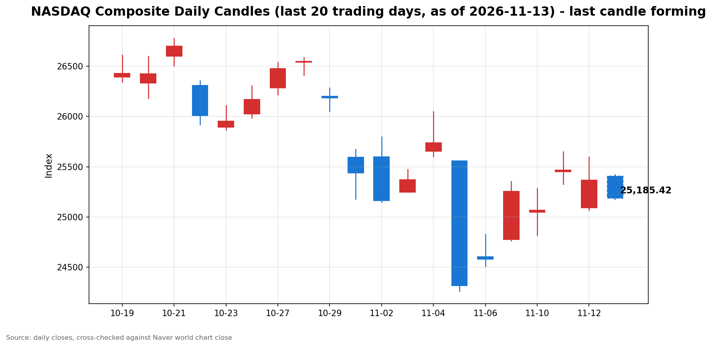

안녕하세요, [한국투자증권](https://securities.koreainvestment.com/main/Main.jsp)에서 [한투-한국투자증권](https://play.google.com/store/apps/details?id=com.truefriend.neosmartarenewal&hl=ko) 개발을 담당하고 있는 way입니다. 
2026년 11월 13일 나스닥 장 오픈 흐름을 수치 중심으로 정리합니다. 

## 개장 배경

전일인 11월 12일 미국 증시는 하락 마감했습니다. 
나스닥 종합은 25,366.09로 전 거래일 대비 0.39% 내렸습니다. 
스탠더드앤드푸어스 500 지수는 7,592.40으로 0.35% 내렸고, 다우존스 산업평균지수는 52,297.09로 0.36% 내렸습니다. 
하락의 중심에는 엔비디아의 경영진 거버넌스 충격이 있습니다. 
엔비디아는 11월 12일 젠슨 황 최고경영자(CEO)의 사임을 발표했습니다. 
사임은 즉시 효력이 발생했고, 콜레트 크레스 최고재무책임자(CFO)가 임시 최고경영자를 맡습니다. 
발표 당일 엔비디아 주가는 장중 14% 넘게 급락했다가 낙폭을 줄여 4.34% 하락으로 마감했습니다. 
11월 13일 나스닥은 전일 종가보다 41.91포인트 높은 25,408.00으로 갭업 출발했습니다. 
시가 기준 상승률은 0.17%입니다. 
그러나 개장 뒤 하락으로 돌아서 10시 기준 25,159.40까지 밀렸습니다. 
장 초반 하락률은 0.82%입니다. 

## 오늘의 스냅샷

| 지수 | 현재가 | 전일 대비 | 등락률 | 전일 종가 | 장중 고가 | 장중 저가 | 스냅샷 기준 시각 |
| --- | --- | --- | --- | --- | --- | --- | --- |
| 나스닥 종합 | 25,159.40 | -206.70 | -0.82% | 25,366.09 | 25,423.09 | 25,152.91 | 미국 동부시간 2026-11-13 10:00, 한국시간 2026-11-14 00:00 |
| 스탠더드앤드푸어스 500 | 7,544.47 | -47.93 | -0.63% | 7,592.40 | 7,601.30 | 7,544.47 | 미국 동부시간 2026-11-13 10:03, 한국시간 2026-11-14 00:03 |
| 다우존스 산업평균지수 | 52,331.69 | +34.60 | +0.07% | 52,297.09 | 52,521.48 | 52,308.92 | 미국 동부시간 2026-11-13 10:00 전후, 한국시간 2026-11-14 00:00 전후 |

당일 수치는 형성 중인 수치로, 마감 전에는 계속 변합니다. 
나스닥 종합의 시가는 25,408.00이었습니다. 
전일 종가와 비교하면 시가 기준으로는 0.17% 상승 출발했습니다. 
장중 고가는 25,423.09로 시가와 비슷한 수준이었고, 장중 저가는 25,152.91로 전일 대비 0.84% 하락 수준이었습니다. 
시가 대비 현재가는 248.60포인트 내렸고, 갭업 출발분을 모두 반납한 뒤 하락으로 돌아선 상태입니다. 
나스닥 종합 값은 네이버 월드 차트 페이지에서 직접 확인했습니다. 
스탠더드앤드푸어스 500 지수 값은 한국투자증권 MTS 해외 대시보드에서 확인했습니다. 
스탠더드앤드푸어스 500 지수의 장중 고가와 저가는 한국투자증권 MTS 시계열의 최대값과 최소값으로 산출했습니다. 
한국투자증권 MTS 시계열은 표본 수가 적어, 실제 장중 고가와 저가보다 좁게 나타날 수 있습니다. 
다우존스 산업평균지수 값은 야후 파이낸스 시세에서 확인했습니다. 
다우존스 산업평균지수의 장중 고가와 저가는 야후 파이낸스 당일 고가와 저가로 확인했습니다. 
한국투자증권 MTS 기준 나스닥 종합은 10시 3분 기준 25,109.88로, 네이버 값과 0.20% 이내에서 일치했습니다. 
한국투자증권 MTS 기준 스탠더드앤드푸어스 500 지수는 7,544.47로, 전일 종가 대비 0.63% 하락입니다. 
나스닥 선물은 한국투자증권 MTS 기준 28,160.50으로 전일 대비 0.79% 내렸습니다. 
원·달러 환율은 한국투자증권 MTS 기준 1,336.50원으로, 전일 대비 1.00원 상승했습니다. 
참고로 [네이버 월드 차트 나스닥 종합](https://finance.naver.com/world/sise.naver?symbol=NAS@IXIC)과 [네이버 월드 차트 나스닥 종합 가격](https://stock.naver.com/worldstock/index/.IXIC/price) 링크를 함께 둡니다. 

## 차트

최근 20거래일 일봉 차트입니다. 
빨간 봉은 종가가 시가보다 높은 날, 파란 봉은 종가가 시가보다 낮은 날입니다. 
당일 봉은 형성 중인 봉으로, 마감 전에는 계속 변합니다. 

## 원인·촉매 분석

표면적으로는 나스닥이 전일 대비 0.82% 하락 출발했습니다. 
근본 촉매는 거시지표가 아니라 인공지능 사이클의 상징 기업에서 터진 거버넌스 충격입니다. 
엔비디아 최고경영자의 사임이 11월 12일 발표됐고, 주가는 장중 14% 넘게 급락했습니다. 
나스닥에서 인공지능 체인의 비중이 크다 보니, 단일 기업의 경영진 소식이 지수 전체의 하락 출발로 이어졌습니다. 
그런데 이날의 하락은 어제와 성격이 다릅니다. 
어제는 갭다운 출발 뒤 낙폭을 줄이는 되돌림이 나왔습니다. 
오늘은 갭업 출발 뒤 하락으로 돌아서 낙폭을 키우는 흐름입니다. 
되돌림이 아니라 매도 압력이 장 초반에 다시 살아나는 모습입니다. 
두 번째 촉매는 금리 경로입니다. 
미국 10년물 국채수익률은 장 초반 5.162%를 기록했습니다. 
11월 12일 종가 5.103%보다 높고, 11월 10일 종가 4.983%보다 17.9bp 높은 수준입니다. 
10월 소비자물가지수 예상 상회 이후 금리 인상 경계가 굳어지면서, 수익률이 나흘 연속 오르는 흐름입니다. 
성장주 밸류에이션에는 금리가 직접적인 부담으로 작용합니다. 
지수 간 방향 차이도 뚜렷합니다. 
나스닥이 0.82% 내리는 동안 스탠더드앤드푸어스 500 지수는 0.63% 내렸고, 다우는 0.07% 올랐습니다. 
하락이 기술주와 인공지능 체인에 집중되고, 경기민감주와 가치주 쪽은 상대적으로 버티고 있음을 보여줍니다. 
다우가 장중 고가 52,521.48로 전일 종가를 웃돈 점도 같은 맥락입니다. 
유가도 이날의 변수입니다. 
서부텍사스산원유는 89.47달러로 전일 종가 88.74달러보다 0.82% 올랐습니다. 
에너지 가격 상승은 물가 압력을 더하는 방향이라, 금리 경계와 함께 성장주에 부담으로 작용할 수 있습니다. 

## 핵심 사건 3가지

### 첫째, 젠슨 황 엔비디아 최고경영자 사임입니다

엔비디아는 11월 12일 젠슨 황 최고경영자의 사임을 발표했습니다. 
사임은 대표이사, 사장, 이사회 구성원 자리에서 모두 즉시 효력이 발생합니다. 
콜레트 크레스 최고재무책임자가 임시 최고경영자를 맡고, 이사회는 내외부 후보를 대상으로 후임자 물색에 들어갔습니다. 
하비 존스가 이사회 첫 의장으로 선임됐습니다. 
사임 발표에 앞서 11월 8일에는 이사회가 외부 법률 자문과 함께 독립 조사를 개시했고, 11월 11일에는 월스트리트저널이 이사회의 해임 준비를 보도했습니다. 
보도 이후 엔비디아 주가는 시간외 거래에서 8% 급락했습니다. 
11월 12일 정규장에서 엔비디아 주가는 151.01달러로 개장해 장중 148.80달러까지 밀렸다가 166.19달러로 마감했습니다. 
전일 종가 173.73달러 대비 4.34% 하락했고, 장중 저가 기준 하락률은 14.35%였습니다. 
주말 이후 시가총액 감소 규모는 약 4,500억 달러 수준으로 보도됐습니다. 
이 사건이 중요한 이유는 인공지능 사이클의 상징인 기업에서 경영진 거버넌스 리스크가 불거졌기 때문입니다. 
실적이나 수요가 아니라 인물과 지배구조라는 변수가 지수를 움직이는 국면입니다. 
엔비디아 이사회는 사업과 제품 로드맵이 차질 없이 이어질 것이라고 밝혔습니다. 
삼성증권 분석에 따르면 인공지능 반도체 루빈에 필요한 공급망과 2028년까지의 신제품 출시 계획은 이미 갖춰져 있습니다. 
한국 정부도 긴급 점검에 나서 첨단 그래픽처리장치(GPU) 26만 장 공급과 기존 협력 사업의 지속 추진 계획을 엔비디아 측과 재확인했습니다. 
정부가 직접 확보하는 3만5천 장 중 2만1천 장은 확보됐고, 나머지는 내년 초 입고될 예정입니다. 
중앙일보 GMC 허브의 11월 13일 G모닝 제목도 젠슨 황 사임을 다루고 있어, 이날 시장의 화두였음이 확인됩니다. 
기사 본문은 유료라 제목 수준에서만 참고했습니다. 
다만 후임자 선임까지의 공백과 의회 청문회 요구 등 불확실성은 남아 있습니다. 
11월 18일 예정된 엔비디아 회사 행사에서 나오는 메시지가 다음 관전 지점입니다. 

### 둘째, 미국 연방정부 셧다운 종료입니다

미국 하원은 11월 12일 저녁 찬성 222표, 반대 209표로 연방정부 임시예산안을 가결했습니다. 
도널드 트럼프 대통령은 같은 날 오후 9시 45분경 서명해 43일간의 셧다운을 종료했습니다. 
10월 1일 시작된 이번 셧다운은 미국 역사상 최장기 기록입니다. 
예산안은 대부분 연방기관의 자금을 2027년 1월 30일까지 연장합니다. 
셧다운 기간 해고된 연방 공무원들의 복직이 포함됐고, 추가 해고도 1월 30일까지 막았습니다. 
이 사건이 중요한 이유는 멈췄던 경제지표 발표와 행정 기능이 다시 돌아가기 때문입니다. 
셧다운 기간에는 고용보고서 등 주요 지표 발표가 지연됐고, 항공편 결항과 식품 지원 차질이 이어졌습니다. 
지표 공백이 해소되면 연준의 금리 판단 재료가 다시 쌓이기 시작합니다. 
다만 이번 예산안은 셧다운의 원인이었던 건강보험 보조금 연장 문제를 해결하지 못했습니다. 
보조금은 12월 말 만료되고, 상원은 12월 둘째 주까지 연장안 표결을 약속한 상태입니다. 
임시예산의 기한이 2027년 1월 30일이라, 같은 대립이 11주 뒤 다시 반복될 수 있습니다. 
단기적으로는 불확실성 해소 요인이지만, 중기적으로는 재정 대립이 남았다는 점이 부담입니다. 

### 셋째, 10월 소비자물가지수 예상 상회와 금리 인상 경계입니다

10월 소비자물가지수는 전월 대비 0.4% 올랐습니다. 
근원 소비자물가지수는 전월 대비 0.3% 올라 시장 예상 0.2%를 웃돌았습니다. 
근원 소비자물가지수의 0.3% 상승은 3개월 연속입니다. 
이 사건이 중요한 이유는 연방준비제도의 12월 결정이 다시 물가 지표에 묶였기 때문입니다. 
11월 11일 기준 시장은 12월 0.25%포인트 인상을 90% 안팎으로 반영하고 있고, 0.5%포인트 인상 가능성도 11.5% 수준으로 보고 있습니다. 
크리스토퍼 월러 연방준비제도 이사는 10월 근원 소비자물가지수가 0.3% 이상을 또 기록하면 12월 회의에서 0.5%포인트 금리 인상을 검토해야 한다는 입장을 밝혔습니다. 
이번 발표는 그 기준에 부합하는 결과입니다. 
로리 로건 댈러스 연방준비은행 총재는 최소 두 차례의 추가 인상이 필요하다고 말했습니다. 
물가 재가속이라기보다는 끈적한 물가 흐름이 이어지고 있다는 해석이 나옵니다. 
미국 10년물 국채수익률이 5.162%까지 오른 점이 금리 부담이 현재진행형임을 보여줍니다. 
중앙일보 GMC 허브의 11월 13일 G브닝 제목도 미국 국채금리 5% 돌파를 다루고 있어, 금리 부담이 이날 시장의 화두였음이 확인됩니다. 
기사 본문은 유료라 제목 수준에서만 참고했습니다. 
다만 금리 인상 기대가 유지되는 한 성장주 중심의 나스닥에는 부담이 이어질 수 있습니다. 
12월 연방공개시장위원회까지 남은 물가 지표와 연준 위원들의 발언이 방향을 가를 변수입니다. 

## 지수·섹터 영향 체인

금리 인상 경계는 성장주 밸류에이션을 통해 기술주에 가장 먼저 작용하는 것이 일반적입니다. 
그런데 이날 하락의 직접적인 계기는 금리가 아니라 인공지능 체인 내부의 거버넌스 소식입니다. 
반도체와 인공지능 인프라 체인에는 엔비디아 사임 소식이 직접적인 심리 변수로 작용합니다. 
11월 11일 필라델피아 반도체지수가 5.7% 올랐던 것과 같은 체인이 이틀 연속 반대 방향으로 흔들리고 있습니다. 
실적 서프라이즈로 오른 체인이 거버넌스 악재로 눌리는 모습이라, 체인 내부의 변동성이 커진 상태입니다. 
엔비디아는 11월 13일 개장 뒤에도 하락하고 있습니다. 
시가 169.89달러에서 출발해 장 초반 161.87달러까지 밀렸고, 전일 종가 대비 2.6% 하락 수준입니다. 
위험자산 전반으로 충격이 번지는 모습도 나타납니다. 
비트코인은 68,784.98달러로 7만 달러 선을 내줬습니다. 
전일 종가 71,342.97달러 대비 3.6% 하락했고, 가상자산 시가총액은 하루 만에 1,300억 달러 넘게 줄었습니다. 
레버리지 롱 포지션 10억 달러 이상의 강제 청산이 이어졌다는 보도도 있습니다. 
다우가 0.07% 오르는 데 그친 점은 하락이 시장 전반으로 확산되지 않았음을 보여줍니다. 
다우는 경기민감주와 금융, 산업재 비중이 높아, 인공지능 체인 악재에 직접 노출되는 정도가 낮습니다. 
스탠더드앤드푸어스 500 지수가 0.63% 내린 것은 기술주 하락이 지수 전반을 끌어내리고 있으나, 다우 쪽의 상대적 선방이 상쇄하고 있음을 보여줍니다. 
금융 섹터는 금리 인상 기대가 순이자마진에는 우호적일 수 있으나, 경기 둔화 우려와 맞물려 방향이 엇갈릴 수 있습니다. 
에너지 섹터는 유가 상승이 직접적인 수혜 요인입니다. 
서부텍사스산원유가 89.47달러까지 오른 점이 에너지 쪽의 상대적 강세를 뒷받침합니다. 
결국 이날의 차별화는 금리 경로라는 공통 변수 위에 인공지능 체인 고유의 변수가 얹힌 결과입니다. 

## 다우·S&P500 흐름

다우존스 산업평균지수는 52,331.69로 전일 대비 34.60포인트, 0.07% 올랐습니다. 
전일 종가는 52,297.09였습니다. 
장중 고가는 52,521.48로 전일 종가를 웃돌았고, 장중 저가는 52,308.92였습니다. 
스탠더드앤드푸어스 500 지수는 7,544.47로 전일 대비 47.93포인트, 0.63% 내렸습니다. 
전일 종가는 7,592.40였습니다. 
세 지수의 방향이 다르다는 점은 이날 하락이 인공지능 체인에 집중된 하락임을 보여줍니다. 
다우의 장중 고가가 전일 종가를 웃돈 점은 가치주 쪽의 저가 매수세가 버티고 있음을 시사합니다. 
스탠더드앤드푸어스 500 지수가 7,600선을 밑도는지도 함께 확인할 필요가 있습니다. 

## 단기·중기 전망과 장 초반 확인할 시나리오

단기적으로는 엔비디아 사임발 충격이 이틀짜리 되돌림인지, 인공지능 체인 전반으로 번지는 흐름의 시작인지가 갈림길입니다. 
장 초반에 확인할 첫 번째 수치는 전일 종가 25,366.09 회복 여부입니다. 
10시 기준 나스닥은 25,159.40으로, 전일 종가보다 206.70포인트 낮은 상태입니다. 
두 번째로 확인할 구간은 전일 장중 저가 25,068.28과 25,000선입니다. 
낙폭이 다시 커져 저가를 밑돌면 25,000선 테스트로 이어지는 시나리오를 염두에 둘 필요가 있습니다. 
반대로 전일 종가를 회복하면 갭 메우기 흐름이 이어지는 시나리오가 힘을 얻습니다. 
11월 11일 장중 고가 25,649.85는 위쪽 저항 구간으로 확인할 수 있습니다. 
스탠더드앤드푸어스 500 지수는 7,600선, 다우는 52,400선 안착 여부를 확인할 필요가 있습니다. 
엔비디아 주가의 방향도 함께 확인할 사안입니다. 
전일 장중 저가 148.80달러를 다시 향하면 체인 전반의 매도 압력이 커질 수 있고, 170달러 회복이 이어지면 충격이 진정되는 방향으로 해석될 수 있습니다. 
미국 10년물 국채수익률이 5.20%를 넘어서는지도 확인할 구간입니다. 
중기적으로는 12월 연방공개시장위원회까지 물가 지표와 연준 위원들의 발언이 방향을 정합니다. 
셧다운 종료로 지연됐던 경제지표 발표가 재개되면 금리 판단 재료가 다시 쌓입니다. 
물가 상승률이 꺾이는 신호가 나오면 금리 부담이 완화되는 방향으로 해석될 수 있습니다. 
물가가 끈적하게 이어지면 금리 인상 기대가 유지되면서 변동성이 이어질 수 있습니다. 
인공지능 체인에서는 실적 모멘텀과 거버넌스 리스크가 번갈아 가격을 움직이는 국면이라, 체인 단위의 변동성에 유의할 필요가 있습니다. 
이 글은 지수와 섹터 단위의 흐름을 정리한 것으로, 특정 종목의 매수나 매도를 권유하지 않습니다. 

## 마치며

엔비디아 최고경영자 사임 여파에 나스닥은 갭업 출발 뒤 하락으로 돌아서 25,159.40까지 밀렸습니다. 
전일 종가 회복 여부와 엔비디아 주가의 방향을 장 초반에 확인할 필요가 있습니다. 
이 글은 매수나 매도를 권유하지 않습니다. 
