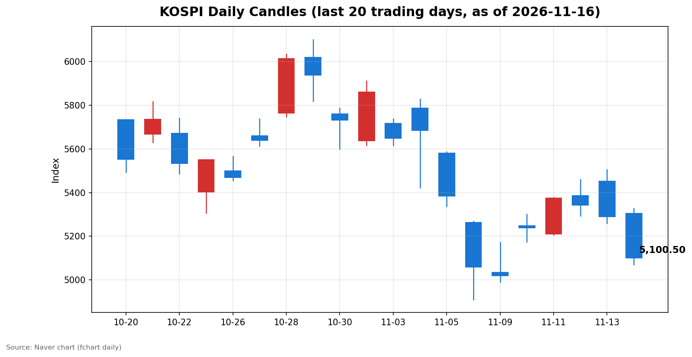
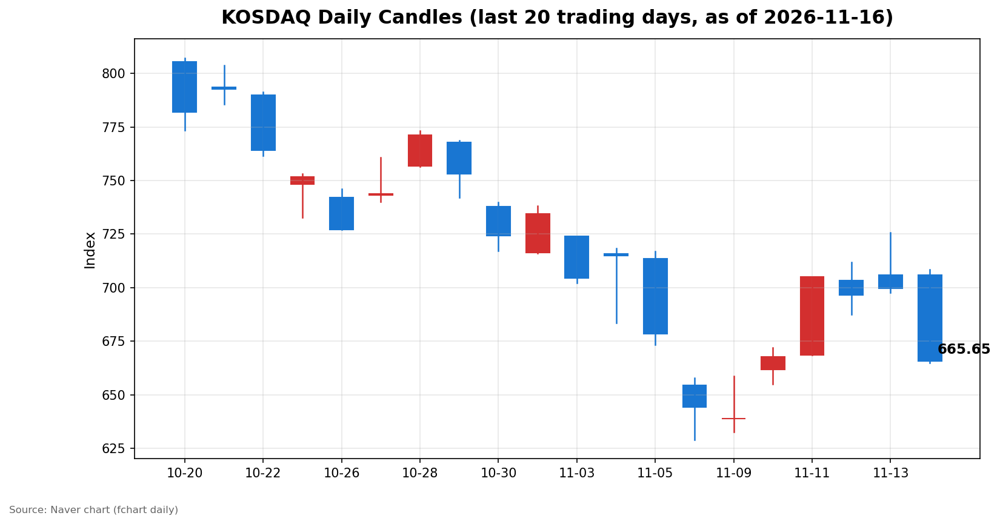

안녕하세요, [한국투자증권](https://securities.koreainvestment.com/main/Main.jsp)에서 [한투-한국투자증권](https://play.google.com/store/apps/details?id=com.truefriend.neosmartarenewal&hl=ko) 개발을 담당하고 있는 way입니다. 
2026년 11월 16일 월요일 국내 장 마감 흐름을 정리합니다. 

## 마감 요약

코스피는 5,100.50으로 전일 대비 190.03포인트, 3.59% 하락해 마감했습니다. 
코스닥은 665.65로 전일 대비 34.01포인트, 4.86% 하락해 마감했습니다. 
두 지수 모두 상승 출발 뒤 낙폭을 키웠고, 오후 들어서도 반등하지 못했습니다. 
코스피는 장중 5,069.83까지 밀렸다가 5,100선을 가까스로 지켰습니다. 
코스닥은 장중 저가 664.98까지 떨어졌고, 종가도 저가 부근에 머물렀습니다. 
외국인의 매도 공세가 마감까지 이어진 하루였습니다. 
코스피에서 외국인은 1조 3,838억 원을 순매도했고, 개인은 1조 3,484억 원을 순매수하며 물량을 받았습니다. 
다만 매도 규모가 커 지수 하락을 막지는 못했습니다. 

## 오늘의 마감 스냅샷

| 지수 | 종가 | 전일 대비 | 등락률 | 시가 | 고가 | 저가 | 거래량 | 거래대금 |
| --- | --- | --- | --- | --- | --- | --- | --- | --- |
| 코스피 | 5,100.50 | -190.03 | -3.59% | 5,305.40 | 5,327.99 | 5,069.83 | 209,274천주 | 15조 8,038억 원 |
| 코스닥 | 665.65 | -34.01 | -4.86% | 705.88 | 708.34 | 664.98 | 414,883천주 | 4조 5,769억 원 |

스냅샷 기준 시각은 2026년 11월 16일 장 마감, 15시 30분 KST입니다. 
전일 종가는 코스피 5,290.53, 코스닥 699.66입니다. 
지수 차트는 [코스피](https://finance.naver.com/sise/sise_index.naver?code=KOSPI)와 [코스닥](https://finance.naver.com/sise/sise_index.naver?code=KOSDAQ)에서 확인할 수 있습니다. 

## 차트

최근 20거래일 일봉 차트입니다. 
빨간 봉은 종가가 시가보다 높은 날, 파란 봉은 종가가 시가보다 낮은 날입니다. 

## 원인·촉매 분석

마감 급락의 출발점은 간밤 미국 증시입니다. 
나스닥 종합지수는 지난주 금요일 25,136.27로 0.91% 하락해 마감했습니다. 
미국 10월 생산자물가지수(PPI)가 4년 만에 최고치를 기록하면서 인플레이션 우려가 다시 커졌습니다. 
미 국채 10년물 금리는 11월 13일 종가 기준 5.153%까지 올랐습니다. 
금리 상승은 성장주의 할인율 부담으로 이어지며, 반도체주를 비롯한 성장주에 직접적인 압박이 됩니다. 
여기에 엔비디아의 리더십 공백이 더해졌습니다. 
젠슨 황 전 최고경영자(CEO)의 사임 이후 AI 반도체 밸류체인 전반에 불확실성이 번지고 있습니다. 
수급 구도도 하락을 뒷받침합니다. 
오전장 잠정치에서 코스피 외국인 순매도는 1조 1,678억 원이었으나, 마감 확정치는 1조 3,838억 원으로 더 커졌습니다. 
오후에도 외국인의 매도가 이어졌다는 뜻입니다. 
코스닥 외국인도 2,112억 원을 순매도했습니다. 
개인은 코스피 1조 3,484억 원, 코스닥 3,768억 원을 순매수하며 받는 쪽에 섰습니다. 
기관은 코스피 4,599억 원, 코스닥 1,541억 원을 순매도해 외국인 쪽에 가세했습니다. 
코스피 기관 안에서는 금융투자가 5,292억 원을 순매수한 반면 연기금은 5,647억 원을 순매도해 엇갈렸습니다. 
원·달러 환율은 오전장 기준 1,335.90원으로 전일 대비 소폭 하락해, 환율 자체는 이날 추가 부담 요인이 되지 않았습니다. 
정리하면, 미국의 금리 부담과 엔비디아발 AI 불확실성이라는 외부 촉매에 외국인의 매도 공세가 겹친 마감입니다. 

## 핵심 사건 3가지

첫째, 엔비디아 CEO 사임 후폭풍과 복귀 논의입니다. 
젠슨 황 전 CEO가 사임한 뒤 지난주 엔비디아 주가는 12.75% 하락했습니다. 
같은 기간 AMD는 18.93%, 브로드컴은 18.16% 상승해, AI 반도체 주도권 재편 기대가 엇갈렸습니다. 
파이낸셜타임스(FT) 보도에 따르면 퇴진 나흘 만에 복귀 가능성이 논의되고 있으며, 실리콘밸리의 우군들이 황 전 CEO를 지지하고 있습니다. 
스콧 베센트 미 재무장관은 이사회에 외부 후임 CEO 영입을 촉구했습니다. 
박현주 미래에셋그룹 회장도 황 전 CEO의 복귀를 촉구하는 온라인 청원에 동참했습니다. 
삼성전자와 SK하이닉스는 아직 공개 입장을 내놓지 않고 있습니다. 
리더십 공백이 길어질수록 AI 반도체 밸류체인 전반의 불확실성은 커집니다. 
11월 17일 예정된 엔비디아 실적 발표가 다음 분기점이 됩니다. 

둘째, 미국 10월 PPI 4년 최고치와 금리 상승입니다. 
10월 PPI가 4년 만에 최고치를 기록하면서, 인플레이션 둔화 기대가 흔들렸습니다. 
미 국채 10년물 금리는 11월 13일 종가 기준 5.153%까지 올랐습니다. 
금리가 오르면 미래 이익의 현재가치가 낮아져 성장주 밸류에이션에 부담이 됩니다. 
국내 증시에서도 반도체주를 중심으로 약세가 나타난 배경입니다. 
연방공개시장위원회(FOMC) 의사록 공개도 앞두고 있어, 금리 경로에 대한 경계감은 당분간 이어질 수 있습니다. 

셋째, 삼성SDI의 대규모 ESS 수주 소식입니다. 
삼성SDI가 미국 주피터파워에 3년간 ESS용 LFP 배터리 16GWh를 공급하는 수조원대 계약을 맺었습니다. 
LS일렉트릭도 미국 빅테크 AI 데이터센터 전력설비 1,300억 원을 추가 수주했습니다. 
삼성바이오로직스 유상증자에는 11.4조 원이 몰려 청약 경쟁률 135.6대 1을 기록했습니다. 
하락장 속에서도 개별 호재와 자금 쏠림은 이어지고 있습니다. 
다만 이날은 지수 하락 압력이 개별 호재를 압도했습니다. 

## 섹터·테마 영향 체인

금리 상승은 성장주 밸류에이션 경로로 시장에 작용했습니다. 
할인율 상승은 반도체주를 비롯한 성장주의 부담이 되었고, 코스피200은 4.03%, 코스피 선물은 4.01% 하락했습니다. 
코스닥 낙폭이 코스피보다 큰 점도 같은 맥락입니다. 
성장·소형주 비중이 높은 코스닥은 금리 부담과 위험 회피 심리에 더 민감하게 반응했습니다. 
반면 방어·특수 테마로는 자금이 이동했습니다. 
보험 테마는 2.43% 상승했고, 구성 종목 11개 중 9개가 올랐습니다. 
국가재난 테마는 3.13%, 소방기기 테마는 2.52%, T-50고등훈련기 테마는 2.21% 올랐습니다. 
면세점 관련주 1.98%, 제당 1.55%, 스마트카 1.52%, 빅데이터 1.28%도 상승했습니다. 
지수 하락 속에서도 테마별로는 자금의 선택이 갈렸습니다. 
금융지주·은행 섹터도 상대적으로 견조했습니다. 
주주환원 기대가 이어지는 가운데, 증권사 과징금 리스크와 거래 부진은 변수로 남아 있습니다. 
ESS·전력설비 체인도 주목할 만합니다. 
AI 데이터센터 전력 수요가 전력설비 수주로 이어지는 구조는 긍정적 요인입니다. 
그러나 단기적으로는 시장 전반의 위험 회피 심리가 우세해, 호재가 지수 흐름을 바꾸지는 못했습니다. 
비트코인도 4개월 만에 최저 수준으로 떨어져, 위험자산 전반의 투자 심리가 위축된 상태입니다. 

## 최근 5거래일 일봉

### 코스피

| 날짜 | 시가 | 고가 | 저가 | 종가 | 거래량(천주) |
| --- | --- | --- | --- | --- | --- |
| 2026-11-10 | 5,247.22 | 5,300.92 | 5,174.55 | 5,239.13 | 253,917 |
| 2026-11-11 | 5,209.71 | 5,377.99 | 5,207.44 | 5,375.36 | 234,732 |
| 2026-11-12 | 5,385.94 | 5,458.84 | 5,293.05 | 5,342.73 | 244,834 |
| 2026-11-13 | 5,452.41 | 5,504.44 | 5,259.09 | 5,290.53 | 247,829 |
| 2026-11-16 | 5,305.40 | 5,327.99 | 5,069.83 | 5,100.50 | 209,274 |

### 코스닥

| 날짜 | 시가 | 고가 | 저가 | 종가 | 거래량(천주) |
| --- | --- | --- | --- | --- | --- |
| 2026-11-10 | 661.73 | 671.91 | 655.09 | 667.61 | 402,110 |
| 2026-11-11 | 668.48 | 705.10 | 668.48 | 705.10 | 411,901 |
| 2026-11-12 | 703.22 | 711.86 | 687.40 | 696.53 | 465,951 |
| 2026-11-13 | 705.96 | 725.81 | 697.69 | 699.66 | 455,458 |
| 2026-11-16 | 705.88 | 708.34 | 664.98 | 665.65 | 414,883 |

## 당일 수급

코스피에서는 외국인이 1조 3,838억 원을 순매도했고, 개인이 1조 3,484억 원을 순매수했습니다. 
기관은 4,599억 원을 순매도했고, 기타법인은 4,883억 원을 순매수했습니다. 
기관 안에서는 금융투자 5,292억 원 순매수와 연기금 5,647억 원 순매도가 엇갈렸습니다. 
투신은 2,142억 원, 사모펀드는 2,088억 원을 순매도했습니다. 
코스닥에서는 외국인이 2,112억 원을 순매도했고, 개인이 3,768억 원을 순매수했습니다. 
기관은 1,541억 원을 순매도했고, 기타법인은 129억 원을 순매도했습니다. 
양 시장 모두 외국인과 기관이 팔고 개인이 받는 구도였습니다. 
개인의 매수 규모가 외국인의 매도 규모와 비슷했지만, 하락을 막기에는 역부족이었습니다. 
외국인의 매도가 오전 잠정치보다 마감 확정치에서 더 커진 점은, 매도 압력이 장 후반까지 이어졌음을 보여줍니다. 

## 강했던 테마와 흐름

하락장 속에서도 오른 테마는 뚜렷했습니다. 
국가재난 테마가 3.13%로 가장 많이 올랐고, 소방기기가 2.52%로 뒤를 이었습니다. 
보험 테마는 2.43% 올랐고, T-50고등훈련기 테마는 2.21% 올랐습니다. 
면세점 관련주도 1.98% 상승했습니다. 
로봇 공급 기대와 한진칼 지배구조 이슈도 장중 부각됐습니다. 
K푸드는 해외 실적 재료를 바탕으로 선별 강세를 보였습니다. 
반면 지수 하락을 주도한 성장주·반도체 밸류체인은 약세가 이어졌습니다. 
방어·특수 테마로의 자금 이동이 하루의 흐름을 요약합니다. 

## 단기·중기 전망과 내일 확인할 시나리오

단기적으로는 엔비디아 실적 발표가 가장 큰 분기점입니다. 
11월 17일 예정된 엔비디아 실적 발표에서 리더십 공백 이후의 가이던스가 확인됩니다. 
실적 내용이 AI 반도체 밸류체인 심리를 가를 수 있습니다. 
금리 경로도 함께 확인해야 합니다. 
미 국채 10년물 금리가 5%대를 유지하는지, FOMC 의사록에서 어떤 신호가 나오는지가 관건입니다. 
금리가 더 오르면 성장주 밸류에이션 부담은 이어질 수 있습니다. 
가격 레벨로는 코스피 5,100선과 코스닥 665선 부근이 단기 지지 구간입니다. 
코스피는 장중 5,069.83까지 밀렸다가 5,100.50으로 마감해, 5,100선 방어가 일단 유지됐습니다. 
이 선이 깨지면 다음 지지 구간을 확인할 필요가 있습니다. 
반등이 나오면 코스피 5,300선 부근이 단기 저항 구간이 됩니다. 
당일 고가 5,327.99가 그 기준입니다. 
수급 측면에서는 외국인의 매도세가 이어지는지 확인해야 합니다. 
외국인 순매도가 줄어들거나 순매수로 돌아서면 하락 압력이 완화될 수 있습니다. 
개인 매수세가 계속 이어지는지도 지켜봐야 합니다. 
중기적으로는 AI 반도체 주도권 재편이 구조적 변수입니다. 
엔비디아 중심 구도가 AMD·구글·아마존 등으로 다변화되면, 메모리 수요 구조도 함께 바뀔 수 있습니다. 
KB증권은 이날 보고서에서 AI 생태계 확장의 수혜 기업으로 삼성전자를 지목했습니다. 
다만 이는 보고서의 분석일 뿐, 투자 판단의 근거가 될 수 없습니다. 
시나리오를 정리하면, 흐름 지속 시나리오는 엔비디아 실적 실망과 금리 부담 지속으로 하락 압력이 이어지는 경우입니다. 
일시적 노이즈 시나리오는 엔비디아 실적이 불확실성을 덜고 금리 상승이 진정되며 반등하는 경우입니다. 
어느 쪽인지 판단하려면 내일 엔비디아 실적과 외국인 수급을 함께 확인해야 합니다. 

## 마치며

코스피와 코스닥이 동반 급락한 하루였습니다. 
외국인의 매도 공세와 금리 부담, 엔비디아발 불확실성이 겹친 결과입니다. 
내일 엔비디아 실적 발표와 외국인 수급을 확인하며 흐름을 지켜보겠습니다. 
이 글은 교육·해설 목적의 시황 정리이며, 특정 종목의 매수나 매도를 권유하는 내용이 아닙니다. 
