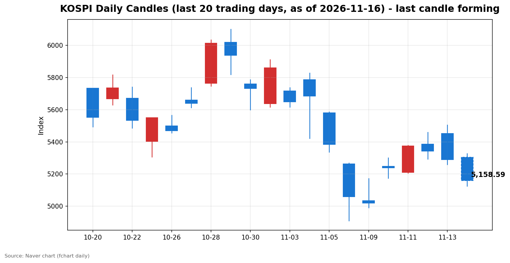
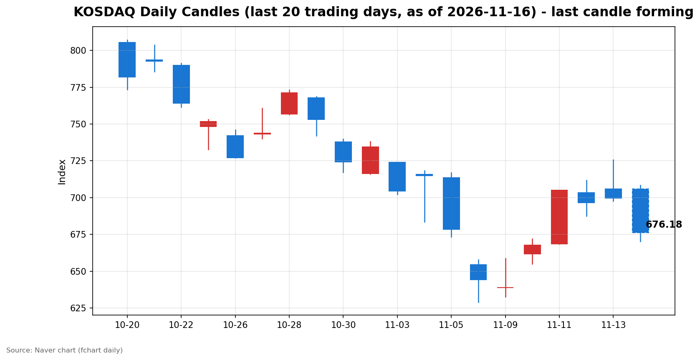

안녕하세요, [한국투자증권](https://securities.koreainvestment.com/main/Main.jsp)에서 [한투-한국투자증권](https://play.google.com/store/apps/details?id=com.truefriend.neosmartarenewal&hl=ko) 개발을 담당하고 있는 way입니다. 
2026년 11월 16일 월요일 오전장, 코스피와 코스닥이 동반 급락한 흐름을 정리합니다. 

## 오전장 요약

코스피는 12시 30분 기준 5,160.30으로 전일 대비 130.23포인트, 2.46% 하락했습니다. 
코스닥은 676.35로 전일 대비 23.31포인트, 3.33% 하락했습니다. 
두 지수 모두 상승 출발 뒤 낙폭을 키우는 방향 전환이 나타났습니다. 
코스피는 시가 5,305.40에서 고가 5,327.99까지 오른 뒤 저가 5,124.56까지 밀렸습니다. 
외국인의 매도 공세가 오전장의 가장 큰 특징입니다. 
코스피에서 외국인은 장중 누적 잠정치 기준 1조 1,678억 원을 순매도했고, 개인은 9,100억 원을 순매수하며 물량을 받았습니다. 
다만 매도 규모가 커 지수 하락을 막지는 못했습니다. 

## 오늘의 스냅샷

| 지수 | 현재가 | 전일 대비 | 등락률 | 시가 | 고가 | 저가 | 거래량 | 거래대금 |
| --- | --- | --- | --- | --- | --- | --- | --- | --- |
| 코스피 | 5,160.30 | -130.23 | -2.46% | 5,305.40 | 5,327.99 | 5,124.56 | 126,474천주 | 8조 6,444억 원 |
| 코스닥 | 676.35 | -23.31 | -3.33% | 705.88 | 708.34 | 670.21 | 279,228천주 | 3조 1,456억 원 |

스냅샷 기준 시각은 2026년 11월 16일 12시 30분 KST입니다. 
전일 종가는 코스피 5,290.53, 코스닥 699.66입니다. 
당일 봉은 형성 중인 봉으로, 마감 전에는 계속 변합니다. 
지수 차트는 [코스피](https://finance.naver.com/sise/sise_index.naver?code=KOSPI)와 [코스닥](https://finance.naver.com/sise/sise_index.naver?code=KOSDAQ)에서 확인할 수 있습니다. 

## 차트

최근 20거래일 일봉 차트입니다. 
빨간 봉은 종가가 시가보다 높은 날, 파란 봉은 종가가 시가보다 낮은 날입니다. 
당일 봉은 형성 중인 봉으로, 마감 전에는 계속 변합니다. 

## 원인·촉매 분석

오전장 급락의 출발점은 간밤 미국 증시입니다. 
나스닥 종합지수는 지난주 금요일 25,136.27로 0.91% 하락해 마감했습니다. 
미국 10월 생산자물가지수(PPI)가 4년 만에 최고치를 기록하면서 인플레이션 우려가 다시 커졌습니다. 
미 국채 10년물 금리는 11월 13일 종가 기준 5.153%까지 올랐습니다. 
금리 상승은 성장주의 할인율 부담으로 이어지며, 반도체주를 비롯한 성장주에 직접적인 압박이 됩니다. 
여기에 엔비디아의 리더십 공백이 더해졌습니다. 
젠슨 황 전 최고경영자(CEO)의 사임 이후 AI 반도체 밸류체인 전반에 불확실성이 번지고 있습니다. 
수급 구도도 하락을 뒷받침합니다. 
전일인 11월 13일 확정 수급에서 코스피 외국인은 5,420억 원, 코스닥 외국인은 807억 원을 순매도했습니다. 
코스피 기관은 60억 원 순매도에 그쳤고, 연기금은 2,109억 원을 순매수했습니다. 
개인 수급은 코스피 145억 원 순매수, 코스닥 512억 원 순매도로 엇갈렸습니다. 
오늘 장중 누적 잠정치에서는 외국인의 매도가 더 커졌습니다. 
코스피 외국인 순매도는 1조 1,678억 원, 코스닥 외국인 순매도는 2,152억 원입니다. 
개인은 코스피 9,100억 원, 코스닥 3,163억 원을 순매수하며 받는 쪽에 섰습니다. 
기관은 코스피 185억 원, 코스닥 844억 원 순매도 잠정치를 기록했습니다. 
장중 수급은 마감 후 확정치가 나오면 달라질 수 있어, 위 수치는 잠정치로만 참고합니다. 
원·달러 환율은 1,335.90원으로 전일 대비 소폭 하락해, 환율 자체는 이날 추가 부담 요인이 되지 않았습니다. 
정리하면, 미국의 금리 부담과 엔비디아발 AI 불확실성이라는 외부 촉매에 외국인의 매도 공세가 겹친 오전장입니다. 

## 핵심 사건 3가지

첫째, 엔비디아 CEO 사임 후폭풍과 복귀 논의입니다. 
젠슨 황 전 CEO가 사임한 뒤 지난주 엔비디아 주가는 12.75% 하락했습니다. 
같은 기간 AMD는 18.93%, 브로드컴은 18.16% 상승해, AI 반도체 주도권 재편 기대가 엇갈렸습니다. 
파이낸셜타임스(FT) 보도에 따르면 퇴진 나흘 만에 복귀 가능성이 논의되고 있으며, 실리콘밸리의 우군들이 황 전 CEO를 지지하고 있습니다. 
스콧 베센트 미 재무장관은 이사회에 외부 후임 CEO 영입을 촉구했습니다. 
박현주 미래에셋그룹 회장도 황 전 CEO의 복귀를 촉구하는 온라인 청원에 동참했습니다. 
삼성전자와 SK하이닉스는 아직 공개 입장을 내놓지 않고 있습니다. 
리더십 공백이 길어질수록 AI 반도체 밸류체인 전반의 불확실성은 커집니다. 
11월 17일 예정된 엔비디아 실적 발표가 다음 분기점이 됩니다. 

둘째, 미국 10월 PPI 4년 최고치와 금리 상승입니다. 
10월 PPI가 4년 만에 최고치를 기록하면서, 인플레이션 둔화 기대가 흔들렸습니다. 
미 국채 10년물 금리는 11월 13일 종가 기준 5.153%까지 올랐습니다. 
금리가 오르면 미래 이익의 현재가치가 낮아져 성장주 밸류에이션에 부담이 됩니다. 
국내 증시에서도 반도체주를 중심으로 약세가 나타난 배경입니다. 
연방공개시장위원회(FOMC) 의사록 공개도 앞두고 있어, 금리 경로에 대한 경계감은 당분간 이어질 수 있습니다. 

셋째, 삼성SDI의 대규모 ESS 수주 소식입니다. 
삼성SDI가 미국 주피터파워에 3년간 ESS용 LFP 배터리 16GWh를 공급하는 수조원대 계약을 맺었습니다. 
LS일렉트릭도 미국 빅테크 AI 데이터센터 전력설비 1,300억 원을 추가 수주했습니다. 
삼성바이오로직스 유상증자에는 11.4조 원이 몰려 청약 경쟁률 135.6대 1을 기록했습니다. 
하락장 속에서도 개별 호재와 자금 쏠림은 이어지고 있습니다. 
다만 이날은 지수 하락 압력이 개별 호재를 압도했습니다. 

## 섹터·테마 영향 체인

금리 상승은 성장주 밸류에이션 경로로 시장에 작용했습니다. 
할인율 상승은 반도체주를 비롯한 성장주의 부담이 되었고, 코스피200은 2.79%, 코스피 선물은 2.66% 하락했습니다. 
코스닥 낙폭이 코스피보다 큰 점도 같은 맥락입니다. 
성장·소형주 비중이 높은 코스닥은 금리 부담과 위험 회피 심리에 더 민감하게 반응했습니다. 
반면 방어·특수 테마로는 자금이 이동했습니다. 
보험 테마는 2.22% 상승했고, 구성 종목 11개가 모두 올랐습니다. 
국가재난 테마는 3.48%, T-50고등훈련기 테마는 3.17% 올랐습니다. 
스마트카 2.44%, 웹툰 2.43%, FPCB 2.41%, 카메라모듈·부품 2.06%, 면세점 2.00%, 빅데이터 1.89%도 상승했습니다. 
지수 하락 속에서도 테마별로는 자금의 선택이 갈렸습니다. 
ESS·전력설비 체인도 주목할 만합니다. 
AI 데이터센터 전력 수요가 전력설비 수주로 이어지는 구조는 긍정적 요인입니다. 
그러나 단기적으로는 시장 전반의 위험 회피 심리가 우세해, 호재가 지수 흐름을 바꾸지는 못했습니다. 
비트코인도 4개월 만에 최저 수준으로 떨어져, 위험자산 전반의 투자 심리가 위축된 상태입니다. 

## 최근 5거래일 일봉

### 코스피

| 날짜 | 시가 | 고가 | 저가 | 종가 | 거래량(천주) |
| --- | --- | --- | --- | --- | --- |
| 2026-11-10 | 5,247.22 | 5,300.92 | 5,174.55 | 5,239.13 | 253,917 |
| 2026-11-11 | 5,209.71 | 5,377.99 | 5,207.44 | 5,375.36 | 234,732 |
| 2026-11-12 | 5,385.94 | 5,458.84 | 5,293.05 | 5,342.73 | 244,834 |
| 2026-11-13 | 5,452.41 | 5,504.44 | 5,259.09 | 5,290.53 | 247,829 |
| 2026-11-16 | 5,305.40 | 5,327.99 | 5,124.56 | 5,160.30 (형성 중) | 126,474 |

### 코스닥

| 날짜 | 시가 | 고가 | 저가 | 종가 | 거래량(천주) |
| --- | --- | --- | --- | --- | --- |
| 2026-11-10 | 661.73 | 671.91 | 655.09 | 667.61 | 402,110 |
| 2026-11-11 | 668.48 | 705.10 | 668.48 | 705.10 | 411,901 |
| 2026-11-12 | 703.22 | 711.86 | 687.40 | 696.53 | 465,951 |
| 2026-11-13 | 705.96 | 725.81 | 697.69 | 699.66 | 455,458 |
| 2026-11-16 | 705.88 | 708.34 | 670.21 | 676.35 (형성 중) | 279,228 |

## 오전 강했던 테마와 흐름 변화

오전장에서 가장 강했던 테마는 국가재난, T-50고등훈련기, 보험, 스마트카, 웹툰 순이었습니다. 
상승 종목으로는 폴라리스AI와 파라텍이 눈에 띄었습니다. 
그러나 지수 흐름은 시가 대비 방향이 전환되었습니다. 
코스피는 전일 종가 5,290.53보다 높은 5,305.40에 출발해 5,327.99까지 올랐습니다. 
이후 외국인의 매도가 장중 누적되면서 저가 5,124.56까지 밀렸습니다. 
장중 고저 차이는 200포인트가 넘습니다. 
코스닥도 전일 종가 699.66보다 높은 705.88에 출발해 708.34까지 오른 뒤 670.21까지 하락했습니다. 
오전 강세 테마의 상승은 지수 하락 속 자금 이동의 단면으로 읽힙니다. 
지수 방향 자체는 외국인 매도 공세에 따라 오전 내내 아래쪽으로 기울었습니다. 

## 오후 전망과 확인할 시나리오

오후에 확인할 첫 번째 가격 레벨은 당일 저가입니다. 
코스피는 5,124.56, 코스닥은 670.21입니다. 
저가를 하회하면 낙폭 확대 흐름으로 이어질 수 있습니다. 
코스피의 다음 지지 구간은 11월 9일 종가 5,018.85와 심리적 지지선인 5,000선입니다. 
코스닥의 다음 지지 구간은 11월 9일 종가 638.97입니다. 
저항 구간은 전일 종가와 당일 고가입니다. 
코스피는 전일 종가 5,290.53과 당일 고가 5,327.99, 코스닥은 전일 종가 699.66과 당일 고가 708.34입니다. 
시나리오는 세 가지로 나눌 수 있습니다. 
첫째, 외국인 매도 강도가 완화되면 낙폭이 축소되는 흐름입니다. 
둘째, 매도가 지속되면 코스피 5,100선 하회 여부를 확인하는 흐름입니다. 
셋째, 관망 심리가 이어지며 저가 부근에서 횡보하는 흐름입니다. 
오후에 확인할 이벤트도 있습니다. 
장 마감 후 확정 수급에서 외국인의 최종 매도 규모를 확인합니다. 
미 국채 금리 움직임도 함께 확인합니다. 
11월 17일 엔비디아 실적 발표와 11월 19일 예정된 앤트로픽 상장을 앞둔 경계감은 당분간 이어질 수 있습니다. 
변동성이 큰 구간이므로, 지수·섹터 단위의 흐름을 확인하며 리스크를 관리하는 관점이 필요합니다. 

## 마치며

오전장은 미국의 금리 부담과 엔비디아발 불확실성에 외국인의 매도 공세가 겹친 급락장이었습니다. 
오후에는 당일 저가와 외국인 매도 강도를 확인하며 흐름을 지켜볼 필요가 있습니다. 
이 글은 교육·해설 목적의 시황 정리이며, 특정 종목의 매수·매도 권유가 아닙니다. 
