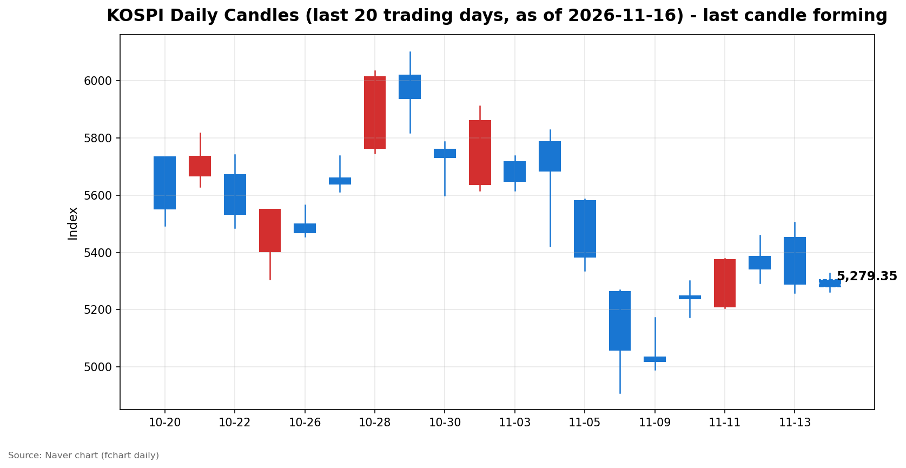
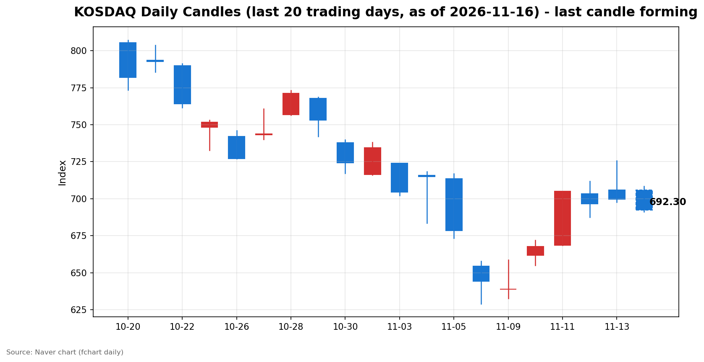

안녕하세요, [한국투자증권](https://securities.koreainvestment.com/main/Main.jsp)에서 [한투-한국투자증권](https://play.google.com/store/apps/details?id=com.truefriend.neosmartarenewal&hl=ko) 개발을 담당하고 있는 way입니다. 
오늘 국내 증시는 미국 물가 지표발 금리 인상 경계와 인공지능 반도체를 둘러싼 불확실성 속에 약세로 출발했습니다. 

## 배경: 간밤 미국 증시와 개장 전 이슈

간밤 뉴욕 증시는 하락 마감했습니다. 
나스닥 종합지수는 25,136.27로 전일 대비 229.82포인트, 0.91% 내렸습니다. 
스탠더드앤드푸어스 500 지수는 7,561.67로 0.40% 하락했습니다. 
필라델피아 반도체 지수는 3.4% 하락하며 인공지능 반도체주의 조정 폭이 컸습니다. 

하락의 직접적인 계기는 미국의 물가 지표였습니다. 
미국 노동통계국이 11월 13일 발표한 10월 생산자물가지수(PPI)는 전년 동월 대비 6.5% 올랐습니다. 
2022년 11월 이후 약 4년 만에 가장 높은 상승률입니다. 
전월 대비 상승률은 0.3%로 시장 예상치 0.4%를 밑돌았으나, 전년 대비 누적된 물가 압력이 부각됐습니다. 
앞서 발표된 10월 소비자물가지수(CPI)도 전월 대비 0.4% 올라 예상치 0.3%를 웃돌았습니다. 
시장은 연준의 12월 기준금리 인상을 기정사실로 받아들이는 분위기이며, 인상 폭을 두고 25bp와 50bp 사이에서 관측이 엇갈리고 있습니다. 
연준은 12월 8일부터 9일까지 기준금리를 결정합니다. 

엔비디아를 둘러싼 경영 불확실성도 투자 심리를 짓눌렀습니다. 
젠슨 황 전 최고경영자(CEO)의 사임 파장이 이어지는 가운데, 파이낸셜타임스는 11월 15일 황 전 CEO가 측근들과 복귀 방안을 협의했다고 보도했습니다. 
주요 주주인 알티미터캐피털과 아트레이디스매니지먼트도 이사회에 황 전 CEO의 재선임 가능성을 열어둘 것을 요구했습니다. 
일론 머스크 테슬라 CEO와 팀 스위니 에픽게임즈 CEO 등도 공개적으로 복귀를 지지했습니다. 
이번 주에는 11월 17일 엔비디아 실적 발표와 11월 19일 앤트로픽 나스닥 상장, 11월 18일 연준 연방공개시장위원회(FOMC) 의사록 공개가 예정돼 있어, 인공지능 투자 심리의 방향을 가늠할 시험대가 이어집니다. 
엔비디아 실적은 젠슨 황 사임 후 첫 실적으로, 임시 CEO인 콜레트 크레스 최고재무책임자(CFO)가 소통을 맡습니다. 
앤트로픽은 공모가를 11월 18일 확정하고 11월 19일 상장하며, 공모 물량의 약 6배에 달하는 수요가 몰렸다고 알려졌습니다. 
11월 16일에는 케빈 워시 연준 의장이 인공지능·생산성 콘퍼런스에서 연설합니다. 
11월 16일자 G모닝은 오전 9시 32분 기준으로 아직 게시되지 않았습니다. 

원/달러 환율은 1,334.80원으로 전일 대비 2.80원, 0.21% 내렸습니다. 
환율 하락은 원화 강세 방향으로, 외국인 수급에는 우호적인 신호입니다. 

## 오늘의 스냅샷

| 지수 | 현재가 | 전일 대비 | 등락률 | 시가 | 고가 | 저가 | 거래량 | 거래대금 |
| --- | --- | --- | --- | --- | --- | --- | --- | --- |
| [코스피](https://finance.naver.com/sise/sise_index.naver?code=KOSPI) | 5,274.09 | -16.44 | -0.31% | 5,305.40 | 5,327.99 | 5,266.28 | 35,329천 주 | 2조 2,748억 원 |
| [코스닥](https://finance.naver.com/sise/sise_index.naver?code=KOSDAQ) | 693.36 | -6.30 | -0.90% | 705.88 | 708.34 | 691.09 | 90,489천 주 | 1조 712억 원 |

스냅샷 기준 시각은 2026년 11월 16일 오전 9시 28분경(KST)입니다. 
전일 종가는 코스피 5,290.53, 코스닥 699.66입니다. 
코스피는 장 초반 5,300선을 내줬고, 코스닥은 700선을 밑돌며 낙폭이 상대적으로 큽니다. 
코스피200은 821.83으로 0.36% 내렸고, 코스피 선물은 819.95로 0.29% 내렸습니다. 

## 차트

최근 20거래일 일봉 차트입니다. 
빨간 봉은 종가가 시가보다 높은 날, 파란 봉은 종가가 시가보다 낮은 날입니다. 
당일 봉은 형성 중인 봉으로, 마감 전에는 계속 변합니다. 

## 원인·촉매 분석

오늘의 약세 출발은 단일 재료가 아니라 물가와 인공지능이라는 두 축의 불확실성이 겹친 결과입니다. 
미국 10월 PPI가 전년 대비 6.5%로 약 4년 만에 최고치를 기록하면서, 연준의 긴축 기조가 길어질 수 있다는 경계가 커졌습니다. 
금리가 오르면 성장주의 밸류에이션 부담이 커지고, 이는 인공지능·반도체 중심의 국내 대형주에 직접적인 하방 압력으로 작용합니다. 
간밤 필라델피아 반도체 지수가 3.4% 하락한 흐름이 국내 개장 초반에 그대로 이어졌습니다. 

다만 하락의 성격은 패닉이 아니라 경계 속 조정으로 보입니다. 
코스피는 지난주 급락 이후 저가 매수세가 이어지고 있으며, 10월 이후 매크로와 인공지능 관련 악재가 반복되는 과정에서 시장에 내성이 생겼다는 분석도 나옵니다. 
키움증권 한지영 연구원은 신규 돌발 악재가 나오지 않는 한 전 저점을 하회하는 최악의 시나리오 발생 가능성은 낮아졌다고 분석했습니다. 
코스피 야간 선물이 하락한 점을 감안하면, 장 초반에는 5,250선 지지력 테스트가 이어질 가능성이 있습니다. 

전일 수급 구도도 오늘의 출발을 설명합니다. 
11월 13일 코스피에서 외국인은 5,419억 원을 순매도했고, 기관은 59억 원 순매도했습니다. 
개인은 145억 원을 순매수했고, 기타법인이 5,333억 원을 순매수했습니다. 
외국인이 장중 고점 5,504.44까지 올랐던 지수를 되돌린 주체였고, 그 매도 물량을 기타법인과 개인이 받은 구도였습니다. 
코스닥에서는 외국인이 806억 원, 개인이 512억 원을 순매도한 반면 기관이 1,259억 원을 순매수했습니다. 
코스피와 코스닥의 주체가 엇갈린 점은, 외국인의 매도가 대형주 중심으로 집중됐음을 시사합니다. 
한편 코스피 선물에서는 외국인이 1,457억 원을 순매수해, 현물 매도와는 다른 포지션을 취했습니다. 
현물 매도·선물 매수의 조합은 방향성 베팅보다는 헤지 성격이 강해 보이며, 외국인이 지수 방향에 대해 확신을 갖기보다 변동성에 대비하고 있음을 보여줍니다. 

## 핵심 사건 3가지

### 1. 미국 10월 PPI, 전년 대비 6.5%로 약 4년 만에 최고치

미국 노동통계국은 11월 13일 10월 PPI가 전년 동월 대비 6.5% 올랐다고 발표했습니다. 
2022년 11월 이후 가장 높은 상승률이며, 9월 상승률 6.3%보다 높아졌습니다. 
전월 대비 상승률은 0.3%로 예상치 0.4%를 밑돌았고, 근원 PPI도 전월 대비 0.3%로 예상에 부합했습니다. 
그러나 시장은 전월 대비 둔화보다 전년 대비 6.5%라는 누적 물가 압력에 무게를 뒀습니다. 
로이터는 12월 25bp 인상은 물론 내년 1월 추가 인상 가능성까지 열어두는 근거가 됐다고 분석했습니다. 
이 지표가 중요한 이유는 연준의 정책 경로가 국내 증시의 밸류에이션과 외국인 자금 흐름을 동시에 좌우하기 때문입니다. 
금리 인상 전망이 강화되면 성장주 중심의 조정이 길어지고, 원/달러 환율의 방향성도 다시 달러 강세 쪽으로 기울 수 있습니다. 

### 2. 엔비디아 젠슨 황 CEO 사임 파장과 복귀 논의, 그리고 AI 빅위크

젠슨 황 전 엔비디아 CEO의 사임 파장이 간밤 나스닥 하락의 한 축이었습니다. 
파이낸셜타임스는 11월 15일 황 전 CEO가 측근들과 복귀 방안을 협의했다고 보도했습니다. 
주요 주주들이 이사회에 재선임 가능성을 열어둘 것을 요구하고, 직원들의 온라인 청원도 이어지고 있습니다. 
그러나 복귀가 확정된 것은 아니며, 경영 승계 불확실성은 11월 17일 엔비디아 실적 발표와 컨퍼런스콜에서 해소 여부를 지켜봐야 합니다. 
사임 여파로 엔비디아 주가는 한 주 동안 13% 급락하며 시가총액이 6,200억 달러 이상 증발했습니다. 
같은 날 코어위브는 6.86%, 네비우스는 16.86% 하락했습니다. 
젠슨 황이 설계한 대중국 인공지능 칩 전략이 흔들리면서 의회의 수출 통제론이 힘을 얻고 있으며, 국방수권법(NDAA)에 첨단 인공지능 칩 수출 차단 법안이 묶여 통과될 가능성도 제기됩니다. 
엔비디아는 네오클라우드 부외 약정·보증과 오픈AI 데이터센터 보증 등 최대 1,645억 달러에 달하는 잠재 금융 부담을 안고 있어, 후임 체제에서 관련 투자 재검토 가능성도 거론됩니다. 
다만 엔비디아 자체 실적은 견고합니다. 
2분기 매출 성장률은 106%, 총마진율은 75% 수준입니다. 
앤트로픽 기업공개는 11월 19일 나스닥 상장이 예정돼 있으며, 중국·홍콩 기관투자자의 청약이 배제됐다고 알려졌습니다. 
FOMC 의사록 공개도 11월 18일에 예정돼 있습니다. 
인공지능 투자 심리가 시험대에 오른 만큼, 국내 반도체·인공지능 관련주의 변동성도 이번 주 내내 클 수 있습니다. 

### 3. 삼성SDI, 미국 주피터파워에 ESS용 LFP 배터리 16GWh 공급

삼성SDI는 미주법인 삼성SDI 아메리카가 미국의 에너지저장장치 개발·운영 전문업체 주피터파워와 총 16GWh 규모의 LFP 배터리 공급 계약을 체결했다고 11월 16일 밝혔습니다. 
2029년부터 3년간 공급하며, 계약 규모는 수조 원대로 알려졌습니다. 
삼성SDI는 올해 10월까지 미국 전력용 시장을 중심으로 60GWh 이상의 ESS 배터리 수주를 확보했습니다. 
이 소식에 삼성SDI 주가는 16일 장 초반 강세를 보였습니다. 
이 사건은 시장 전체의 방향을 바꾸는 재료는 아니지만, 2차전지 밸류체인 안에서 ESS라는 성장 축이 실제로 수주로 확인되고 있다는 점에서 의미가 있습니다. 
기존 삼원계 중심이던 ESS 제품군에 LFP가 추가되면서 국내 소재 업체들과의 공급망도 함께 확대되고 있습니다. 

## 섹터·테마 영향 체인

지수 약세와 달리 중소형 테마는 장 초반 강세를 보이며 차별화가 뚜렷합니다. 
KIS MTS 기준 스마트카 테마는 4.06%, T-50 고등훈련기는 3.92%, FPCB는 3.73%, 카메라모듈·부품은 3.53% 올랐습니다. 
빅데이터 2.76%, 갤럭시부품 2.27%, 로봇 1.74%, 자율주행차 1.48%도 상승했습니다. 
스마트카와 자율주행차, 카메라모듈·부품, 갤럭시부품의 강세는 하나의 연결고리로 이어집니다. 
전장·카메라·부품 수요가 스마트폰과 자동차라는 두 단말에서 동시에 확인되고 있기 때문입니다. 
로봇과 빅데이터의 강세는 인공지능 응용처가 하드웨어를 넘어 소프트웨어·자동화로 확산되고 있음을 보여줍니다. 

반면 금리→성장주 밸류에이션 경로를 통해 대형 반도체·성장주는 직접적인 타격을 받았습니다. 
PPI발 금리 인상 경계가 커지면 할인율 상승으로 미래 이익의 현재 가치가 낮아지고, 이는 대형 성장주의 밸류에이션 부담으로 이어집니다. 
간밤 필라델피아 반도체 지수 3.4% 하락이 그 경로를 확인해 줍니다. 
국내에서는 삼성전자와 SK하이닉스가 장 초반 나란히 약세를 보였습니다. 
다만 SK하이닉스의 트리니티 팹 소부장 양산 검증 문턱 완화 소식은 중기적으로 국내 반도체 소부장 밸류체인에 우호적인 재료입니다. 
단기적으로는 금리·인공지능 불확실성이 대형주를 누르고, 중기적으로는 공급망 내재화와 ESS 수주 같은 실물 재료가 중소형 테마를 받치는 구도입니다. 

## 최근 5거래일 일봉

당일 봉은 형성 중인 봉으로, 마감 전에는 계속 변합니다. 

### 코스피

| 날짜 | 시가 | 고가 | 저가 | 종가 | 거래량(천 주) |
| --- | --- | --- | --- | --- | --- |
| 2026-11-09 | 5,034.20 | 5,172.94 | 4,990.66 | 5,018.85 | 248,140 |
| 2026-11-10 | 5,247.22 | 5,300.92 | 5,174.55 | 5,239.13 | 253,917 |
| 2026-11-11 | 5,209.71 | 5,377.99 | 5,207.44 | 5,375.36 | 234,732 |
| 2026-11-12 | 5,385.94 | 5,458.84 | 5,293.05 | 5,342.73 | 244,834 |
| 2026-11-13 | 5,452.41 | 5,504.44 | 5,259.09 | 5,290.53 | 247,829 |
| 2026-11-16(형성 중) | 5,305.40 | 5,327.99 | 5,266.28 | 5,274.09 | 35,329 |

### 코스닥

| 날짜 | 시가 | 고가 | 저가 | 종가 | 거래량(천 주) |
| --- | --- | --- | --- | --- | --- |
| 2026-11-09 | 638.82 | 658.66 | 632.70 | 638.97 | 358,495 |
| 2026-11-10 | 661.73 | 671.91 | 655.09 | 667.61 | 402,110 |
| 2026-11-11 | 668.48 | 705.10 | 668.48 | 705.10 | 411,901 |
| 2026-11-12 | 703.22 | 711.86 | 687.40 | 696.53 | 465,951 |
| 2026-11-13 | 705.96 | 725.81 | 697.69 | 699.66 | 455,458 |
| 2026-11-16(형성 중) | 705.88 | 708.34 | 691.09 | 693.36 | 90,489 |

코스피는 11월 11일 5,375.36까지 반등한 뒤 11월 13일 장중 5,504.44까지 올랐으나 종가는 5,290.53으로 되돌렸습니다. 
고점권에서 윗꼬리가 긴 봉이 이어지고 있어, 상단에서의 매도 압력이 확인되는 구간입니다. 
코스닥은 11월 11일 705.10까지 오른 뒤 700선 안팎에서 등락하고 있으며, 오늘 700선을 밑돌았습니다. 

## 전일 수급

11월 13일 수급은 시장별로 주체가 엇갈렸습니다. 
코스피에서는 외국인이 5,419억 원을 순매도했고 기관은 59억 원을 순매도했습니다. 
개인이 145억 원을 순매수했고 기타법인이 5,333억 원을 순매수했습니다. 
외국인의 매도 규모가 컸음에도 지수 낙폭이 0.98%에 그친 배경에는 기타법인과 개인의 매수세가 있었습니다. 
다만 기타법인의 매수는 통상 추세적인 매수 주체로 보기 어려워, 외국인 매도가 이어질 경우 하방 지지력이 약해질 수 있습니다. 
코스닥에서는 기관이 1,259억 원을 순매수하며 매수 주체로 나섰고, 외국인이 806억 원, 개인이 512억 원을 순매도했습니다. 
기관의 코스닥 매수는 중소형주에 대한 선별적 관심이 유지되고 있음을 보여줍니다. 
선물 시장에서는 외국인이 1,457억 원을 순매수했습니다. 
현물 매도와 선물 매수가 병행된 점은 외국인이 방향성 베팅보다 변동성 헤지에 무게를 두고 있음을 시사합니다. 

## 단기·중기 전망과 확인할 시나리오

단기적으로는 이번 주 예정된 이벤트들이 방향을 결정합니다. 
11월 17일 엔비디아 실적 발표와 컨퍼런스콜에서 경영 승계 불확실성이 해소되는지, 11월 19일 앤트로픽 나스닥 상장에 대한 시장의 반응이 어떤지가 인공지능 투자 심리의 분기점이 됩니다. 
11월 18일 공개되는 FOMC 의사록에서는 연준 위원들의 금리 인상 속도와 폭에 대한 인식이 확인될 것입니다. 
11월 16일 케빈 워시 연준 의장의 인공지능·생산성 콘퍼런스 연설도 주목할 일정입니다. 
코스피는 5,250선 지지력 테스트가 진행 중이며, 이 구간이 지켜지지 않으면 11월 9일 저점권인 5,000선 부근까지 되돌림이 확대될 수 있습니다. 
반대로 5,300선을 회복하면 단기 반등 흐름이 이어질 수 있습니다. 
코스닥은 700선 회복 여부가 관건이며, 690선 부근이 단기 지지 구간으로 보입니다. 
중기적으로는 금리 경로가 핵심 변수입니다. 
12월 FOMC에서 인상 폭이 25bp로 확정되고 추가 인상 신호가 완화되면 성장주 밸류에이션 부담이 덜어질 수 있습니다. 
반대로 50bp 인상론이나 내년 1월 추가 인상 가능성이 구체화되면 조정 국면이 길어질 수 있습니다. 
섹터 단위에서는 ESS·전장·로봇 등 실물 수주와 공급망 재료가 확인되는 테마와, 금리 민감도가 높은 대형 성장주의 온도 차가 이어질 가능성이 있습니다. 

## 장 초반 확인할 점

- 코스피 5,250선 지지 여부와 외국인 현물 매매 동향을 확인합니다. 
- 코스닥 700선 회복 여부와 기관의 매수 지속 여부를 확인합니다. 
- 원/달러 환율이 1,330원대에서 안정되는지 확인합니다. 
- 엔비디아 관련 소식과 이번 주 예정된 실적·FOMC 의사록 일정에 대한 시장 반응을 확인합니다. 
- 중소형 테마의 강세가 지수 약세 속에서도 유지되는지 확인합니다. 

## 마치며

오늘 국내 증시는 미국 물가 지표발 금리 인상 경계와 인공지능 반도체 불확실성 속에 약세로 출발했습니다. 
이번 주 엔비디아 실적과 FOMC 의사록 등 굵직한 일정이 예정돼 있어, 장 초반의 지지력 테스트와 외국인 수급 방향을 차분히 확인하는 시간이 필요합니다. 
이 글은 교육·해설 목적의 시장 정리이며, 특정 종목의 매수·매도를 권유하는 내용이 아닙니다. 

---

데이터 출처: 네이버 금융 실시간 시세 및 일봉, 네이버 시장동향 투자자별 매매동향, 한국투자증권 MTS 국내 대시보드, 딥서치 뉴스 검색, 중앙일보 GMC 허브 
스냅샷 기준 시각: 2026년 11월 16일 오전 9시 28분경(KST) 
