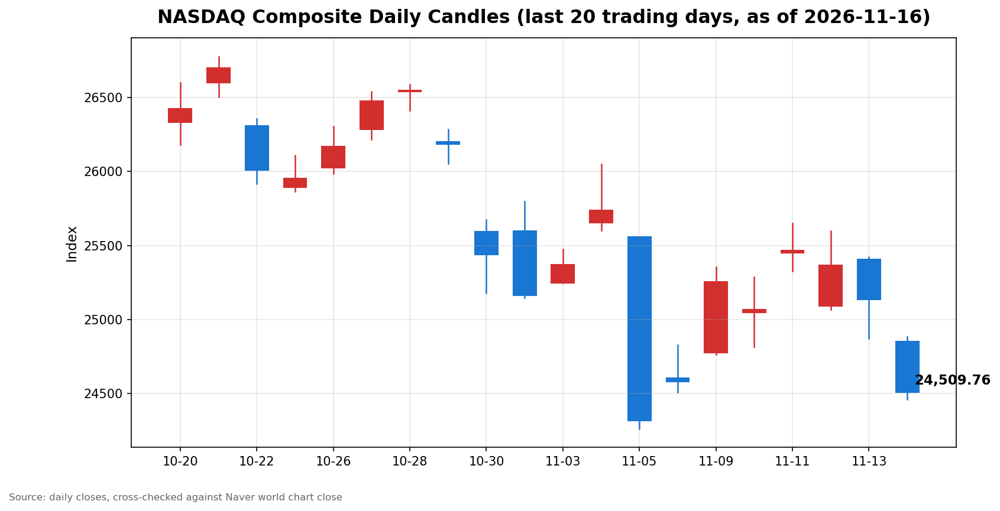

안녕하세요, [한국투자증권](https://securities.koreainvestment.com/main/Main.jsp)에서 [한투-한국투자증권](https://play.google.com/store/apps/details?id=com.truefriend.neosmartarenewal&hl=ko) 개발을 담당하고 있는 way입니다. 
2026년 11월 16일 나스닥 장 마감 흐름을 수치 중심으로 정리합니다. 

## 마감 요약

나스닥 종합은 24,509.76으로 전일 종가보다 626.52포인트, 2.49% 내렸습니다. 
장중 저가 24,460.28까지 밀린 뒤 종가는 저가보다 49.48포인트 높은 수준에서 마감했습니다. 
스탠더드앤드푸어스 500 지수는 1.92% 내렸고, 다우존스 산업평균지수는 1.41% 내리며 3대 지수가 일제히 하락했습니다. 
하락이 기술주와 인공지능 체인에 집중된 장이었습니다. 
이날의 촉매는 미국의 대중국 AI 칩 접근 규제 강화, 엔비디아 실적 발표를 앞둔 경계, 연준의 금리 경로에 대한 불확실성이 겹친 것입니다. 

## 오늘의 마감 스냅샷

| 지수 | 종가 | 전일 대비 | 등락률 | 전일 종가 | 당일 고가 | 당일 저가 | 스냅샷 기준 시각 |
| --- | --- | --- | --- | --- | --- | --- | --- |
| 나스닥 종합 | 24,509.76 | -626.52 | -2.49% | 25,136.27 | 24,882.04 | 24,460.28 | 미국 동부시간 2026-11-16 16:21, 한국시간 2026-11-17 06:21 |
| 스탠더드앤드푸어스 500 | 7,416.59 | -145.08 | -1.92% | 7,561.67 | 7,515.60 | 7,400.15 | 미국 동부시간 2026-11-16 16:20 전후, 한국시간 2026-11-17 06:20 전후 |
| 다우존스 산업평균지수 | 51,608.17 | -739.38 | -1.41% | 52,347.55 | 52,324.00 | 51,511.56 | 미국 동부시간 2026-11-16 16:20 전후, 한국시간 2026-11-17 06:20 전후 |

나스닥 종합의 시가는 24,853.35였습니다. 
전일 종가와 비교하면 시가 기준으로는 1.13% 하락 출발했습니다. 
시가 대비 종가는 343.59포인트 내렸고, 장 초반부터 하락이 이어졌습니다. 
장중 저가는 24,460.28로 전일 대비 2.69% 하락 수준이었습니다. 
종가는 장중 저가보다 49.48포인트 높고, 저가 대비 0.20% 되돌린 상태입니다. 
장중 고가는 24,882.04로 시가와 비슷한 수준이었습니다. 
나스닥 종합 값은 네이버 월드 차트 페이지에서 직접 확인했습니다. 
한국투자증권 MTS 해외 대시보드 기준 나스닥 종합은 24,509.76으로, 네이버 값과 정확히 일치했습니다. 
스탠더드앤드푸어스 500 지수 값은 한국투자증권 MTS 해외 대시보드에서 확인했습니다. 
스탠더드앤드푸어스 500 지수와 다우존스 산업평균지수의 당일 고가와 저가는 야후 파이낸스 일봉 수치로 확인했습니다. 
다우존스 산업평균지수 종가와 전일 대비, 등락률은 네이버 월드 차트 페이지 하단 시장지표에서 확인했습니다. 
나스닥 선물은 한국투자증권 MTS 기준 27,299.50으로 전일 대비 2.62% 내렸습니다. 
원·달러 환율은 한국투자증권 MTS 기준 1,336.50원으로, 지난 거래일 1,337.60원보다 1.10원 내렸습니다. 
나스닥 종합 거래량은 1,593,296천주였습니다. 
참고로 [네이버 월드 차트 나스닥 종합](https://finance.naver.com/world/sise.naver?symbol=NAS@IXIC)과 [네이버 월드 차트 나스닥 종합 가격](https://stock.naver.com/worldstock/index/.IXIC/price) 링크를 함께 둡니다. 

## 차트

최근 20거래일 일봉 차트입니다. 
빨간 봉은 종가가 시가보다 높은 날, 파란 봉은 종가가 시가보다 낮은 날입니다. 

## 원인·촉매 분석

표면적으로는 나스닥이 2.49% 내렸습니다. 
근본 촉매는 세 갈래로 겹쳐 있습니다. 
첫째는 AI 칩 접근 규제의 강화입니다. 
미국 상무부 산업안보국은 16일 잠정 규칙을 공개했습니다. 
중국 기업이 제3국 데이터센터를 통해 미국의 첨단 AI 칩 연산 능력을 우회 사용하는 경로를 막는 내용입니다. 
싱가포르, 태국, 말레이시아, 인도네시아, 브라질 등에서 첨단 AI 칩과 서버를 재수출하거나 원격 접근을 제공할 때 허가를 요구합니다. 
중국과 러시아, 이란 등에 본사나 최상위 모회사를 둔 기업이 규제 대상입니다. 
엔비디아 매출의 20% 이상이 중국에서 나온다는 보도가 있을 만큼, 중국 시장과 우회 경로가 AI 칩 수요의 일부를 차지해 왔습니다. 
규제가 수요 경로를 좁힐 수 있다는 우려가 반도체주 전반으로 번졌습니다. 
둘째는 엔비디아 실적 발표를 앞둔 경계입니다. 
엔비디아는 17일에 분기 실적을 발표합니다. 
창업자이자 최고경영자였던 젠슨 황이 11월 12일에 사임한 뒤 처음 맞는 실적 발표입니다. 
재무책임자인 콜레트 크레스가 임시 최고경영자를 맡고 있습니다. 
실적 내용보다 경영 공백과 AI 인프라 투자 지속성에 대한 시장의 평가가 먼저 움직였습니다. 
셋째는 금리와 유동성 환경입니다. 
미국 국채 10년물 수익률은 5.121%로 마감했습니다. 
5%대 초반의 수익률은 성장주 밸류에이션에 부담으로 작용합니다. 
연준 의장 케빈 워시는 16일 샌프란시스코 연설에서 인공지능을 주제로 삼았고, 금리 경로에 대해서는 언급하지 않았습니다. 
금리 인하 기대에 별다른 힘을 보태지 못한 점도 투자 심리를 눌렀습니다. 
전일 미국 지수 간 방향 차이는 크지 않았습니다. 
11월 13일에는 다우존스 산업평균지수가 0.10% 오르며 혼조였지만, 16일에는 3대 지수가 모두 내렸습니다. 
기술주 중심의 하락이 시장 전체로 확산된 하루였습니다. 

## 핵심 사건 3가지

### 1. 미국의 제3국 AI 칩 규제 강화

미국 상무부 산업안보국은 16일에 잠정 최종 규칙을 공개했습니다. 
중국 기업이 해외 데이터센터를 통해 첨단 AI 칩에 접근하는 경로를 차단하는 조치입니다. 
싱가포르, 태국, 말레이시아, 인도네시아, 브라질 등 특정 국가의 첨단 AI 칩과 서버에 대한 원격 접근에도 허가가 필요합니다. 
딥서치 문서 검색으로 확인한 한국 언론 보도에서도 같은 내용이 교차 검증됐습니다. 
이 조치가 중요한 이유는 AI 칩 수요의 지형을 바꾸기 때문입니다. 
중국은 2022년 미국의 첨단 반도체 수출 통제 이후에도 동남아시아 데이터센터와 중개업체를 통해 연산 능력을 확보해 왔습니다. 
우회 경로가 막히면 AI 칩 제조사의 수요 전망에 불확실성이 커집니다. 
시장에서는 규제의 직접 규모보다, AI 인프라 투자 사이클이 꺾일 수 있다는 심리적 충격이 크게 작용했습니다. 
중앙일보 GMC 허브의 [11/16 G브닝] 제목도 젠슨 황 없는 엔비디아 실적과 앤트로픽 상장을 AI 슈퍼위크의 개막으로 다뤘습니다. 

### 2. 엔비디아 경영 공백 속 실적 발표 임박

엔비디아 주가는 이날 약 4% 내렸습니다. 
젠슨 황 전 최고경영자는 11월 12일에 사임했습니다. 
사임 이후 주가는 2012년 10월 이후 가장 긴 주간 하락세를 기록했습니다. 
17일 실적 발표는 황 전 최고경영자 없이 처음 맞는 분기 성적표입니다. 
실적 발표 전부터 시장은 경영 공백과 AI 인프라 지출의 지속 가능성을 저울질하고 있습니다. 
19일에는 앤트로픽의 나스닥 상장이 예정돼 있습니다. 
역대 최대 규모의 기업공개가 될 수 있다는 전망이 나옵니다. 
일부에서는 개인 투자 자금이 다른 AI 주식에서 앤트로픽으로 이동할 수 있다는 관측도 있습니다. 
실적과 상장이 같은 주에 몰리면서 AI 섹터의 변동성은 당분간 이어질 수 있습니다. 

### 3. 변동성 지표 급등과 안전자산마저 약세

변동성 지수(VIX)는 19.30에서 23.11로 올랐습니다. 
하루 상승 폭은 19.74%에 달합니다. 
투자자가 가격 하락에 대비하는 움직임이 커졌다는 의미입니다. 
비트코인은 7월 이후 가장 낮은 수준으로 떨어졌습니다. 
가상자산 관련주인 스트래티지는 6.92% 내렸고, MSCI 지수에서 제외될 수 있다는 관측도 제기됐습니다. 
금은 장중 기준 0.61% 내려 3,862.60달러를 기록했습니다. 
주식과 가상자산, 금이 함께 내린 것은 위험 회피 자금이 뚜렷한 피난처를 찾지 못했다는 의미입니다. 
국제 유가도 서부텍사스산원유 기준 85.36달러로 전일 대비 3.61% 내렸습니다. 
골드만삭스는 내년 원유 공급 과잉을 이유로 유가 전망을 78달러로 낮췄습니다. 
원유 약세는 에너지주에는 부담이지만, 물가 측면에서는 부담을 덜어주는 요인입니다. 

## 지수·섹터 영향 체인

나스닥 종합이 2.49% 내린 반면, 스탠더드앤드푸어스 500 지수는 1.92%, 다우존스 산업평균지수는 1.41% 내렸습니다. 
기술주 비중이 높은 지수일수록 하락 폭이 컸습니다. 
정보기술과 커뮤니케이션서비스는 스탠더드앤드푸어스 500 지수 안에서 2.5% 넘게 내린 섹터로 보도됐습니다. 
필수소비재를 제외한 모든 섹터가 하락했습니다. 
반도체가 직격탄을 맞았습니다. 
엔비디아 약 4%, AMD 5% 안팎, 브로드컴 약 4%, 마이크론과 인텔 6%대 하락이 보도됐습니다. 
AI 칩 규제는 반도체 설계와 메모리, 장비로 이어지는 밸류체인 전체에 영향을 줍니다. 
규제로 수요가 줄면 메모리 가격과 장비 발주에도 파급이 이어질 수 있습니다. 
대형 기술주도 함께 내렸습니다. 
알파벳 약 3.6%, 아마존 약 3.4%, 메타 약 2.7%, 마이크로소프트 약 1.0% 하락이 보도됐습니다. 
하이퍼스케일러는 데이터센터 투자 규모가 크기 때문에, 규제와 중간선거 이후의 규제 논의가 투자 계획에 영향을 줄 수 있습니다. 
미국 중간선거에서는 민주당이 상원과 하원을 모두 차지했습니다. 
데이터센터 건설과 전력, 환경 문제가 선거 쟁점이 됐습니다. 
내년 1월 민주당이 의회를 장악하면 인프라 인허가와 규제 심사가 강화될 수 있다는 관측이 나옵니다. 
금리 경로는 성장주 밸류에이션과 연결됩니다. 
10년물 수익률이 5.1%대에 머무르면 미래 현금흐름의 현재가치가 낮아집니다. 
유가 하락은 에너지 섹터에는 부담이지만, 운송과 소비재의 비용 부담을 덜어줍니다. 
이날의 하락은 특정 섹터의 문제가 아니라, AI 밸류체인 전반의 재평가로 확산됐습니다. 

## 다우·S&P500 마감 흐름

다우존스 산업평균지수는 51,608.17로 전일 대비 739.38포인트, 1.41% 내렸습니다. 
장중 고가는 52,324.00, 저가는 51,511.56이었습니다. 
시가 52,267.06에서 출발해 장중 내내 하락 압력을 받았습니다. 
스탠더드앤드푸어스 500 지수는 7,416.59로 전일 대비 145.08포인트, 1.92% 내렸습니다. 
장중 고가는 7,515.60, 저가는 7,400.15였습니다. 
시가 7,513.98에서 출발한 뒤 장중 저가까지 밀렸고, 종가는 저가보다 16.44포인트 높았습니다. 
3대 지수가 모두 하락했지만, 낙폭은 나스닥이 가장 컸습니다. 
다우존스 산업평균지수와 스탠더드앤드푸어스 500 지수는 기술주보다 경기 방어적인 종목 비중이 높아 상대적으로 낙폭이 작았습니다. 
나스닥 종합은 10월 6일 사상 최고 종가 27,599 대비 11.19% 낮은 수준입니다. 
11월 5일에 기록한 24,315보다는 194.76포인트 높은 수준에서 마감했습니다. 

## 단기·중기 전망과 다음 거래일 확인할 시나리오

흐름 지속과 일시적 노이즈를 구분하는 기준은 17일 엔비디아 실적입니다. 
실적 발표 전후로 반도체와 AI 체인의 방향이 다시 정해질 수 있습니다. 
19일 앤트로픽 상장도 같은 주의 변수입니다. 
다음 거래일에는 세 가지 구간을 확인합니다. 
첫째, 나스닥 종합의 당일 저가 24,460.28과 11월 5일 저점 24,315 부근입니다. 
이 구간을 지키지 못하면 하락이 이어질 수 있습니다. 
둘째, 25,000선 회복 여부입니다. 
25,000선을 되찾지 못하면 반등은 기술적 되돌림에 그칠 수 있습니다. 
셋째, 국채 10년물 수익률의 5.1%대 유지 여부입니다. 
수익률이 더 오르면 성장주 밸류에이션 부담이 커집니다. 
중기적으로는 AI 칩 규제의 세부 적용 범위가 관건입니다. 
허가 대상 국가와 적용 시점이 확정되면, 반도체 수요 전망이 다시 계산될 수 있습니다. 
중간선거 이후의 데이터센터 규제 논의도 중기 변수입니다. 
단기 변동성은 높지만, 지수 단위에서는 저점 구간과 반등 저항 구간을 확인하며 대응하는 것이 중요합니다. 
이 글은 매수나 매도를 권유하지 않습니다. 

## 마치며

나스닥은 AI 칩 규제와 엔비디아 실적 경계가 겹치며 2.49% 급락했습니다. 
17일 실적과 19일 앤트로픽 상장이 다음 흐름을 가를 변수입니다. 
이 글은 교육과 해설을 목적으로 작성했으며, 특정 종목의 매수나 매도를 권유하지 않습니다. 
