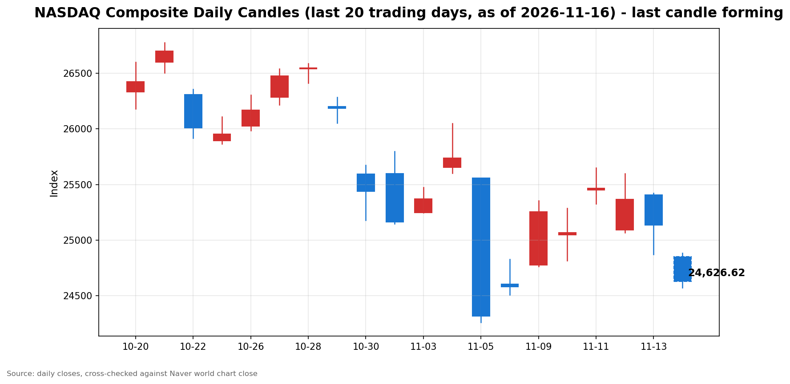

안녕하세요, [한국투자증권](https://securities.koreainvestment.com/main/Main.jsp)에서 [한투-한국투자증권](https://play.google.com/store/apps/details?id=com.truefriend.neosmartarenewal&hl=ko) 개발을 담당하고 있는 way입니다. 
2026년 11월 16일 나스닥 장중 흐름을 수치 중심으로 정리합니다. 

## 장중 요약

나스닥 종합은 미국 동부시간 12시 59분 기준 24,606.18로 전일 종가보다 530.09포인트, 2.11% 내렸습니다. 
시가 24,853.35로 1.13% 갭 하락 출발한 뒤, 장 초반 반등이 시가 대비 0.12%에 그쳤습니다. 
이후 하락이 이어지며 장중 저가 24,572.01까지 밀렸고, 현재가는 저점 부근에서 거래되고 있습니다. 
스탠더드앤드푸어스 500 지수는 1.51% 내렸고, 다우존스 산업평균지수는 0.93% 내렸습니다. 
낙폭이 나스닥에 가장 크고 다우에 가장 작은 점은, 하락이 기술주와 인공지능 체인에 집중되고 있음을 보여줍니다. 
이날의 촉매는 젠슨 황 사임 여파의 지속, 유가 급락, 그리고 이번 주에 몰린 대형 이벤트를 앞둔 경계감입니다. 

## 오늘의 스냅샷

| 지수 | 현재가 | 전일 대비 | 등락률 | 전일 종가 | 장중 고가 | 장중 저가 | 스냅샷 기준 시각 |
| --- | --- | --- | --- | --- | --- | --- | --- |
| 나스닥 종합 | 24,606.18 | -530.09 | -2.11% | 25,136.27 | 24,882.04 | 24,572.01 | 미국 동부시간 2026-11-16 12:59, 한국시간 2026-11-17 02:59 |
| 스탠더드앤드푸어스 500 | 7,447.22 | -114.45 | -1.51% | 7,561.67 | 7,513.78 | 7,450.50 | 미국 동부시간 2026-11-16 12:59, 한국시간 2026-11-17 02:59 |
| 다우존스 산업평균지수 | 51,858.93 | -488.62 | -0.93% | 52,347.55 | 52,324.00 | 51,853.83 | 미국 동부시간 2026-11-16 12:59, 한국시간 2026-11-17 02:59 |

당일 수치는 형성 중인 수치로, 마감 전에는 계속 변합니다. 
나스닥 종합의 시가는 24,853.35였습니다. 
전일 종가와 비교하면 시가 기준으로는 1.13% 갭 하락 출발했습니다. 
장중 고가는 24,882.04로 시가보다 0.12% 높은 수준에 그쳤고, 장중 저가는 24,572.01로 전일 대비 2.24% 하락 수준이었습니다. 
현재가는 장중 저가보다 34.17포인트 높고, 저가 대비 0.14% 되돌린 상태입니다. 
전일 장중 저가 24,872.41과 비교하면, 현재가는 전일 저가를 266.23포인트 밑돌고 있습니다. 
52주 최고 27,722.75와 비교하면, 현재가는 52주 최고보다 11.24% 낮은 수준입니다. 
나스닥 종합 값은 네이버 월드 차트 페이지에서 직접 확인했습니다. 
한국투자증권 MTS 해외 대시보드 기준 나스닥 종합은 12시 55분 기준 24,635.69로, 네이버 값과 0.12% 이내에서 일치했습니다. 
전일 종가 25,136.27은 양쪽에서 정확히 일치했습니다. 
스탠더드앤드푸어스 500 지수 값은 네이버 월드 차트 페이지에서 확인했습니다. 
스탠더드앤드푸어스 500 지수의 장중 고가와 저가는 한국투자증권 MTS 시계열의 최대값과 최소값으로 산출했습니다. 
한국투자증권 MTS 시계열은 표본 수가 적어, 실제 장중 고가와 저가보다 좁게 나타날 수 있습니다. 
다우존스 산업평균지수 값은 네이버 월드 차트 페이지에서 확인했습니다. 
나스닥 선물은 한국투자증권 MTS 기준 27,425.75로 전일 대비 2.17% 내렸습니다. 
원·달러 환율은 한국투자증권 MTS 기준 1,336.00원으로, 전일 대비 0.12% 내렸습니다. 
참고로 [네이버 월드 차트 나스닥 종합](https://finance.naver.com/world/sise.naver?symbol=NAS@IXIC)과 [네이버 월드 차트 나스닥 종합 가격](https://stock.naver.com/worldstock/index/.IXIC/price) 링크를 함께 둡니다. 

## 차트

최근 20거래일 일봉 차트입니다. 
빨간 봉은 종가가 시가보다 높은 날, 파란 봉은 종가가 시가보다 낮은 날입니다. 
당일 봉은 형성 중인 봉으로, 마감 전에는 계속 변합니다. 

## 원인·촉매 분석

표면적으로는 나스닥이 장중 2.11% 내리고 있습니다. 
근본 촉매는 세 갈래로 겹쳐 있습니다. 
첫째는 인공지능 체인의 거버넌스 충격이 이어지고 있다는 점입니다. 
젠슨 황 최고경영자의 사임이 11월 12일 발표됐고, 11월 13일 효력이 발생했습니다. 
엔비디아는 지난주 10.6% 하락했고, 이날 장중에는 156.41달러로 전일 대비 3.95% 내리고 있습니다. 
필라델피아 반도체지수는 9,690.67로 전일 대비 4.49% 내리고 있습니다. 
실적이나 수요가 아니라 인물과 지배구조라는 변수가 지수를 움직이는 국면입니다. 
둘째는 금리와 달러 부담이 배경으로 남아 있다는 점입니다. 
미국 10년물 국채수익률은 5.13% 안팎의 수준으로, 전일 종가 5.15%와 비슷한 수준입니다. 
당일 금리가 크게 움직인 것은 아니어서, 금리는 이날의 직접적인 촉매라기보다 부담의 배경입니다. 
지난 금요일 발표된 10월 생산자물가지수는 전년 대비 6.5% 올라 약 4년 만에 가장 높은 수준을 기록했습니다. 
물가 둔화가 정체된 흐름이 확인된 만큼, 금리 경로에 대한 부담이 이어지고 있습니다. 
달러 강세도 이어지고 있습니다. 
달러지수는 103.53 수준이고, 국제 금은 3,861.40달러로 전일 대비 0.64% 내렸습니다. 
셋째는 유가 급락입니다. 
서부텍사스산원유는 86.14달러로 전일 대비 2.73% 내렸습니다. 
골드만삭스는 내년 전 세계 원유시장이 하루 200만 배럴의 공급 과잉이 될 것으로 전망했습니다. 
유가 하락은 물가 압력을 덜어주는 요인이지만, 수요 둔화 신호로 읽히면 위험자산 전반에 부담이 됩니다. 
아시아 시장의 선행 하락도 개장 전부터 하방 압력을 만들었습니다. 
코스피는 5,100.50으로 3.59% 하락 마감했고, 코스닥은 665.65로 4.86% 내렸습니다. 
일본 니케이지수도 2.42% 내렸습니다. 
미국 개장 전 나스닥100 선물은 0.90% 내린 상태였습니다. 
지수 간 방향 차이도 뚜렷합니다. 
나스닥이 2.11% 내리는 동안 스탠더드앤드푸어스 500 지수는 1.51% 내렸고, 다우는 0.93% 내리는 데 그쳤습니다. 
하락이 기술주와 인공지능 체인에 집중되고, 경기민감주와 가치주 쪽은 상대적으로 버티고 있음을 보여줍니다. 

## 핵심 사건 3가지

### 첫째, 젠슨 황 사임 여파와 엔비디아 실적 대기입니다

젠슨 황 최고경영자의 사임이 11월 12일 발표됐고, 11월 13일 효력이 발생했습니다. 
콜레트 크레스 최고재무책임자가 임시 최고경영자를 맡았습니다. 
엔비디아는 지난주 10.6% 하락했고, 이날 장중에는 156.41달러로 전일 대비 3.95% 내리고 있습니다. 
지난주 인공지능 대형주의 하락도 컸습니다. 
TSMC ADR은 5.3% 내렸고, 슈퍼마이크로는 14.2% 내렸고, 오라클은 13.2% 내렸고, 팔란티어는 13.7% 내렸고, AMD는 9.8% 내렸습니다. 
필라델피아 반도체지수는 이날 4.49% 내리고 있습니다. 
엔비디아 실적은 미국시간 11월 17일 장 마감 후에 발표되며, 한국시간으로는 11월 18일 새벽에 확인됩니다. 
실적 발표는 콜레트 크레스가 이끄는 임시 체제에서 이뤄집니다. 
이 사건이 중요한 이유는 인공지능 사이클의 상징인 기업에서 경영진 거버넌스 리스크가 불거졌기 때문입니다. 
실적이나 수요가 아니라 인물과 지배구조라는 변수가 지수를 움직이는 국면입니다. 
중앙일보 GMC 허브의 11월 14일 G모닝은 실적을 앞두고 월가의 비관적 전망이 있다는 제목을 달았습니다. 
투자자들 사이에서는 젠슨 황의 복귀를 바라는 목소리도 전해집니다. 
다만 후임자 선임까지의 공백과 의회 청문회 요구 등 불확실성은 남아 있습니다. 
실적 발표에서 나오는 메시지가 다음 관전 지점입니다. 
한편 모건스탠리의 마이클 윌슨 미국 주식 수석전략가는 기업들의 견조한 주당순이익 증가와 국제유가 하락, 금리 변동성 안정, 인공지능 투자 확대가 주가 상승을 뒷받침할 것으로 전망했습니다. 
2027년 인공지능 투자 사이클의 가장 중요한 변화로는 수혜 기업의 확대를 꼽았습니다. 

### 둘째, 유가 급락과 골드만삭스의 공급 과잉 전망입니다

서부텍사스산원유는 86.14달러로 전일 대비 2.73% 내렸습니다. 
지난 금요일 브렌트유는 1% 넘게 하락해 95달러를 밑돌았습니다. 
골드만삭스는 내년 전 세계 원유시장이 하루 200만 배럴의 공급 과잉이 될 것으로 전망했습니다. 
브렌트유 선물은 내년 연평균 88달러가 될 것으로 봤고, 리스크 프리미엄이 사라지면 연말에는 78달러 수준이 될 것으로 봤습니다. 
올해 미국과 이란의 전쟁으로 4월 브렌트유는 126달러까지 올랐고, 2022년 이후 최고치였습니다. 
중국 수요 둔화와 도로용 연료 수요 하루 40만 배럴 감소가 언급됐고, 중국 전체 원유 수요는 2025년에 이미 정점을 찍었다고 했습니다. 
이 사건이 중요한 이유는 유가가 물가와 경기라는 두 방향의 신호를 동시에 주기 때문입니다. 
유가 하락은 물가 압력을 덜어주는 요인이지만, 공급 과잉 전망이 수요 둔화와 겹치면 경기 신호로도 읽힙니다. 
에너지 섹터에는 직접적인 부담이 되고, 물가 부담이 완화되면 금리 경로에는 우호적으로 작용할 수 있습니다. 
두 해석이 맞서는 만큼, 유가 흐름이 마감까지 지수 방향에 영향을 주는 변수로 남아 있습니다. 

### 셋째, 인공지능 슈퍼위크 이벤트 대기입니다

이번 주에는 인공지능과 거시지표 관련 대형 일정이 몰려 있습니다. 
11월 17일에는 미국 10월 소매판매와 엔비디아 실적, 디즈니와 홈디포 실적이 예정돼 있습니다. 
도널드 트럼프 대통령의 아시아 순방도 같은 날 예정돼 있습니다. 
11월 18일에는 10월 27일과 28일 연방공개시장위원회 의사록과 팔로알토 네트웍스, 타깃, 로우스, TJX 실적이 예정돼 있습니다. 
11월 19일에는 앤트로픽이 나스닥에 상장합니다. 
기업가치는 2,870억 달러 수준으로 언급됐고, 공모 자금은 최대 644억 달러 수준으로 언급됐습니다. 
기업공개 수요는 공모 규모의 6배 수준으로 전해집니다. 
11월 16일에는 케빈 워시 전 연준 이사가 인공지능과 생산성 콘퍼런스에서 연설했습니다. 
이 사건이 중요한 이유는 단일 악재가 아니라 일정 자체가 변동성을 키우는 국면이기 때문입니다. 
변동성지수는 21.75로 전일 대비 12.69% 올랐습니다. 
이벤트를 앞둔 대기 심리가 짙어진 가운데, 결과에 따라 방향이 갈리는 구조입니다. 
반면 모건스탠리는 미국 주식에 대한 비중 확대 의견을 유지하고, 글로벌 주식 비중 확대를 권고했습니다. 
한국 주식을 대만보다 선호한다는 평가도 함께 내놨습니다. 
단기 조정과 중기 낙관 전망이 엇갈리는 국면이라, 이벤트 결과가 방향을 가를 가능성이 큽니다. 

## 지수·섹터 영향 체인

금리 부담은 성장주 밸류에이션을 통해 기술주에 작용하는 것이 일반적입니다. 
그런데 이날 하락의 직접적인 계기는 금리가 아니라 인공지능 체인 내부의 거버넌스 소식입니다. 
반도체와 인공지능 인프라 체인에는 엔비디아 사임 소식이 직접적인 심리 변수로 작용합니다. 
필라델피아 반도체지수가 4.49% 내리고, 엔비디아가 3.95% 내리는 점이 체인 내부의 충격을 보여줍니다. 
지난주에 크게 내렸던 인공지능 대형주들이 이번 주에도 체인 단위로 흔들리고 있습니다. 
인공지능 수요 자체보다, 수요를 떠받치는 구조와 주체에 대한 선별이 심해지는 모습입니다. 
반면 앤트로픽 기업공개에 대한 투자 열기는 높은 수준으로 전해집니다. 
기업공개 수요가 공모 규모의 6배 수준이라는 점이 이를 보여줍니다. 
엔비디아 투자심리가 악화된 상황과 대조를 이루고 있습니다. 
에너지 섹터는 유가 급락의 직접적인 영향을 받습니다. 
서부텍사스산원유가 2.73% 내린 점은 에너지 쪽의 상대적 약세를 시사합니다. 
다만 유가 하락이 물가 압력을 덜어주면, 금리 부담이 완화되는 방향으로 작용할 수 있습니다. 
금융 섹터는 금리 수준이 높은 상태가 순이자마진에는 우호적일 수 있으나, 경기 둔화 우려와 맞물려 방향이 엇갈릴 수 있습니다. 
다우가 0.93% 내리는 데 그친 점은 하락이 시장 전반으로 확산되지 않았음을 보여줍니다. 
다우는 경기민감주와 금융, 산업재 비중이 높아, 인공지능 체인 악재에 직접 노출되는 정도가 낮습니다. 
스탠더드앤드푸어스 500 지수가 1.51% 내린 것은 기술주 하락이 지수 전반을 끌어내리고 있으나, 다우 쪽의 상대적 선방이 상쇄하고 있음을 보여줍니다. 
안전자산도 이날은 약세를 보였습니다. 
국제 금은 달러 강세에 0.64% 내렸습니다. 
위험 회피 속에서도 달러 강세가 금 가격을 누르는 모습입니다. 
한국 시장에서도 같은 체인이 흔들렸습니다. 
SK하이닉스는 7.05% 내린 1,028,000원에 마감했고, 장중 995,000원까지 밀렸습니다. 
미국에서 D램 가격 담합 소송을 당했다는 소식이 전해졌습니다. 
삼성전자는 2.5% 내린 150,100원에 마감했습니다. 
코스피 시장에서는 외국인이 4,270억 원을 순매도했고, 프로그램 매매는 1.6조 원 순매도했습니다. 
결국 이날의 차별화는 금리 경로라는 공통 변수 위에 인공지능 체인 고유의 변수가 얹힌 결과입니다. 

## 다우·S&P500 흐름

다우존스 산업평균지수는 51,858.93으로 전일 대비 488.62포인트, 0.93% 내렸습니다. 
전일 종가는 52,347.55였습니다. 
장중 고가는 52,324.00으로 전일 종가를 밑돌았고, 장중 저가는 51,853.83이었습니다. 
현재가는 장중 저가보다 5.10포인트 높은 수준으로, 저점 부근에서 거래되고 있습니다. 
스탠더드앤드푸어스 500 지수는 7,447.22로 전일 대비 114.45포인트, 1.51% 내렸습니다. 
전일 종가는 7,561.67였습니다. 
스탠더드앤드푸어스 500 지수는 7,500선을 밑돌고 있습니다. 
세 지수가 모두 내리는 가운데 낙폭이 나스닥에 가장 크다는 점은, 이날 하락이 인공지능 체인에 집중된 하락임을 보여줍니다. 
다우의 장중 고가가 전일 종가를 웃돌지 못한 점은 가치주 쪽의 버팀목도 장 초반부터 약했음을 시사합니다. 
스탠더드앤드푸어스 500 지수가 7,500선을 회복하는지와 다우가 52,000선을 회복하는지가 마감까지의 관전 지점입니다. 

## 오전과 오후 흐름 변화

나스닥은 시가 24,853.35로 1.13% 갭 하락 출발했습니다. 
장 초반 고가 24,882.04를 찍은 뒤 하락으로 돌아섰습니다. 
고가는 시가보다 0.12% 높은 수준에 그쳐, 오전 반등 시도가 제한적이었음을 보여줍니다. 
한국투자증권 MTS 장중 시계열 기준으로는 오전 중 24,872선까지 오른 뒤 하락 전환이 나타났습니다. 
이후 저점을 향해 꾸준히 밀리며, 현재가는 장중 저가 24,572.01보다 0.14% 높은 수준에서 거래되고 있습니다. 
오전에는 갭 하락 출발 뒤 제한적인 반등이 나타났고, 오후 들어서는 저가 부근으로 밀리는 흐름이 이어지고 있습니다. 
되돌림이 추세 전환인지는 아직 확인되지 않았습니다. 
스탠더드앤드푸어스 500 지수도 비슷한 흐름입니다. 
한국투자증권 MTS 시계열 기준 장중 고가는 7,513.78이었고, 저가는 7,450.50이었습니다. 
현재가는 한국투자증권 MTS 시계열의 저가와 비슷한 수준에서 거래되고 있습니다. 
다우는 시가 52,267.06으로 0.15% 하락 출발한 뒤 고가 52,324.00을 찍고 저가 부근으로 밀렸습니다. 
엔비디아는 장중 156.41달러로 전일 대비 3.95% 내리고 있습니다. 
오전의 반등이 오후 들어 이어지지 못하고, 낙폭이 확대되는 모습입니다. 

## 마감까지 전망과 확인할 시나리오

단기적으로는 저가에서의 반등이 이어지는지, 다시 저가를 향하는지가 갈림길입니다. 
마감까지 확인할 첫 번째 수치는 장중 저가 24,572.01 방어 여부입니다. 
현재가는 저가보다 34.17포인트 높은 상태입니다. 
저가를 지키면 저가 매수세가 버티는 흐름으로 해석될 수 있습니다. 
저가를 밑돌면 낙폭 확대 시나리오가 힘을 얻을 수 있습니다. 
두 번째로 확인할 구간은 25,000선입니다. 
현재가가 25,000선보다 393.82포인트 낮아, 회복까지는 거리가 있습니다. 
25,000선을 회복하면 갭 메우기 흐름이 이어지는 시나리오가 힘을 얻습니다. 
전일 종가 25,136.27 회복 여부도 함께 확인할 필요가 있습니다. 
스탠더드앤드푸어스 500 지수는 7,500선, 다우는 52,000선 회복 여부를 확인할 필요가 있습니다. 
엔비디아 주가의 방향도 함께 확인할 사안입니다. 
장중 156.41달러 수준에서 더 밀리면 체인 전반의 매도 압력이 커질 수 있고, 160달러 회복이 이어지면 충격이 진정되는 방향으로 해석될 수 있습니다. 
미국 10년물 국채수익률이 5.15%를 넘어서는지도 확인할 구간입니다. 
나스닥 선물이 2.17% 내리고 있어, 마감까지 하방 압력이 이어질 가능성을 시사합니다. 
중기적으로는 12월 연방공개시장위원회까지 물가 지표와 연준 위원들의 발언이 방향을 정합니다. 
이번 주에는 10월 소매판매와 엔비디아 실적, 연방공개시장위원회 의사록, 앤트로픽 상장이 차례로 예정돼 있습니다. 
결과에 따라 방향이 갈리는 국면이라, 단일 이벤트에 대한 단정적인 해석은 피할 필요가 있습니다. 
인공지능 체인에서는 실적 모멘텀과 거버넌스 리스크가 번갈아 가격을 움직이는 국면이라, 체인 단위의 변동성에 유의할 필요가 있습니다. 
이 글은 지수와 섹터 단위의 흐름을 정리한 것으로, 특정 종목의 매수나 매도를 권유하지 않습니다. 

## 마치며

나스닥은 갭 하락 출발 뒤 제한적인 반등에 그치며 장중 2.11% 내리고 있고, 엔비디아발 인공지능 조정과 유가 급락이 겹친 흐름입니다. 
마감까지 장중 저가 방어 여부와 이번 주 대형 이벤트의 결과를 확인할 필요가 있습니다. 
이 글은 매수나 매도를 권유하지 않습니다. 
