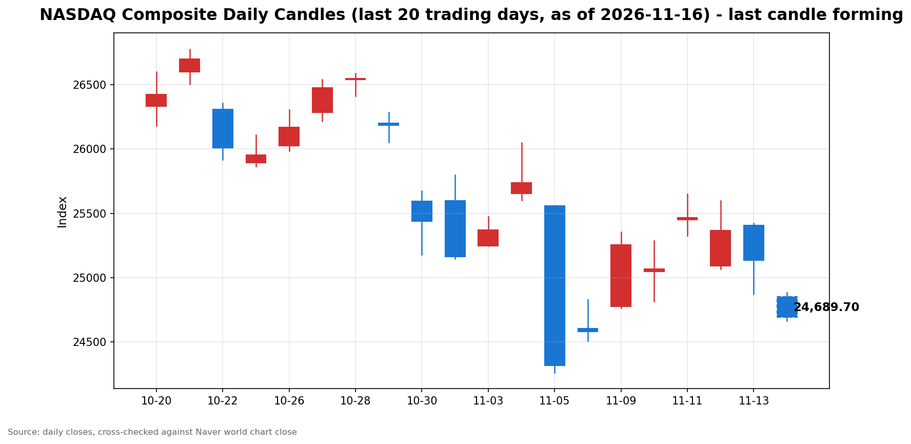

안녕하세요, [한국투자증권](https://securities.koreainvestment.com/main/Main.jsp)에서 [한투-한국투자증권](https://play.google.com/store/apps/details?id=com.truefriend.neosmartarenewal&hl=ko) 개발을 담당하고 있는 way입니다. 
2026년 11월 16일 나스닥 장 오픈 흐름을 수치 중심으로 정리합니다. 

## 개장 배경

전 거래일인 11월 13일 미국 증시는 혼조 마감했습니다. 
나스닥 종합은 25,136.27로 전 거래일 대비 0.91% 내렸습니다. 
스탠더드앤드푸어스 500 지수는 7,561.67로 0.4% 내렸고, 다우존스 산업평균지수는 52,347.55로 0.1% 올랐습니다. 
하락의 중심에는 엔비디아 최고경영자 사임 여파가 있습니다. 
엔비디아는 11월 13일 162.85달러로 마감했고, 전일 대비 2.01% 내렸습니다. 
지난 한 주 동안 엔비디아 주가는 약 13% 급락했습니다. 
11월 16일 나스닥은 전일 종가보다 282.92포인트 낮은 24,853.35로 갭다운 출발했습니다. 
시가 기준 하락률은 1.13%입니다. 
개장 뒤에도 낙폭이 커져 10시 기준 24,690.09까지 밀렸습니다. 
장 초반 하락률은 1.78%입니다. 
금요일의 하락이 주말을 거치며 되돌림 없이 이어지는 흐름입니다. 

## 오늘의 스냅샷

| 지수 | 현재가 | 전일 대비 | 등락률 | 전일 종가 | 장중 고가 | 장중 저가 | 스냅샷 기준 시각 |
| --- | --- | --- | --- | --- | --- | --- | --- |
| 나스닥 종합 | 24,690.09 | -446.18 | -1.78% | 25,136.27 | 24,882.04 | 24,690.09 | 미국 동부시간 2026-11-16 10:00, 한국시간 2026-11-17 00:00 |
| 스탠더드앤드푸어스 500 | 7,491.04 | -70.63 | -0.93% | 7,561.67 | 7,513.78 | 7,489.63 | 미국 동부시간 2026-11-16 10:00 전후, 한국시간 2026-11-17 00:00 전후 |
| 다우존스 산업평균지수 | 52,045.56 | -301.99 | -0.58% | 52,347.55 | 52,324.00 | 52,045.32 | 미국 동부시간 2026-11-16 10:00, 한국시간 2026-11-17 00:00 |

당일 수치는 형성 중인 수치로, 마감 전에는 계속 변합니다. 
나스닥 종합의 시가는 24,853.35였습니다. 
전일 종가와 비교하면 시가 기준으로는 1.13% 하락 출발했습니다. 
장중 고가는 24,882.04로 시가와 비슷한 수준이었고, 장중 저가는 24,690.09로 현재가와 같은 수준입니다. 
시가 대비 현재가는 163.26포인트 내렸고, 갭다운 출발 뒤에도 매도 압력이 이어지는 상태입니다. 
나스닥 종합의 거래량은 248,292천주, 다우존스 산업평균지수의 거래량은 125,721천주입니다. 
스탠더드앤드푸어스 500 지수의 거래량은 확인이 필요해 표기하지 않았습니다. 
나스닥 종합과 다우존스 산업평균지수 값은 네이버 월드 차트 페이지에서 직접 확인했습니다. 
스탠더드앤드푸어스 500 지수 값은 한국투자증권 MTS 해외 대시보드에서 확인했습니다. 
네이버 S&P 500 페이지는 Npay 증권 홈으로 이동해 값을 확인할 수 없었기 때문입니다. 
스탠더드앤드푸어스 500 지수의 장중 고가와 저가는 한국투자증권 MTS 시계열의 최대값과 최소값으로 산출했습니다. 
한국투자증권 MTS 시계열은 표본 수가 적어, 실제 장중 고가와 저가보다 좁게 나타날 수 있습니다. 
한국투자증권 MTS 기준 나스닥 종합은 10시 전후 24,773.30으로, 네이버 값과 같은 하락 방향을 보였습니다. 
전일 종가는 한국투자증권 MTS 값에서도 25,136.27로 네이버 값과 정확히 일치했습니다. 
한국투자증권 MTS 기준 스탠더드앤드푸어스 500 지수는 10시 3분 기준 7,472.97로, 하락이 이어지고 있습니다. 
나스닥 선물은 한국투자증권 MTS 기준 27,608.75로 전일 대비 1.52% 내렸습니다. 
원·달러 환율은 한국투자증권 MTS 기준 1,336.10원으로, 전일 대비 1.50원 내렸습니다. 
참고로 [네이버 월드 차트 나스닥 종합](https://finance.naver.com/world/sise.naver?symbol=NAS@IXIC)과 [네이버 월드 차트 나스닥 종합 가격](https://stock.naver.com/worldstock/index/.IXIC/price) 링크를 함께 둡니다. 

## 차트

최근 20거래일 일봉 차트입니다. 
빨간 봉은 종가가 시가보다 높은 날, 파란 봉은 종가가 시가보다 낮은 날입니다. 
당일 봉은 형성 중인 봉으로, 마감 전에는 계속 변합니다. 

## 원인·촉매 분석

표면적으로는 나스닥이 전일 대비 1.78% 하락 출발했습니다. 
근본 촉매는 두 갈래입니다. 
첫째는 인공지능 사이클의 상징 기업에서 터진 거버넌스 충격이 가시지 않은 점입니다. 
엔비디아 최고경영자의 사임이 11월 12일 발표됐고, 주가는 지난 한 주 동안 약 13% 급락했습니다. 
실적이나 수요가 아니라 인물과 지배구조라는 변수가 지수를 움직이는 국면이 이어지고 있습니다. 
둘째는 물가 지표가 다시 연준의 금리 경로를 묶은 점입니다. 
미국 10월 생산자물가지수 상승률이 전년 동월 대비 약 4년 만에 최고치를 기록했습니다. 
10월 근원 소비자물가지수도 전월 대비 0.3% 올라 시장 예상 0.2%를 웃돌았고, 0.3% 상승은 3개월 연속입니다. 
물가 재가속이라기보다는 끈적한 물가 흐름이 이어지고 있다는 해석이 나옵니다. 
미국 10년물 국채금리는 5%를 다시 넘어선 것으로 보도됐습니다. 
11월 13일 장 초반에는 5.162%를 기록했습니다. 
성장주 밸류에이션에는 금리가 직접적인 부담으로 작용합니다. 
지수 간 방향 차이도 뚜렷합니다. 
나스닥이 1.78% 내리는 동안 스탠더드앤드푸어스 500 지수는 0.93% 내렸고, 다우는 0.58% 내렸습니다. 
하락이 기술주와 인공지능 체인에 집중되고, 경기민감주와 가치주 쪽은 상대적으로 버티고 있음을 보여줍니다. 
금요일에는 다우만 0.1% 올랐지만, 오늘은 세 지수가 모두 내리고 있습니다. 
다만 낙폭의 크기는 나스닥, 스탠더드앤드푸어스 500 지수, 다우 순으로 벌어져 있습니다. 
유가도 이날의 변수입니다. 
서부텍사스산원유는 11월 13일 89.47달러로 전일 종가 88.74달러보다 0.82% 올랐습니다. 
11월 16일 당일 유가는 확인이 필요합니다. 
에너지 가격 상승은 물가 압력을 더하는 방향이라, 금리 경계와 함께 성장주에 부담으로 작용할 수 있습니다. 

## 핵심 사건 3가지

### 첫째, 젠슨 황 엔비디아 최고경영자 사임 여파의 지속입니다

엔비디아는 11월 12일 젠슨 황 최고경영자의 사임을 발표했습니다. 
사임은 대표이사, 사장, 이사회 구성원 자리에서 모두 즉시 효력이 발생했습니다. 
콜레트 크레스 최고재무책임자가 임시 최고경영자를 맡고, 이사회는 내외부 후보를 대상으로 후임자 물색에 들어갔습니다. 
사임 발표에 앞서 11월 8일에는 이사회가 외부 법률 자문과 함께 독립 조사를 개시했고, 11월 11일에는 월스트리트저널이 이사회의 해임 준비를 보도했습니다. 
11월 12일 정규장에서 엔비디아 주가는 151.01달러로 개장해 장중 148.80달러까지 밀렸다가 166.19달러로 마감했습니다. 
전일 종가 173.73달러 대비 4.34% 하락했고, 장중 저가 기준 하락률은 14.35%였습니다. 
11월 13일에는 162.85달러로 마감해 2.01% 더 내렸습니다. 
지난 한 주 동안의 하락률은 약 13% 수준입니다. 
경쟁사인 AMD 주가도 지난 한 주 동안 8.75% 급락했습니다. 
이 사건이 중요한 이유는 인공지능 사이클의 상징인 기업에서 경영진 거버넌스 리스크가 불거졌기 때문입니다. 
엔비디아가 그동안 인공지능 기업들에 대규모 자금을 투자하며 반도체 수요를 뒷받침해 온 만큼, 경영진 교체로 자금 지원이 축소되면 인공지능 투자 생태계와 반도체 수요 전반이 위축될 수 있다는 우려가 커지고 있습니다. 
중앙일보 GMC 허브의 11월 16일 G프터눈 제목도 젠슨 황 리스크가 여전하다고 다루고 있어, 이날 시장의 화두였음이 확인됩니다. 
기사 본문은 유료라 제목 수준에서만 참고했습니다. 
다만 후임자 선임까지의 공백과 의회 청문회 요구 등 불확실성은 남아 있습니다. 
11월 17일 장 마감 후 발표되는 엔비디아 실적에서 나오는 메시지가 다음 관전 지점입니다. 

### 둘째, 미국 10월 생산자물가지수 약 4년 만에 최고치와 연준 12월 빅스텝 가능성입니다

미국 10월 생산자물가지수 상승률이 전년 동월 대비 약 4년 만에 최고치를 기록했습니다. 
이에 따라 연준이 12월에 한 번에 0.5%포인트를 올리는 빅스텝에 나설 가능성까지 제기되고 있습니다. 
크리스토퍼 월러 연방준비제도 이사는 10월 근원 소비자물가지수가 0.3% 이상을 또 기록하면 12월 회의에서 0.5%포인트 금리 인상을 검토해야 한다는 입장을 밝혔습니다. 
이번 발표는 그 기준에 부합하는 결과입니다. 
로리 로건 댈러스 연방준비은행 총재는 최소 두 차례의 추가 인상이 필요하다고 말했습니다. 
일주일 전까지만 해도 시장은 12월 금리 동결 가능성을 열어뒀지만, 예상보다 높은 물가 지표와 연준 인사들의 발언 이후 분위기가 급변했습니다. 
지난주 미국 2년물 국채금리는 최대 37bp 급등했습니다. 
이 사건이 중요한 이유는 연방준비제도의 12월 결정이 다시 물가 지표에 묶였기 때문입니다. 
금리 인상 기대가 유지되는 한 성장주 중심의 나스닥에는 부담이 이어질 수 있습니다. 
이번 주에는 연준 의장의 발언과 11월 18일 공개되는 10월 연방공개시장위원회 의사록이 방향을 가를 변수입니다. 
중앙일보 GMC 허브의 11월 14일 G모닝 제목도 물가 지표에도 불구하고 반도체가 급락했다고 다루고 있어, 물가 부담이 이날 시장의 화두였음이 확인됩니다. 
기사 본문은 유료라 제목 수준에서만 참고했습니다. 

### 셋째, 인공지능 슈퍼위크의 개막입니다

이번 주는 엔비디아 실적과 앤트로픽 기업공개가 겹치는 인공지능 슈퍼위크입니다. 
엔비디아 실적은 11월 17일 장 마감 후에 발표됩니다. 
젠슨 황 최고경영자의 사퇴 이후 처음 발표되는 실적입니다. 
시장에서는 엔비디아의 매출과 이익이 모두 전년 동기 대비 100% 가까이 증가할 것으로 예상하고 있습니다. 
투자자들의 관심은 황 전 최고경영자의 퇴진 이후 경영 안정성과 성장 전망에 집중되고 있습니다. 
앤트로픽은 11월 18일 공모가를 확정하고 11월 19일 나스닥에서 거래를 시작할 예정입니다. 
이 사건이 중요한 이유는 인공지능 사이클의 다음 방향을 가늠하는 재료가 한 주에 몰려 있기 때문입니다. 
실적이 경영 안정성에 대한 의구심을 덜어주면 체인 전반의 심리도 진정되는 방향으로 해석될 수 있습니다. 
반대로 실적이나 가이던스에서 흔들림이 확인되면 거버넌스 충격이 수요 우려로 번지는 흐름이 이어질 수 있습니다. 
앤트로픽 상장은 인공지능 기업에 대한 시장의 평가를 확인하는 계기가 됩니다. 
중앙일보 GMC 허브의 11월 16일 G브닝 제목도 젠슨 황 없는 엔비디아 실적과 앤트로픽 상장을 인공지능 슈퍼위크의 개막으로 다루고 있습니다. 
기사 본문은 유료라 제목 수준에서만 참고했습니다. 

## 지수·섹터 영향 체인

금리 인상 경계는 성장주 밸류에이션을 통해 기술주에 가장 먼저 작용하는 것이 일반적입니다. 
그런데 이날 하락의 직접적인 계기는 금리가 아니라 인공지능 체인 내부의 거버넌스 소식입니다. 
반도체와 인공지능 인프라 체인에는 엔비디아 사임 소식이 직접적인 심리 변수로 작용합니다. 
금요일에 AMD가 급락한 것처럼, 체인 내부의 종목들이 함께 흔들리고 있습니다. 
엔비디아의 자금 지원 축소 우려는 인공지능 기업들의 투자 여력과 반도체 수요로 이어지는 연결고리입니다. 
다우가 0.58% 내리는 데 그친 점은 하락이 시장 전반으로 확산되지 않았음을 보여줍니다. 
다우는 경기민감주와 금융, 산업재 비중이 높아, 인공지능 체인 악재에 직접 노출되는 정도가 낮습니다. 
스탠더드앤드푸어스 500 지수가 0.93% 내린 것은 기술주 하락이 지수 전반을 끌어내리고 있으나, 다우 쪽의 상대적 선방이 상쇄하고 있음을 보여줍니다. 
금융 섹터는 금리 인상 기대가 순이자마진에는 우호적일 수 있으나, 경기 둔화 우려와 맞물려 방향이 엇갈릴 수 있습니다. 
에너지 섹터는 유가 상승이 직접적인 수혜 요인입니다. 
서부텍사스산원유가 89.47달러까지 오른 점이 에너지 쪽의 상대적 강세를 뒷받침합니다. 
아시아 시장에서도 같은 흐름이 나타났습니다. 
일본 니케이 225 지수는 11월 16일 59,662.02로 전일 대비 2.42% 내렸습니다. 
기술주 약세가 지역을 넘어 확산되고 있음을 보여줍니다. 
결국 이날의 차별화는 금리 경로라는 공통 변수 위에 인공지능 체인 고유의 변수가 얹힌 결과입니다. 

## 다우·S&P500 흐름

다우존스 산업평균지수는 52,045.56으로 전일 대비 301.99포인트, 0.58% 내렸습니다. 
전일 종가는 52,347.55였습니다. 
장중 고가는 52,324.00으로 전일 종가를 밑돌았고, 장중 저가는 52,045.32였습니다. 
스탠더드앤드푸어스 500 지수는 7,491.04로 전일 대비 70.63포인트, 0.93% 내렸습니다. 
전일 종가는 7,561.67였습니다. 
세 지수가 모두 내린다는 점은 금요일의 혼조와 달리 하락이 지수 전반으로 번지고 있음을 보여줍니다. 
다만 낙폭의 크기가 나스닥, 스탠더드앤드푸어스 500 지수, 다우 순으로 벌어진 점은 하락의 중심이 여전히 기술주와 인공지능 체인에 있음을 보여줍니다. 
스탠더드앤드푸어스 500 지수가 7,500선을 밑도는지도 함께 확인할 필요가 있습니다. 
10시 기준 지수는 7,491.04로 7,500선을 밑돌고 있습니다. 
다우는 52,000선 안착 여부를 확인할 필요가 있습니다. 

## 단기·중기 전망과 장 초반 확인할 시나리오

단기적으로는 엔비디아 사임발 충격이 되돌림 없이 이어지는 흐름인지, 인공지능 체인 전반으로 번지는 흐름의 시작인지가 갈림길입니다. 
장 초반에 확인할 첫 번째 수치는 전일 종가 25,136.27 회복 여부입니다. 
10시 기준 나스닥은 24,690.09로, 전일 종가보다 446.18포인트 낮은 상태입니다. 
두 번째로 확인할 구간은 전일 장중 저가 24,872.41과 25,000선입니다. 
10시 기준 현재가는 이미 전일 장중 저가와 25,000선을 모두 밑돌고 있습니다. 
낙폭이 다시 커지면 24,500선 테스트로 이어지는 시나리오를 염두에 둘 필요가 있습니다. 
반대로 전일 종가를 회복하면 갭 메우기 흐름이 이어지는 시나리오가 힘을 얻습니다. 
11월 11일 장중 고가 25,649.85는 위쪽 저항 구간으로 확인할 수 있습니다. 
스탠더드앤드푸어스 500 지수는 7,500선 회복 여부와 7,600선 안착 여부를 확인할 필요가 있습니다. 
다우는 52,000선 안착 여부를 확인할 필요가 있습니다. 
엔비디아 주가의 방향도 함께 확인할 사안입니다. 
전일 종가 162.85달러를 밑돌면 체인 전반의 매도 압력이 커질 수 있고, 170달러 회복이 이어지면 충격이 진정되는 방향으로 해석될 수 있습니다. 
미국 10년물 국채수익률이 5.20%를 넘어서는지도 확인할 구간입니다. 
이번 주에는 11월 17일 장 마감 후 엔비디아 실적, 11월 18일 10월 연방공개시장위원회 의사록, 11월 19일 앤트로픽 나스닥 상장이 차례로 예정돼 있습니다. 
중기적으로는 12월 연방공개시장위원회까지 물가 지표와 연준 위원들의 발언이 방향을 정합니다. 
물가 상승률이 꺾이는 신호가 나오면 금리 부담이 완화되는 방향으로 해석될 수 있습니다. 
물가가 끈적하게 이어지면 금리 인상 기대가 유지되면서 변동성이 이어질 수 있습니다. 
인공지능 체인에서는 실적 모멘텀과 거버넌스 리스크가 번갈아 가격을 움직이는 국면이라, 체인 단위의 변동성에 유의할 필요가 있습니다. 
이 글은 지수와 섹터 단위의 흐름을 정리한 것으로, 특정 종목의 매수나 매도를 권유하지 않습니다. 

## 마치며

엔비디아 최고경영자 사임 여파와 물가·금리 우려가 겹치며 나스닥은 갭다운 출발 뒤 10시 기준 24,690.09까지 밀렸습니다. 
전일 종가 회복 여부와 이번 주 엔비디아 실적, 앤트로픽 상장을 장 초반에 확인할 필요가 있습니다. 
이 글은 매수나 매도를 권유하지 않습니다. 
