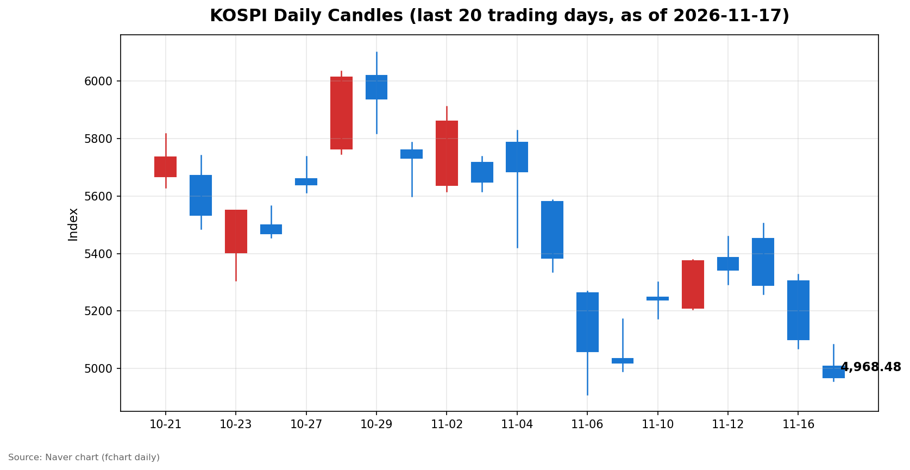
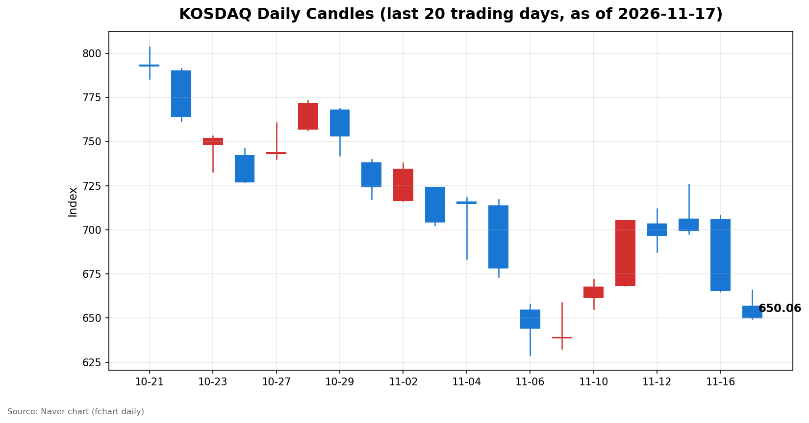

안녕하세요, [한국투자증권](https://securities.koreainvestment.com/main/Main.jsp)에서 [한투-한국투자증권](https://play.google.com/store/apps/details?id=com.truefriend.neosmartarenewal&hl=ko) 개발을 담당하고 있는 way입니다. 
2026년 11월 17일 화요일 국내 장 마감 흐름을 정리합니다. 

## 마감 요약

코스피는 4,968.48로 전일 대비 132.02포인트, 2.59% 하락해 마감했습니다. 
코스닥은 650.06으로 전일 대비 15.59포인트, 2.34% 하락해 마감했습니다. 
코스피는 종가 기준으로 5,000선을 내줬습니다. 
서울경제 보도에 따르면 2월 2일 이후 9개월여 만에 종가 기준 5,000선 하회입니다. 
같은 보도에 따르면 6월 최고점 9,114.55 대비 45.5% 낮은 수준입니다. 
두 지수 모두 장중 한때 5,084.06과 665.79까지 올랐으나 오후 들어 낙폭을 키웠습니다. 
외국인의 매도 공세가 마감까지 이어진 하루였습니다. 
코스피에서 외국인은 1조 4,459억 원을 순매도했고, 개인은 4,291억 원을 순매수하며 물량을 받았습니다. 
기관은 5,361억 원을 순매수했으나 지수 하락을 막지는 못했습니다. 

## 오늘의 마감 스냅샷

| 지수 | 종가 | 전일 대비 | 등락률 | 시가 | 고가 | 저가 | 거래량 | 거래대금 |
| --- | --- | --- | --- | --- | --- | --- | --- | --- |
| 코스피 | 4,968.48 | -132.02 | -2.59% | 5,008.09 | 5,084.06 | 4,957.00 | 183,092천주 | 14조 1,960억 원 |
| 코스닥 | 650.06 | -15.59 | -2.34% | 656.82 | 665.79 | 649.62 | 414,452천주 | 4조 7,012억 원 |

스냅샷 기준 시각은 2026년 11월 17일 장 마감, 15시 30분 KST입니다. 
전일 종가는 코스피 5,100.50, 코스닥 665.65입니다. 
전일 종가는 네이버 실시간 등락률로 역산한 값과 일봉 종가가 일치하는 것을 확인했습니다. 
지수 차트는 [코스피](https://finance.naver.com/sise/sise_index.naver?code=KOSPI)와 [코스닥](https://finance.naver.com/sise/sise_index.naver?code=KOSDAQ)에서 확인할 수 있습니다. 

## 차트

최근 20거래일 일봉 차트입니다. 
빨간 봉은 종가가 시가보다 높은 날, 파란 봉은 종가가 시가보다 낮은 날입니다. 

## 원인·촉매 분석

마감 급락의 출발점은 간밤 미국 증시입니다. 
나스닥 종합지수는 11월 16일 24,509.76으로 2.49% 하락해 마감했고, 스탠더드앤드푸어스(S&P) 500지수도 1.92% 하락했습니다. 
필라델피아 반도체지수는 5% 이상 급락했고, 엔비디아는 4% 이상 하락해 10월 6일 고점 대비 약 35% 낮은 수준까지 내려왔습니다. 
중앙일보 GMC의 11월 17일 G모닝 브리핑도 간밤 뉴욕 증시의 하락과 엔비디아발 불확실성을 짚었습니다. 
미국 인공지능과 반도체주가 급락하면서 국내 반도체주에도 직접적인 압박이 가해졌습니다. 
삼성전자는 190,300원으로 3.30% 하락했고, SK하이닉스는 1,098,000원으로 1.96% 하락했습니다. 
두 종목의 시가총액 비중이 큰 만큼 지수 하락의 상당 부분이 이 흐름에서 나왔습니다. 
미국 물가와 금리 우려도 이어지고 있습니다. 
미국 10월 생산자물가지수(PPI)가 4년 만에 최고치를 기록하면서 인플레이션 우려가 다시 커졌습니다. 
금리 인상 우려가 부각되면 성장주의 할인율 부담이 커지고, 반도체주를 비롯한 성장주의 밸류에이션이 압박을 받습니다. 
여기에 엔비디아의 리더십 공백이 더해졌습니다. 
젠슨 황 전 최고경영자(CEO)의 사임 이후 인공지능 반도체 밸류체인 전반에 불확실성이 번지고 있습니다. 
수급 구도도 하락을 뒷받침합니다. 
코스피 외국인은 1조 4,459억 원을 순매도해 전일에 이어 이틀 연속 1조 원대 순매도를 기록했습니다. 
개인은 4,291억 원을 순매수하며 받는 쪽에 섰으나 매도 규모에 미치지 못했습니다. 
기관은 5,361억 원을 순매수했으나, 금융투자가 7,903억 원을 순매수한 반면 투신은 1,692억 원, 사모펀드는 596억 원을 순매도해 내부 방향이 엇갈렸습니다. 
코스닥에서도 외국인은 883억 원을 순매도했고, 개인은 1,155억 원을 순매수했습니다. 
원·달러 환율은 1,337.70원으로 전일 대비 1.20원, 0.09% 상승에 그쳐, 환율 자체는 이날 추가 부담 요인이 되지 않았습니다. 
정리하면, 미국의 금리 부담과 엔비디아발 인공지능 불확실성이라는 외부 촉매에 외국인의 매도 공세가 겹친 마감입니다. 

## 핵심 사건 3가지

첫째, 엔비디아발 인공지능 투자 불안이 확산되고 있습니다. 
젠슨 황 전 최고경영자(CEO)의 사임 이후 엔비디아를 둘러싼 불확실성이 커졌고, 간밤 나스닥은 2.49% 하락했습니다. 
엔비디아는 4% 이상 하락해 10월 6일 고점 대비 약 35% 낮은 수준까지 내려왔습니다. 
젠슨 황의 복귀를 바라는 청원에는 약 18만 명이 서명했으나, 이사회는 복귀를 논의하지 않고 있는 것으로 전해졌습니다. 
다만 오픈AI의 샘 올트먼 최고경영자(CEO)는 젠슨 황이 떠났다고 인공지능 산업 전체가 흔들리지는 않을 것이라고 전망했습니다. 
미국 인공지능과 반도체주의 급락이 국내 반도체주로 전이되면서 삼성전자와 SK하이닉스가 동반 하락했습니다. 
여기에 엔비디아 실적 발표가 한국시간 11월 18일 오전 6시 20분으로 예정돼 있어, 발표 전까지 경계 심리가 이어졌습니다. 
실적 결과에 따라 인공지능 투자 사이클에 대한 시장의 판단이 달라질 수 있는 만큼, 이번 실적은 단기 방향을 가르는 분기점입니다. 

둘째, 미국 물가와 금리 인상 우려가 다시 고개를 들고 있습니다. 
미국 10월 생산자물가지수(PPI)가 4년 만에 최고치를 기록했습니다. 
물가 상승 압력이 확인되면서 금리 인상 우려가 부각되고, 성장주에는 할인율 부담이 커졌습니다. 
시카고상품거래소(CME) 페드워치 기준 12월 연방준비제도(연준)의 0.25%포인트 인상 확률은 91%에 달합니다. 
금리 인상 우려는 금값에도 번져, 금값이 14개월 만에 최저 수준으로 밀렸다는 보도가 나왔습니다. 
국내 증시도 이 흐름에서 자유롭지 못했고, 외국인의 매도 공세와 맞물려 낙폭이 확대됐습니다. 
금리 경로에 대한 불확실성이 해소되지 않는 한 성장주 중심의 부담은 이어질 수 있습니다. 

셋째, 외국인의 매도 공세 속에 코스피가 5,000선을 내줬습니다. 
코스피 외국인은 1조 4,459억 원을 순매도해 이틀 연속 1조 원대 순매도를 기록했습니다. 
코스피는 장중 5,084.06까지 올랐으나 오후 들어 밀리기 시작했고, 종가 4,968.48로 5,000선을 하회했습니다. 
5,000선은 심리적 지지선으로 여겨져 온 만큼, 종가 기준 하회는 투자 심리에 구조적인 충격을 줍니다. 
외국인 매도가 이어지는 한 지수의 반등 여력은 제한될 수밖에 없습니다. 

## 섹터·테마 영향 체인

인공지능 투자 불안은 반도체 밸류체인에서 출발해 성장주 전반으로 번졌습니다. 
삼성전자와 SK하이닉스의 하락이 지수를 끌어내렸고, 반도체를 중심으로 한 성장주의 밸류에이션 부담이 커졌습니다. 
금리 인상 우려는 같은 방향으로 작용했습니다. 
금리가 오르면 미래 이익의 현재 가치가 낮아져 성장주의 부담이 커지고, 반도체와 같은 경기 민감 성장주가 먼저 압박을 받습니다. 
반면 상승 테마는 소형주 중심에 머물렀습니다. 
한국투자증권 MTS 기준 상승률 상위 테마는 자전거 5.18%, 개성공단 3.94%, 면세점 3.42%, 일자리 2.58%, 전자파차단 2.50%였습니다. 
상승 테마가 소형 테마에 그쳤다는 점은 자금이 대형 성장주를 피해 상대적으로 작은 테마로 이동했음을 보여줍니다. 
다만 이들 테마의 시가총액이 작아 지수 하락을 상쇄하지는 못했습니다. 
정리하면, 인공지능과 금리라는 두 가지 압박이 대형 성장주를 누른 반면, 소형 테마로의 자금 이동은 지수 방어에는 미치지 못했습니다. 

## 최근 5거래일 일봉

| 날짜 | 코스피 종가 | 코스피 등락률 | 코스닥 종가 | 코스닥 등락률 |
| --- | --- | --- | --- | --- |
| 2026-11-11 | 5,375.36 | +2.60% | 705.10 | +5.62% |
| 2026-11-12 | 5,342.73 | -0.61% | 696.53 | -1.22% |
| 2026-11-13 | 5,290.53 | -0.98% | 699.66 | +0.45% |
| 2026-11-16 | 5,100.50 | -3.59% | 665.65 | -4.86% |
| 2026-11-17 | 4,968.48 | -2.59% | 650.06 | -2.34% |

11월 13일 종가 5,290.53에서 11월 17일 종가 4,968.48까지 코스피는 이틀 만에 6.09% 하락했습니다. 
코스닥도 같은 기간 699.66에서 650.06으로 7.09% 하락했습니다. 
코스피는 11월 11일 반등 이후 4거래일 연속 하락했고, 코스닥은 같은 기간 11월 13일을 제외한 3거래일 하락했습니다. 

## 당일 수급

코스피에서는 외국인이 1조 4,459억 원을 순매도했습니다. 
개인은 4,291억 원을 순매수해 외국인이 던진 물량을 받았습니다. 
그러나 개인의 매수 규모가 외국인 매도의 3분의 1 수준에 그쳐 지수 하락을 막지는 못했습니다. 
기관은 5,361억 원을 순매수했습니다. 
기관 안에서는 금융투자가 7,903억 원을 순매수한 반면 투신은 1,692억 원, 사모펀드는 596억 원을 순매도했습니다. 
연기금은 84억 원을 순매도했고, 보험은 174억 원을 순매수했습니다. 
기타법인은 4,807억 원을 순매수했습니다. 
코스닥에서는 외국인이 883억 원을 순매도했고, 개인은 1,155억 원을 순매수했습니다. 
코스닥 기관은 252억 원을 순매도했습니다. 
기관 안에서는 금융투자가 607억 원을 순매수한 반면 투신은 468억 원, 사모펀드는 262억 원을 순매도했습니다. 
수급 구도를 정리하면, 외국인이 양 시장 모두에서 매도 주체였고, 개인이 받는 쪽에 섰으며, 기관은 코스피에서는 매수, 코스닥에서는 매도로 갈렸습니다. 
외국인의 매도 규모가 개인과 기관의 매수 여력을 넘어선 하루였습니다. 

## 강했던 테마와 흐름

상승률 상위 테마는 자전거, 개성공단, 면세점, 일자리, 전자파차단 순이었습니다. 
자전거 테마는 5.18% 올랐고, 개성공단은 3.94%, 면세점은 3.42% 올랐습니다. 
이들 테마는 시가총액이 작고, 지수 하락 국면에서도 개별 재료에 따라 움직이는 소형 테마입니다. 
대형주가 하락하는 국면에서 소형 테마가 오른 것은 자금의 피난처 성격이라기보다 테마별 개별 흐름으로 보는 것이 적절합니다. 
지수 전체로는 반도체와 성장주의 약세가 흐름을 지배했고, 상승 테마의 영향은 제한적이었습니다. 

## 단기·중기 전망과 내일 확인할 시나리오

단기적으로는 한국시간 11월 18일 오전 6시 20분 발표되는 엔비디아 실적이 첫 번째 분기점입니다. 
실적 결과와 향후 전망에 따라 인공지능 투자 사이클에 대한 시장의 판단이 달라질 수 있습니다. 
실적이 기대에 미치지 못하면 반도체주를 중심으로 한 조정 압력이 이어질 수 있습니다. 
반대로 실적이 기대를 웃돌면 인공지능 불확실성이 완화되며 반등의 계기가 될 수 있습니다. 
두 번째로 확인할 것은 코스피 5,000선 회복 여부입니다. 
종가 기준 5,000선을 내준 만큼, 다음 거래일에는 5,000선 회복 여부가 심리의 가늠자가 됩니다. 
당일 저가 4,957.00이 단기 지지 구간으로 작용하는지, 전일 종가 5,100.50이 저항으로 작용하는지도 함께 확인할 필요가 있습니다. 
세 번째는 외국인의 매도 지속 여부입니다. 
이틀 연속 1조 원대 순매도가 이어진 만큼, 매도 규모가 축소되는지, 아니면 이어지는지가 지수 방향을 좌우합니다. 
중기적으로는 인공지능 투자 사이클의 지속 여부가 핵심입니다. 
대외경제정책연구원(KIEP)은 2027년 세계경제 성장률을 3.2%로 전망하면서 인공지능 투자 지속 여부를 관건으로 꼽았습니다. 
금리 경로에 대한 불확실성이 해소되지 않는 한 성장주 중심의 부담은 이어질 수 있습니다. 
리스크 관리 관점에서는 지수보다 섹터 단위의 흐름을 확인하는 것이 적절합니다. 
반도체와 성장주의 약세가 이어지는지, 소형 테마로의 자금 이동이 확산되는지를 구분해 볼 필요가 있습니다. 

## 마치며

코스피는 5,000선을 내주며 4,968.48로 마감했고, 외국인의 매도 공세와 엔비디아발 인공지능 불안이 맞물린 하루였습니다. 
다음 거래일에는 엔비디아 실적 결과와 5,000선 회복 여부, 외국인 매도 지속 여부를 확인할 필요가 있습니다. 
이 글은 시장 해설을 목적으로 하며, 특정 종목의 매수나 매도를 권유하지 않습니다. 
