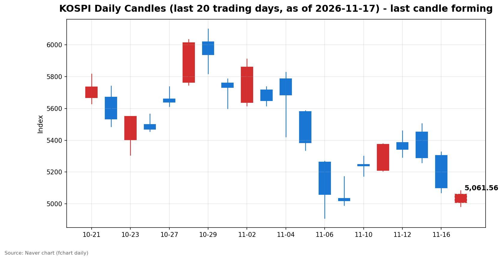
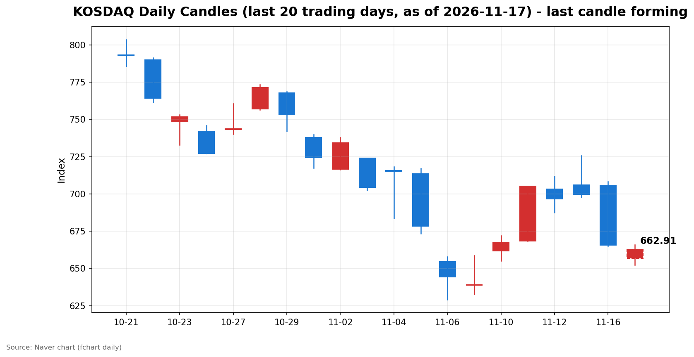

안녕하세요, [한국투자증권](https://securities.koreainvestment.com/main/Main.jsp)에서 [한투-한국투자증권](https://play.google.com/store/apps/details?id=com.truefriend.neosmartarenewal&hl=ko) 개발을 담당하고 있는 way입니다. 
오늘 국내 증시는 간밤 미국 반도체주 급락 여파로 하락 출발했으나, 오전 중 낙폭을 줄이며 코스피 5,000선을 되찾았습니다. 

## 오전장 요약

코스피는 시초 5,008.09로 전일 종가 대비 1.81% 낮게 출발했습니다. 
장 초반에는 4,984.83까지 밀리며 전일 대비 낙폭이 2.27%까지 커졌습니다. 
이후 지수는 점차 낙폭을 줄였고, 낮 12시 32분 기준 5,061.20으로 전일 대비 0.77% 하락 수준까지 회복했습니다. 
코스닥도 시초 656.82로 1.33% 하락 출발한 뒤 저점 652.37까지 밀렸다가 662.61로 낙폭을 0.46%까지 줄였습니다. 
간밤 나스닥 종합지수가 2.49% 하락한 충격이 장 초반에 그대로 반영됐으나, 오전 흐름만으로는 하락이 더 깊어지지 않았습니다. 
전일 3.59% 급락했던 코스피가 5,000선을 되찾았다는 점이 오전장의 가장 큰 변화입니다. 

## 오늘의 스냅샷

| 지수 | 현재가 | 전일 대비 | 등락률 | 시가 | 고가 | 저가 | 거래량 | 거래대금 |
| --- | --- | --- | --- | --- | --- | --- | --- | --- |
| 코스피 | 5,061.20 | -39.30 | -0.77% | 5,008.09 | 5,084.06 | 4,984.83 | 110,119천주 | 8,064,082백만원 |
| 코스닥 | 662.61 | -3.04 | -0.46% | 656.82 | 665.79 | 652.37 | 276,608천주 | 3,149,348백만원 |

스냅샷 기준 시각은 2026년 11월 17일 낮 12시 32분(KST)입니다. 
전일 종가는 코스피 5,100.50, 코스닥 665.65입니다. 
네이버 실시간 시세와 일봉 데이터를 교차 확인했으며, 전일 종가는 두 출처가 일치합니다. 
당일 봉은 형성 중인 봉으로, 종가와 거래량은 마감 전 계속 변합니다. 
코스피 차트는 [네이버 금융 코스피](https://finance.naver.com/sise/sise_index.naver?code=KOSPI)에서 확인할 수 있습니다. 
코스닥 차트는 [네이버 금융 코스닥](https://finance.naver.com/sise/sise_index.naver?code=KOSDAQ)에서 확인할 수 있습니다. 

## 차트

최근 20거래일 일봉 차트입니다. 
빨간 봉은 종가가 시가보다 높은 날, 파란 봉은 종가가 시가보다 낮은 날입니다. 
당일 봉은 형성 중인 봉으로, 마감 전에는 계속 변합니다. 

## 원인·촉매 분석

오늘 하락의 직접적인 촉매는 간밤 미국 반도체주 급락입니다. 
나스닥 종합지수는 24,509.76으로 2.49% 하락했고, 필라델피아 반도체지수는 5% 넘게 급락했습니다. 
엔비디아 최고경영자(CEO) 사임에 따른 경영 불확실성과 미국의 대중국 인공지능 반도체 수출 통제 강화 소식이 겹친 결과입니다. 
이 충격이 국내 반도체 대형주로 번지며 코스피는 5,000선을 밑도는 수준에서 장을 시작했습니다. 
다만 낙폭이 더 깊어지지 않은 데에는 오전 중 저가 인식이 작용한 것으로 보입니다. 
전일 코스피가 3.59% 급락한 뒤라, 단기 낙폭이 과도하다는 인식이 장 초반 저점에서 매수세를 불렀습니다. 
수급 구도는 여전히 부담 요인입니다. 
전일 코스피에서 외국인은 1조 3,287억원을 순매도했고 기관도 4,562억원을 순매도했습니다. 
반면 개인은 1조 2,904억원을 순매수하며 외국인이 던진 물량을 받았습니다. 
전일 수급은 네이버 시장동향 기준 최종값입니다. 
코스닥에서도 전일 외국인과 기관이 각각 2,097억원, 1,540억원을 순매도했습니다. 
외국인과 기관이 함께 파는 구도에서 개인 매수세만으로 지수 하락을 막기는 쉽지 않으며, 외국인 매도의 강도가 오후 장의 관건입니다. 
원/달러 환율은 1,339.40원으로 전일 대비 2.90원 올랐습니다. 
환율이 1,330원대 후반에서 머물며 외국인 매도 압력과 맞물려 있습니다. 
거시 배경도 우호적이지 않습니다. 
10월 생산자물가지수(PPI)가 4년 만에 최고치를 기록해 인플레이션 압력이 이어지고 있고, 시장이 반영한 12월 미국 연준의 0.25%포인트 금리 인상 확률은 91%에 달합니다. 
금리 인상 기대가 커지면 성장주 밸류에이션 부담이 커지고, 인공지능 투자에 대한 경계감도 함께 높아집니다. 
당일 장중 수급은 아직 확정치가 나오지 않아 확인이 필요합니다. 

## 핵심 사건 3가지

### 1. 엔비디아 실적 발표 임박과 경영 공백

엔비디아의 3분기 실적 발표가 11월 17일(현지시간)로 다가왔습니다. 
젠슨 황 전 최고경영자(CEO)가 퇴진한 뒤 처음 맞는 실적 발표라, 실적 자체보다 경영 공백 속에서도 첨단 반도체 시장의 지배력을 유지할 수 있는지가 관심입니다. 
딥서치 교차 검증에 따르면 엔비디아의 인공지능 투자 약정은 5,000억 달러 규모로, 그 지속 가능성에 대한 의문도 제기되고 있습니다. 
실적에서 주문 흐름과 향후 가이던스가 확인되기 전까지는 경계감이 유지될 가능성이 큽니다. 
이번 실적은 인공지능 수요와 투자 지속성을 확인하는 첫 시험대라는 평가가 나옵니다. 

### 2. D램 담합 소송 본안 돌입

미국 법원이 삼성전자와 SK하이닉스에 대한 D램 담합 집단소송의 기각 신청을 거부하고 본안 소송에 돌입했다는 소식이 전해졌습니다. 
중앙일보 GMC 11월 16일자 G프터눈 브리핑이 전한 내용입니다. 
전일 삼성전자는 4.47%, SK하이닉스는 7.89% 하락했는데, 젠슨 황 리스크에 더해 소송 리스크가 겹친 점이 낙폭을 키운 요인으로 지목됩니다. 
소송이 장기화하면 반도체 대형주의 불확실성이 이어질 수 있다는 점에서, 실적 발표와 별개로 주시할 필요가 있는 사건입니다. 

### 3. PPI 쇼크와 12월 금리 인상 기대

10월 생산자물가지수(PPI)가 4년 만에 최고치를 기록했습니다. 
인플레이션 압력이 이어지면서 시장이 반영한 12월 미국 연준의 0.25%포인트 금리 인상 확률은 91%에 달합니다. 
금리 인상 기대는 성장주 밸류에이션에 직접적인 부담을 줍니다. 
인공지능 투자에 대한 경계감도 함께 높아지며, 기술주 중심의 조정 압력이 커졌습니다. 
이 사건은 엔비디아 이슈와 별개로, 시장 전반의 할인율에 영향을 주는 구조적인 요인입니다. 

## 섹터·테마 영향 체인

반도체 밸류체인이 직접적인 타격을 받았습니다. 
메모리와 반도체 장비, 후공정으로 이어지는 밸류체인 전반이 미국 반도체주 급락과 함께 약세를 보이고 있습니다. 
전일 삼성전자가 4.47%, SK하이닉스가 7.89% 하락한 데 이어 오늘 장 초반에도 두 종목은 약세를 이어가고 있습니다. 
다만 한국투자증권 MTS의 낮 12시 시장 브리핑에 따르면 반도체 대형주의 흐름은 엇갈리고 있습니다. 
인공지능 설계주에 대한 관심은 이어지고 있습니다. 
PFN AI칩 설계 기대가 지속되고 있고, 온디바이스AI 테마는 1.64% 상승했습니다. 
인공지능 수요 자체가 사라진 것이 아니라, 관심의 무게중심이 대형 반도체주에서 설계와 온디바이스 쪽으로 이동하고 있다는 해석이 가능합니다. 
PCB도 SOCAMM과 가격 인상 기대 속에 선별 매수가 이어지고 있습니다. 
전력 테마가 새로 부각되고 있습니다. 
중앙일보 GMC 11월 17일자 리포트에 따르면 컨스텔레이션 에너지는 빅테크와 15~20년 장기 전력 계약을 확보했습니다. 
인공지능 전력 수요에 대한 관심이 이어지고 있다는 점에서, 전력 인프라 관련 흐름은 반도체 조정과 다른 궤적을 보이고 있습니다. 
바이오 쪽으로도 자금이 이동하고 있습니다. 
면역항암제 테마는 1.47%, 위탁생산(CMO, CDMO) 테마는 2.00% 상승했습니다. 
인공지능 조정과 무관한 영역에서 자금이 머무르고 있다는 점이 오전장의 특징입니다. 
면세점 관련주도 3.62% 상승하며 소비·관광 쪽의 강세가 확인됐습니다. 

## 최근 5거래일 일봉

### 코스피

| 날짜 | 시가 | 고가 | 저가 | 종가 | 거래량 |
| --- | --- | --- | --- | --- | --- |
| 2026-11-10 | 5,247.22 | 5,300.92 | 5,174.55 | 5,239.13 | 253,917천주 |
| 2026-11-11 | 5,209.71 | 5,377.99 | 5,207.44 | 5,375.36 | 234,732천주 |
| 2026-11-12 | 5,385.94 | 5,458.84 | 5,293.05 | 5,342.73 | 244,834천주 |
| 2026-11-13 | 5,452.41 | 5,504.44 | 5,259.09 | 5,290.53 | 247,829천주 |
| 2026-11-16 | 5,305.40 | 5,327.99 | 5,069.83 | 5,100.50 | 221,296천주 |
| 2026-11-17 | 5,008.09 | 5,084.06 | 4,984.83 | 5,061.20 | 110,119천주 |

2026년 11월 17일 봉은 형성 중인 봉이며, 종가와 거래량은 마감 전 계속 변합니다. 

### 코스닥

| 날짜 | 시가 | 고가 | 저가 | 종가 | 거래량 |
| --- | --- | --- | --- | --- | --- |
| 2026-11-10 | 661.73 | 671.91 | 655.09 | 667.61 | 402,110천주 |
| 2026-11-11 | 668.48 | 705.10 | 668.48 | 705.10 | 411,901천주 |
| 2026-11-12 | 703.22 | 711.86 | 687.40 | 696.53 | 465,951천주 |
| 2026-11-13 | 705.96 | 725.81 | 697.69 | 699.66 | 455,458천주 |
| 2026-11-16 | 705.88 | 708.34 | 664.98 | 665.65 | 446,420천주 |
| 2026-11-17 | 656.82 | 665.79 | 652.37 | 662.61 | 276,608천주 |

2026년 11월 17일 봉은 형성 중인 봉이며, 종가와 거래량은 마감 전 계속 변합니다. 

## 오전 강했던 테마와 흐름 변화

시가 대비 방향 전환이 오전장의 핵심입니다. 
코스피는 시초 5,008.09에서 낮 12시 32분 5,061.20까지 오르며 시초 대비 53.11포인트 상승했습니다. 
등락률로는 시초 1.81% 하락에서 0.77% 하락으로 약 1.04%포인트 회복했습니다. 
코스닥도 시초 656.82에서 662.61까지 오르며 시초 대비 5.79포인트 상승했고, 등락률은 1.33% 하락에서 0.46% 하락으로 약 0.87%포인트 회복했습니다. 
두 시장 모두 시초 대비 방향이 위쪽으로 전환됐습니다. 
오전 강했던 테마는 자전거 5.47%, 일자리 4.38%, 개성공단 3.64%, 면세점 관련주 3.62%, 위탁생산(CMO, CDMO) 2.00%, 하이브리드카 2.00%, 온디바이스AI 1.64%, SSD 1.58%, 면역항암제 1.47% 순입니다. 
한국투자증권 MTS 낮 12시 시장 브리핑은 AI 설계주 관심이 이어지는 가운데 전력·바이오 테마가 새로 부각되고, 반도체 대형주는 엇갈리고 있다고 전했습니다. 
다만 자전거·일자리·개성공단 등 상위 테마는 구성 종목 수가 적어, 지수 전체의 방향을 설명하는 재료로는 한계가 있습니다. 
오전장의 본질은 테마 강세보다 낙폭 축소와 5,000선 회복에 있습니다. 

## 오후 전망과 확인할 시나리오

오후에는 오전 회복 흐름이 이어지는지, 아니면 일시적인 반등에 그치는지를 구분해야 합니다. 
확인할 첫 번째 수치는 당일 고가 돌파 여부입니다. 
코스피 당일 고가는 5,084.06, 코스닥 당일 고가는 665.79입니다. 
고가를 넘으면 오전의 낙폭 축소 흐름이 이어질 수 있고, 넘지 못하면 저점 재확인 가능성이 커집니다. 
두 번째로 확인할 수치는 전일 종가 회복 여부입니다. 
코스피 전일 종가는 5,100.50, 코스닥 전일 종가는 665.65입니다. 
전일 종가를 회복하면 3거래일 연속 하락 흐름이 끊길 수 있으나, 회복하지 못하면 약세 흐름이 이어질 수 있습니다. 
세 번째로 확인할 수치는 외국인 매도 강도입니다. 
당일 장중 수급은 아직 확정치가 나오지 않아 확인이 필요하며, 마감 이후 최종값으로 판단해야 합니다. 
원/달러 환율이 1,340원선을 넘는지 여부도 함께 확인할 필요가 있습니다. 
엔비디아 실적 발표가 11월 18일 새벽으로 다가온 만큼, 발표 전까지는 경계감이 유지될 가능성이 큽니다. 
실적에서 주문 흐름과 향후 가이던스가 확인되기 전까지는 관망 흐름이 이어질 수 있습니다. 
한편 모건스탠리가 3~5년 내 코스피 1만 시대를 전망했다는 보도도 있으나, 이는 장기 관점의 전망으로 당일 오후 장세의 판단 근거가 되지는 않습니다. 
리스크 관리 관점에서는 당일 고가와 전일 종가, 5,000선 지지 여부를 함께 보며 오후 흐름을 판단하는 것이 필요합니다. 

## 마치며

오전장은 하락 출발 후 낙폭을 줄이며 코스피 5,000선을 되찾은 흐름이었습니다. 
오후에는 당일 고가 돌파 여부와 엔비디아 실적 발표를 앞둔 경계감을 함께 확인할 필요가 있습니다. 
이 글은 시황 해설을 목적으로 하며, 특정 종목의 매수·매도를 권유하지 않습니다. 
