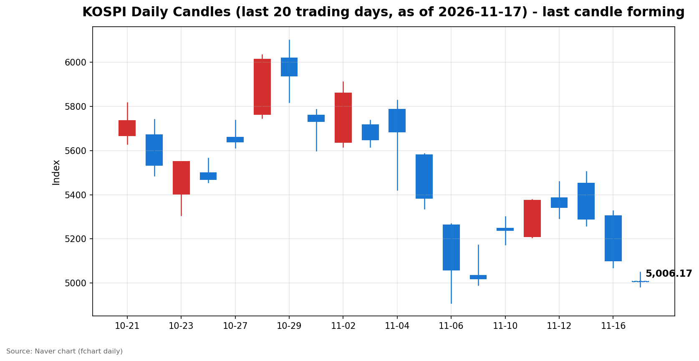
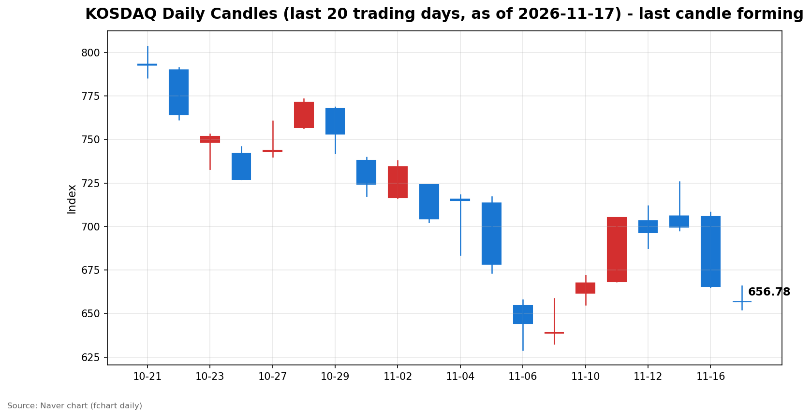

안녕하세요, [한국투자증권](https://securities.koreainvestment.com/main/Main.jsp)에서 [한투-한국투자증권](https://play.google.com/store/apps/details?id=com.truefriend.neosmartarenewal&hl=ko) 개발을 담당하고 있는 way입니다. 
오늘 국내 증시는 간밤 미국 반도체주 급락 여파로 하락 출발해 코스피 5,000선을 두고 공방을 벌이고 있습니다. 

## 배경

간밤 뉴욕 증시는 인공지능 관련주 매도세에 일제히 하락했습니다. 
나스닥 종합지수는 24,509.76으로 2.49% 하락했습니다. 
스탠더드앤드푸어스 500지수는 1.92%, 다우지수는 1.55% 각각 하락했습니다. 
필라델피아 반도체지수는 5% 넘게 급락했습니다. 
엔비디아는 4% 넘게 하락해 10월 6일 고점 대비 약 35% 빠졌습니다. 
브로드컴도 3.92% 하락했습니다. 
원/달러 환율은 1,338.00원으로 전일 대비 1.50원 올랐습니다. 
간밤 흐름은 중앙일보 GMC 허브의 11월 17일자 G모닝 브리핑과 딥서치 교차 검증으로 확인했습니다. 

## 오늘의 스냅샷

| 지수 | 현재가 | 전일 대비 | 등락률 | 시가 | 고가 | 저가 | 거래량 | 거래대금 |
| --- | --- | --- | --- | --- | --- | --- | --- | --- |
| 코스피 | 5,005.73 | -94.77 | -1.86% | 5,008.09 | 5,049.30 | 4,984.83 | 35,508천주 | 2,560,598백만원 |
| 코스닥 | 655.35 | -10.30 | -1.55% | 656.82 | 665.79 | 652.37 | 106,055천주 | 1,174,579백만원 |

스냅샷 기준 시각은 2026년 11월 17일 오전 9시 31분(KST)입니다. 
전일 종가는 코스피 5,100.50, 코스닥 665.65입니다. 
네이버 실시간 시세와 일봉 데이터를 교차 확인했으며, 전일 종가는 두 출처가 일치합니다. 
코스피 차트는 [네이버 금융 코스피](https://finance.naver.com/sise/sise_index.naver?code=KOSPI)에서 확인할 수 있습니다. 
코스닥 차트는 [네이버 금융 코스닥](https://finance.naver.com/sise/sise_index.naver?code=KOSDAQ)에서 확인할 수 있습니다. 

## 차트

최근 20거래일 일봉 차트입니다. 
빨간 봉은 종가가 시가보다 높은 날, 파란 봉은 종가가 시가보다 낮은 날입니다. 
당일 봉은 형성 중인 봉으로, 마감 전에는 계속 변합니다. 

## 원인·촉매 분석

오늘 하락의 직접적인 촉매는 엔비디아발 인공지능 조정입니다. 
젠슨 황 엔비디아 최고경영자(CEO)의 사임 소식에 경영 불확실성이 커졌고, 미국의 대중국 반도체 수출 통제 강화 소식이 겹치면서 간밤 미국 반도체주가 급락했습니다. 
이 충격이 국내 반도체 대형주로 번졌고, 외국인의 매도세로 이어졌습니다. 
전일에도 삼성전자와 SK하이닉스가 각각 4.47%, 7.89% 급락한 바 있어, 악재가 하루 만에 끝난 것이 아니라 이어지고 있다는 점이 중요합니다. 
거시 배경도 우호적이지 않습니다. 
10월 생산자물가지수(PPI)가 4년 만에 최고치를 기록해 인플레이션 압력이 이어지고 있고, 시장이 반영한 12월 미국 연준의 0.25%포인트 금리 인상 확률은 91%에 달합니다. 
금리 인상 기대가 커지면 성장주 밸류에이션 부담이 커지고, 인공지능 투자에 대한 경계감도 함께 높아집니다. 
수급 구도도 하락을 뒷받침합니다. 
전일 코스피에서 외국인은 1조 3,287억원을 순매도했고 기관도 4,562억원을 순매도했습니다. 
반면 개인은 1조 2,904억원을 순매수하며 외국인이 던진 물량을 받았습니다. 
외국인과 기관이 함께 파는 구도에서 개인 매수세만으로 지수 하락을 막기는 쉽지 않으며, 외국인 매도의 강도가 오늘 장의 관건입니다. 
원/달러 환율이 1,338원까지 오른 점도 외국인 매도 압력과 맞물려 있습니다. 

## 핵심 사건 3가지

### 1. 젠슨 황 엔비디아 CEO 사임과 경영 불확실성

젠슨 황 엔비디아 최고경영자(CEO)가 사임하면서 인공지능 산업의 상징적인 경영자가 자리를 떠났습니다. 
엔비디아 주가는 간밤 4% 넘게 하락했고, 10월 6일 고점 대비 약 35% 빠졌습니다. 
샘 올트먼 오픈AI 최고경영자는 황이 떠났다고 인공지능 산업 전체가 흔들리지는 않을 것이라고 언급했습니다. 
다만 후임 인선이 확정되기 전까지 엔비디아의 경영 공백에 대한 경계감은 이어질 전망입니다. 
인공지능 산업의 방향성을 제시해 온 인물의 퇴장이라는 점에서, 단순한 개별 기업 뉴스를 넘어 산업 전체의 심리에 영향을 주는 사건입니다. 

### 2. 미국의 대중국 인공지능 반도체 수출 통제 강화

미국 정부가 중국 기업의 첨단 인공지능 반도체 원격 접속을 통제하기로 했다는 소식이 전해졌습니다. 
국방수권법(NDAA)에 첨단 인공지능 칩 수출 차단 법안을 묶어 통과시키려는 움직임도 있습니다. 
중앙일보 GMC 리포트(11월 14일자)에 따르면, 젠슨 황 사임으로 대중 인공지능 반도체 전략에서 구형 칩 조건부 공급으로 중국을 미국 생태계에 묶어두는 방안을 설계·설득해 온 핵심 인물이 사라지면서 수출 통제론이 유리해졌습니다. 
수출 통제가 강화되면 중국 매출 비중이 있는 반도체 기업의 실적 전망이 흔들리고, 인공지능 인프라 투자 전반의 수요 전망도 함께 약해집니다. 
필라델피아 반도체지수가 5% 넘게 급락한 배경에는 이 규제 우려가 자리하고 있습니다. 

### 3. 엔비디아 실적 발표 임박과 앤트로픽 상장

엔비디아 실적 발표가 11월 18일 새벽으로 다가왔습니다. 
이번 실적은 인공지능 수요와 투자 지속성을 확인하는 첫 시험대라는 평가가 나옵니다. 
실적에서 주문 흐름과 향후 가이던스가 확인되기 전까지는 경계감이 유지될 가능성이 큽니다. 
앤트로픽도 11월 18일 공모가를 확정하고 11월 19일 나스닥에 상장할 예정입니다. 
인공지능 대장주의 실적과 대형 상장이 같은 주에 몰리면서, 인공지능 투자 생태계 전반에 대한 시장의 판단이 한꺼번에 시험받는 국면입니다. 

## 섹터·테마 영향 체인

반도체 밸류체인이 직접적인 타격을 받았습니다. 
메모리와 반도체 장비, 후공정으로 이어지는 밸류체인 전반이 미국 반도체주 급락과 함께 약세를 보이고 있습니다. 
전일 삼성전자가 4.47%, SK하이닉스가 7.89% 하락한 데 이어 오늘 장 초반에도 두 종목은 약세를 이어가고 있습니다. 
인공지능 인프라 관련 기업도 금융 부담 우려가 부각되고 있습니다. 
중앙일보 GMC 리포트(11월 14일자)에 따르면 엔비디아의 네오클라우드 보증·투자 등 잠재 금융 부담은 최대 약 1,645억 달러에 달합니다. 
후임 체제에서는 코어위브와 네비우스 같은 인프라 기업이 먼저 타격을 받을 수 있다는 분석이 나오며, 간밤 코어위브는 6.86%, 네비우스는 16.86% 하락했습니다. 
반면 상대적으로 강세를 보이는 쪽도 있습니다. 
한국투자증권 MTS의 오전 9시 10분 시장 브리핑에 따르면 ASIC 강세가 이어지고 있습니다. 
수능 보안과 발사체 소재 테마가 새로운 관심권으로 부상하고 있다는 언급도 있었습니다. 
자금의 성격도 바뀌고 있습니다. 
G모닝 브리핑에 따르면 자금은 기술주에서 월마트와 코스트코 같은 방어주로 이동하고 있습니다. 
성장주 중심의 자금이 방어주로 옮겨가는 흐름은 인공지능 조정에 대한 경계감이 단기 매물을 넘어 자산 배분의 변화로 이어지고 있음을 보여줍니다. 
코스닥은 전일 4.86% 급락하며 코스피보다 낙폭이 컸으나, 오늘은 1.55% 하락으로 코스피보다 낙폭이 작습니다. 
전일 과도한 낙폭 이후 상대적으로 진정되는 모습이나, 추세 전환으로 보기에는 아직 이릅니다. 

## 최근 5거래일 일봉

### 코스피

| 날짜 | 시가 | 고가 | 저가 | 종가 | 거래량 |
| --- | --- | --- | --- | --- | --- |
| 2026-11-10 | 5,247.22 | 5,300.92 | 5,174.55 | 5,239.13 | 253,917천주 |
| 2026-11-11 | 5,209.71 | 5,377.99 | 5,207.44 | 5,375.36 | 234,732천주 |
| 2026-11-12 | 5,385.94 | 5,458.84 | 5,293.05 | 5,342.73 | 244,834천주 |
| 2026-11-13 | 5,452.41 | 5,504.44 | 5,259.09 | 5,290.53 | 247,829천주 |
| 2026-11-16 | 5,305.40 | 5,327.99 | 5,069.83 | 5,100.50 | 221,296천주 |
| 2026-11-17 | 5,008.09 | 5,049.30 | 4,984.83 | 5,006.17 | 34,949천주 |

2026년 11월 17일 봉은 형성 중인 봉이며, 종가와 거래량은 마감 전 계속 변합니다. 

### 코스닥

| 날짜 | 시가 | 고가 | 저가 | 종가 | 거래량 |
| --- | --- | --- | --- | --- | --- |
| 2026-11-10 | 661.73 | 671.91 | 655.09 | 667.61 | 402,110천주 |
| 2026-11-11 | 668.48 | 705.10 | 668.48 | 705.10 | 411,901천주 |
| 2026-11-12 | 703.22 | 711.86 | 687.40 | 696.53 | 465,951천주 |
| 2026-11-13 | 705.96 | 725.81 | 697.69 | 699.66 | 455,458천주 |
| 2026-11-16 | 705.88 | 708.34 | 664.98 | 665.65 | 446,420천주 |
| 2026-11-17 | 656.82 | 665.79 | 652.37 | 656.78 | 103,756천주 |

2026년 11월 17일 봉은 형성 중인 봉이며, 종가와 거래량은 마감 전 계속 변합니다. 

## 전일 수급

전일은 11월 16일 기준입니다. 
코스피에서 외국인은 1조 3,287억원을 순매도했고, 기관은 4,562억원을 순매도했습니다. 
개인은 1조 2,904억원을 순매수했고, 기타법인은 4,945억원을 순매수했습니다. 
외국인이 1조원이 넘는 물량을 던진 날에 개인이 이를 대부분 받아낸 구도입니다. 
기관 세부적으로는 금융투자가 5,328억원을 순매수했으나 연기금이 5,647억원을 순매도해 기관 전체로는 순매도로 집계됐습니다. 
코스닥에서도 외국인은 2,005억원, 기관은 1,535억원을 순매도했고, 개인은 3,674억원을 순매수했습니다. 
양 시장 모두 외국인과 기관이 팔고 개인이 받는 동일한 구도가 나타났습니다. 
개인의 매수세가 지수 하락을 떠받치는 역할을 했으나, 외국인의 매도 강도가 꺾이지 않는 한 지수 반등의 동력으로 보기는 어렵습니다. 
오늘 장 초반에도 외국인의 매도세가 이어지고 있어, 전일과 같은 구도가 반복되고 있습니다. 

## 단기·중기 전망과 확인할 시나리오

단기적으로는 코스피 5,000선 안착 여부가 가장 중요합니다. 
오늘 장 초반 지수는 4,984.83까지 밀렸다가 5,000선을 회복하는 공방을 벌이고 있습니다. 
5,000선은 심리적인 기준선인 동시에 전일 저점인 5,069.83을 이미 밑돈 뒤의 다음 지지선이라는 점에서 의미가 큽니다. 
단기 지지선은 당일 저점인 4,984.83과 5,000선이며, 저항선은 당일 고점인 5,049.30과 전일 종가인 5,100.50입니다. 
코스닥의 단기 지지선은 당일 저점인 652.37이며, 저항선은 전일 종가인 665.65와 당일 고점인 665.79입니다. 
11월 18일 새벽 엔비디아 실적이 단기 흐름의 분기점이 됩니다. 
실적에서 인공지능 수요와 투자 지속성이 확인되면 이번 조정은 일단락될 수 있고, 실망스러운 내용이 나오면 조정은 연장될 수 있습니다. 
다만 어느 쪽이든 실적 발표 전까지는 경계감이 유지될 가능성이 큽니다. 
중기적으로는 미국의 수출 통제 방향이 관건입니다. 
국방수권법에 첨단 인공지능 칩 수출 차단 법안이 묶이는지와 엔비디아 후임 최고경영자 인선, 앤트로픽 상장 이후 자금 흐름을 함께 확인할 필요가 있습니다. 
금리 경로도 중기 변수입니다. 
12월 금리 인상 확률이 91%로 반영된 상황에서 인플레이션 지표가 추가로 강하게 나오면 성장주 밸류에이션 부담은 더 커질 수 있습니다. 
반대로 수출 통제 우려가 완화되고 엔비디아 실적이 확인되면 반도체 밸류체인 전반의 투자 심리도 함께 회복될 수 있습니다. 
어느 시나리오든 특정 종목의 매수·매도를 권유하는 것은 아니며, 지수와 섹터 단위의 흐름을 확인하는 관점으로 봐야 합니다. 

## 장 초반 확인할 점

외국인의 순매도 규모가 장 초반보다 줄어드는지 확인해야 합니다. 
삼성전자와 SK하이닉스의 낙폭이 장 초반보다 축소되는지도 함께 봐야 합니다. 
코스피가 5,000선을 회복한 뒤 이를 유지하는지, 당일 고점인 5,049.30을 넘기는지도 확인할 지점입니다. 
원/달러 환율이 1,338원 안팎에서 추가로 오르는지도 외국인 수급과 함께 봐야 합니다. 

## 마치며

오늘 장은 엔비디아발 인공지능 조정이라는 명확한 촉매 아래 코스피 5,000선을 두고 공방을 벌이고 있습니다. 
11월 18일 새벽 엔비디아 실적 발표까지는 경계감이 이어질 전망이며, 이 글은 교육·해설 목적이며 특정 종목의 매수·매도를 권유하지 않습니다. 
