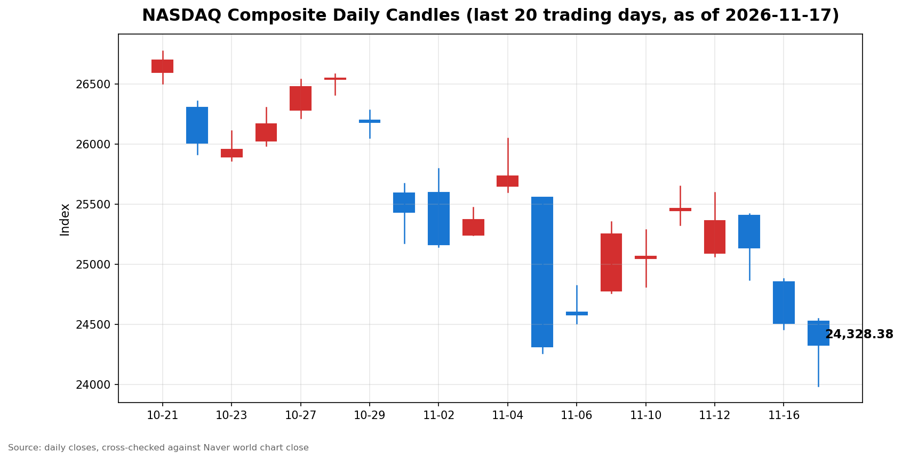

안녕하세요, [한국투자증권](https://securities.koreainvestment.com/main/Main.jsp)에서 [한투-한국투자증권](https://play.google.com/store/apps/details?id=com.truefriend.neosmartarenewal&hl=ko) 개발을 담당하고 있는 way입니다. 
현지시간 11월 17일 화요일, 나스닥은 장 마감 후 예정된 엔비디아 실적 발표를 앞둔 경계감 속에 3대 지수 모두 하락 마감했습니다. 

## 마감 요약

나스닥 종합은 전일 대비 181.38포인트, 0.74% 하락한 24,328.38로 마감했습니다. 
다우는 848.75포인트, 1.64% 하락한 50,759.42로 3대 지수 가운데 낙폭이 가장 컸습니다. 
S&P500은 76.06포인트, 1.03% 하락한 7,340.53으로 마감했습니다. 
나스닥은 장중 23,989.09까지 밀려 24,000선을 밑돌았다가 낙폭을 줄여 마감했습니다. 
오후 1시 01분 스냅샷에서 나스닥이 1.15% 하락했던 것과 비교하면, 마감으로 갈수록 낙폭이 축소됐습니다. 
변동성 지수는 23.49까지 오르며 전일 대비 13% 가까이 급등해 투자심리 위축을 보여줬습니다. 
중앙일보 GMC G브닝에 따르면 나스닥100 지수는 이틀간 6% 증발했습니다. 
이날 하락은 특정 지표 하나 때문이 아니라, 엔비디아 실적 대기, AI 수익성 의구심, 금리인상 전망 강화가 겹친 결과입니다. 

## 오늘의 마감 스냅샷

| 지수 | 종가 | 전일 대비 | 등락률 | 전일 종가 | 당일 고가 | 당일 저가 |
| --- | --- | --- | --- | --- | --- | --- |
| 나스닥 종합 | 24,328.38 | -181.38 | -0.74% | 24,509.76 | 24,547.66 | 23,989.09 |
| S&P500 | 7,340.53 | -76.06 | -1.03% | 7,416.59 | 7,410.75 | 7,294.00 |
| 다우 | 50,759.42 | -848.75 | -1.64% | 51,608.17 | 51,463.53 | 50,566.98 |

스냅샷 기준 시각은 미국 동부시간 2026년 11월 17일 오후 4시 20분, 한국시간 11월 18일 오전 6시 20분입니다. 
나스닥과 다우 수치는 [네이버 월드 차트](https://finance.naver.com/world/sise.naver?symbol=NAS@IXIC)([나스닥 종합 가격 페이지](https://stock.naver.com/worldstock/index/.IXIC/price))에서 브라우저로 확인한 장마감 값입니다. 
S&P500은 한투 MTS 해외 대시보드 기준이며, 등락률 1.03%는 당일 보도로도 확인됐습니다. 
S&P500의 당일 고가와 저가는 한투 MTS 장중 시계열 기준 값입니다. 
나스닥 종가 24,328.38은 한투 MTS 교차값과 일치합니다. 
원·달러 환율은 1,335.40원으로 전일 대비 1.10원, 0.08% 하락했습니다. 

## 차트

최근 20거래일 일봉 차트입니다. 
빨간 봉은 종가가 시가보다 높은 날, 파란 봉은 종가가 시가보다 낮은 날입니다. 

## 원인·촉매 분석

오늘 장의 근본 촉매는 AI 투자 수익성에 대한 의구심입니다. 
엔비디아 실적 발표를 몇 시간 앞두고, 시장은 AI 투자 규모가 실제 수익으로 이어지는지를 묻기 시작했습니다. 
여기에 젠슨 황 전 CEO 사임 이후 이어진 경영 불확실성과 수출통제 강화 보도가 겹쳤습니다. 
AI 우려가 반도체에 머물지 않고 소프트웨어와 은행주까지 번진 점이 이날 하락의 특징입니다. 
거시 쪽에서는 10월 소매판매가 전월 대비 0.2% 증가해 소비가 견조함을 보여줬고, 통제그룹 소매판매는 0.6% 증가했습니다. 
견조한 소비는 금리인상 전망을 강화하는 방향으로 작용했습니다. 
10월 소비자물가지수가 시장 예상치를 웃돈 데 이어, 크리스토퍼 월러 연준 이사가 50bp 인상 가능성을 언급한 것도 금리 부담을 키웠습니다. 
11월 17일 아침 기준 CME 페드워치에서 12월 0.25%포인트 인상 확률은 91%, 0.50%포인트 인상 확률은 9%였습니다. 
달러 강세와 국채 금리 상승, 연준 금리인상 전망이 겹치며 금은 장중 온스당 3,832.70달러까지 밀려 1년여 만에 최저 수준을 기록했습니다. 
이날 미국 10년물 국채수익률과 국제유가의 마감 수치는 확인 필요입니다. 
금리 경로가 성장주 밸류에이션에 부담을 주는 연결고리는 이날도 그대로 작용했습니다. 
장중에는 NSA 통신망 장애 보도가 전해지며 낙폭이 확대되는 장면도 있었습니다. 

## 핵심 사건 3가지

첫째, 장 마감 후 예정된 엔비디아 분기 실적 발표입니다. 
엔비디아는 최근 네 번 연속 시장 예상을 웃도는 실적을 냈습니다. 
이번 실적의 관전 포인트는 동남아시아 사업 설명, AI 생태계 파트너 기업에 대한 자금 지원 지속 여부, CEO 승계 로드맵입니다. 
월가 예상 매출은 1,090억 달러, 데이터센터 매출은 1,020억 달러로 전년 동기 대비 2배 수준입니다. 
매출총이익률은 74.3%, 영업이익률은 65.8%로 전망됐습니다. 
주가는 10월 6일 고점 대비 약 35% 하락한 상태로 실적을 맞이했습니다. 
옵션 시장은 실적 발표 후 주가 변동 폭을 플러스마이너스 7% 수준으로 예상하고 있습니다. 
실적과 콘퍼런스 콜의 전망이 AI 투자심리의 향방을 가를 변수로 꼽힙니다. 

둘째, 젠슨 황 사임 후폭풍과 이른바 순환금융에 대한 의구심입니다. 
11월 13일 엔비디아는 젠슨 황이 CEO와 이사직에서 물러나고, 콜레트 크레스 최고재무책임자가 임시 CEO를 맡는다고 밝혔습니다. 
당일 엔비디아 주가는 장 초반 한때 14%까지 하락했다가 낙폭을 줄여 4.3% 하락 마감했습니다. 
황 전 CEO는 이사회 요청이 있으면 복귀하겠다고 밝혔으나, 이사회는 복귀를 검토하지 않고 후임 선임 절차를 진행 중입니다. 
트럼프 대통령도 황 전 CEO의 복귀 가능성에 반대하지 않겠다고 밝혔습니다. 
엔비디아는 AI 기업에 투자하거나 빚보증을 서 주고, 그 돈으로 다시 엔비디아 칩을 사게 하는 순환금융 구조로 AI 반도체 공급망을 떠받쳐 왔다는 지적이 이어지고 있습니다. 
IMF 게오르기에바 총재는 AI 순환 파이낸싱 규모가 1조 달러에 달한다고 경고했습니다. 
HSBC가 부실 데이터센터 프로젝트 대출 채권 약 3억 달러를 헐값에 매각했다는 보도도 나왔습니다. 
반면 샘 올트먼은 젠슨이 떠났다고 AI 산업 전체가 흔들리지는 않을 것이라는 입장을 밝혔습니다. 
13F 공시에 따르면 소로스는 젠슨 황 사임 전 엔비디아 지분을 20% 가까이 줄였습니다. 
11월 17일에는 이사회에 국가안보 및 수출통제 감독 위원회를 신설했고, 미국 정부가 중국 기업의 동남아시아 데이터센터 대상 고성능 칩 판매 규제를 강화하는 새 규정을 발표했으며, 베선트 재무장관이 엔비디아의 내부통제가 느슨했다고 비판했다는 보도도 나왔습니다. 
AI 수요 둔화보다 엔비디아 고유의 경영 리스크가 부각됐다는 분석이 나오는 배경입니다. 

셋째, 10월 소매판매 발표와 금리인상 전망 강화입니다. 
10월 소매판매는 전월 대비 0.2% 증가했고, 9월 증가율은 0.8%로 유지됐습니다. 
자동차 판매 감소의 영향을 받았으나, 자동차와 휘발유, 건축자재, 음식 서비스를 제외한 통제그룹은 0.6% 증가했습니다. 
견조한 소비 지표는 금리인상 전망을 강화했고, 12월 금리인상 전망 강화 속에 국채 금리가 상승하는 흐름이 이어졌습니다. 
이날 금이 1년여 만에 최저 수준까지 밀린 것도 달러 강세와 금리 상승, 긴축 전망이 겹친 결과로 해석됩니다. 
소비가 꺾이지 않는 한 연준의 긴축 경로가 시장의 부담으로 남는다는 점이 이날 확인됐습니다. 

## 지수·섹터 영향 체인

다우가 1.64% 하락으로 낙폭이 가장 컸습니다. 
홈디포는 시장 예상치를 웃도는 분기 실적을 냈으나, 다음 주 CEO 교체를 앞둔 경영진 변화가 주가에 부담을 줬습니다. 
은행주 약세도 다우와 S&P500의 하락에 힘을 보탰습니다. 
S&P500은 1.03% 하락했고, 소프트웨어주까지 약세가 번지며 AI 우려가 특정 업종을 넘어 확산됐습니다. 
나스닥은 0.74% 하락으로 3대 지수 가운데 낙폭이 가장 작았습니다. 
필라델피아 반도체지수는 32.23포인트, 0.34% 상승한 9,642.88로 마감해 상대적으로 견조했습니다. 
엔비디아는 하락했으나 경쟁사와 자체 칩을 개발하는 기업에 사업 기회가 생길 수 있다는 기대가 반영된 것으로 풀이됩니다. 
금리인상 전망 강화는 성장주 밸류에이션에 부담을 주는 연결고리로 작용했고, 이는 나스닥보다 금리 민감도가 낮은 가치주와 금융주에도 부담을 줬습니다. 
다만 반도체 지수의 반등은 AI 하드웨어 수요 자체가 무너졌다는 해석에는 거리를 두게 합니다. 
한국 시장에서는 11월 17일 코스피가 132.02포인트, 2.59% 하락한 4,968.48로 마감해 5,000선을 내줬습니다. 
외국인은 이날 1조 4,430억 원어치를 순매도했고, 코스피는 4거래일 연속 하락하며 이 기간 7.57% 내렸습니다. 
미국발 AI 불안이 아시아 반도체 시장으로 번진 연결고리가 확인된 셈입니다. 

## 다우·S&P500 마감 흐름

다우는 장중 고가 51,463.53, 저가 50,566.98을 기록하며 50,759.42로 마감했습니다. 
다우의 낙폭 1.64%는 3대 지수 가운데 가장 컸고, 이는 실적보다 경영진 변화와 금융주 부담이 크게 작용했음을 보여줍니다. 
S&P500은 장중 고가 7,410.75, 저가 7,294.00을 기록하며 7,340.53으로 마감했습니다. 
S&P500의 하락은 기술주에 국한되지 않고 소프트웨어와 은행주로 번졌다는 점에서 시장 전반의 경계감을 보여줍니다. 
두 지수 모두 장중 저가 부근에서는 낙폭을 일부 줄였으나, 전일 종가를 회복하지는 못했습니다. 
변동성 지수가 23.49까지 오른 점은 하락의 폭보다 투자심리의 위축을 더 또렷하게 보여줍니다. 

## 단기·중기 전망과 다음 거래일 확인할 시나리오

다음 거래일의 첫 번째 확인 지점은 엔비디아 실적 발표 결과와 콘퍼런스 콜입니다. 
동남아시아 사업에 대한 설명, 파트너 기업 자금 지원 지속 여부, CEO 승계 로드맵이 어떻게 제시되는지가 관건입니다. 
실적이 예상을 웃돌고 전망이 견조하면 AI 신뢰 회복으로 이어질 수 있고, 반대로 실망스러우면 변동성이 확대될 수 있습니다. 
두 번째 확인 지점은 나스닥 24,000선입니다. 
이날 장중 23,989.09까지 밀렸다가 회복했기 때문에, 다음 거래일에도 24,000선 안착 여부가 단기 흐름을 가릅니다. 
위쪽에서는 전일 저가 24,460.28과 11월 16일 종가 24,509.76이 저항 구간으로 작용할 수 있습니다. 
세 번째 확인 지점은 금리 경로입니다. 
12월 FOMC를 향한 금리인상 전망과 미국 2년물 국채금리의 움직임이 성장주 흐름을 좌우할 전망입니다. 
앤트로픽은 11월 18일 공모가를 확정하고 11월 19일 나스닥에 상장할 예정이어서, AI 관련 자금 흐름의 또 다른 확인 지점이 됩니다. 
중기적으로는 AI 투자 수익성 논란이 단기 노이즈인지 구조적 재평가인지를 가르는 기준이 엔비디아 실적 이후의 주가 반응과 반도체 지수의 지속 여부입니다. 
필라델피아 반도체지수가 견조함을 이어가면 하드웨어 수요 자체에 대한 신뢰는 유지되는 것으로 해석할 수 있습니다. 
반대로 엔비디아 실적 이후에도 소프트웨어와 은행주 약세가 이어지면, AI 우려가 밸류체인 전반으로 번지는 흐름으로 봐야 합니다. 
변동성 지수가 높은 수준을 유지하면 단기적으로는 급등락이 반복될 수 있습니다. 
이 글의 시나리오는 지수와 섹터 단위의 관찰 지점이며, 특정 종목의 매수나 매도를 권유하지 않습니다. 

## 마치며

나스닥은 엔비디아 실적 발표를 앞둔 경계감과 금리인상 전망 강화 속에 3대 지수 모두 하락 마감했습니다. 
다음 거래일은 엔비디아 실적 결과와 24,000선 안착 여부가 시장의 다음 방향을 가를 전망입니다. 
이 글은 교육과 시장 해설을 목적으로 작성됐으며, 특정 종목의 매수나 매도를 권유하지 않습니다. 
