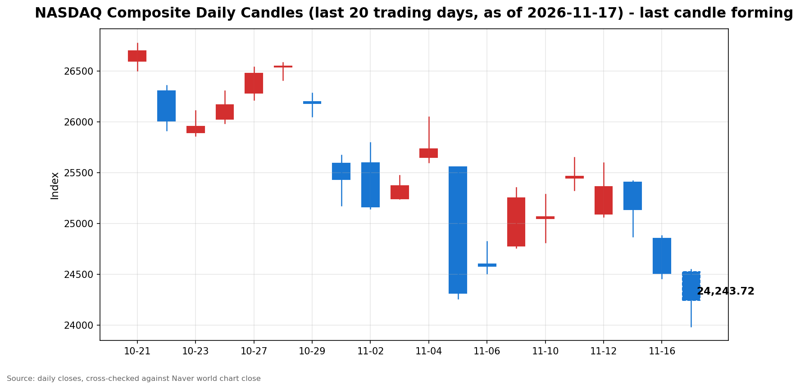

안녕하세요, [한국투자증권](https://securities.koreainvestment.com/main/Main.jsp)에서 [한투-한국투자증권](https://play.google.com/store/apps/details?id=com.truefriend.neosmartarenewal&hl=ko) 개발을 담당하고 있는 way입니다. 
현지시간 11월 17일 화요일, 나스닥은 약보합으로 출발한 뒤 장중 낙폭을 키워 3대 지수 모두 전일 저가를 밑돌고 있습니다. 

## 장중 요약

오전 10시 01분 스냅샷에서 나스닥은 전일 대비 0.07% 하락에 그쳤으나, 오후 1시 01분에는 1.15% 하락으로 낙폭이 커졌습니다. 
S&P500도 같은 시간 0.07% 하락에서 1.15% 하락으로, 다우는 0.55% 하락에서 1.48% 하락으로 낙폭이 확대됐습니다. 
3대 지수는 모두 전일 저가를 밑돌았습니다. 
나스닥 장중 저가는 23,989.09로 전일 저가 24,460.28을 밑돌았고, 24,000선도 장중 밑돌았습니다. 
하락의 배경에는 엔비디아 실적 발표 대기, 미 상무부의 AI 반도체 수출통제 강화, 10월 소매판매 발표가 함께 자리하고 있습니다. 
섹터별로는 기술주가 가장 크게 내렸고, 에너지는 상대적으로 낙폭이 작았습니다. 

## 오늘의 스냅샷

| 지수 | 현재가 | 전일 대비 | 등락률 | 전일 종가 | 장중 고가 | 장중 저가 |
| --- | --- | --- | --- | --- | --- | --- |
| 나스닥 종합 | 24,228.87 | -280.89 | -1.15% | 24,509.76 | 24,547.66 | 23,989.09 |
| S&P500 | 7,331.19 | -85.40 | -1.15% | 7,416.59 | 7,415.37 | 7,288.34 |
| 다우 | 50,844.07 | -764.10 | -1.48% | 51,608.17 | 51,463.53 | 50,685.51 |

스냅샷 기준 시각은 미국 동부시간 2026년 11월 17일 오후 1시 01분, 한국시간 11월 18일 오전 3시 01분입니다. 
나스닥 수치는 [네이버 월드 차트](https://finance.naver.com/world/sise.naver?symbol=NAS@IXIC)([나스닥 종합 가격 페이지](https://stock.naver.com/worldstock/index/.IXIC/price)) 기준 오후 1시 01분 값이며, 한투 MTS 해외 대시보드 교차값 24,231.47과 일치하는 수준입니다. 
S&P500은 한투 MTS 해외 대시보드 기준, 다우는 Yahoo Finance 기준 오후 1시 04분경 값입니다. 
당일 수치는 형성 중인 수치로, 마감 전에는 계속 변합니다. 
나스닥 거래량은 스냅샷 기준 578,749천주입니다. 

## 차트

최근 20거래일 일봉 차트입니다. 
빨간 봉은 종가가 시가보다 높은 날, 파란 봉은 종가가 시가보다 낮은 날입니다. 
당일 봉은 형성 중인 봉으로, 마감 전에는 계속 변합니다. 

## 원인·촉매 분석

오늘 장의 표면적인 흐름은 오전 약보합 출발 뒤 장중 하락 전환입니다. 
근본 촉매는 AI 쇼크와 금리 경로 불확실성의 결합입니다. 
미국 10년물 국채금리는 5.093%로 전일 5.121%보다 소폭 내렸고, 당일 범위는 5.089%에서 5.152%였습니다. 
금리가 소폭 내렸는데도 주가가 내렸다는 점이 중요합니다. 
이날 하락이 금리 급등 때문이 아니라 AI와 실적 불확실성에 따른 위험 회피 성격이 강하다는 뜻입니다. 
10월 소매판매도 금리 경로 기대에 영향을 줬습니다. 
핵심 소매판매가 예상을 웃돌면서 소비가 꺾이지 않았다는 신호가 나왔고, 이는 금리 인하 기대를 약화시키는 방향으로 작용합니다. 
원/달러 환율은 1,335.30원으로 전일 대비 0.09% 하락에 그쳐, 외환 쪽의 추가 충격은 크지 않았습니다. 
금 현물 가격은 온스당 3,868.4달러로 전일 대비 0.4% 올랐고, 전일 저점 3,832.70달러에서 반등했습니다. 
안전자산 선호가 일부 돌아오고 있는 흐름입니다. 
WTI 유가는 배럴당 86.37달러로 전일 대비 0.76% 올라 에너지 섹터의 상대 강세를 뒷받침했습니다. 
중앙일보 GMC 허브의 11월 17일자 기사 제목은 트럼프 대통령이 시카고 연은 총재에 친트럼프 인사를 지명했다고 전했습니다. 
연준 개편 움직임은 금리 경로를 둘러싼 불확실성을 키우는 요인으로, 제목 수준에서만 참고합니다. 
전일 지수 간 방향 차이도 오늘 흐름과 연결됩니다. 
전일인 11월 16일에는 나스닥이 2.49%로 가장 크게 내렸고 S&P500이 1.92%, 다우가 1.41% 내렸습니다. 
오늘은 다우가 1.48%로 낙폭이 가장 큽니다. 
충격이 기술주에서 경기민감 성격이 강한 전통 업종으로 번지고 있는 모습입니다. 

## 핵심 사건 3가지

### 1. 엔비디아 실적 발표를 앞둔 AI 쇼크 확산

미 상무부는 11월 16일 중국 기업이 제3국 데이터센터를 빌려 미국산 첨단 AI 반도체를 원격으로 쓰는 길을 막는 규정을 내놨습니다. 
엔비디아는 젠슨 황 전 최고경영자(CEO) 사임 이후 임시 체제로 운영되고 있습니다. 
엔비디아는 이사회 직속 국가안보 및 수출통제 감독위원회를 신설했고, 실적 발표는 현지시간 오늘 장 마감 후로 예정돼 있습니다. 
시장이 주목하는 질문은 가이던스, CEO 승계 로드맵, AI 생태계 자금 지원 방침 유지 여부입니다. 
중앙일보 GMC 허브의 11월 17일자 기사 제목도 엔비디아 실적과 앤트로픽 기업공개(IPO)를 앞두고 AI 쇼크가 미 증시 전방위로 확산되고 있다고 전했습니다. 
같은 허브의 기사 제목은 앤트로픽이 2,000억 달러 기업가치를 노린다고 전하고 있습니다. 
중앙일보 GMC의 11월 17일 G모닝 제목은 젠슨 황을 둘러싼 논쟁을 주제로 다뤘습니다. 
이 사건이 중요한 이유는 엔비디아가 AI 투자 사이클의 중심에 있기 때문입니다. 
수출통제 강화와 자금 지원 방침 변화는 반도체와 AI 밸류체인 전반의 투자 심리에 직접적인 영향을 줍니다. 

### 2. 10월 소매판매 발표와 금리 경로 기대

10월 소매판매는 전월 대비 0.2% 증가해 예상치에 부합했습니다. 
9월 소매판매 증가율은 0.8%로 기존 발표대로 유지됐습니다. 
자동차 판매 감소가 헤드라인을 눌렀고, 헤드라인 증가세는 9월보다 둔화했습니다. 
자동차와 휘발유, 건축자재, 음식 서비스를 제외한 핵심 소매판매는 10월 0.6% 증가해 전망치 0.3%를 웃돌았습니다. 
핵심 소매판매는 국내총생산(GDP) 산출에 반영되는 지표로, 근원 소비 흐름을 파악하는 데 쓰입니다. 
보도 해석은 엇갈렸습니다. 
한 매체는 견조한 소비에 금리인상 전망이 강화됐다고 전했고, 다른 매체는 물가 상승에 따른 소비 약화 징후라고 전했습니다. 
같은 지표에 대한 두 해석이 공존한다는 점에서, 금리 경로에 대한 시장의 판단은 아직 정해지지 않았습니다. 
다만 핵심 소비가 예상을 웃돌았다는 사실 자체는 금리 인하 기대를 약화시키는 방향으로 작용합니다. 
이 사건이 중요한 이유는 소비 지표 하나가 금리 경로 기대를 바꾸고, 금리 경로 기대가 다시 성장주 밸류에이션에 영향을 주는 연결고리를 보여주기 때문입니다. 

### 3. 아시아 증시로의 확산과 전일 저가 이탈

코스피는 11월 17일 4,968.48로 2.59% 내리며 종가 기준 5,000선을 밑돌았습니다. 
코스피가 종가 기준 5,000선 아래에서 마감한 것은 2월 2일 이후 처음입니다. 
코스피는 11월 12일 이후 4거래일 연속 하락했고, 이 기간 총 7.57% 내렸습니다. 
중앙일보 GMC의 11월 17일 G프터눈도 코스피 5,000선 붕괴를 주제로 다뤘습니다. 
대만 증시도 급락했고, 같은 허브의 기사 제목은 TSMC 신용등급 강등 우려를 전하고 있습니다. 
디즈니는 실적 호조에도 주가가 떨어졌다는 기사 제목이 나왔고, AI 공포가 실적이 좋은 종목까지 집어삼키는 모습으로 전해졌습니다. 
미국 장중에도 3대 지수가 모두 전일 저가를 밑돌며 같은 흐름이 이어지고 있습니다. 
이 사건이 중요한 이유는 엔비디아발 충격이 미국 기술주에 머무르지 않고 아시아 반도체 밸류체인과 글로벌 증시로 확산되고 있음을 보여주기 때문입니다. 

## 지수·섹터 영향 체인

지수별로는 다우가 상대적으로 약합니다. 
다우는 1.48% 하락으로, 나스닥과 S&P500의 1.15%보다 낙폭이 큽니다. 
전일에는 나스닥이 2.49%로 가장 크게 내렸던 것과 대조됩니다. 
오늘은 기술주 약세에 경기민감 성격이 강한 다우 구성 종목 쪽의 약세가 더해지는 모습입니다. 
섹터 ETF 기준으로는 기술(XLK)이 1.85% 하락으로 가장 큰 낙폭을 보였고, 반도체(SMH)가 1.52% 내렸습니다. 
AI 쇼크가 기술과 반도체에 직접 작용한 결과입니다. 
금융(XLF)은 1.54% 내렸습니다. 
금리 상승이 순이자마진에는 우호적일 수 있으나, 경기 둔화 우려와 맞물리면 방향이 갈릴 수 있습니다. 
오늘 금융주의 하락은 금리 수혜 논리만으로는 설명되지 않습니다. 
에너지(XLE)는 0.44% 하락에 그쳐 가장 작은 낙폭을 보였습니다. 
WTI 유가 상승이 에너지 섹터를 받치고 있습니다. 
헬스케어는 1.01%, 유틸리티는 0.70% 내렸습니다. 
방어 성격의 섹터도 내렸으나 낙폭은 상대적으로 작았습니다. 
금값 반등은 안전자산 선호가 일부 돌아오고 있음을 보여줍니다. 
연결고리를 정리하면 다음과 같습니다. 
수출통제 강화는 AI 반도체 수요 기대를 약화시키고, 이는 기술과 반도체 밸류에이션 조정으로 이어집니다. 
조정 과정에서 생긴 공포는 경기민감주와 금융주까지 번지고, 에너지와 금은 상대적으로 선방하는 구도입니다. 

## 다우·S&P500 흐름

다우는 50,844.07로 전일 대비 764.10포인트, 1.48% 하락한 수준에서 거래되고 있습니다. 
장중 고가는 51,463.53, 저가는 50,685.51입니다. 
전일 종가 51,608.17과 전일 저가 51,511.56을 모두 밑돌고 있으며, 51,000선도 밑돌았습니다. 
S&P500은 7,331.19로 전일 대비 85.40포인트, 1.15% 하락한 수준입니다. 
장중 고가는 7,415.37, 저가는 7,288.34입니다. 
전일 저가 7,400.15를 밑돌았고, 7,300선 근처에서 거래되고 있습니다. 
두 지수 모두 전일 급락에 이은 약보합 출발 뒤 장중 낙폭을 키우는 흐름입니다. 

## 오전과 오후 흐름 변화

나스닥은 시가 24,528.06으로 전일 종가보다 소폭 높게 출발했습니다. 
장 초반 고점 24,547.66을 찍은 뒤 줄곧 밀렸고, 오전 약보합에서 오후 하락으로 방향이 전환됐습니다. 
오전 스냅샷과 비교하면 세 지수 모두 오전 저가를 밑돌았습니다. 
나스닥은 오전 저가 24,437.83에서 장중 저가 23,989.09로, S&P500은 오전 저가 7,393.82에서 7,288.34로, 다우는 오전 저가 51,183.68에서 50,685.51로 내려갔습니다. 
오전의 관망세가 오후 들어 매도 우위로 바뀐 흐름입니다. 
다만 하락이 금리 급등에 따른 것은 아닙니다. 
10년물 국채금리는 5.09%대에서 소폭 내렸고, 하락의 성격은 AI와 실적 불확실성에 따른 위험 회피에 가깝습니다. 

## 마감까지 전망과 확인할 시나리오

오늘 장의 가장 큰 분기점은 장 마감 후 엔비디아 실적 발표와 콘퍼런스 콜입니다. 
가이던스, CEO 승계 로드맵, AI 생태계 자금 지원 방침이 확인되면 내일 아시아 장부터 미국 장까지 방향이 정해질 수 있습니다. 
마감까지 확인할 가격 레벨은 다음과 같습니다. 
나스닥은 장중 저가 23,989.09와 24,000선 회복 여부, 아래로는 11월 5일 종가 24,315.00과 저가 24,262.14 구간, 위로는 전일 종가 24,509.76과 11월 13일 종가 25,136.27입니다. 
S&P500은 장중 저가 7,288.34와 7,300선, 위로는 전일 종가 7,416.59입니다. 
다우는 장중 저가 50,685.51과 51,000선 회복 여부, 위로는 전일 종가 51,608.17입니다. 
지수와 섹터 단위의 시나리오는 다음과 같습니다. 
흐름 지속 시나리오에서는 3대 지수가 전일 저가 아래에 머무르고 기술주 약세가 이어지면서, 마감까지 위험 회피 흐름이 이어질 수 있습니다. 
일시적 노이즈 시나리오에서는 10년물이 5.09%대에서 더 내리고 금과 에너지의 상대 강세가 이어지면서 낙폭이 제한될 수 있습니다. 
다만 실적 발표 전 관망세가 강해 반등의 지속 여부는 실적 확인 뒤에 가려질 수 있습니다. 
함께 확인할 수치는 10년물 국채금리의 당일 범위 5.089%에서 5.152% 이탈 여부, 금과 유가 흐름, 마감 전 거래량 변화입니다. 
위 내용은 지수·섹터 단위의 관전 포인트이며, 특정 종목의 매수·매도 권유가 아닙니다. 

## 마치며

나스닥은 약보합 출발 뒤 장중 낙폭을 키워 3대 지수 모두 전일 저가를 밑돌았습니다. 
장 마감 후 엔비디아 실적 발표가 오늘 장의 가장 큰 분기점이며, 결과 확인 전까지 관망과 위험 관리의 관점에서 흐름을 지켜볼 필요가 있습니다. 
