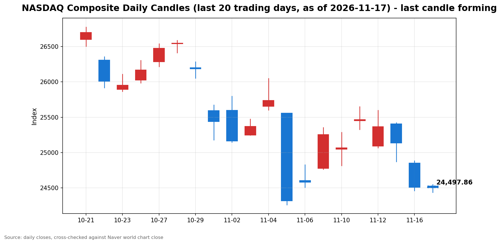

안녕하세요, [한국투자증권](https://securities.koreainvestment.com/main/Main.jsp)에서 [한투-한국투자증권](https://play.google.com/store/apps/details?id=com.truefriend.neosmartarenewal&hl=ko) 개발을 담당하고 있는 way입니다. 
현지시간 11월 17일 화요일, 나스닥은 전일 급락 뒤 엔비디아 실적 발표를 앞둔 관망 속에 약보합으로 출발했습니다. 

## 개장 배경

전일인 11월 16일 뉴욕증시는 3대 지수가 일제히 하락 마감했습니다. 
나스닥 종합은 24,509.76으로 2.49% 내렸고, S&P500은 7,416.59로 1.92%, 다우는 51,608.17로 1.41% 하락했습니다. 
하락의 배경에는 10월 생산자물가지수(PPI) 쇼크의 여진과 엔비디아 최고경영자(CEO) 젠슨 황의 사임 여파, 미국 10년물 국채금리 5% 재돌파에 따른 긴축 우려가 겹쳐 있습니다. 
오늘 개장 직후 지수는 전일 종가 근처에서 방향을 탐색하고 있습니다. 
장 마감 후 예정된 엔비디아 실적 발표가 오늘 장의 가장 큰 분기점입니다. 

## 오늘의 스냅샷

| 지수 | 현재가 | 전일 대비 | 등락률 | 전일 종가 | 장중 고가 | 장중 저가 |
| --- | --- | --- | --- | --- | --- | --- |
| 나스닥 종합 | 24,493.52 | -16.24 | -0.07% | 24,509.76 | 24,547.66 | 24,437.83 |
| S&P500 | 7,411.64 | -4.95 | -0.07% | 7,416.59 | 7,415.37 | 7,393.82 |
| 다우 | 51,326.49 | -281.68 | -0.55% | 51,608.17 | 51,463.53 | 51,183.68 |

스냅샷 기준 시각은 미국 동부시간 2026년 11월 17일 오전 10시 01분, 한국시간 11월 18일 오전 0시 01분입니다. 
나스닥 수치는 [네이버 월드 차트](https://finance.naver.com/world/sise.naver?symbol=NAS@IXIC)([나스닥 종합 가격 페이지](https://stock.naver.com/worldstock/index/.IXIC/price)) 기준이며, S&P500은 한투 MTS 해외 대시보드 기준 오전 9시 58분 값이고, 다우는 Yahoo Finance 기준 오전 10시경 값입니다. 
네이버 월드 차트 페이지는 curl 직접 조회가 차단되어 브라우저로 확인한 값이며, 전일 종가 24,509.76은 한투 MTS 교차값 및 Yahoo Finance 일봉과 일치합니다. 
당일 수치는 형성 중인 수치로, 마감 전에는 계속 변합니다. 
나스닥 거래량은 스냅샷 기준 213,767천주입니다. 

## 차트

최근 20거래일 일봉 차트입니다. 
빨간 봉은 종가가 시가보다 높은 날, 파란 봉은 종가가 시가보다 낮은 날입니다. 
당일 봉은 형성 중인 봉으로, 마감 전에는 계속 변합니다. 

## 원인·촉매 분석

오늘 개장의 직접적인 배경은 전일 급락 이후의 숨 고르기입니다. 
나스닥은 개장 시 24,528.06으로 전일 종가보다 소폭 높게 출발한 뒤 반락해 약보합권에서 거래되고 있습니다. 
급락 하루 만의 기술적 되돌림 시도와 실적 대기 관망이 동시에 작용하는 모습입니다. 
근본 촉매는 금리입니다. 
미국 10년물 국채금리가 5%를 재돌파하면서 성장주 밸류에이션에 대한 부담이 이어지고 있습니다. 
달러 강세와 함께 금값이 1년여 만에 최저 수준까지 밀린 점도 같은 방향을 가리킵니다. 
시장에서는 연준의 추가 긴축 가능성까지 거론되고 있으며, 이는 금리 인하 기대가 우세했던 흐름과 결이 다릅니다. 
다만 금리 부담 속에서도 나스닥의 낙폭이 다우보다 작은 점은 의미가 있습니다. 
개장 전 특징주에서는 엔비디아 실적 발표를 기다리며 주가가 상승했다는 소식이 전해졌고, 기술주 쪽에 대기 매수가 남아 있음을 보여줍니다. 
원/달러 환율은 1,336.60원으로 전일 대비 0.01% 상승에 그쳐, 외환 쪽의 추가 충격은 크지 않았습니다. 

## 핵심 사건 3가지

### 1. 젠슨 황 사임 후폭풍과 엔비디아 실적 발표

엔비디아는 젠슨 황 전 최고경영자(CEO)의 사임 이후 임시 체제로 운영되고 있습니다. 
엔비디아는 현지시간 11월 17일 이사회 직속 국가안보 및 수출통제 감독위원회를 신설했다고 발표했고, 트럼프 대통령은 관련 조치를 긍정적으로 평가했습니다. 
실적 발표는 현지시간 11월 17일 장 마감 후, 한국시간 11월 18일 오전에 예정되어 있습니다. 
시장이 주목하는 질문은 세 가지입니다. 
동남아시아 사업에 대한 설명, AI 생태계 파트너 기업들에 대한 자금 지원 유지 여부, 그리고 CEO 승계 로드맵입니다. 
일부 보도에서는 새 경영진 체제에서 엔비디아의 AI 업계 자금 지원이 대폭 축소될 수 있다는 전망도 나왔습니다. 
키뱅크 캐피털 마켓츠의 존 빈 애널리스트는 결국 콘퍼런스 콜의 초점이 실적과 전망에 맞춰질 것으로 예상했습니다. 
중앙일보 GMC의 11월 17일 G모닝도 젠슨 황을 둘러싼 논쟁을 주제로 다뤘습니다. 
이 사건이 중요한 이유는 엔비디아가 AI 투자 사이클의 중심에 있기 때문입니다. 
CEO 공백과 자금 지원 방침 변화는 반도체와 AI 밸류체인 전반의 투자 심리에 직접적인 영향을 줍니다. 

### 2. 미국 10년물 국채금리 5% 재돌파와 긴축 우려

미국 10년물 국채금리가 5%를 다시 넘어섰습니다. 
금리 상승은 성장주의 미래 현금흐름 가치를 낮추는 방향으로 작용합니다. 
같은 흐름에서 금 현물 가격은 온스당 3,832.70달러까지 밀려 1년여 만에 최저 수준을 기록한 뒤 3,865달러 선에서 거래되고 있습니다. 
달러 강세, 국채금리 상승, 연준 긴축 전망이 함께 금값을 누르고 있습니다. 
오늘 발표가 예정된 미국의 10월 소매판매 지표는 이 국면의 단기 방향을 가를 변수로 꼽힙니다. 
소매판매가 예상을 밑돌면 긴축 전망이 약해질 수 있고, 예상을 웃돌면 고금리 장기화 우려가 이어질 수 있습니다. 

### 3. PPI 쇼크의 여진과 아시아 증시로의 확산

지난주 발표된 10월 생산자물가지수(PPI)는 4년 만에 가장 높은 상승률을 기록하며 인플레이션 우려를 다시 키웠습니다. 
그 여진으로 11월 16일 나스닥은 2.49% 급락했고, 한국 코스피도 11월 17일 4,968.48로 2.59% 내리며 5,000선을 밑돌았습니다. 
코스피가 종가 기준 5,000선 아래에서 마감한 것은 2월 2일 이후 처음입니다. 
중앙일보 GMC의 11월 17일 G프터눈도 코스피 5000선 붕괴를 주제로 다뤘습니다. 
코스피는 11월 12일 이후 4거래일 연속 하락하며 이 기간 총 7.57% 내렸습니다. 
젠슨 황 사태로 위축된 반도체 투자 심리가 미국을 넘어 아시아 증시까지 확산된 흐름입니다. 
이 사건이 중요한 이유는 물가 지표 하나가 금리 경로 기대를 바꾸고, 금리 경로 기대가 다시 성장주와 반도체 밸류체인 전반의 심리를 바꾸는 연결고리를 보여주기 때문입니다. 

## 지수·섹터 영향 체인

지수별로는 다우가 상대적으로 약합니다. 
다우는 -0.55%로, 나스닥과 S&P500의 -0.07%보다 낙폭이 큽니다. 
전일에는 나스닥이 -2.49%로 가장 크게 내렸던 것과 대조됩니다. 
오늘은 기술주가 엔비디아 실적 대기 매수에 힘입어 낙폭을 제한하는 반면, 경기민감 성격이 강한 다우 구성 종목 쪽의 약세가 두드러지는 모습입니다. 
금리 경로를 둘러싼 불확실성은 성장주 밸류에이션에 직접적인 부담입니다. 
10년물 5% 재돌파는 할인율 상승을 의미하고, 이는 먼 미래의 이익에 의존하는 성장주에 상대적으로 더 크게 작용합니다. 
반도체·AI 섹터는 양면적인 위치에 있습니다. 
엔비디아 실적 대기 매수가 단기 하방을 받치고 있지만, CEO 공백과 AI 생태계 자금 지원 축소 전망은 밸류체인 전반의 재평가 압력으로 이어질 수 있습니다. 
금융 섹터는 금리 상승이 순이자마진에는 우호적일 수 있으나, 경기 둔화 우려와 맞물리면 방향이 갈릴 수 있어 확인이 필요합니다. 
에너지 섹터의 방향은 유가 흐름에 달려 있으며, 유가 수치는 확인이 필요합니다. 
금값 하락과 달러 강세는 안전자산 선호가 약해졌다기보다, 실질금리와 달러가 금의 기회비용을 높인 결과로 해석됩니다. 

## 다우·S&P500 흐름

다우는 51,326.49로 전일 대비 281.68포인트, 0.55% 하락한 수준에서 거래되고 있습니다. 
장중 고가는 51,463.53, 저가는 51,183.68입니다. 
전일 종가 51,608.17과 전일 저가 51,511.56을 함께 보면, 오늘은 전일 저가를 밑도는 구간에서 거래되고 있습니다. 
S&P500은 7,411.64로 전일 대비 4.95포인트, 0.07% 하락한 수준입니다. 
장중 고가는 7,415.37, 저가는 7,393.82입니다. 
전일 저가 7,400.15 근처에서 등락하고 있어, 전일 저가의 지지 여부가 장 초반의 관전 포인트입니다. 
두 지수 모두 전일 급락 이후 방향을 정하지 못한 채 약보합권에서 머무르고 있습니다. 

## 단기·중기 전망과 장 초반 확인할 시나리오

오늘 장의 흐름은 장 마감 후 엔비디아 실적 발표를 앞두고 관망세가 이어질 가능성이 큽니다. 
실적과 콘퍼런스 콜에서 가이던스, CEO 승계 로드맵, AI 생태계 자금 지원 방침이 확인되면 내일 아시아 장부터 미국 장까지 방향이 정해질 수 있습니다. 
장 초반에 확인할 수치는 다음과 같습니다. 
나스닥은 전일 종가 24,509.76과 당일 저가 24,437.83, 전일 저가 24,460.28의 지지 여부, 그리고 11월 13일 종가 25,136.27 수준의 저항 구간입니다. 
S&P500은 전일 종가 7,416.59과 전일 저가 7,400.15의 지지 여부입니다. 
다우는 전일 종가 51,608.17 회복 여부와 전일 저가 51,511.56의 지지 여부입니다. 
오늘 발표되는 10월 소매판매 결과도 확인할 필요가 있습니다. 
소비 둔화 신호가 확인되면 경기 우려가 커질 수 있고, 반대로 소비가 견조하면 고금리 장기화 우려가 이어질 수 있습니다. 
중기적으로는 금리 경로가 핵심 변수입니다. 
10년물 국채금리가 5% 위에서 머무르면 성장주 밸류에이션 부담이 이어질 수 있고, 금리가 되돌려지면 기술주 반등의 여지가 생깁니다. 
엔비디아 실적이 우호적으로 나오면 AI·반도체 심리 회복의 계기가 될 수 있고, 실망스럽게 나오면 밸류체인 전반의 재조정이 이어질 수 있습니다. 
다만 이는 시나리오일 뿐이며, 어느 쪽으로 결론이 날지는 실적과 지표 확인 이후에 판단할 일입니다. 

## 마치며

나스닥은 전일 급락 뒤 엔비디아 실적 발표를 앞둔 관망 속에 약보합으로 출발했습니다. 
오늘은 장 마감 후 실적과 소매판매 지표 확인이 다음 방향을 가를 분기점이 될 것으로 보입니다. 
이 글은 교육·해설 목적의 시황 정리이며, 특정 종목의 매수·매도 권유가 아닙니다. 
