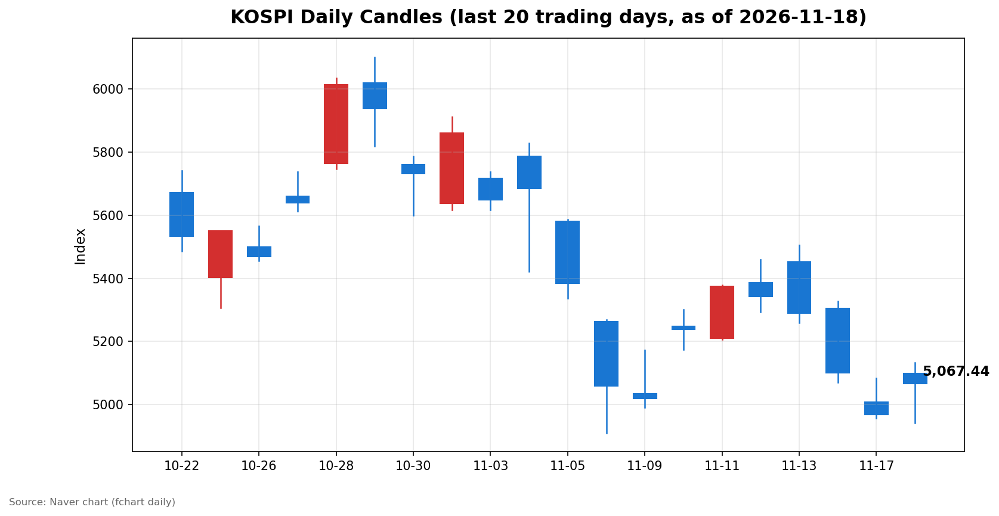
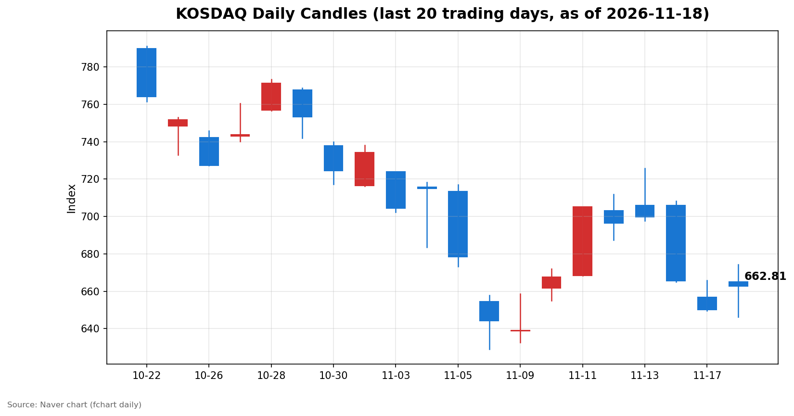

안녕하세요, [한국투자증권](https://securities.koreainvestment.com/main/Main.jsp)에서 [한투-한국투자증권](https://play.google.com/store/apps/details?id=com.truefriend.neosmartarenewal&hl=ko) 개발을 담당하고 있는 way입니다. 
2026년 11월 18일 수요일 국내 장 마감 흐름을 정리합니다. 

## 마감 요약

코스피는 5,067.44로 전일 대비 98.96포인트, 1.99% 상승해 마감했습니다. 
코스닥은 662.81로 전일 대비 12.75포인트, 1.96% 상승해 마감했습니다. 
코스피는 4거래일 연속 하락을 멈추고 종가 기준으로 5,000선을 되찾았습니다. 
보도에 따르면 전일 종가 4,968.48은 약 9개월 만에 5,000선을 내준 수준이었습니다. 
장중에는 5,133.14까지 올랐다가 4,943.17까지 밀리며 189.97포인트를 오가는 변동성이 나타났습니다. 
외국인은 코스피에서 3,340억 원을 순매도했으나, 기관이 5,047억 원을 순매수하며 지수를 받았습니다. 
개인은 6,309억 원을 순매도했습니다. 

## 오늘의 마감 스냅샷

| 지수 | 종가 | 전일 대비 | 등락률 | 시가 | 고가 | 저가 | 거래량 | 거래대금 |
| --- | --- | --- | --- | --- | --- | --- | --- | --- |
| 코스피 | 5,067.44 | +98.96 | +1.99% | 5,098.82 | 5,133.14 | 4,943.17 | 192,708천주 | 14조 8,257억 원 |
| 코스닥 | 662.81 | +12.75 | +1.96% | 664.93 | 674.30 | 646.31 | 415,628천주 | 5조 5,168억 원 |

스냅샷 기준 시각은 2026년 11월 18일 장 마감, 15시 30분 KST입니다. 
전일 종가는 코스피 4,968.48, 코스닥 650.06입니다. 
전일 종가는 네이버 실시간 등락률로 역산한 값과 일봉 종가가 일치하는 것을 확인했습니다. 
지수 차트는 [코스피](https://finance.naver.com/sise/sise_index.naver?code=KOSPI)와 [코스닥](https://finance.naver.com/sise/sise_index.naver?code=KOSDAQ)에서 확인할 수 있습니다. 

## 차트

최근 20거래일 일봉 차트입니다. 
빨간 봉은 종가가 시가보다 높은 날, 파란 봉은 종가가 시가보다 낮은 날입니다. 

## 원인·촉매 분석

오늘 반등의 직접적인 출발점은 간밤 발표된 엔비디아 실적입니다. 
엔비디아는 2027 회계연도 3분기 매출 1,158억 4,000만 달러를 기록했습니다. 
전년 동기 대비 103% 증가한 수치로, 시장 예상 1,091억 달러를 6.2% 상회했습니다. 
조정 주당순이익은 2.68달러로 시장 예상 2.48달러를 웃돌았습니다. 
데이터센터 매출은 1,076억 달러로 전년 동기 대비 110% 증가했습니다. 
4분기 매출 가이던스는 1,300억 달러로 제시돼 시장 예상 1,251억 달러를 웃돌았습니다. 
2028 회계연도 매출 성장률 전망도 기존 약 70%에서 약 75%로 상향 조정됐습니다. 
젠슨 황 전 최고경영자 사임 이후 처음 공개된 실적이라는 점에서, 인공지능 반도체 수요가 경영진 교체에도 견조하다는 신호로 받아들여졌습니다. 
실적 발표 후 엔비디아 주가는 시간외 거래에서 2.55% 상승했습니다. 
중앙일보 GMC의 11월 18일 G모닝 브리핑도 엔비디아 실적을 실적은 합격점, 복귀는 물음표로 정리했습니다. 
이 흐름이 국내 반도체와 인공지능 부품주로 이어지며 코스피는 2.62% 상승 출발했고, 장중 5,133.14까지 올랐습니다. 
다만 상승분은 그대로 유지되지 않았습니다. 
장중 외국인이 매도세로 돌아서고 개인의 매물이 늘면서 지수는 5,000선을 내줬고, 저가 4,943.17까지 밀렸습니다. 
오후 들어 기관과 기타법인의 매수가 유입되며 지수는 5,067.44로 회복해 마감했습니다. 
원·달러 환율은 1,333.20원으로 전일 대비 2.20원, 0.16% 하락해 원화가 소폭 강세를 보였습니다. 
환율 안정은 외국인의 매도 압력을 완화하는 방향으로 작용했습니다. 
4거래일 연속 하락에 따른 낙폭 과대 인식도 반등의 배경으로 볼 수 있습니다. 
코스피는 11월 13일 종가 5,290.53에서 11월 17일 종가 4,968.48까지 6.09% 하락한 바 있습니다. 
정리하면, 엔비디아 호실적이라는 외부 촉매에 낙폭 과대 인식이 더해져 반등이 시작됐으나, 장중 매물 출회로 변동성이 컸고, 기관 매수가 마감을 지킨 하루입니다. 

## 핵심 사건 3가지

첫째, 엔비디아 어닝 서프라이즈가 국내 증시의 반등을 이끌었습니다. 
엔비디아는 미국 현지시간 11월 17일 장 마감 후 2027 회계연도 3분기 실적을 발표했습니다. 
매출은 1,158억 4,000만 달러로 전년 동기 대비 103% 증가했고, 시장 예상 1,091억 달러를 6.2% 상회했습니다. 
데이터센터 매출은 1,076억 달러로 전년 동기 대비 110% 증가했고, 전체 매출의 약 93%를 차지했습니다. 
조정 주당순이익은 2.68달러로 시장 예상 2.48달러를 상회했습니다. 
4분기 매출 가이던스는 1,300억 달러로 시장 예상 1,251억 달러를 웃돌았습니다. 
콜레트 크레스 임시 최고경영자는 2028 회계연도 매출 성장률 전망을 기존 약 70%에서 약 75%로 높였습니다. 
젠슨 황 전 최고경영자의 사임 이후 처음 공개된 실적입니다. 
실적 발표 전까지 엔비디아 주가는 이달 들어 24% 하락한 상태였습니다. 
인공지능 투자 수익성에 대한 우려와 리더십 공백이 주가를 눌러온 만큼, 실적 서프라이즈는 투자 심리를 되돌리는 계기가 됐습니다. 
시간외 주가 상승과 함께 국내 반도체주에도 매수세가 유입됐습니다. 
다만 실적 발표 직후의 반응이 추세 전환으로 이어질지는 미국 정규장 주가와 외국인 수급을 더 확인할 필요가 있습니다. 

둘째, HD현대로보틱스가 국내 첫 1톤급 초대형 로봇을 산업현장에 공급했습니다. 
HD현대로보틱스는 11월 18일 국내 최초로 자체 개발한 1톤급 초대형 산업용 로봇을 산업현장에 공급했습니다. 
로봇 이름은 HDT1000-33이며, 최대 1톤의 중량물을 취급할 수 있는 6축 다관절 로봇입니다. 
경기 안산 한국R&D 본사에서 첫 판매 기념행사가 열렸습니다. 
공급된 로봇은 건설기계용 대형 엔진 생산 공정에 투입돼 실린더 블록을 가공 설비에 투입하고 운반하는 역할을 맡습니다. 
수천 회 반복 이동에도 목표 위치와의 오차는 0.1mm 이내입니다. 
시연에서는 420kg 부품을 들어 올렸습니다. 
개발은 2024년 2월에 착수해 2년여 만에 공급에 이르렀습니다. 
회사는 조선 기자재, 차량용 대형 부품, 전기차 배터리팩, 이차전지 등으로 적용 범위를 넓힐 계획입니다. 
로봇 테마는 이날 5.65% 올랐고, 30개 종목 중 28개가 상승했습니다. 
산업용 로봇의 고중량 자동화 시장 개척이라는 점에서, 로봇과 자동화 테마의 재료가 된 하루입니다. 

셋째, 한국개발연구원(KDI)이 성장률 전망을 대폭 상향 조정했습니다. 
KDI는 11월 18일 발표한 2026년 하반기 경제전망에서 올해 성장률을 3.8%, 내년 성장률을 3.9%로 제시했습니다. 
지난 8월 전망과 비교하면 올해는 3.2%에서 0.6%포인트, 내년은 2.2%에서 1.7%포인트 상향 조정된 수치입니다. 
국제통화기금(IMF)이 전날 제시한 내년 성장률 전망 3.3%보다 0.6%포인트 높습니다. 
상향 조정의 배경은 반도체 호황입니다. 
올해 성장의 절반 정도, 내년 성장의 3분의 2 정도가 반도체와 관련 파급효과에서 나올 것으로 분석됐습니다. 
반도체를 포함한 컴퓨터·전자·광학기기 제조업의 명목 국내총생산(GDP) 대비 부가가치 비중은 2022~2025년 평균 7.5%에서 올해 상반기 20.7%로 급등했습니다. 
수출은 올해 10.3%, 내년 8.1% 증가하고, 설비투자는 올해 8.7%, 내년 8.1% 증가할 것으로 전망됐습니다. 
다만 KDI는 반도체 의존도가 높아진 만큼 글로벌 인공지능 투자가 위축될 경우 성장률이 대폭 하락할 수 있다고 경고했습니다. 
체감경기와 지표 사이의 격차도 과제로 지적됐습니다. 
성장률 전망 상향은 국내 증시의 중기 배경을 뒷받침하는 재료이나, 반도체 한 축에 대한 의존도가 커졌다는 점은 변동성 요인으로 함께 봐야 합니다. 

## 섹터·테마 영향 체인

인공지능 반도체 수요 확인은 밸류체인을 따라 부품주로 번졌습니다. 
엔비디아 실적이 데이터센터 수요의 지속을 확인하면서, 인공지능 가속기용 기판과 MLCC 등 부품 수요 기대가 커졌습니다. 
MLCC 테마는 3.17% 올랐습니다. 
한국투자증권 MTS 인공지능 시장 요약도 엔비디아향 인공지능 부품 공급 협력을 거론했습니다. 
삼성전기는 806,000원으로 6.90% 상승했습니다. 
로봇 테마는 HD현대로보틱스 공급 소식에 5.65% 올랐습니다. 
로봇의 확산은 제조업 자동화 투자와 연결됩니다. 
KDI 전망에서 설비투자가 올해 8.7%, 내년 8.1% 증가할 것으로 제시된 점과 같은 방향입니다. 
엔터테인먼트 테마는 3.55% 올랐고, 블록체인은 4.33%, 재택근무는 6.06% 올랐습니다. 
대마 관련 테마는 15.54% 올랐으나 종목 수가 2개로 작아 지수에 미치는 영향은 제한적입니다. 
전력 테마는 종목별로 흐름이 갈렸습니다. 
정리하면, 인공지능 부품과 로봇이라는 두 축이 이날 상승을 이끌었고, 나머지 테마는 개별 재료에 따라 움직였습니다. 
코스피와 코스닥이 함께 2% 가까이 오른 만큼 상승은 대형주에 머물지 않고 시장 전반으로 확산됐습니다. 

## 최근 5거래일 일봉

| 날짜 | 코스피 종가 | 코스피 등락률 | 코스닥 종가 | 코스닥 등락률 |
| --- | --- | --- | --- | --- |
| 2026-11-12 | 5,342.73 | -0.61% | 696.53 | -1.22% |
| 2026-11-13 | 5,290.53 | -0.98% | 699.66 | +0.45% |
| 2026-11-16 | 5,100.50 | -3.59% | 665.65 | -4.86% |
| 2026-11-17 | 4,968.48 | -2.59% | 650.06 | -2.34% |
| 2026-11-18 | 5,067.44 | +1.99% | 662.81 | +1.96% |

코스피는 11월 11일 종가 5,375.36에서 11월 17일 종가 4,968.48까지 4거래일 연속 하락했습니다. 
같은 기간 하락폭은 7.57%였습니다. 
오늘 반등으로 11월 11일 종가 대비 하락폭은 5.73%로 줄었습니다. 
코스닥도 11월 11일 종가 705.10에서 11월 17일 종가 650.06까지 7.81% 하락한 뒤 오늘 반등했습니다. 

## 당일 수급

코스피에서는 외국인이 3,340억 원을 순매도했습니다. 
전일 1조 4,190억 원 순매도에서 규모가 크게 줄었습니다. 
외국인은 11월 13일부터 4거래일 연속 순매도를 이어가고 있습니다. 
개인은 6,309억 원을 순매도했습니다. 
전일 4,310억 원 순매수에서 매도로 돌아섰습니다. 
기관은 5,047억 원을 순매수했습니다. 
기관 안에서는 금융투자가 3,118억 원, 투신이 2,214억 원을 순매수했습니다. 
연기금은 660억 원을 순매수했고, 사모펀드는 771억 원을 순매도했습니다. 
기타법인은 4,603억 원을 순매수했습니다. 
코스닥에서는 외국인이 460억 원을 순매도했고, 개인은 1,228억 원을 순매도했습니다. 
코스닥 기관은 1,768억 원을 순매수했습니다. 
기관 안에서는 금융투자가 902억 원, 투신이 567억 원을 순매수했습니다. 
기타법인은 80억 원을 순매도했습니다. 
수급 구도를 정리하면, 양 시장 모두에서 기관이 매수 주체였고, 외국인과 개인이 매도 주체였습니다. 
외국인의 매도 규모가 전일 대비 크게 줄었고, 기관의 매수가 이어졌다는 점이 오늘 반등을 뒷받침했습니다. 
다만 외국인이 여전히 순매도라는 점에서 매도세의 완전한 전환으로 보기는 이릅니다. 
수급 수치는 네이버 시장동향 기준입니다. 

## 강했던 테마와 흐름

한국투자증권 MTS 기준 상승률 상위 테마는 마리화나 15.54%, 재택근무 6.06%, 로봇 5.65%, 블록체인 4.33%, 제분 4.08% 순이었습니다. 
엔터테인먼트 3.55%, 급속충전 3.54%, MLCC 3.17%, 전자지갑 3.09%도 올랐습니다. 
로봇 테마는 30개 종목 중 28개가 올랐고, MLCC 테마는 6개 종목 중 5개가 올랐습니다. 
대형주 중심의 반등과 테마 강세가 함께 나타난 점이 오늘 흐름의 특징입니다. 
코스피 거래대금은 전일 14조 1,960억 원에서 14조 8,257억 원으로 늘었습니다. 
코스닥 거래대금은 전일 4조 7,012억 원에서 5조 5,168억 원으로 늘었습니다. 

## 단기·중기 전망과 내일 확인할 시나리오

단기적으로는 5,000선 안착 여부가 첫 번째 관전 포인트입니다. 
오늘 종가 5,067.44로 5,000선을 되찾았으나, 장중 4,943.17까지 밀린 만큼 안착을 확인하려면 다음 거래일의 흐름이 필요합니다. 
당일 고가 5,133.14와 저가 4,943.17이 단기 지지·저항 구간의 기준이 됩니다. 
11월 16일 종가 5,100.50이 저항으로 작용하는지도 함께 확인할 필요가 있습니다. 
두 번째는 외국인의 매도 지속 여부입니다. 
외국인 순매도 규모가 전일 1조 4,190억 원에서 3,340억 원으로 줄었습니다. 
매도 규모가 더 축소되거나 매수로 전환되는지가 지수 방향을 좌우합니다. 
세 번째는 미국 증시의 반응입니다. 
엔비디아의 시간외 상승이 정규장에서 이어지는지, 나스닥이 반등하는지를 확인할 필요가 있습니다. 
중기적으로는 인공지능 투자 사이클의 지속 여부가 핵심입니다. 
엔비디아 실적이 수요 지속을 확인했으나, KDI가 지적한 것처럼 반도체 의존도가 높아진 만큼 인공지능 투자 위축 시 변동성이 커질 수 있습니다. 
리스크 관리 관점에서는 지수보다 섹터 단위의 흐름을 확인하는 것이 적절합니다. 
인공지능 부품과 로봇 테마의 강세가 이어지는지, 외국인 수급이 안정되는지를 구분해 볼 필요가 있습니다. 

## 마치며

코스피는 엔비디아 호실적에 힘입어 5,000선을 되찾고 5,067.44로 마감했으나, 장중 변동성이 컸던 하루였습니다. 
다음 거래일에는 5,000선 안착 여부와 외국인 매도 축소 지속 여부, 미국 증시의 반응을 확인할 필요가 있습니다. 
이 글은 시장 해설을 목적으로 하며, 특정 종목의 매수나 매도를 권유하지 않습니다. 
