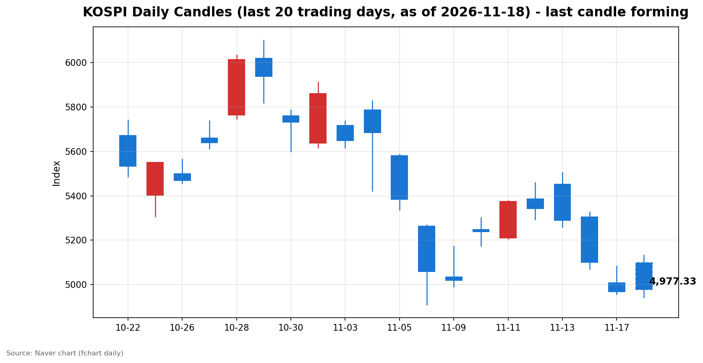
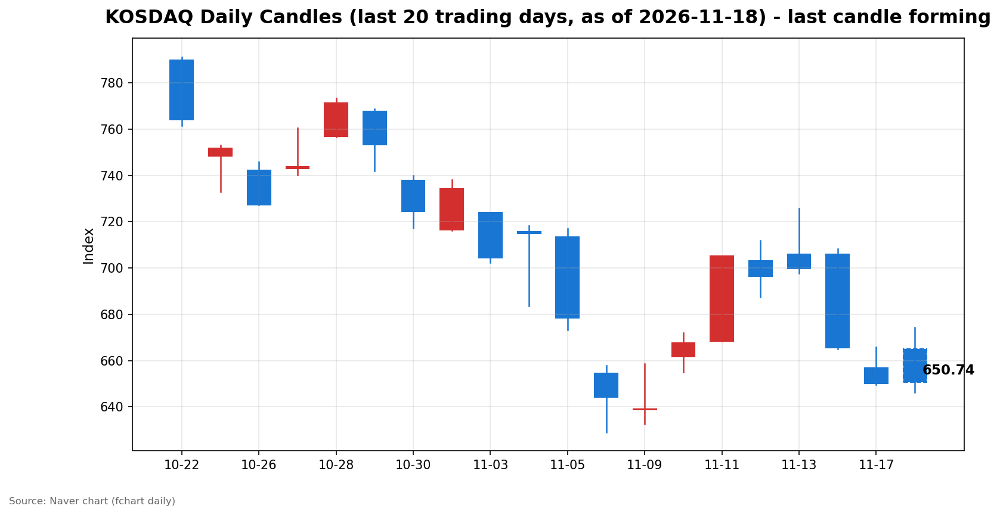

안녕하세요, [한국투자증권](https://securities.koreainvestment.com/main/Main.jsp)에서 [한투-한국투자증권](https://play.google.com/store/apps/details?id=com.truefriend.neosmartarenewal&hl=ko) 개발을 담당하고 있는 way입니다. 
오늘 오전 국내 증시는 엔비디아의 어닝 서프라이즈에 힘입어 급등 출발했으나, 상승폭을 대부분 반납하고 5,000선을 사이에 둔 공방을 벌이는 흐름을 보였습니다. 

## 오전장 요약

코스피는 전일 대비 14.45포인트 오른 4,982.93으로 장중 거래되고 있습니다. 
시가 5,098.82로 2% 넘게 상승 출발해 장중 고가 5,133.14까지 올랐으나, 이후 하락 전환해 장중 저가 4,943.17까지 밀렸다가 5,000선 언저리에서 등락하고 있습니다. 
코스닥도 비슷한 흐름으로, 시가 664.93에서 고가 674.30까지 올랐다가 저가 646.31까지 밀린 뒤 651.37 수준에서 거래되고 있습니다. 
전일까지 코스피는 4거래일 연속 하락하며 11월 11일 종가 5,375.36에서 11월 17일 종가 4,968.48까지 7.6% 가까이 내린 상태였고, 오늘 오전 반등 시도 역시 5,000선 안착에는 이르지 못하고 있습니다. 

## 오늘의 스냅샷

| 지수 | 현재가 | 전일 대비 | 등락률 | 시가 | 고가 | 저가 | 거래량 | 거래대금 |
| --- | --- | --- | --- | --- | --- | --- | --- | --- |
| 코스피 | 4,982.93 | +14.45 | +0.29% | 5,098.82 | 5,133.14 | 4,943.17 | 1억 2,125만 주 | 8조 6,245억 원 |
| 코스닥 | 651.37 | +1.31 | +0.20% | 664.93 | 674.30 | 646.31 | 2억 9,430만 주 | 3조 9,443억 원 |

스냅샷 기준 시각은 2026년 11월 18일 12시 27분(KST)입니다. 
전일 종가는 코스피 4,968.48, 코스닥 650.06이며, 네이버 실시간 등락률을 역산한 값과 일치합니다. 
당일 봉은 아직 형성 중인 봉으로, 종가는 마감 전까지 계속 변합니다. 
코스피 차트는 [네이버 코스피](https://finance.naver.com/sise/sise_index.naver?code=KOSPI), 코스닥 차트는 [네이버 코스닥](https://finance.naver.com/sise/sise_index.naver?code=KOSDAQ)에서 확인할 수 있습니다. 

## 차트

최근 20거래일 일봉 차트입니다. 
빨간 봉은 종가가 시가보다 높은 날, 파란 봉은 종가가 시가보다 낮은 날입니다. 
당일 봉은 형성 중인 봉으로, 마감 전에는 계속 변합니다. 

## 원인·촉매 분석

오늘 오전장의 출발점은 간밤 미국 장 마감 뒤 발표된 엔비디아의 2027 회계연도 3분기 실적입니다. 
매출 1,158억 4,400만 달러로 전년 동기 대비 두 배 넘게 늘었고, 주당순이익 2.68달러와 4분기 매출 전망도 시장 예상을 웃돌았습니다. 
매출은 시장 예상 1,093억 달러를, 주당순이익은 예상 2.47달러를 각각 상회했고, 4분기 매출 가이던스 1,300억 달러도 예상 1,253억 달러를 웃돌았습니다. 
내년 매출 성장률 가이던스도 70%에서 75%로 상향됐습니다. 
정규장에서 0.48% 하락했던 엔비디아 주가는 시간 외 거래에서 4% 넘게 올랐고, 인공지능 인프라 수요가 여전히 견조하다는 신호로 받아들여졌습니다. 
이 기대감은 오늘 국내 증시의 출발을 결정했습니다. 
반도체와 전자부품, 인공지능 메모리 공급망 관련주가 장 초반 강세를 보였고, 코스피는 5,100선을 넘기며 출발했습니다. 
그러나 상승은 오래가지 못했습니다. 
엔비디아 실적이 인공지능 수요의 견조함을 확인해줬지만, 막대한 인공지능 투자 규모와 투자 대비 수익성에 대한 시장의 의구심까지 해소하지는 못했다는 평가가 함께 나왔습니다. 
일본 증시도 장 초반 상승 뒤 상승폭을 전부 반납하고 하락 반전하는 등, 아시아 증시 전반에서 같은 되돌림이 나타났습니다. 
미국 기관투자자의 기술주 비중 축소도 되돌림의 배경 가운데 하나입니다. 
뱅크오브아메리카(BofA) 펀드매니저 설문에서 기술주 비중 지표가 한 달 새 37%에서 12%로 급감했고, 인공지능 과다 투자에 대한 응답이 역대 최대 격차를 보였습니다. 
미 상무부 산업안보국(BIS)이 11월 16일(현지시간) 중국 기업의 미국산 첨단 인공지능 반도체 원격 접속을 사실상 전면 통제하는 신규 규제를 발표한 점도 구조적 부담으로 작용합니다. 
우회 수출 우려 5개국에 대한 선적 요건 강화와 해외 파운드리의 중국 인공지능 반도체 위탁생산 규제 강화가 포함됐고, 이는 국내 반도체 공급망에도 영향을 줄 수 있는 사안입니다. 
전일 수급 구도도 오전 흐름의 배경을 설명합니다. 
11월 17일 코스피에서 외국인은 1조 4,190억 원을 순매도했고, 개인은 4,310억 원, 기관은 5,134억 원을 순매수했습니다. 
기관 순매수 가운데 금융투자가 7,675억 원으로 대부분을 차지했고, 투신은 1,690억 원 순매도였습니다. 
외국인이 던진 물량을 기관과 개인이 받아낸 구도였지만, 지수는 2.59% 하락하며 5,000선을 내줬습니다. 
즉 외국인 매도 압력이 워낙 컸고, 국내 매수 주체의 방어만으로는 하락을 막지 못한 날이었습니다. 
코스닥에서도 외국인은 882억 원을 순매도했고, 개인이 1,081억 원을 순매수하며 받쳤으나 지수는 2.34% 내렸습니다. 
오늘 오전의 급등 출발 뒤 되돌림은 이 전일 구도의 연장선에 있습니다. 
엔비디아발 호재로 매수세가 유입됐지만, 외국인 매도 압력이 가신 것으로 확인되지 않은 상태에서 지수는 5,100선 위에서 매물을 맞고 되밀렸습니다. 
당일 장중 수급은 아직 확정치가 나오지 않았으므로, 오전 수급은 확인이 필요합니다. 

## 핵심 사건 3가지

첫 번째 사건은 엔비디아의 어닝 서프라이즈입니다. 
2027 회계연도 3분기 매출 1,158억 4,400만 달러, 주당순이익 2.68달러로 시장 예상을 웃돌았고, 4분기 매출 전망도 예상을 상회했습니다. 
인공지능 인프라 수요가 꺾이지 않았다는 사실이 수치로 확인된 만큼, 국내 반도체·전자부품 공급망에 대한 기대가 장 초반 지수를 끌어올렸습니다. 
다만 정규장 하락 뒤 시간 외 반등이라는 주가 반응 자체가 보여주듯, 실적 호조가 곧바로 인공지능 투자 수익성에 대한 의구심을 지우지는 못했습니다. 
두 번째 사건은 젠슨 황 전 엔비디아 최고경영자(CEO)의 사임 이후 이어지는 지배구조 불확실성입니다. 
황 전 CEO가 사임 닷새 만에 복귀 의사를 공식화했으나, 엔비디아 이사회는 재선임 가능성을 공개적으로 일축했습니다. 
가족이 중국 반도체 우회 공급 의혹에 연루된 싱가포르 기업과의 거래에 관여했다는 보도까지 나오면서, 지배구조와 정보공개를 둘러싼 논란이 확산하고 있습니다. 
실적이 아무리 좋아도 최고경영자 공백과 지배구조 논란이 해소되지 않으면, 인공지능 대장주의 밸류에이션에 대한 시장의 신뢰는 온전히 돌아오지 않습니다. 
이는 오늘 오전 국내 반도체주의 상승폭이 빠르게 축소된 배경 가운데 하나입니다. 
세 번째 사건은 국내 금융권을 둘러싼 악재가 한꺼번에 불거진 점입니다. 
은행 대출 연체율이 9월 기준 0.59%로 10년 만에 최고 수준을 기록했고, 미래에셋생명 해킹으로 1만 418명의 정보가 유출됐으며, KDB생명 매각은 산은과 한국투자증권 간 협상이 종료되며 7번째 매각 시도도 불발됐습니다. 
각각의 사안은 성격이 다르지만, 금융 시스템의 건전성과 정보보안, 구조조정이라는 세 축에서 동시에 불안 신호가 나왔다는 점에서 시장 심리에 부담을 줍니다. 
특히 연체율 상승은 고금리와 경기 둔화가 가계·기업의 상환 능력에 스며들고 있음을 보여주는 지표라, 단순한 금융주 뉴스를 넘어 거시적 부담으로 읽힙니다. 

## 섹터·테마 영향 체인

인공지능 메모리 호황이라는 큰 줄기에서 반도체·전자부품·소재·장비 쪽으로 매수세가 퍼졌습니다. 
엔비디아와 신규 기판 계약 및 고대역폭메모리(HBM) 개발 기대감이 있는 반도체·전자부품주가 강세를 보였고, 인공지능 서버용 적층세라믹콘덴서(MLCC) 소재 공급 확대 기대감에 관련주가 급등했습니다. 
두산테스나와 유진테크 등 반도체 장비·부품주도 오전 강세를 보였습니다. 
로봇 테마는 오늘 오전 가장 강한 주도력을 보였습니다. 
대형 휴머노이드의 보행 성공과 로봇 부품 공급망 확대 소식에 레인보우로보틱스가 14% 넘게 올랐고, 브릴스도 13% 넘게 상승했습니다. 
다만 테마 내 주요 대형주의 약세로 종목별 혼조세도 함께 나타나, 테마 전체가 일제히 오르는 흐름은 아니었습니다. 
로켓·우주항공 테마도 스페이스X의 로켓 회수 성공과 우주항공용 특수합금 공급 계약 소식에 강세를 보였고, 쎄트렉아이 등이 올랐습니다. 
보안 테마에서는 파수AI가 20% 넘게, 한싹이 12% 넘게 오르는 등 사이버보안 수요 확대 기대감이 반영됐습니다. 
엔터테인먼트 테마도 3분기 실적 회복세와 월드투어 기대감에 JYP Ent. 등이 강세를 보였습니다. 
반대로 지수 하락을 주도했던 쪽은 대형 반도체주의 되돌림과 금융주였습니다. 
엔비디아 서프라이즈에도 대형주의 상승폭이 축소되면서 지수 전체의 탄력은 약해졌고, 연체율·해킹·매각 불발이라는 금융권 악재는 금융주의 투자 심리를 짓눌렀습니다. 
연결고리를 정리하면, 인공지능 수요 확인이 반도체·소재·장비로 이어지는 순환과 로봇·우주·보안 같은 성장 테마로의 확산이라는 두 갈래 수혜가 나타났고, 그 반대편에서는 인공지능 투자 수익성에 대한 의구심과 금융권 건전성 우려가 지수의 상단을 제한하는 구도입니다. 

## 최근 5거래일 일봉

| 날짜 | 코스피 종가 | 코스닥 종가 |
| --- | --- | --- |
| 2026-11-11 | 5,375.36 | 705.10 |
| 2026-11-12 | 5,342.73 | 696.53 |
| 2026-11-13 | 5,290.53 | 699.66 |
| 2026-11-16 | 5,100.50 | 665.65 |
| 2026-11-17 | 4,968.48 | 650.06 |

코스피는 11월 11일 이후 4거래일 연속 하락했고, 코스닥도 같은 기간 705.10에서 650.06으로 내렸습니다. 
오늘 오전 반등 시도가 이어지고 있으나, 아직 4거래일 하락분의 되돌림 수준에 머물고 있습니다. 

## 오전 강했던 테마와 흐름 변화

오전 강했던 테마는 로봇, 로켓·우주항공, 보안, 엔터테인먼트, 인공지능 메모리·소재 쪽이었습니다. 
레인보우로보틱스와 브릴스, 파수AI, 한싹, JYP Ent. 등이 두 자릿수 안팎의 상승률을 보였습니다. 
시가 대비 방향 전환 여부는 지수 기준으로 명확합니다. 
코스피는 시가 5,098.82보다 낮은 4,982.93 수준으로 밀렸고, 장중 고가 대비로는 150포인트 넘게 되돌렸습니다. 
코스닥도 시가 664.93보다 낮은 651.37 수준에서 거래되고 있습니다. 
즉 개별 테마의 강세는 이어졌지만, 지수 전체로는 시가 대비 아래로 방향이 전환된 오전이었습니다. 
테마 강세와 지수 약세가 동시에 나타난 것은, 매수세가 대형주 중심의 지수보다는 로봇·우주·보안 같은 성장 테마와 개별 종목으로 쏠렸음을 보여줍니다. 

## 오후 전망과 확인할 시나리오

오후에는 오전 흐름이 지속되는지, 아니면 일시적 되돌림에 그치는지를 가르는 분기점이 5,000선입니다. 
코스피가 5,000선을 되찾아 종가를 그 위에서 마친다면, 엔비디아 서프라이즈를 계기로 한 반등 시도가 이어지는 흐름으로 볼 수 있습니다. 
반대로 5,000선을 회복하지 못하고 장중 저가 4,943.17 부근을 다시 시험한다면, 4거래일 연속 하락의 연장선에서 하락 압력이 이어지는 것으로 해석됩니다. 
저항 구간은 시가 5,098.82와 장중 고가 5,133.14이며, 이 구간을 회복해야 오전의 되돌림이 일단락됐다고 볼 수 있습니다. 
코스닥은 장중 저가 646.31이 1차 지지 구간이고, 저항은 시가 664.93과 장중 고가 674.30입니다. 
확인할 이벤트로는 미국 시간 외 거래에서 엔비디아 주가의 움직임과 미국 선물 지수의 방향이 있습니다. 
엔비디아 시간 외 상승폭이 유지되면 국내 반도체·전자부품주의 오후 매수 심리에 도움이 될 수 있고, 반대로 축소되면 오전과 같은 되돌림 압력이 이어질 수 있습니다. 
국내에서는 장중 외국인 매매 동향이 확정치로 나오지 않으므로, 마감 뒤 공시되는 외국인·기관 수급을 확인해야 합니다. 
전일과 같이 외국인의 대규모 순매도가 이어지는지, 기관의 금융투자 중심 매수가 방어에 나서는지가 오후 흐름의 방향을 가늠하는 단서가 됩니다. 
리스크 관리 관점에서는 지수가 5,000선 아래에서 머무는 동안에는 반등 시도가 번번이 매물에 막히는 흐름이 반복될 수 있다는 점을 염두에 둘 필요가 있습니다. 
오후에는 특정 종목의 매매 판단을 서두르기보다, 지수가 5,000선 안착 여부를 확인한 뒤 섹터별 흐름을 지켜보는 접근이 바람직합니다. 

## 마치며

오늘 오전 국내 증시는 엔비디아의 어닝 서프라이즈로 급등 출발했으나, 인공지능 투자 수익성에 대한 의구심과 외국인 매도 압력 속에 상승폭을 반납하며 5,000선을 사이에 둔 공방을 벌였습니다. 
오후에는 5,000선 안착 여부와 엔비디아 시간 외 주가, 마감 뒤 수급이 반등의 지속 여부를 가를 것입니다. 
이 글은 교육·해설 목적으로 작성됐으며, 특정 종목의 매수나 매도를 권유하는 내용이 아닙니다. 
