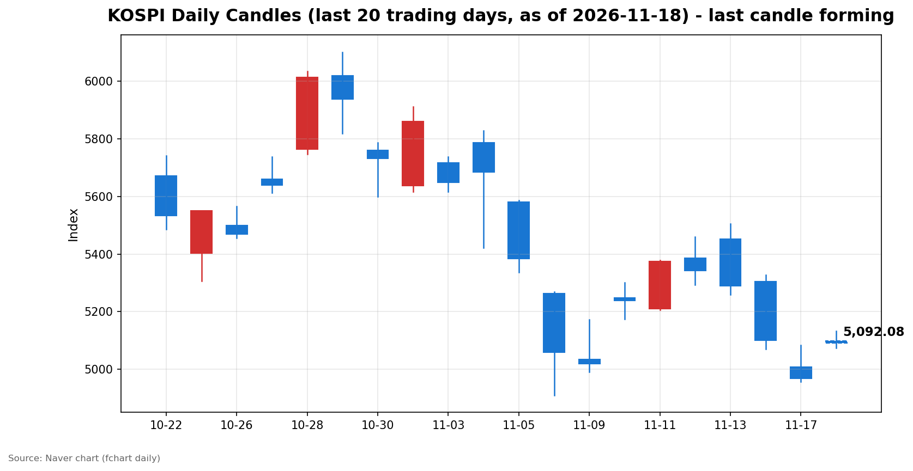
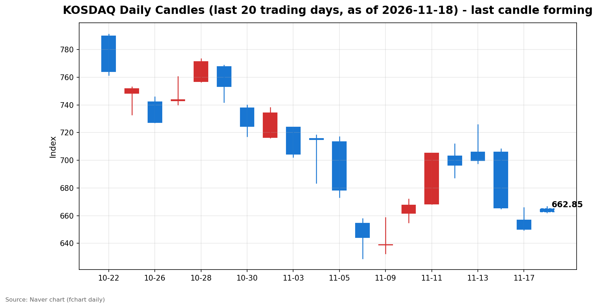

안녕하세요, [한국투자증권](https://securities.koreainvestment.com/main/Main.jsp)에서 [한투-한국투자증권](https://play.google.com/store/apps/details?id=com.truefriend.neosmartarenewal&hl=ko) 개발을 담당하고 있는 way입니다. 
간밤 엔비디아의 3분기 실적 서프라이즈에 힘입어 국내 증시가 4거래일 연속 하락을 끊고 5,000선을 되찾으며 출발했습니다. 

## 배경: 간밤 미국 증시와 개장 전 이슈

간밤 뉴욕증시는 하락 마감했습니다. 
나스닥 종합지수는 24,328.38로 181.38포인트(0.74%) 내렸고, S&P500 지수는 7,340.53으로 76.06포인트(1.03%) 내렸으며, 다우지수는 1.64% 하락했습니다. 
미국 10년물 국채금리가 5%를 웃돌고 10월 생산자물가(PPI)가 4년 만에 가장 높은 수준을 기록하면서 긴축 우려가 이어진 것이 부담으로 작용했습니다. 
다만 장 마감 뒤 발표된 엔비디아의 3분기 실적이 예상을 크게 웃돌면서 시간외 거래에서 주가가 상승 전환했고, 국내 증시의 개장 분위기를 바꿨습니다. 

## 오늘의 스냅샷

| 지수 | 현재가 | 전일 대비 | 등락률 | 시가 | 고가 | 저가 | 거래량 | 거래대금 |
| --- | --- | --- | --- | --- | --- | --- | --- | --- |
| [코스피](https://finance.naver.com/sise/sise_index.naver?code=KOSPI) | 5,098.10 | +129.62 | +2.61% | 5,098.82 | 5,133.14 | 5,075.20 | 38,022천주 | 2조 5,825억 원 |
| [코스닥](https://finance.naver.com/sise/sise_index.naver?code=KOSDAQ) | 663.52 | +13.46 | +2.07% | 664.93 | 666.71 | 662.14 | 94,695천주 | 1조 1,590억 원 |

스냅샷 기준 시각은 2026년 11월 18일 09시 28분(KST)이며, 네이버 실시간 데이터를 기준으로 합니다. 
전일 종가는 코스피 4,968.48, 코스닥 650.06입니다. 
코스피200 지수는 793.38로 2.94% 올랐고, 코스피 선물은 792.05로 3.24% 올랐습니다. 
원/달러 환율은 1,332.10원으로 전일 대비 3.30원 내렸습니다. 

## 차트

최근 20거래일 일봉 차트입니다. 
빨간 봉은 종가가 시가보다 높은 날, 파란 봉은 종가가 시가보다 낮은 날입니다. 
당일 봉은 형성 중인 봉으로, 마감 전에는 계속 변합니다. 

## 원인·촉매 분석

오늘 반등의 직접적인 촉매는 엔비디아의 실적 서프라이즈입니다. 
엔비디아는 회계연도 3분기 매출 1,158억 달러(약 155조 원)를 기록해 전년 동기 대비 103% 늘었고, 시장 예상 1,093억 달러를 웃돌았습니다. 
조정 주당순이익(EPS)은 2.68달러로 예상 2.47달러를 웃돌았고, 데이터센터 매출은 1,076억 달러에 달했습니다. 
4분기 매출 전망도 1,300억 달러(±3%)로 제시돼 예상 1,253억 달러를 웃돌았습니다. 
임시 최고경영자(CEO) 콜레트 크레스는 내년 매출 성장률을 전년 대비 75%로 제시했습니다. 
젠슨 황 전 CEO의 사임 이후 불거진 AI 수요 둔화와 지배구조 불확실성에 대한 의구심이 실적 숫자로 일단 가라앉은 셈입니다. 
반등의 배경에는 낙폭 과대에 대한 되돌림 성격도 있습니다. 
코스피는 11월 11일 5,375.36에서 11월 17일 4,968.48까지 4거래일 연속 하락해 7.57% 밀렸고, 종가 기준 5,000선을 밑돈 것은 2월 2일 이후 9개월 보름 만이었습니다. 
같은 기간 외국인은 코스피에서 11월 13일 5,419억 원, 11월 16일 1조 3,287억 원, 11월 17일 1조 4,190억 원을 순매도하며 매도세를 주도했습니다. 
환율도 반등을 돕는 방향입니다. 
원/달러 환율은 1,332.10원으로 3.30원 내리며 원화 강세로 돌아섰고, 이는 외국인 자금 유출 압력을 완화하는 요인입니다. 
다만 반등의 지속성을 단정하기는 이릅니다. 
미국 10년물 국채금리가 5%를 웃도는 가운데 BofA 펀드매니저 설문에서는 기술주 비중 확대 지표가 37%에서 12%로 떨어져 2006년 이후 가장 큰 감소폭을 기록했습니다. 
응답자의 52%는 6개월 안에 하이퍼스케일러 중 한 곳이 투자를 줄일 것으로 내다봤습니다. 
실적이라는 호재와 금리·AI 과잉투자 우려라는 악재가 맞물린 국면입니다. 

## 핵심 사건 3가지

### 1. 엔비디아 3분기 실적 서프라이즈와 젠슨 황 복귀 불확실성

엔비디아는 시장 예상을 웃도는 3분기 실적과 4분기 가이던스를 내놓았습니다. 
매출 1,158억 달러(전년 대비 +103%), 조정 EPS 2.68달러, 데이터센터 매출 1,076억 달러, 4분기 매출 전망 1,300억 달러라는 숫자는 AI 인프라 수요가 여전히 견조하다는 신호로 읽힙니다. 
엔비디아 주가는 정규장에서 장중 4%까지 밀렸다가 0.44% 하락으로 마감한 뒤 시간외 거래에서 상승 전환했습니다. 
주목할 점은 실적과 별개로 지배구조 불확실성이 해소되지 않았다는 사실입니다. 
젠슨 황 전 CEO는 사임 후 처음 소셜미디어에 글을 올려 이사회가 판단한다면 기꺼이 복귀하겠다는 뜻을 밝혔지만, 이사회가 복귀를 검토하지 않는다는 보도도 있어 복귀 여부는 불확실합니다. 
실적이 단기 불안을 가라앉혔으나, 리더십 공백이라는 구조적 질문은 남아 있습니다. 
국내 증시에는 삼성전자와 SK하이닉스를 비롯한 AI 밸류체인의 실적 신뢰도를 되돌리는 계기가 됐습니다. 

### 2. 미국 거시 압박 지속: 금리 5%대, PPI 4년 최고치, 소비 둔화

미국 10월 생산자물가(PPI)가 4년 만에 가장 높은 수준을 기록했고, 미국 10년물 국채금리는 5%를 웃돌았습니다. 
금리 인상 전망이 다시 고개를 들면서 금값은 온스당 3,832.70달러까지 밀려 1년여 만에 최저 수준을 기록했습니다. 
10월 소매판매는 전월 대비 0.2% 증가에 그쳐 소비 둔화 조짐을 보였고, 주택건설업체 체감경기는 14년 만에 최저 수준으로 떨어졌습니다. 
이 같은 거시 압박이 간밤 뉴욕증시 3대 지수의 동반 하락으로 이어졌고, 나스닥은 이틀 연속 하락했습니다. 
국내 증시에도 금리 상승은 성장주 밸류에이션 부담으로 작용하는 요인입니다. 
오늘 반등은 실적 호재가 거시 악재를 일시적으로 앞선 구도이며, 금리 레벨이 내려가지 않는 한 반등의 상단을 제한하는 변수로 남습니다. 

### 3. 삼성전기·엔비디아 협력 확대, 국내 AI 기판 밸류체인 부각

삼성전기는 엔비디아와 신규 AI 기판 공급 계약을 맺었다는 소식에 6.63% 오른 804,000원에 거래됐습니다. 
양사는 AI 기판에 이어 MLCC 협력 확대와 생산 지원도 검토하는 것으로 알려졌습니다. 
삼성전자는 4%대, SK하이닉스는 5.56% 오른 1,159,000원 선에서 거래되며 지수 상승을 이끌었습니다. 
이번 협력은 엔비디아의 실적 서프라이즈와 맞물려 국내 반도체·기판·후공정 밸류체인 전반의 투자 심리를 되살리는 계기가 됐습니다. 
한국투자증권 MTS의 오전 시장 브리핑도 반도체 기판·후공정의 연속 강세를 시장의 중심 흐름으로 짚었습니다. 
다만 협력 확대의 구체적인 규모와 일정은 확인되지 않았으므로, 관련 흐름은 단기 재료로 접근하는 것이 적절합니다. 

## 섹터·테마 영향 체인

반도체·AI 밸류체인이 반등의 중심입니다. 
엔비디아 실적이 AI 수요 둔화 우려를 완화하면서 메모리(HBM·D램), 기판, 후공정으로 이어지는 밸류체인 전반에 온기가 확산됐습니다. 
삼성전자·SK하이닉스의 동반 상승이 지수 상승을 이끌었고, 삼성전기의 기판 공급 계약 소식은 부품·소재 쪽으로 온기를 넓혔습니다. 
전력·원전 테마도 AI와 연결된 흐름입니다. 
미 연방에너지규제위원회(FERC)가 빅테크의 원전 전력 직접 구매를 승인하면서 컨스텔레이션은 메타·마이크로소프트와 20년 장기 전력구매계약을 체결했습니다. 
AI 데이터센터의 전력 부족이 구조적 문제로 인식되면서 전력 인프라 쪽으로 관심이 이동하고 있습니다. 
금융보안·광통신 테마는 한국투자증권 MTS 오전 브리핑에서 신규 부각 흐름으로 지목됐고, 배터리는 상대적으로 부진한 흐름을 보였습니다. 
지배구조·상법 테마도 별개 축으로 움직였습니다. 
한진칼은 호반그룹의 최대주주 등극과 조원태 회장의 추가 매입 계획 소식에 5.10% 올랐고, SK와 LS도 각각 4.40%, 3.46% 올랐습니다. 
금리 상승은 성장주 밸류에이션에 부담을 주는 연결고리입니다. 
10년물 국채금리가 5%를 웃도는 국면에서는 AI 성장주의 밸류에이션 재평가 압력이 커질 수 있어, 실적 호재와 금리 부담이 섹터 안에서 동시에 작용하고 있습니다. 

## 최근 5거래일 일봉

### 코스피

| 날짜 | 시가 | 고가 | 저가 | 종가 | 거래량(천주) |
| --- | --- | --- | --- | --- | --- |
| 2026-11-12 | 5,385.94 | 5,458.84 | 5,293.05 | 5,342.73 | 244,834 |
| 2026-11-13 | 5,452.41 | 5,504.44 | 5,259.09 | 5,290.53 | 247,829 |
| 2026-11-16 | 5,305.40 | 5,327.99 | 5,069.83 | 5,100.50 | 221,296 |
| 2026-11-17 | 5,008.09 | 5,084.06 | 4,957.00 | 4,968.48 | 193,978 |
| 2026-11-18 | 5,098.82 | 5,133.14 | 5,075.20 | 5,092.08(형성 중) | 37,851 |

### 코스닥

| 날짜 | 시가 | 고가 | 저가 | 종가 | 거래량(천주) |
| --- | --- | --- | --- | --- | --- |
| 2026-11-12 | 703.22 | 711.86 | 687.40 | 696.53 | 465,951 |
| 2026-11-13 | 705.96 | 725.81 | 697.69 | 699.66 | 455,458 |
| 2026-11-16 | 705.88 | 708.34 | 664.98 | 665.65 | 446,420 |
| 2026-11-17 | 656.82 | 665.79 | 649.62 | 650.06 | 467,132 |
| 2026-11-18 | 664.93 | 666.71 | 662.14 | 662.85(형성 중) | 94,077 |

11월 18일 봉은 형성 중인 봉으로, 마감 전에는 계속 변합니다. 

## 전일 수급: 외국인이 팔고 개인·기관이 받은 하루

전일(11월 17일) 코스피에서 외국인은 1조 4,190억 원을 순매도했습니다. 
3거래일 연속 대규모 순매도였고, 개인은 4,310억 원, 기관은 5,135억 원을 순매수하며 물량을 받았습니다. 
기관 안에서는 금융투자가 7,675억 원을 순매수하며 매수를 주도했고, 투신(-1,690억 원)과 사모(-596억 원)는 순매도에 나섰습니다. 
기타법인은 4,746억 원을 순매수했습니다. 
코스닥에서는 외국인이 882억 원을 순매도했고, 개인이 1,081억 원을 순매수하며 홀로 받았으며, 기관은 266억 원을 순매도했습니다. 
구도를 해석하면 외국인의 매도가 지수 하락을 주도했고, 개인과 기관의 매수가 낙폭을 일부 떠받치는 형태였습니다. 
다만 11월 17일 코스피가 2.59% 하락한 것을 보면 매수세의 방어력은 제한적이었습니다. 
오늘 반등이 이어지려면 외국인의 순매도 규모가 줄어들거나 순매수로 전환되는지가 관건입니다. 

## 단기·중기 전망과 확인할 시나리오

단기적으로는 엔비디아 실적 호재에 따른 기술적 반등이 이어질지, 아니면 금리 부담에 눌려 되돌림에 그칠지가 갈림길입니다. 
반등 지속 시나리오에서는 외국인의 매도 진정, 원/달러 환율의 안정, 삼성전자·SK하이닉스 중심의 AI 밸류체인 강세 지속이 함께 확인돼야 합니다. 
일시적 노이즈 시나리오에서는 젠슨 황 복귀 불확실성, BofA 설문에서 드러난 AI 과잉투자 우려, 10년물 국채금리 5%대 유지가 반등의 상단을 제한할 수 있습니다. 
확인할 가격 레벨은 코스피 전일 고가 5,084.06과 5,100선 안착 여부, 전일 저가 4,957.00과 4,900선 지지 여부입니다. 
코스닥은 전일 고가 665.79와 670선 회복 여부, 전일 저가 649.62과 650선 지지 여부를 확인할 필요가 있습니다. 
중기적으로는 엔비디아의 다음 분기 가이던스 이행 여부와 미 상무부의 대중 데이터센터 규제(11월 16일 공개)가 AI 밸류체인에 미치는 영향이 변수입니다. 
미국 10월 소매판매 둔화 이후 소비 지표와 연준 인사들의 발언도 금리 경로를 가늠하는 재료입니다. 
리스크 관리 관점에서는 한 가지 재료에 쏠린 반등일수록 거래대금과 외국인 수급의 동반 여부를 함께 확인하는 것이 중요합니다. 

## 장 초반 확인할 점

첫째, 외국인의 순매수 전환 여부입니다. 
전일 1조 4,190억 원 순매도의 연장선인지, 반등에 동참하는지 오전 수급을 확인해야 합니다. 
둘째, 삼성전자·SK하이닉스의 상승 지속 여부입니다. 
개장 초반의 강세가 유지되는지, 차익 매물이 나오는지를 봐야 합니다. 
셋째, 원/달러 환율의 흐름입니다. 
1,330원 선 안팎에서의 움직임이 외국인 수급에 영향을 줄 수 있습니다. 
넷째, 거래대금의 확대 여부입니다. 
반등에 거래대금이 동반되는지가 반등의 강도를 가늠하는 잣대입니다. 
다섯째, 오늘 밤 미국 정규장에서 엔비디아 주가의 흐름입니다. 
시간외 상승이 정규장까지 이어지는지가 내일 국내 증시의 분위기를 좌우할 수 있습니다. 

## 마치며

엔비디아의 실적 서프라이즈가 4거래일 연속 하락에 지친 국내 증시에 반등의 계기를 만들었습니다. 
다만 금리 부담과 AI 과잉투자 우려가 남아 있는 만큼, 오늘 장은 반등의 출발점으로 보되 수급과 금리 흐름을 함께 확인하는 것이 중요합니다. 
이 글은 시장 해설을 위한 교육 목적의 글로, 특정 종목의 매수·매도를 권유하는 내용이 아닙니다. 
