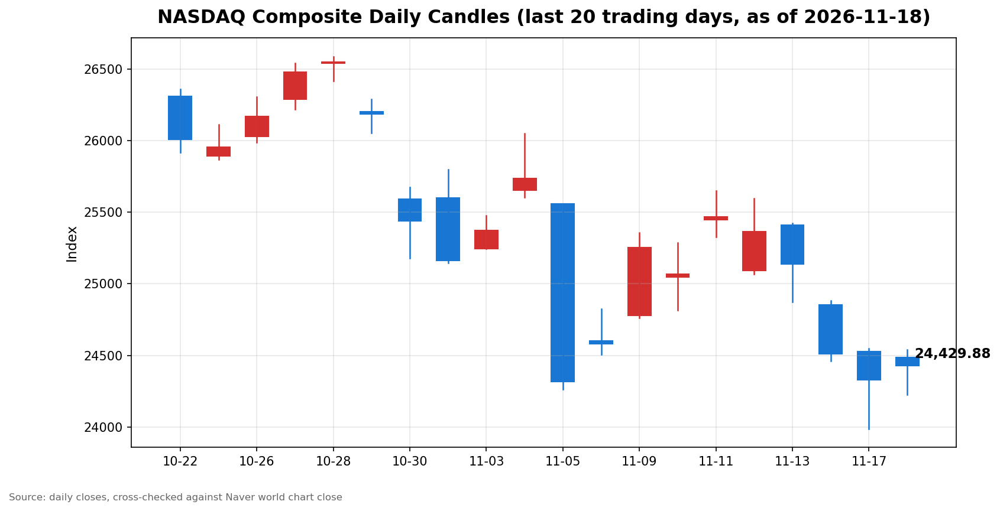

안녕하세요, [한국투자증권](https://securities.koreainvestment.com/main/Main.jsp)에서 [한투-한국투자증권](https://play.google.com/store/apps/details?id=com.truefriend.neosmartarenewal&hl=ko) 개발을 담당하고 있는 way입니다. 
현지시간 11월 18일 수요일, 나스닥은 엔비디아 호실적에 힘입어 상승 마감했으나 다우와 S&P500은 금리인상 전망 강화 속에 하락했습니다. 

## 마감 요약

나스닥 종합은 전일 대비 101.50포인트, 0.42% 상승한 24,429.89로 마감했습니다. 
다우는 561.25포인트, 1.11% 하락한 50,198.17로 마감했습니다. 
S&P500은 16.90포인트, 0.23% 하락한 7,323.63으로 마감했습니다. 
나스닥은 전일 0.74% 하락에서 반등에 성공했으나, 다우와 S&P500은 하락세를 이어갔습니다. 
오후 12시 56분 스냅샷에서 나스닥이 0.41% 상승했던 것과 비교하면, 마감까지 상승폭은 거의 그대로 유지됐습니다. 
반면 S&P500은 같은 시간 0.04% 하락에서 0.23% 하락으로, 다우는 0.84% 하락에서 1.11% 하락으로 낙폭이 커졌습니다. 
오후 2시 공개된 연준 의사록 이후 S&P500이 상승분을 반납하고 하락으로 돌아선 흐름이 마감까지 이어졌습니다. 
엔비디아는 장 초반 2.7% 올랐으나 오후 들어 2%대 하락으로 돌아서며 호실적의 온기를 지키지 못했습니다. 
미국 10년물 국채수익률은 5.07% 수준으로 전일 대비 약 4bp 하락했습니다. 
달러는 19개월 만에 최고 수준까지 강세를 보였고, 금 현물 가격은 온스당 3,745달러 수준으로 2025년 9월 이후 최저를 기록했습니다. 
중앙일보 GMC 11월 18일 G브닝은 엔비디아 성적표와 앤트로픽 가격 결정을 당일 핵심 주제로 다뤘습니다. 

## 오늘의 마감 스냅샷

| 지수 | 종가 | 전일 대비 | 등락률 | 전일 종가 | 당일 고가 | 당일 저가 |
| --- | --- | --- | --- | --- | --- | --- |
| 나스닥 종합 | 24,429.89 | +101.50 | +0.42% | 24,328.38 | 24,538.78 | 24,225.30 |
| S&P500 | 7,323.63 | -16.90 | -0.23% | 7,340.53 | 7,355.03 | 7,292.16 |
| 다우 | 50,198.17 | -561.25 | -1.11% | 50,759.42 | 50,637.70 | 50,029.35 |

스냅샷 기준 시각은 미국 동부시간 2026년 11월 18일 오후 4시 20분, 한국시간 11월 19일 오전 6시 20분입니다. 
나스닥과 다우 수치는 [네이버 월드 차트](https://finance.naver.com/world/sise.naver?symbol=NAS@IXIC)([나스닥 종합 가격 페이지](https://stock.naver.com/worldstock/index/.IXIC/price))에서 브라우저로 확인한 장마감 값입니다. 
네이버 월드 차트 페이지는 curl 직접 조회로는 수치를 확인할 수 없어 브라우저로 직접 확인했습니다. 
S&P500은 한투 MTS 해외 대시보드 기준이며, 종가 7,323.63과 등락률 0.23% 하락은 당일 보도로도 확인됐습니다. 
S&P500의 당일 고가와 저가는 한투 MTS 장중 시계열 기준 값입니다. 
나스닥 종가 24,429.89는 한투 MTS 교차값과 일치합니다. 
나스닥 거래량은 1,459,188천주, 다우 거래량은 684,512천주입니다. 
원·달러 환율은 1,333.70원으로 전일 대비 1.70원, 0.13% 하락했습니다. 

## 차트

최근 20거래일 일봉 차트입니다. 
빨간 봉은 종가가 시가보다 높은 날, 파란 봉은 종가가 시가보다 낮은 날입니다. 

## 원인·촉매 분석

오늘 장의 근본 촉매는 금리인상 전망 강화와 엔비디아 실적이라는 두 힘이 충돌한 결과입니다. 
엔비디아는 전일 장 마감 후 시장 예상을 웃도는 실적과 전망을 내놨습니다. 
장 초반에는 실적이 나스닥 반등을 이끌었으나, 오후 들어 금리 부담이 실적의 온기를 압도했습니다. 
크리스토퍼 월러 연준 이사는 오전 CNBC 인터뷰에서 12월 회의에서 0.5%포인트 인상이 필요할 수 있다고 밝혔습니다. 
오후 2시 공개된 10월 FOMC 의사록도 추가 금리인상 필요성을 인정하는 내용이었습니다. 
두 신호가 겹치며 12월 금리인상은 사실상 기정사실로 받아들여졌고, 시장은 인상 폭 논쟁으로 넘어갔습니다. 
CME 페드워치 기준 12월 0.25%포인트 인상 확률은 95% 수준으로 집계됐습니다. 
금리인상 전망 강화는 성장주 밸류에이션에 부담을 주는 연결고리로 작용했습니다. 
다만 미국 10년물 국채수익률이 5.07% 수준으로 소폭 내린 점은 채권 시장이 연준의 매파적 발언을 그대로 따라가지 않았음을 보여줍니다. 
달러 강세는 19개월 최고 수준까지 이어졌고, 금과 비트코인이 동반 약세를 보였습니다. 
비트코인은 62,429달러 수준으로 3.80% 하락했습니다. 
지수 간 방향 차이도 의미가 있습니다. 
나스닥이 오른 것은 AI 하드웨어 실적이라는 개별 촉매가 지수를 떠받쳤기 때문입니다. 
다우가 1.11% 하락한 것은 금리 민감주와 경기 민감주가 함께 약세를 보였기 때문입니다. 
S&P500이 0.23% 하락에 그친 것은 기술주 강세와 나머지 업종 약세가 상쇄된 결과입니다. 
이날 국제유가는 장중 5% 넘게 급락했다가 낙폭을 줄였으며, 마감 유가는 확인 필요입니다. 
이날 변동성 지수 마감 수치는 확인 필요입니다. 

## 핵심 사건 3가지

첫째, 엔비디아 분기 실적 발표와 주가의 반락입니다. 
엔비디아는 11월 17일 장 마감 후 2027회계연도 3분기 매출 1,158억 4,000만 달러를 발표했습니다. 
이는 전년 동기 대비 103% 증가한 수치로, 시장 예상 1,091억 달러를 웃돌았습니다. 
순이익은 652억 8,700만 달러로 분기 기준 최대 수준을 기록했습니다. 
데이터센터 매출은 1,076억 달러로 전년 동기 대비 110.5% 증가했습니다. 
4분기 매출 전망은 약 1,300억 달러로 제시돼 시장 예상 1,252억 5,000만 달러를 웃돌았습니다. 
2028회계연도 매출 성장률 전망도 약 70%에서 약 75%로 상향됐습니다. 
그럼에도 주가는 장 초반 2.7% 상승에서 오후 들어 2%대 하락으로 돌아섰습니다. 
실적이 기대에 못 미친 것이 아니라, 기대가 이미 주가에 반영된 뒤 경영 불확실성이 다시 부각된 결과로 풀이됩니다. 
젠슨 황 전 CEO는 지난주 사임했고, 이사회는 복귀를 검토하지 않는다고 밝혔습니다. 
임시 CEO는 콜레트 크레스 최고재무책임자가 맡고 있습니다. 
딥서치 문서 검색으로 확인한 국내 보도도 엔비디아 호실적에도 미국 증시가 혼조를 보였다고 전했습니다. 
중앙일보 GMC 11월 18일 G모닝 제목은 실적은 합격점, 복귀는 물음표였습니다. 
실적 자체보다 CEO 승계와 AI 투자 수익성 논란이 시장의 관심사로 남아 있음을 보여줍니다. 

둘째, 연준 의사록 공개와 월러 이사의 50bp 인상 발언입니다. 
10월 27일부터 28일까지 열린 FOMC 의사록은 오후 2시에 공개됐습니다. 
의사록은 경제가 예상대로 진행되면 추가 금리인상이 필요하다는 인식을 담고 있었습니다. 
일부 위원은 물가 지표가 좋지 않을 경우 0.5%포인트 인상을 주장한 것으로 전해졌습니다. 
의사록 공개 직후 S&P500은 장중 상승분을 반납하고 하락 전환했습니다. 
월러 이사는 오전 CNBC 인터뷰에서 12월 회의에서 0.5%포인트 인상이 필요할 수 있다고 말했습니다. 
다만 1월 추가 인상을 명확히 예고하면 12월 0.5%포인트 인상은 피할 수 있다는 단서도 달았습니다. 
이 발언은 딥서치 트렌딩 토픽에서도 당일 주요 이슈로 선정됐습니다. 
달러는 발언 이후 19개월 만에 최고 수준까지 올랐습니다. 
금 현물 가격은 온스당 3,745달러 수준으로 2025년 9월 이후 최저를 기록했습니다. 
연준의 긴축 경로가 시장의 부담으로 남는다는 점이 이날 다시 확인됐습니다. 

셋째, 소매 실적 부진과 앤트로픽 기업공개 가격 결정입니다. 
타겟과 로우스 등 주요 소매업체의 실적과 전망이 부진하게 나오며 경기 민감주가 약세를 보였습니다. 
반면 TJX는 10% 상승하며 소매 업종 내에서도 종목별 온도 차가 컸습니다. 
주택착공 건수는 시장 예상을 웃돌아 경기 둔화 우려를 일부 덜었습니다. 
다우 구성 종목인 유나이티드헬스는 CMS 제안 소식에 6% 하락하며 다우 낙폭을 키웠습니다. 
앤트로픽은 이날 공모가를 확정하고 11월 19일 나스닥 상장을 앞두고 있습니다. 
앤트로픽 상장은 AI 산업의 자금 조달 여건을 가늠하는 다음 확인 지점이 됩니다. 
중앙일보 GMC 11월 18일 G브닝도 엔비디아 성적표와 앤트로픽 가격표를 함께 다뤘습니다. 
소매 실적 부진이 경기 둔화 신호인지, 업종별 선별 국면인지는 다음 지표에서 가려질 전망입니다. 

## 지수·섹터 영향 체인

나스닥은 0.42% 상승했고, S&P500은 0.23% 하락했으며, 다우는 1.11% 하락했습니다. 
같은 날 세 지수가 서로 다른 방향으로 움직인 것은 촉매의 성격이 달랐기 때문입니다. 
기술주는 엔비디아 실적이라는 개별 호재가 버팀목이 됐습니다. 
데이터센터 매출이 전년 동기 대비 110.5% 증가한 점은 AI 하드웨어 수요가 꺾이지 않았음을 보여줍니다. 
반면 금리인상 전망 강화는 성장주 밸류에이션을 압박하는 방향으로 작용했습니다. 
실적 호재와 금리 부담이 맞서며 나스닥은 상승했으나 상승폭은 제한됐습니다. 
다우는 경기 민감주와 금리 민감주가 함께 약세를 보이며 낙폭이 가장 컸습니다. 
소매 실적 부진은 소비 둔화 우려를 키웠고, 유나이티드헬스 하락은 다우에 직접 부담을 줬습니다. 
금융주는 금리인상 전망에도 불구하고 약세를 보였는데, 이는 긴축이 경기 둔화로 이어질 수 있다는 우려가 반영된 것으로 풀이됩니다. 
에너지는 국제유가 급락 소식에 부담을 받았습니다. 
금과 비트코인의 동반 약세는 달러 강세와 금리 상승 전망이 안전자산과 위험자산을 함께 압박했음을 보여줍니다. 
한국 시장에서는 코스피가 엔비디아 실적에 힘입어 하루 만에 5,000선을 탈환했습니다. 
미국발 AI 실적 온기가 아시아 반도체 시장으로 번진 연결고리가 확인된 셈입니다. 
다만 엔비디아 주가 자체가 하락 마감한 점은 온기의 지속 여부에 물음표를 남겼습니다. 

## 다우·S&P500 마감 흐름

다우는 장중 고가 50,637.70, 저가 50,029.35를 기록하며 50,198.17로 마감했습니다. 
다우의 낙폭 1.11%는 3대 지수 가운데 가장 컸고, 이틀 연속 하락입니다. 
전일 1.64% 하락에 이어 낙폭이 이어진 점은 실적보다 금리와 경기 우려가 크게 작용했음을 보여줍니다. 
S&P500은 장중 고가 7,355.03, 저가 7,292.16을 기록하며 7,323.63으로 마감했습니다. 
S&P500은 5거래일 연속 하락했고, 200일 이동평균선인 7,345 아래에 머물렀습니다. 
두 지수 모두 오후 장중 스냅샷보다 낙폭이 커졌고, 이는 연준 의사록 공개 이후의 흐름이 마감까지 이어졌음을 보여줍니다. 
나스닥만 상승을 지킨 점은 기술주와 나머지 시장 사이의 온도 차를 보여줍니다. 

## 단기·중기 전망과 다음 거래일 확인할 시나리오

다음 거래일의 첫 번째 확인 지점은 앤트로픽의 나스닥 상장입니다. 
공모가 대비 상장 첫날 주가 흐름이 AI 관련 자금 흐름의 온도를 보여줄 전망입니다. 
두 번째 확인 지점은 실업수당 청구 건수입니다. 
11월 19일 오전 8시 30분 발표되는 주간 실업수당 청구 건수가 노동시장의 견조함을 가늠합니다. 
세 번째 확인 지점은 나스닥 24,000선 안착 여부입니다. 
이날 장중 저가 24,225.30을 지켰기 때문에, 다음 거래일에도 24,000선 위에서 버티는지가 단기 흐름을 가릅니다. 
위쪽에서는 당일 고가 24,538.78과 전일 고가 24,547.66이 저항 구간으로 작용할 수 있습니다. 
S&P500은 200일 이동평균선 7,345 회복 여부가 관건입니다. 
7,340.53인 전일 종가를 되찾지 못하면 5거래일 연속 하락 흐름이 이어지는 것으로 봐야 합니다. 
다우는 50,000선 방어 여부가 단기 관전 포인트입니다. 
이날 장중 저가 50,029.35가 50,000선 바로 위에서 형성됐기 때문입니다. 
중기적으로는 금리 경로가 핵심 변수입니다. 
12월 8일부터 9일까지 열리는 FOMC에서 인상 폭이 0.25%포인트인지 0.5%포인트인지가 성장주 흐름을 좌우할 전망입니다. 
엔비디아 실적 이후에도 주가가 반등하지 못하면, AI 투자 수익성 논란이 단기 노이즈인지 구조적 재평가인지를 가르는 기준이 됩니다. 
반대로 반도체 지수가 견조함을 이어가면 하드웨어 수요 자체에 대한 신뢰는 유지되는 것으로 해석할 수 있습니다. 
이 글의 시나리오는 지수와 섹터 단위의 관찰 지점이며, 특정 종목의 매수나 매도를 권유하지 않습니다. 

## 마치며

나스닥은 엔비디아 호실적에 힘입어 상승했으나, 다우와 S&P500은 금리인상 전망 강화 속에 하락 마감했습니다. 
다음 거래일은 앤트로픽 상장과 실업수당 청구 건수, 나스닥 24,000선 안착 여부가 시장의 다음 방향을 가를 전망입니다. 
이 글은 교육과 시장 해설을 목적으로 작성됐으며, 특정 종목의 매수나 매도를 권유하지 않습니다. 
