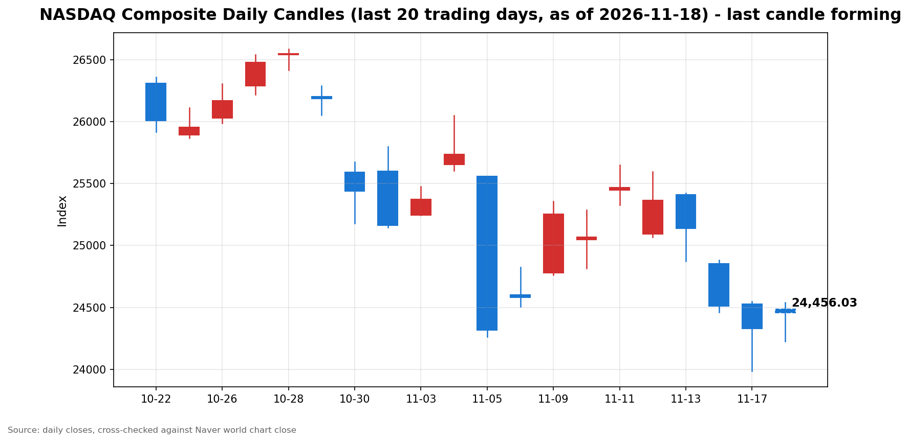

안녕하세요, [한국투자증권](https://securities.koreainvestment.com/main/Main.jsp)에서 [한투-한국투자증권](https://play.google.com/store/apps/details?id=com.truefriend.neosmartarenewal&hl=ko) 개발을 담당하고 있는 way입니다. 
현지시간 11월 18일 수요일, 나스닥은 엔비디아 실적 발표 이후 반등 흐름을 이어가다 장중 상승폭을 줄이고 있습니다. 

## 장중 요약

오전 10시 01분 스냅샷에서 나스닥은 전일 대비 0.66% 상승했으나, 오후 12시 56분에는 0.41% 상승으로 오름폭이 줄었습니다. 
S&P500은 같은 시간 0.05% 상승에서 0.04% 하락으로 방향이 바뀌었습니다. 
다우는 오전 0.74% 하락에서 오후 0.84% 하락으로 약세가 이어졌습니다. 
3대 지수 가운데 나스닥만 상승을 지키고 있고, 다우와 S&P500은 하락 또는 약보합권에 머물고 있습니다. 
장 초반 엔비디아는 3% 가까이 올랐다가 상승분을 반납했고, 오후 들어서는 전일보다 2.33% 내린 수준에서 거래되고 있습니다. 
미 10년물 국채금리는 5.06%로 전일보다 소폭 내렸고, 국제유가는 5% 넘게 급락했습니다. 

## 오늘의 스냅샷

| 지수 | 현재가 | 전일 대비 | 등락률 | 전일 종가 | 장중 고가 | 장중 저가 |
| --- | --- | --- | --- | --- | --- | --- |
| 나스닥 종합 | 24,427.26 | +98.88 | +0.41% | 24,328.38 | 24,538.78 | 24,225.30 |
| S&P500 | 7,337.77 | -2.76 | -0.04% | 7,340.53 | 7,352.64 | 7,292.16 |
| 다우 | 50,330.58 | -428.84 | -0.84% | 50,759.42 | 50,637.70 | 50,029.35 |

스냅샷 기준 시각은 미국 동부시간 2026년 11월 18일 오후 12시 56분, 한국시간 11월 19일 오전 2시 56분입니다. 
나스닥 수치는 [네이버 월드 차트](https://finance.naver.com/world/sise.naver?symbol=NAS@IXIC)([나스닥 종합 가격 페이지](https://stock.naver.com/worldstock/index/.IXIC/price)) 기준 오후 12시 56분 값이며, 한투 MTS 해외 대시보드 교차값 24,444.53(+116.15, +0.48%)과 방향이 일치합니다. 
S&P500은 한투 MTS 해외 대시보드 기준, 다우는 Yahoo Finance 기준 오후 1시경 값입니다. 
당일 수치는 형성 중인 수치로, 마감 전에는 계속 변합니다. 
나스닥 거래량은 스냅샷 기준 535,905천주입니다. 
나스닥의 52주 범위는 20,690.25에서 27,722.75입니다. 

## 차트

최근 20거래일 일봉 차트입니다. 
빨간 봉은 종가가 시가보다 높은 날, 파란 봉은 종가가 시가보다 낮은 날입니다. 
당일 봉은 형성 중인 봉으로, 마감 전에는 계속 변합니다. 

## 원인·촉매 분석

오늘 장의 표면적인 흐름은 엔비디아 실적 발표 이후 기술주 반등입니다. 
근본 촉매는 세 가지 힘이 동시에 작용한 결과입니다. 
첫째, 엔비디아 실적과 매출 전망 상향이 AI 수요 둔화 우려를 누그러뜨렸습니다. 
둘째, 월러 연준 이사의 12월 빅스텝 재언급이 금리 인상 우려를 다시 키웠습니다. 
셋째, 국제유가와 금값의 급락이 에너지와 안전자산 쪽의 자금 흐름을 흔들었습니다. 
미 10년물 국채금리는 5.06%로 전일 5.10%보다 소폭 내렸고, 당일 범위는 5.06%에서 5.12%였습니다. 
금리가 내렸는데도 다우가 약세를 이어갔다는 점이 중요합니다. 
이날 약세가 금리 급등 때문이 아니라, 금리 경로를 둘러싼 연준 내부 이견과 AI 투자 지속성 우려에 따른 것이라는 뜻입니다. 
달러지수는 103.81로 전일 103.49보다 0.31% 올랐습니다. 
달러 강세에도 금 선물은 온스당 3,742.3달러로 전일 대비 3.15% 급락했습니다. 
안전자산 선호가 약해지기보다, 금리 인상 우려 국면에서 금이 먼저 조정을 받는 모습입니다. 
중앙일보 GMC 허브에 오른 기사 제목도 금값이 14개월 만에 최저 수준이라며 미국 금리 인상 우려에 하락 압력이 있다고 전했습니다. 
WTI 유가는 배럴당 81.64달러로 전일 대비 5.08% 급락했습니다. 
유가 급락은 에너지 섹터 약세의 직접적인 배경입니다. 
원/달러 환율은 1,332.50원으로 전일 대비 0.22% 내렸습니다. 
전일 지수 간 방향 차이도 오늘 흐름과 연결됩니다. 
전일인 11월 17일에는 나스닥이 0.74%, S&P500이 1.15%, 다우가 1.48% 내렸습니다. 
오늘은 나스닥만 상승하고 다우가 가장 크게 내리고 있습니다. 
엔비디아 실적이 기술주의 낙폭을 되돌리는 동안, 경기민감 성격이 강한 다우 구성 종목의 약세는 이어지는 모습입니다. 
중앙일보 GMC 허브의 11월 18일자 G모닝 제목은 엔비디아 실적을 합격점으로 평가하면서도 젠슨 황 복귀 여부를 물음표로 남겼습니다. 
같은 허브의 11월 18일자 G브닝 제목도 엔비디아 성적표와 앤트로픽 가격표를 함께 다뤘습니다. 
제목 수준에서만 참고합니다. 

## 핵심 사건 3가지

### 1. 엔비디아 실적 발표와 가이던스 상향, 그러나 주가 상승분 반납

엔비디아는 현지시간 11월 17일 장 마감 후 실적을 발표했습니다. 
시장 예상을 크게 웃도는 실적 전망을 내놨고, 매출 전망을 상향했습니다. 
경영진은 이번 전망에 현재 시행 중인 미국의 수출 통제가 반영됐다고 설명했습니다. 
지난 분기 중국에서 판매한 호퍼 제품은 24억달러 규모였습니다. 
젠슨 황 전 최고경영자(CEO) 퇴임 후 첫 실적에서 AI 컴퓨팅 수요가 이어지고 있음이 확인됐습니다. 
다만 임시 CEO인 콜레트 크레스는 앞으로의 투자에 엄격한 기준을 예고했습니다. 
엔비디아의 AI 생태계 자금 지원 역할이 축소될 수 있다는 전망도 나왔습니다. 
주가 반응은 엇갈렸습니다. 
엔비디아 주가는 장 초반 3% 가까이 올랐다가 상승분을 반납했고, 오후 들어서는 151.84달러로 전일 대비 2.33% 내린 수준에서 거래되고 있습니다. 
실적이 기대를 웃돌았는데도 주가가 밀렸다는 점이 중요합니다. 
시장이 실적 자체보다 AI 투자 사이클의 지속성과 경영 공백 이후의 자금 지원 방침을 더 크게 보고 있다는 뜻입니다. 
이 사건이 중요한 이유는 엔비디아가 AI 투자 사이클의 중심에 있기 때문입니다. 
실적 호조가 기술주 반등의 계기가 됐지만, 상승 지속 여부는 투자 방침에 대한 의구심이 해소되는지에 달려 있습니다. 

### 2. 월러 연준 이사의 12월 빅스텝 재언급과 연준 내부 이견

크리스토퍼 월러 연준 이사는 현지시간 11월 18일 CNBC 인터뷰에서 12월 기준금리를 0.5%포인트 올리는 빅스텝을 다시 언급했습니다. 
월러 이사는 인플레이션에 대해 매우 우려하고 있으며, 인플레이션이 잘못된 방향으로 가고 확산하고 있다고 말했습니다. 
시장에 이 신호를 매우 명확하게 전달하지 못한다면 12월에 0.5%포인트를 올려서 끝내야 한다고 강조했습니다. 
딥서치 트렌딩 토픽에서도 월러 이사의 12월 빅스텝 발언이 당일 주요 이슈로 선정됐습니다. 
반면 존 윌리엄스 뉴욕 연은 총재는 11월 17일 한 번에 0.5%포인트 올리는 빅스텝에는 부정적인 견해를 밝혔습니다. 
물가 상승률을 낮추기 위해 통화 긴축을 이어갈 필요가 있다면서도, 큰 폭으로 금리를 올릴 상황은 아니라는 입장입니다. 
시장은 12월과 1월에 각각 0.25%포인트씩 인상하는 경로를 예상하고 있습니다. 
월러 이사의 발언은 이 예상보다 강한 긴축 가능성을 다시 시장에 던진 셈입니다. 
오늘 오후에는 연준 의사록 공개도 예정돼 있습니다. 
이 사건이 중요한 이유는 금리 경로 기대가 성장주 밸류에이션의 기준이 되기 때문입니다. 
연준 내부에서 인상 속도를 둘러싼 이견이 확인되면서, 시장은 의사록에서 추가 신호를 찾으려 하고 있습니다. 

### 3. 국제유가와 금값 급락, 다우 약세의 확산

WTI 유가는 배럴당 81.64달러로 전일 대비 5.08% 급락했습니다. 
오전 스냅샷 기준 83.35달러에서 오후 들어 낙폭이 더 커졌습니다. 
금 선물도 온스당 3,742.3달러로 전일 대비 3.15% 급락했습니다. 
오전 기준 3,767달러 선에서 오후 들어 낙폭이 확대됐습니다. 
유가 급락은 에너지 섹터의 약세로 직결됐고, 에너지 ETF는 2.64% 내렸습니다. 
다우도 0.84% 하락으로 3대 지수 가운데 낙폭이 가장 큽니다. 
다우 구성 종목 가운데 유나이티드헬스와 셰브런 등의 약세가 전해졌습니다. 
유가와 금값이 동시에 급락했다는 점이 중요합니다. 
경기 둔화 우려와 금리 인상 우려가 함께 작용하면서, 원자재와 안전자산이 동시에 조정을 받는 모습입니다. 
변동성지수(VIX)는 24.19로 전일 대비 4.99% 내렸습니다. 
장 초반 26.26까지 올랐던 VIX가 오후 들어 내렸다는 점에서, 공포 자체는 장중 고점보다 누그러진 상태입니다. 
이 사건이 중요한 이유는 하락의 성격이 기술주에 머무르지 않고 에너지와 경기민감주로 번지고 있음을 보여주기 때문입니다. 
나스닥이 실적 호재로 버티는 동안 다우의 약세가 이어지는 엇갈림이 오늘 장의 특징입니다. 

## 지수·섹터 영향 체인

지수별로는 나스닥만 상승하고 다우가 상대적으로 약합니다. 
나스닥은 0.41% 상승, S&P500은 0.04% 하락, 다우는 0.84% 하락입니다. 
전일에는 3대 지수가 모두 내렸던 것과 대조됩니다. 
오늘은 실적 호재가 기술주에, 금리 인상 우려와 유가 급락이 경기민감주에 각각 작용하는 모습입니다. 
섹터 ETF 기준으로는 유틸리티(XLU)가 0.51% 상승으로 가장 강했습니다. 
기술(XLK)은 0.07% 상승에 그쳤고, 반도체(SMH)는 0.42% 내렸습니다. 
엔비디아 실적 호재에도 반도체 ETF가 내렸다는 점에서, AI 투자 지속성 우려가 반도체 전반에 남아 있습니다. 
금융(XLF)은 0.74% 내렸습니다. 
금리 인상 기대가 커지면 순이자마진에는 우호적일 수 있으나, 경기 둔화 우려와 맞물리면 방향이 갈릴 수 있습니다. 
오늘 금융주의 하락은 금리 수혜 논리만으로는 설명되지 않습니다. 
에너지(XLE)는 2.64% 하락으로 가장 큰 낙폭을 보였습니다. 
WTI 유가 5.08% 급락이 에너지 섹터에 직접 작용한 결과입니다. 
헬스케어(XLV)는 1.53% 내렸습니다. 
다우 약세의 한 축이 헬스케어 쪽에 있다는 점과 맞닿아 있습니다. 
연결고리를 정리하면 다음과 같습니다. 
엔비디아 실적 상향은 기술주 반등의 계기가 됐지만, 투자 방침에 대한 의구심이 상승폭을 제한했습니다. 
월러 발언은 금리 경로 불확실성을 키웠고, 이는 성장주 밸류에이션 부담으로 이어졌습니다. 
유가 급락은 에너지 섹터의 직접적인 타격이 됐고, 금값 급락은 안전자산 쪽의 조정으로 이어졌습니다. 
기술주의 버팀과 에너지·경기민감주의 약세가 동시에 나타나는 구도입니다. 

## 다우·S&P500 흐름

다우는 50,330.58로 전일 대비 428.84포인트, 0.84% 하락한 수준에서 거래되고 있습니다. 
장중 고가는 50,637.70, 저가는 50,029.35입니다. 
전일 종가 50,759.42를 밑돌고 있으며, 50,000선 근처에서 거래되고 있습니다. 
S&P500은 7,337.77로 전일 대비 2.76포인트, 0.04% 하락한 수준입니다. 
장중 고가는 7,352.64, 저가는 7,292.16입니다. 
전일 종가 7,340.53을 소폭 밑돌았고, 7,300선 근처에서 거래되고 있습니다. 
두 지수 모두 전일 급락에 이은 약보합 출발 뒤 장중 낙폭을 키우지 않고 약세를 이어가는 흐름입니다. 
나스닥과 달리 반등의 계기가 없는 점이 두 지수의 공통점입니다. 

## 오전과 오후 흐름 변화

나스닥은 시가 24,486.18로 전일 종가보다 높게 출발했습니다. 
장 초반 고점 24,538.78을 찍은 뒤 줄곧 밀렸고, 오전 0.66% 상승에서 오후 0.41% 상승으로 오름폭이 줄었습니다. 
오전 스냅샷과 비교하면 나스닥은 오전 저가 24,268.03을 밑도는 24,225.30까지 내려갔습니다. 
S&P500은 오전 0.05% 상승에서 오후 0.04% 하락으로 방향이 바뀌었습니다. 
오전 저가 7,313.15에서 장중 저가 7,292.16으로 내려갔습니다. 
다우는 오전 0.74% 하락에서 오후 0.84% 하락으로 약세가 이어졌습니다. 
오전의 반등 기대가 오후 들어 약해지면서, 3대 지수 모두 오전 저가를 밑도는 흐름입니다. 
다만 하락이 금리 급등에 따른 것은 아닙니다. 
10년물 국채금리는 5.07% 수준에서 5.06%로 소폭 내렸고, 하락의 성격은 AI 투자 지속성 우려와 금리 경로 이견에 따른 관망에 가깝습니다. 
VIX가 장 초반 26.26에서 오후 24.19로 내린 점도 공포가 고점보다 누그러졌음을 보여줍니다. 

## 마감까지 전망과 확인할 시나리오

오늘 장의 가장 큰 분기점은 오후에 공개되는 연준 의사록입니다. 
의사록에서 12월 인상 폭과 속도에 대한 위원들의 판단이 확인되면, 금리 경로 기대가 다시 정해질 수 있습니다. 
마감까지 확인할 가격 레벨은 다음과 같습니다. 
나스닥은 장중 저가 24,225.30과 24,000선 지지 여부, 위로는 장중 고가 24,538.78과 24,500선 안착 여부입니다. 
S&P500은 장중 저가 7,292.16과 7,300선, 위로는 전일 종가 7,340.53입니다. 
다우는 장중 저가 50,029.35와 50,000선 방어 여부, 위로는 전일 종가 50,759.42입니다. 
지수와 섹터 단위의 시나리오는 다음과 같습니다. 
흐름 지속 시나리오에서는 나스닥의 상승폭이 더 줄고 다우 약세가 이어지면서, 마감까지 관망과 위험 회피 흐름이 이어질 수 있습니다. 
일시적 노이즈 시나리오에서는 10년물이 5.06%대에서 더 내리고 VIX 하락이 이어지면서 낙폭이 제한될 수 있습니다. 
다만 엔비디아 주가가 상승분을 반납한 상태라, 반등의 지속 여부는 의사록 확인 뒤에 가려질 수 있습니다. 
함께 확인할 수치는 10년물 국채금리의 당일 범위 5.06%에서 5.12% 이탈 여부, 유가와 금값 흐름, 마감 전 거래량 변화입니다. 
위 내용은 지수·섹터 단위의 관전 포인트이며, 특정 종목의 매수·매도 권유가 아닙니다. 

## 마치며

나스닥은 엔비디아 실적에 반등했으나 오후 들어 상승폭을 줄였고, 다우는 유가 급락과 금리 경로 이견 속에 약세를 이어갔습니다. 
마감까지는 연준 의사록이 가장 큰 변수이며, 결과 확인 전까지 관망과 위험 관리의 관점에서 흐름을 지켜볼 필요가 있습니다. 
