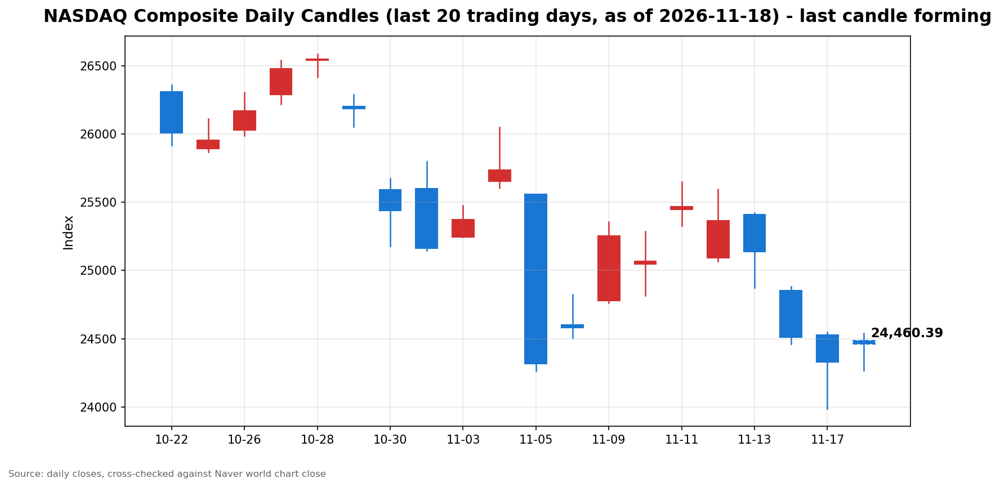

안녕하세요, [한국투자증권](https://securities.koreainvestment.com/main/Main.jsp)에서 [한투-한국투자증권](https://play.google.com/store/apps/details?id=com.truefriend.neosmartarenewal&hl=ko) 개발을 담당하고 있는 way입니다. 
엔비디아 실적 발표 이후 나스닥이 반등하며 장을 열었습니다. 

## 개장 배경

전일인 2026년 11월 17일 나스닥 종합은 24,328.38로 마감했습니다. 
전일 대비 0.74% 하락한 수치입니다. 
11월 13일 0.91%, 11월 16일 2.49%에 이어 3거래일 연속 하락이었습니다. 
젠슨 황 전 최고경영자(CEO)의 퇴임 이후 AI 투자 심리가 위축된 흐름이 이어졌습니다. 
코스피도 같은 날 4,968.48로 마감하며 5,000선을 밑돌았습니다. 
다만 11월 18일 국내 증시에서는 코스피가 하루 만에 5,000선을 되찾았습니다. 
이날 장 마감 뒤 발표된 엔비디아 실적이 장 초반 분위기를 바꿨습니다. 

## 오늘의 스냅샷

스냅샷 기준 시각은 미국 동부시간 2026년 11월 18일 오전 10시 1분에서 10시 4분, 한국시간 2026년 11월 19일 오전 0시 1분에서 0시 4분입니다. 
당일 수치는 장중 형성 중인 값으로, 마감 전에는 계속 변합니다. 

| 지수 | 현재가 | 전일 대비 | 등락률 | 전일 종가 | 장중 고가·저가 |
| --- | --- | --- | --- | --- | --- |
| 나스닥 종합 | 24,488.74 | +160.35 | +0.66% | 24,328.38 | 고가 24,538.78 · 저가 24,268.03 |
| S&P500 | 7,344.49 | +3.96 | +0.05% | 7,340.53 | 고가 7,352.38 · 저가 7,313.15 |
| 다우 | 50,384.92 | -374.50 | -0.74% | 50,759.42 | 확인 필요 |

나스닥 종합 수치는 [네이버 월드 차트](https://finance.naver.com/world/sise.naver?symbol=NAS@IXIC) 및 [네이버 Npay 증권 나스닥 종합 페이지](https://stock.naver.com/worldstock/index/.IXIC/price)에서 확인한 값입니다. 
한투 MTS 해외 대시보드 교차값은 같은 시각 기준 나스닥 종합 24,473.46(+145.08, +0.60%), S&P500 7,344.49(+3.96, +0.05%)로 방향이 일치합니다. 
나스닥 종합의 52주 범위는 20,690.25에서 27,722.75입니다. 
장 초반 거래량은 218,898천주로 집계됐습니다. 

거시 지표는 다음과 같습니다. 
미 10년물 국채금리는 5.07% 수준으로, 5% 위에서 움직이고 있습니다. 
달러지수는 103.76으로 전일 대비 0.26% 올랐습니다. 
서부텍사스산원유(WTI)는 배럴당 83.35달러로 전일 대비 1.54% 내렸습니다. 
금 선물은 온스당 3,767달러 선으로 전일 대비 2.51% 내렸습니다. 
변동성지수(VIX)는 26.26으로 전일 대비 3.14% 올랐습니다. 
원/달러 환율은 미국 동부시간 오전 9시 59분 기준 1,332.50원으로 전일 대비 0.22% 내렸습니다. 

## 차트

최근 20거래일 일봉 차트입니다. 
빨간 봉은 종가가 시가보다 높은 날, 파란 봉은 종가가 시가보다 낮은 날입니다. 
당일 봉은 형성 중인 봉으로, 마감 전에는 계속 변합니다. 

## 원인·촉매 분석

장 초반 반등의 직접 촉매는 엔비디아 실적입니다. 
젠슨 황 퇴임 후 첫 실적에서 사상 최대 매출이 확인됐고, 매출 전망이 상향됐습니다. 
AI 수요 둔화에 대한 우려가 완화되며 기술주가 지수를 끌어올렸습니다. 
다만 반등의 폭은 제한적입니다. 
미 10년물 국채금리가 5% 위에서 움직이며 성장주 밸류에이션 부담이 이어지고 있습니다. 
달러 강세와 금 급락은 긴축 우려가 여전하다는 신호입니다. 

지수 간 방향 차이는 뚜렷합니다. 
나스닥은 0.66% 올랐지만 S&P500은 0.05% 오르는 데 그쳤고, 다우는 0.74% 내렸습니다. 
기술·AI 주도 종목이 반등을 이끌고, 전통·경기민감 종목은 약세를 보인 구도입니다. 
S&P500이 보합에 머문 것은 기술주 상승과 그 외 종목 약세가 상쇄된 결과로 해석됩니다. 
유가 하락은 에너지 섹터에는 부담이지만, 인플레이션 압력을 낮추는 방향으로 작용합니다. 

## 핵심 사건 3가지

첫째, 엔비디아 실적과 매출 전망 상향입니다. 
엔비디아는 젠슨 황 CEO 퇴임 이후 첫 실적에서 사상 최대 매출을 기록했습니다. 
2028년 1월 마감 회계연도의 매출 증가율 전망을 종전 70%에서 75%로 상향 조정했습니다. 
스테이트 스트리트 글로벌 마켓츠는 실적 발표가 AI 관련 투자가 둔화될 기미가 거의 없다는 점을 확인시켜줬다고 평가했습니다. 
골드만삭스를 비롯한 월가에서는 매수 의견을 유지했습니다. 
다만 젠슨 황의 복귀 요청을 이사회가 받아들이지 않았고, 후임 불확실성은 여전히 남아 있습니다. 
어닝콜에서는 중국 관련 내용이 주목받았다는 분석도 나왔습니다. 

둘째, 미 10년물 국채금리 5% 재돌파와 긴축 우려입니다. 
미 10년물 국채금리가 5%를 다시 넘어서며 추가 긴축 우려가 확산됐습니다. 
달러 강세와 국채금리 상승, 연준 금리 인상 전망이 겹치며 금값이 압박을 받았습니다. 
금은 전날 장중 온스당 3,832.70달러까지 내려 2025년 10월 이후 최저치를 기록했습니다. 
이날 금 선물은 3,767달러 선까지 추가로 내려 약세가 이어지고 있습니다. 
연준 의장의 발언에도 시장의 관심이 모이고 있습니다. 

셋째, 엔비디아의 AI 자금 지원 축소 전망입니다. 
새 경영진 체제에 들어간 엔비디아가 AI 업계에 대한 자금 지원을 대폭 줄일 것으로 전망됩니다. 
축소 규모는 약 67조 원 수준으로 거론됩니다. 
실적이 AI 수요의 지속을 확인시켜준 반면, 자금줄 측면에서는 생태계 확장 속도가 느려질 수 있다는 우려가 공존합니다. 
루빈 출하 확대는 반도체·HBM 수요에 긍정적이지만, 고객사 자금 지원이 신중해지면 데이터센터 증설과 후속 주문이 늦어질 수 있습니다. 

## 지수·섹터 영향 체인

나스닥 반등은 반도체·기술 섹터가 주도했습니다. 
엔비디아 실적이 AI 수요 지속을 확인시켜주며 기술주 전반의 투자 심리가 회복됐습니다. 
반도체 밸류체인에서는 AI 서버·HBM 수요 기대가 이어지고 있습니다. 
다만 자금 지원 축소 전망은 AI 생태계 전반의 확장 속도에 대한 의문을 남깁니다. 

금리 경로는 섹터별로 다르게 작용합니다. 
10년물 금리가 5% 위에 머물면 성장주 밸류에이션 부담이 커집니다. 
그럼에도 나스닥이 오른 것은 실적이라는 개별 촉매가 금리 부담을 일시적으로 앞선 결과입니다. 
금융 섹터는 금리 상승의 수혜와 경기 둔화 우려 사이에서 방향이 갈립니다. 
에너지 섹터는 유가 하락의 직격탄을 받습니다. 
WTI가 1.54% 내리며 에너지 종목의 약세 요인이 됐습니다. 
금·원자재 약세는 달러 강세와 실질금리 상승이 함께 작용한 결과입니다. 

## 다우·S&P500 흐름

다우는 50,384.92로 전일 대비 0.74% 내리며 장을 열었습니다. 
전일 종가는 50,759.42였습니다. 
기술주 반등과 달리 전통 산업·경기민감 종목의 약세가 다우를 눌렀습니다. 
S&P500은 7,344.49로 전일 대비 0.05% 오르는 데 그쳤습니다. 
전일 종가는 7,340.53이었습니다. 
기술주 상승과 그 외 섹터 약세가 맞물리며 지수는 보합권에 머물렀습니다. 
나스닥과 다우의 엇갈림은 AI·기술 대 경기민감이라는 장 초반의 구도를 보여줍니다. 

## 단기·중기 전망과 장 초반 확인할 시나리오

단기적으로는 반등의 지속 여부를 가리는 구간입니다. 
엔비디아 실적발 반등이 하루짜리 기술적 되돌림인지, AI 수요 확인에 기반한 흐름인지는 장중 움직임으로 가늠해야 합니다. 
VIX가 26.26으로 여전히 높은 수준이라 변동성은 이어질 수 있습니다. 

장 초반에 확인할 수치는 다음과 같습니다. 
나스닥이 전일 장중 고가인 24,547.66을 회복하고 24,500선에 안착하는지 확인합니다. 
10년물 국채금리가 5% 위에서 머무는지, 아니면 되돌림이 나타나는지 확인합니다. 
금 선물이 온스당 3,800달러를 회복하는지, 약세가 이어지는지 확인합니다. 
10월 소매판매 지표 발표가 예정돼 있어 소비 둔화 여부가 단기 방향을 가를 변수로 꼽힙니다. 
앤트로픽 IPO 가격도 정해지며 AI 관련 소식이 이어지고 있습니다. 

시나리오는 지수·섹터 단위로 나눠 봅니다. 
금리가 안정되고 나스닥이 24,500선에 안착하면 기술주 중심의 반등이 이어질 수 있습니다. 
금리가 다시 오르고 달러 강세가 심화되면 반등은 되돌림에 그칠 수 있습니다. 
금·유가 약세가 이어지면 안전자산과 에너지 섹터의 약세가 지속될 수 있습니다. 
중기적으로는 AI 수요 지속 여부와 금리 경로가 함께 가늠돼야 합니다. 
후임 CEO 불확실성과 자금 지원 축소 전망은 엔비디아를 둘러싼 구조적 변수로 남아 있습니다. 

## 마치며

엔비디아 실적이 AI 수요에 대한 우려를 누그러뜨리며 나스닥이 반등으로 장을 열었습니다. 
다만 금리 5%대와 달러 강세가 이어지는 만큼, 반등의 지속 여부는 장 초반 금리와 주요 가격 레벨의 움직임으로 확인해야 합니다. 
이 글은 교육·해설 목적의 시황 정리이며, 특정 종목의 매수·매도 권유가 아닙니다. 
