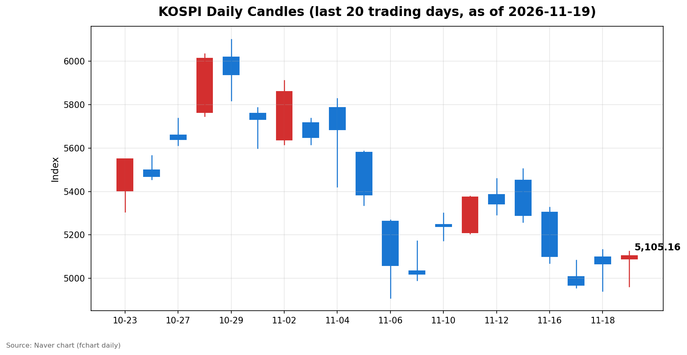
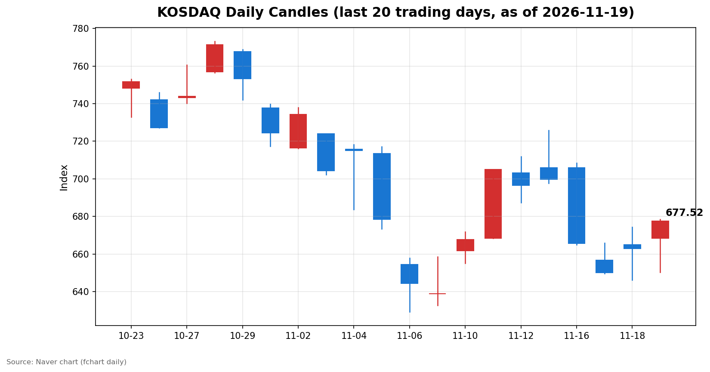

안녕하세요, [한국투자증권](https://securities.koreainvestment.com/main/Main.jsp)에서 [한투-한국투자증권](https://play.google.com/store/apps/details?id=com.truefriend.neosmartarenewal&hl=ko) 개발을 담당하고 있는 way입니다. 
2026년 11월 19일 국내 증시 마감 상황을 정리했습니다. 

## 마감 요약

코스피는 5,137.89로 전일 대비 70.45포인트, 1.39% 상승했습니다. 
코스닥은 684.81로 전일 대비 22.00포인트, 3.32% 상승했습니다. 
양 지수 모두 장중 5,000선과 650선 부근까지 내려가는 약세를 보이다가 오후 들어 낙폭을 되돌리고 상승 마감했습니다. 
수출 1조 달러 돌파 소식과 한중 FTA 후속협상 실질 타결 소식이 투자 심리를 떠받쳤고, 여행·콘텐츠·항공 테마가 급등했습니다. 
외국인은 양 시장에서 순매도를 이어갔지만, 매도 규모는 11월 16일과 17일의 1조 원대에서 크게 줄었습니다. 

## 오늘의 마감 스냅샷

| 지수 | 종가 | 전일 대비 | 등락률 | 시가 | 고가 | 저가 | 거래량 | 거래대금 |
| --- | --- | --- | --- | --- | --- | --- | --- | --- |
| 코스피 | 5,137.89 | +70.45 | +1.39% | 5,090.04 | 5,137.89 | 4,963.61 | 1억 7,520만 주 | 11조 4,554억 원 |
| 코스닥 | 684.81 | +22.00 | +3.32% | 668.31 | 684.81 | 650.39 | 3억 5,946만 주 | 4조 2,724억 원 |

스냅샷은 네이버 실시간 데이터를 기준으로 하며, 전일 종가는 네이버 실시간 등락률로 역산한 값과 일봉 종가가 일치하는 것을 확인했습니다. 
코스피 전일 종가는 5,067.44, 코스닥 전일 종가는 662.81입니다. 
원·달러 환율은 주간 거래 종가 기준 1,330.0원으로 전일 대비 3원 하락했습니다. 
자세한 지수 흐름은 [코스피](https://finance.naver.com/sise/sise_index.naver?code=KOSPI)와 [코스닥](https://finance.naver.com/sise/sise_index.naver?code=KOSDAQ)에서 확인할 수 있습니다. 

## 차트

최근 20거래일 일봉 차트입니다. 
빨간 봉은 종가가 시가보다 높은 날, 파란 봉은 종가가 시가보다 낮은 날입니다. 

## 원인·촉매 분석

오늘 장의 반등은 세 가지 촉매가 겹치며 만들어졌습니다. 
첫째, 한국 수출이 사상 처음으로 연간 1조 달러를 돌파했다는 소식이 전해졌습니다. 
수출이 역대 최대 규모에 도달했다는 사실 자체가 경기와 기업 실적에 대한 신뢰를 높이는 재료로 작용했습니다. 
둘째, 한중 FTA 서비스·투자 후속협상이 실질 타결되면서 중국 콘텐츠 시장 재개방 기대가 커졌습니다. 
여행·콘텐츠·항공·엔터테인먼트 테마가 일제히 급등한 배경입니다. 
셋째, 미국 인공지능 기업 앤트로픽의 기업공개가 역대 최대 규모로 진행되면서 인공지능 투자 열기가 다시 확인됐습니다. 
인공지능 반도체 장비와 소재 종목이 강세를 보인 흐름과 맞닿아 있습니다. 
환율도 우호적으로 움직였습니다. 
원·달러 환율은 장중 1,320원대까지 내려갔다가 1,330.0원으로 마감했습니다. 
반도체 기업의 달러 매도가 환율 하락 요인으로 거론됐습니다. 
다만 외국인은 코스피에서 4,375억 원, 코스닥에서 1,792억 원을 순매도했습니다. 
지수 상승에도 외국인 매도가 이어졌다는 점은, 반등의 동력이 외국인 복귀가 아니라 국내 수급과 테마 순환에 있었음을 보여줍니다. 
코스피에서는 기타법인이 4,506억 원을 순매수하며 외국인 매도 물량을 흡수했습니다. 
기관은 4억 원 순매수로 사실상 중립이었고, 개인은 136억 원을 순매도했습니다. 
달러인덱스가 103.86으로 2025년 4월 이후 최고 수준을 기록한 점은 글로벌 달러 강세가 이어지고 있음을 보여줍니다. 
원화 강세와 달러 강세가 동시에 나타나는 구도는 수출 기업의 달러 공급이 원화 방향을 가르고 있음을 시사합니다. 
반등의 이면에는 경계감도 남아 있습니다. 
중앙일보 GMC의 11월 19일자 G모닝 브리핑은 엔비디아가 3분기 매출 1,158억 달러로 전년 대비 103% 증가하는 실적을 냈음에도 주가가 2.89% 반락 마감했다고 전했습니다. 
젠슨 황 퇴진 이후 경영 불확실성과 연준의 매파적 발언이 부담으로 지목됐습니다. 
연준 크리스토퍼 월러 이사가 12월 0.5%포인트 인상 가능성을 언급했고, 시장은 12월 0.25%포인트 인상 확률을 95%로 반영하고 있습니다. 
실적 호조만으로는 주가를 밀어 올리기 어려운 국면이라는 점이 반도체 대형주의 종목별 차별화로 이어졌습니다. 

## 핵심 사건 3가지

### 1. 한국 수출, 사상 첫 연간 1조 달러 돌파

한국의 연간 수출이 사상 처음으로 1조 달러를 넘어섰습니다. 
세계에서 연간 수출 1조 달러를 달성한 국가는 독일, 미국, 중국에 이어 한국이 네 번째입니다. 
지난해 연간 수출 7,000억 달러를 달성한 지 불과 1년 만의 기록입니다. 
수출은 반도체를 중심으로 한 제조업 경쟁력의 결과이며, 지수 레벨보다 경제 체력에 대한 평가를 바꾸는 재료입니다. 
단기적으로는 투자 심리를 떠받치는 요인이지만, 수출 증가가 내수 투자와 일자리로 이어지는지는 앞으로 확인할 과제입니다. 

### 2. 한중 FTA 후속협상 실질 타결, 콘텐츠 공동제작 확대

한중 FTA 서비스·투자 후속협상이 실질 타결됐습니다. 
콘텐츠 공동제작 범위가 영화에서 드라마·예능 등으로 확대됐습니다. 
이 소식에 스튜디오드래곤이 상한가를 기록했고, 콘텐츠 테마가 10.54% 올랐습니다. 
여행 테마는 11.78% 올랐고, 노랑풍선은 상한가를 기록했습니다. 
다만 이번 협상에는 한국 드라마의 중국 방영이나 국내 연예인의 현지 방송 출연을 직접 허용하는 내용이 포함되지 않았습니다. 
기대감이 실제 매출로 연결되는지, 후속 조치가 이어지는지를 확인해야 하는 단계입니다. 

### 3. 앤트로픽 기업공개, 공모가 83달러로 역대 최대 규모

미국 인공지능 기업 앤트로픽의 공모가가 주당 83달러로 확정됐습니다. 
이번 상장은 스페이스엑스가 보유했던 역대 최대 규모 기록을 넘어섰습니다. 
장외 거래에서는 공모가보다 22~26% 높게 출발할 것으로 점쳐졌습니다. 
국내에서는 SK텔레콤이 보유한 앤트로픽 지분 가치가 공모가 기준 약 4조 3,000억 원으로 평가됐습니다. 
앤트로픽은 증권신고서에서 고대역폭메모리 등 고성능 메모리의 핵심 공급업체로 SK하이닉스와 삼성전자, 마이크론을 명시했습니다. 
인공지능 투자 수요가 여전히 강하다는 신호이며, 국내 반도체 공급망에 대한 관심으로 이어지는 재료입니다. 

## 섹터·테마 영향 체인

오늘 장의 영향 체인은 중국발 기대감에서 출발했습니다. 
한중 FTA 후속협상 타결 소식은 콘텐츠 공동제작 확대라는 직접 경로로 드라마·영화·웹툰·엔터테인먼트 테마를 자극했습니다. 
여행과 항공 테마는 중국인 관광객 회복 기대와 맞물려 동반 강세를 보였습니다. 
여행 테마 내에서는 노랑풍선이 상한가를 기록했고, 하나투어와 참좋은여행도 17%대 상승률을 기록했습니다. 
콘텐츠 테마의 강세는 코스닥 상승률 3.32%를 이끈 동력 중 하나입니다. 
다른 축은 인공지능 반도체 생태계입니다. 
반도체 장비·소재 기업들의 대규모 수주와 3분기 실적 호조가 이어지며 성장 기대가 높아졌습니다. 
테스는 SK하이닉스향 481억 원 공급 계약이 부각되며 17.63% 올랐고, 피에스케이와 브이엠도 두 자릿수 상승률을 기록했습니다. 
다만 반도체 대형주 내에서는 종목별 차별화가 나타났습니다. 
KIS MTS 시장 브리핑은 SK하이닉스 약세 속 반도체 종목별 차별화를 언급했습니다. 
대형주 중심의 지수 상승보다 중소형 테마와 장비·소재 종목의 순환이 두드러진 하루였습니다. 

## 최근 5거래일 일봉

| 날짜 | 코스피 시가 | 코스피 고가 | 코스피 저가 | 코스피 종가 | 코스닥 종가 |
| --- | --- | --- | --- | --- | --- |
| 11월 13일 | 5,452.41 | 5,504.44 | 5,259.09 | 5,290.53 | 699.66 |
| 11월 16일 | 5,305.40 | 5,327.99 | 5,069.83 | 5,100.50 | 665.65 |
| 11월 17일 | 5,008.09 | 5,084.06 | 4,957.00 | 4,968.48 | 650.06 |
| 11월 18일 | 5,098.82 | 5,133.14 | 4,943.17 | 5,067.44 | 662.81 |
| 11월 19일 | 5,090.04 | 5,137.89 | 4,963.61 | 5,137.89 | 684.81 |

코스피는 11월 17일 종가 4,968.48을 저점으로 이틀 연속 반등했습니다. 
코스닥도 11월 17일 종가 650.06에서 이틀 연속 올라 684.81까지 회복했습니다. 
다만 코스피는 5거래일 전인 11월 13일 종가보다 2.89% 낮은 수준입니다. 
코스닥도 같은 기간 2.12% 낮은 수준이라, 반등이 추세 전환인지 되돌림인지는 아직 단정하기 어렵습니다. 

## 당일 수급

코스피에서는 외국인이 4,375억 원을 순매도했습니다. 
외국인 매도는 11월 16일 1조 3,287억 원, 11월 17일 1조 4,190억 원에 비하면 크게 줄었지만, 매도 기조 자체는 이어졌습니다. 
개인도 136억 원을 순매도했습니다. 
기관은 4억 원 순매수로 사실상 중립이었습니다. 
기관 내부에서는 금융투자가 958억 원을 순매수한 반면 사모펀드가 854억 원, 연기금이 473억 원을 순매도해 방향이 엇갈렸습니다. 
외국인과 개인이 판 물량은 기타법인이 4,506억 원을 순매수하며 흡수했습니다. 
지수 상승이 외국인 매수에 의한 것이 아니라 기타법인의 매수와 테마 순환에 의해 만들어졌다는 점에 유의해야 합니다. 
코스닥에서는 외국인이 1,792억 원을 순매도했습니다. 
반면 기관이 1,234억 원을 순매수했고 개인도 579억 원을 순매수했습니다. 
기관 내부에서는 투신이 484억 원, 금융투자가 333억 원, 사모펀드가 211억 원을 순매수했습니다. 
코스닥의 강세는 기관과 개인이 외국인 매도 물량을 받아낸 구도에서 나왔습니다. 
당일 수급은 마감 직후 네이버 시장동향 API 최종값으로 확인했습니다. 

## 강했던 테마와 흐름

여행 테마가 11.78% 오르며 가장 강했습니다. 
콘텐츠 테마는 10.54%, 케이블TV는 6.42%, 영화·드라마제작은 6.15%, 웹툰은 5.72% 올랐습니다. 
항공 테마는 5.00%, 엔터테인먼트 테마는 4.94% 상승했습니다. 
인공지능 반도체 장비·소재 흐름도 이어졌습니다. 
테스, 피에스케이, 브이엠이 두 자릿수 상승률을 기록했습니다. 
시장 전체로는 대형주보다 테마·중소형 종목의 순환이 두드러졌습니다. 
코스피 거래대금은 11조 4,554억 원, 코스닥 거래대금은 4조 2,724억 원이었습니다. 

## 단기·중기 전망과 내일 확인할 시나리오

단기적으로는 11월 17일 저점 이후 이틀 연속 반등이 이어지고 있습니다. 
흐름이 지속되려면 외국인의 순매도 규모가 더 줄어들고 매수로 전환되는지가 관건입니다. 
코스피가 당일 고가 5,137.89를 넘어 5,100선 위에서 안착하는지, 코스닥이 680선에 안착하는지도 확인할 지점입니다. 
반대로 당일 저점인 코스피 4,963.61과 코스닥 650.39를 다시 밑돌면 반등이 되돌림에 그쳤다는 신호로 해석할 수 있습니다. 
한중 FTA 후속협상 관련 후속 조치가 나오는지, 중국 콘텐츠 시장 개방 기대가 구체화되는지도 지켜볼 사안입니다. 
수출 1조 달러 돌파는 구조적 재료이지만, 단기 지수 방향을 결정짓는 변수는 수급입니다. 
중기적으로는 인공지능 투자 사이클과 반도체 업황, 환율 방향이 지수 상단을 결정합니다. 
원·달러 환율이 1,330원 선에서 안정되는지, 달러인덱스 강세가 이어지는지도 함께 확인할 필요가 있습니다. 
이 글은 교육·해설 목적의 시장 정리이며, 특정 종목의 매수나 매도를 권유하지 않습니다. 

## 마치며

오늘 국내 증시는 중국발 훈풍과 수출 1조 달러 소식에 힘입어 이틀 연속 반등했습니다. 
다만 외국인 매도가 이어지고 있고 반등 폭도 아직 낙폭을 되돌리지 못한 수준이라, 내일 수급과 가격 레벨을 확인하며 흐름을 지켜볼 필요가 있습니다. 
정정(2026-11-19): 발행 직후 확인에서 종가가 마감 확정 전 수치로 잘못 기재된 것을 확인해, 코스피 종가 5,115.40(+0.95%)·코스닥 종가 680.20(+2.62%)으로 정정하고 스냅샷 표·최근 5거래일 표·관련 수치를 함께 수정했습니다. 
정정(2026-11-23): 1차 정정에 쓴 종가가 마감 직후 동결된 스냅샷 수치였던 것으로 확인돼, 재확인(fchart 일봉·11월 20일 마감 글 대조) 후 코스피 종가 5,137.89(+1.39%)·코스닥 종가 684.81(+3.32%)로 다시 정정하고 스냅샷 표·최근 5거래일 표·관련 수치를 함께 수정했습니다. 
