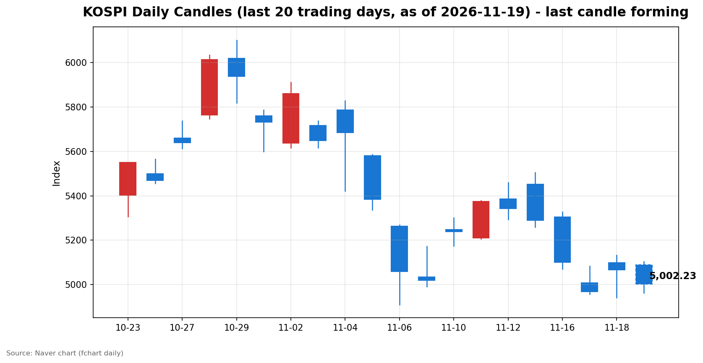
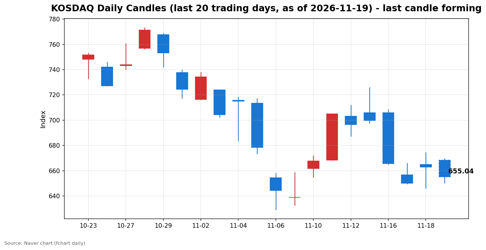

안녕하세요, [한국투자증권](https://securities.koreainvestment.com/main/Main.jsp)에서 [한투-한국투자증권](https://play.google.com/store/apps/details?id=com.truefriend.neosmartarenewal&hl=ko) 개발을 담당하고 있는 way입니다. 
수능일인 오늘 국내 증시는 상승 출발했으나, 외국인과 기관의 매도가 이어지며 코스피가 장중 5,000선 아래로 밀렸다가 5,000선 부근에서 공방을 벌이고 있습니다. 

## 오전장 요약

코스피는 시가 5,090.04로 전일 종가보다 22.60포인트 높게 출발했습니다. 
장 초반에는 고가 5,103.85까지 올랐으나, 이후 하락폭을 키우며 저가 4,963.61까지 밀렸습니다. 
장중 5,000선이 무너진 뒤 낙폭을 일부 줄이며 12시 30분 기준 5,007.42에 머물고 있습니다. 
코스닥도 시가 668.31에서 출발해 고가 669.46을 기록한 뒤 저가 650.39까지 내렸고, 12시 30분 기준 655.38을 기록하고 있습니다. 
지수와 달리 한중 개방 기대를 받는 관광·엔터테인먼트·화장품·게임 관련 종목들은 오전 내내 강세를 이어갔습니다. 
간밤 나스닥이 0.42% 오른 것과 달리 국내 증시가 약세를 보인 점이 오늘 오전장의 특징입니다. 

## 오늘의 스냅샷

| 지수 | 현재가 | 전일 대비 | 등락률 | 시가 | 고가 | 저가 | 거래량 | 거래대금 |
| --- | --- | --- | --- | --- | --- | --- | --- | --- |
| [코스피](https://finance.naver.com/sise/sise_index.naver?code=KOSPI) | 5,007.42 | -60.02 | -1.18% | 5,090.04 | 5,103.85 | 4,963.61 | 102,748천주 | 6조 391억 원 |
| [코스닥](https://finance.naver.com/sise/sise_index.naver?code=KOSDAQ) | 655.38 | -7.43 | -1.12% | 668.31 | 669.46 | 650.39 | 201,075천주 | 2조 3,920억 원 |

스냅샷 기준 시각은 2026년 11월 19일 12시 30분(KST)이며, 네이버 실시간 데이터를 기준으로 합니다. 
전일 종가는 코스피 5,067.44, 코스닥 662.81입니다. 
전일 종가는 네이버 실시간 데이터의 등락률로 역산한 값과 네이버 일봉의 전일 종가가 일치하는 것을 확인했습니다. 
당일 봉은 형성 중인 봉으로, 마감 전까지 수치는 계속 변합니다. 
한국투자증권 MTS 기준 원/달러 환율은 1,331.60원으로 전일보다 2.10원 올랐습니다. 

## 차트

최근 20거래일 일봉 차트입니다. 
빨간 봉은 종가가 시가보다 높은 날, 파란 봉은 종가가 시가보다 낮은 날입니다. 
당일 봉은 형성 중인 봉으로, 마감 전에는 계속 변합니다. 

## 원인·촉매 분석

오늘 오전 하락의 가장 직접적인 촉매는 외국인의 매도 지속입니다. 
전일인 11월 18일 코스피에서 외국인은 3,405억 원을 순매도했습니다. 
외국인 순매도는 11월 16일과 17일에 하루 1조 3,000억 원이 넘는 규모로 이어지다 18일에 3,405억 원으로 줄었습니다. 
매도 강도는 완화됐으나, 매도가 멈추지 않았다는 점이 오전 하락의 배경입니다. 
전일 수급 구도를 보면 기관이 4,926억 원, 기타법인이 4,648억 원을 순매수하며 물량을 받았습니다. 
개인은 6,169억 원을 순매도했습니다. 
기관 안에서는 금융투자가 3,069억 원, 투신이 2,113억 원을 순매수하며 매수를 주도했습니다. 
코스닥에서는 전일 외국인이 497억 원, 개인이 1,215억 원을 순매도했고, 기관이 1,794억 원을 순매수했습니다. 
장중 수급 확정치는 아직 집계되지 않았습니다. 
한국투자증권 MTS 오전 집계 잠정치로는 코스피에서 외국인과 기관이 순매도하고 개인이 순매수하는 흐름이 나타나고 있으나, 확정치는 마감 이후 확인이 필요합니다. 
연준의 매파 신호도 하락 압력으로 작용했습니다. 
크리스토퍼 월러 연준 이사는 12월 0.5%포인트 금리 인상 가능성을 언급했고, 10월 연방공개시장위원회 의사록도 매파적으로 평가됐습니다. 
시장은 12월 0.25%포인트 인상 확률을 약 95%로 보고 있으나, 인상 폭을 둘러싼 불확실성 자체가 위험자산 심리를 위축시키고 있습니다. 
미국 10년물 국채금리는 5.06%로 4bp 내렸으나, 금리 수준 자체가 여전히 높아 성장주 밸류에이션 부담을 덜어주지 못했습니다. 
원/달러 환율이 1,331.60원으로 오른 점도 외국인 자금 유출 압력을 키우는 요인입니다. 
서부텍사스산원유는 82.80달러로 3.7% 내렸고, 금 현물도 3.2% 하락했습니다. 
간밤 미국 증시는 엇갈렸습니다. 
나스닥은 0.42% 올랐으나, S&P500은 0.23% 내리며 5거래일 연속 하락했고, 다우지수도 1.11% 내렸습니다. 
국내 증시가 나스닥의 상승을 따라가지 못한 것은, 실적 호재보다 리더십 불확실성과 매파 경계라는 구조적 부담이 더 크게 작용했기 때문으로 해석됩니다. 
중앙일보 GMC 허브에서는 11월 19일 G프터눈 브리핑이 확인 시점인 12시 34분까지 게시되지 않았고, 같은 날 G모닝 브리핑의 내용을 교차 확인했습니다. 

## 핵심 사건 3가지

### 1. 한중 FTA 서비스·투자 후속협상 타결, 한한령 완화 기대 확산

한국과 중국의 FTA 서비스·투자 후속협상이 타결됐습니다. 
중국은 영화·게임 등 분야에서 한국에 최혜국대우를 약속했고, 관광·법률·건설 등 분야의 개방 수준을 높이기로 했습니다. 
이 소식이 전해지자 관광·엔터테인먼트·화장품·게임 관련 종목들이 일제히 강세를 보였습니다. 
한국투자증권 MTS 기준 오전에는 노랑풍선이 상한가에 올랐고, 하나투어는 19.02%, 하이브는 9.84% 올랐으며, 한국화장품도 상한가를 기록했습니다. 
다만 전면적인 한한령 해제로 단정하기는 이릅니다. 
증권가에서는 이번 협상에서 중국 본토 공연이 언급되지 않았다는 점을 들어, 엔터테인먼트 실적에 직접 연결되기까지는 확인이 더 필요하다는 지적이 나옵니다. 
화장품에 대해서도 한한령이 현지 영업에 미친 직접적인 영향은 제한적이었다는 평가가 있어, 한류 인기 회복이 시장점유율 상승으로 이어질지는 별개의 문제로 봐야 합니다. 
기대감이 선반영된 테마와 실제 실적 개선 사이의 간격이 오후 이후의 관전 포인트입니다. 

### 2. 엔비디아 리더십 리스크 심화, 무디스 신용전망 하향과 후임 물색 보도

엔비디아는 실적 서프라이즈에도 주가가 2.89% 하락했습니다. 
3분기 매출 1,158억 달러, 전년 대비 103% 증가, 4분기 매출 전망 1,300억 달러라는 숫자는 시장 예상을 모두 웃돌았습니다. 
그럼에도 주가가 반락한 것은 젠슨 황 전 최고경영자 사임 이후의 리더십 불확실성 때문입니다. 
미국 신용평가사 무디스는 엔비디아의 신용등급 전망을 긍정적에서 안정적으로 한 단계 낮췄습니다. 
신용등급 자체는 Aa1로 유지됐으나, 무디스는 황 전 최고경영자의 퇴진 이후 경영 불안과 정부 조사를 언급했습니다. 
엔비디아 이사회가 고용한 임원 채용업체가 차기 최고경영자 후보로 ARM의 르네 하스 최고경영자에게 접촉했다는 보도도 나왔습니다. 
이사회 의장이 황 전 최고경영자의 복귀 계획이 없다고 선을 그은 점도 불확실성을 키우고 있습니다. 
실적이 아니라 리더십과 AI 투자 지속 가능성에 대한 시장의 질문이 커지고 있다는 점이 이번 사건의 핵심입니다. 

### 3. 앤트로픽 나스닥 상장 임박, AI 투자 의지의 가늠자

앤트로픽은 오늘 밤 나스닥에 상장합니다. 
공모가는 주당 83달러로 확정됐는데, 이는 희망 범위인 70~78달러를 웃도는 수준입니다. 
기관 주문은 공모 주식 수의 약 6배에 달했고, 사모 배정을 더하면 총 조달 규모는 약 904억 달러에 이릅니다. 
이는 지난 6월 스페이스X가 세운 역대 최대 공모 기록을 웃도는 규모입니다. 
시장에서는 앤트로픽 상장이 국내외 증시를 짓누르던 수급 부담을 덜어줄 수 있을지 주목하고 있습니다. 
미래에셋증권은 앤트로픽 상장의 결과에 따라 AI 설비투자 모멘텀에 영향이 미칠 수 있다고 진단했습니다. 
공모 청약 열기가 상장 이후 주가로 이어질지가 관건이며, 오늘 밤 첫 거래 결과가 내일 국내 증시의 AI 관련 심리에도 영향을 줄 수 있습니다. 

## 섹터·테마 영향 체인

한한령 완화 기대는 관광에서 출발해 항공·엔터테인먼트·화장품·게임으로 확산되는 연결고리를 만들었습니다. 
관광 수요 회복 기대가 여행사를 먼저 끌어올렸고, 중국 운수권을 보유한 항공사에도 기대가 번졌습니다. 
콘텐츠 분야에서는 영화·게임의 최혜국대우 약속이 제작사와 게임사의 중국 시장 진출 불확실성을 낮추는 재료로 작용했습니다. 
화장품은 중국인 관광객 증가에 따른 면세점과 화장품 소비 회복 가능성이 투자 심리를 자극했습니다. 
한국투자증권 MTS 12시 시장 브리핑도 한중 개방 기대에 콘텐츠와 게임으로 매수세가 확산되고 있다고 평가했습니다. 
반면 지수 하락의 중심에는 반도체를 비롯한 대형 성장주가 있습니다. 
엔비디아 반락은 AI 밸류체인 전반에 대한 경계 심리로 이어졌고, 실적 호재에도 주가가 오르지 않는 현상은 밸류에이션 부담을 다시 확인시켰습니다. 
한국투자증권 MTS 브리핑은 HBM과 항공이 재료를 이어가고, 로봇은 종목별로 엇갈리고 있다고 전했습니다. 
금리가 높은 수준에 머무는 국면에서는 성장주 반등의 상단이 제한되는 구조가 이어지고 있습니다. 
유가 하락은 운송·화학 등 에너지 비용 부담이 큰 업종에는 우호적이나, 에너지주 자체에는 부담으로 작용합니다. 
결국 오늘 오전장은 한한령 수혜 테마의 강세와 대형주 중심의 지수 약세가 동시에 나타난, 테마와 지수가 갈린 장세였습니다. 

## 최근 5거래일 일봉

| 날짜 | 시가 | 고가 | 저가 | 종가 |
| --- | --- | --- | --- | --- |
| 2026-11-13 | 5,452.41 | 5,504.44 | 5,259.09 | 5,290.53 |
| 2026-11-16 | 5,305.40 | 5,327.99 | 5,069.83 | 5,100.50 |
| 2026-11-17 | 5,008.09 | 5,084.06 | 4,957.00 | 4,968.48 |
| 2026-11-18 | 5,098.82 | 5,133.14 | 4,943.17 | 5,067.44 |
| 2026-11-19 | 5,090.04 | 5,103.85 | 4,963.61 | 5,007.42 (형성 중) |

| 날짜 | 시가 | 고가 | 저가 | 종가 |
| --- | --- | --- | --- | --- |
| 2026-11-13 | 705.96 | 725.81 | 697.69 | 699.66 |
| 2026-11-16 | 705.88 | 708.34 | 664.98 | 665.65 |
| 2026-11-17 | 656.82 | 665.79 | 649.62 | 650.06 |
| 2026-11-18 | 664.93 | 674.30 | 646.31 | 662.81 |
| 2026-11-19 | 668.31 | 669.46 | 650.39 | 655.38 (형성 중) |

위 표는 코스피와 코스닥 순서이며, 11월 19일 수치는 12시 30분 기준 형성 중인 봉입니다. 
코스피는 11월 12일부터 17일까지 4거래일 연속 하락한 뒤 18일에 1.99% 반등했으나, 19일 오전에 다시 5,000선 아래로 밀렸습니다. 
코스닥도 11월 18일 1.96% 반등 뒤 19일 오전에 하락으로 돌아섰습니다. 

## 오전 강했던 테마와 흐름 변화

오전 강했던 테마는 한중 개방 기대와 연결된 관광·콘텐츠였습니다. 
노랑풍선과 한국화장품이 상한가를 기록했고, 하나투어와 하이브도 두 자릿수에 가까운 상승률을 보였습니다. 
한국투자증권 MTS 12시 브리핑은 K팝·엔터테인먼트와 K문화·중국·한한령 해제 테마를 오전 강세 테마의 앞자리에 올렸습니다. 
지수 흐름은 시가 대비 방향이 바뀌었습니다. 
코스피는 시가 5,090.04에서 고가 5,103.85까지 오른 뒤 저가 4,963.61까지 밀리며 상승 출발에서 하락으로 전환됐습니다. 
코스닥도 시가 668.31에서 고가 669.46을 찍은 뒤 저가 650.39까지 내리며 같은 전환을 보였습니다. 
개장 직후의 상승이 유지되지 못하고 오전 내내 매도 우위로 기울었다는 점이 오늘 오전장의 흐름 변화입니다. 

## 오후 전망과 확인할 시나리오

오후에는 5,000선 공방이 이어질지가 첫 번째 확인 지점입니다. 
코스피는 장중 저가 4,963.61에서 낙폭을 줄이며 5,007.42까지 회복했으나, 5,000선을 되찾은 뒤 안착할지는 아직 확인되지 않았습니다. 
오후에 5,000선을 지켜내면 오전의 급락이 일시적 충격에 그쳤다는 해석이 힘을 얻을 수 있습니다. 
반대로 5,000선을 다시 내주고 저가 4,963.61을 밑돌면 하락 추세가 이어지는 신호로 읽힐 수 있습니다. 
외국인 매도 강도도 확인할 수치입니다. 
전일 3,405억 원으로 줄었던 외국인 순매도가 장중에 다시 커지는지, 개인의 순매수가 이를 얼마나 받아내는지가 오후 흐름을 가를 수 있습니다. 
한한령 수혜 테마는 오후에도 강세가 이어지는지, 차익 실현 매물이 나오는지를 확인할 필요가 있습니다. 
기대감이 선반영된 테마는 오후에 변동성이 커질 수 있어, 장중 고가와 저가의 폭이 넓어지는지 지켜볼 필요가 있습니다. 
오늘 밤 앤트로픽 상장을 앞둔 만큼, 오후에는 새로운 재료보다 관망 심리가 강해질 가능성도 있습니다. 
원/달러 환율이 1,331원대에서 더 오르는지, 1,330원 아래로 되돌리는지도 외국인 수급과 함께 확인할 지점입니다. 
단기적으로는 5,000선 안착 여부와 장중 저가 4,963.61, 장중 고가 5,103.85가 오후의 기준선이 됩니다. 
중기적으로는 외국인 매도 강도의 완화 여부와 앤트로픽 상장 이후 AI 투자 심리의 방향이 다음 주 흐름을 좌우할 수 있습니다. 

## 마치며

오늘 오전 국내 증시는 한한령 완화 기대라는 뚜렷한 호재와 외국인 매도 지속이라는 부담이 동시에 작용하며 테마와 지수가 갈린 장세를 보였습니다. 
오후에는 5,000선 공방과 외국인 수급, 한한령 테마의 강세 지속 여부를 확인하며 변동성에 유의할 필요가 있습니다. 
이 글은 시장 해설을 목적으로 하며, 특정 종목의 매수나 매도를 권유하지 않습니다. 
