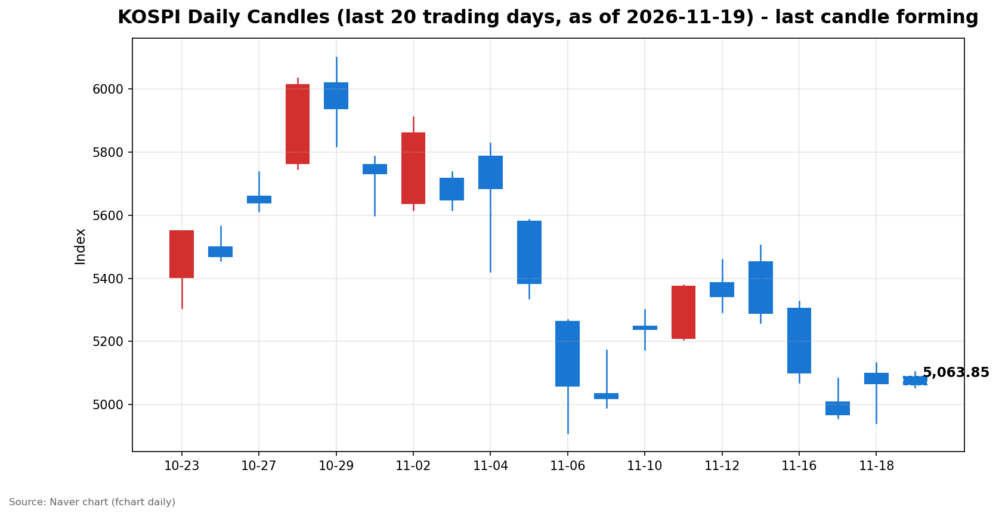
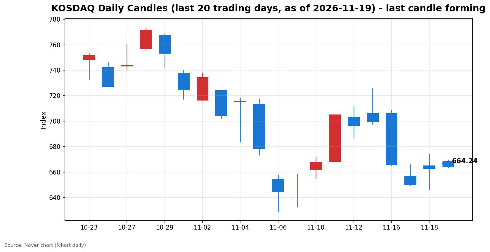

안녕하세요, [한국투자증권](https://securities.koreainvestment.com/main/Main.jsp)에서 [한투-한국투자증권](https://play.google.com/store/apps/details?id=com.truefriend.neosmartarenewal&hl=ko) 개발을 담당하고 있는 way입니다. 
수능일인 오늘 국내 증시는 오전 10시에 개장했고, 코스피는 상승 출발 뒤 빠르게 상승폭을 반납하며 약보합으로 돌아섰습니다. 

## 배경: 간밤 미국 증시와 개장 전 이슈

간밤 뉴욕증시는 엇갈린 흐름을 보였습니다. 
나스닥 종합지수는 24,429.89로 101.51포인트(0.42%) 올랐고, S&P500 지수는 7,323.63으로 16.90포인트(0.23%) 내리며 5거래일 연속 하락했으며, 다우지수는 1.11% 하락했습니다. 
나스닥의 상승과 S&P500·다우의 하락이 갈린 것은 엔비디아 실적을 둘러싼 엇갈린 평가가 그대로 반영된 결과입니다. 
엔비디아는 3분기 매출 1,158억 달러(전년 대비 103% 증가), 조정 주당순이익(EPS) 2.68달러, 데이터센터 매출 1,076억 달러를 기록해 시장 예상을 크게 웃돌았고, 4분기 매출 전망도 1,300억 달러로 제시했습니다. 
그럼에도 엔비디아 주가는 장 초반 2% 상승에서 2.89% 하락으로 돌아서며 마감했습니다. 
실적 숫자는 서프라이즈였으나, 젠슨 황 전 최고경영자(CEO)의 사임 이후 리더십 불확실성과 고객사의 천문학적 AI 투자 지속 가능성에 대한 의문이 주가를 눌렀습니다. 
연준의 매파 신호도 부담으로 작용했습니다. 
크리스토퍼 월러 연준 이사는 방송 인터뷰에서 12월 0.5%포인트 인상 가능성을 언급했고, 10월 연방공개시장위원회(FOMC) 의사록도 매파적으로 평가됐습니다. 
시장은 12월 0.25%포인트 인상 확률을 약 95%로 보지만, 인상 폭을 둘러싼 불확실성 자체가 위험자산 심리를 위축시키고 있습니다. 
미국 10년물 국채금리는 5.06%로 4bp 내렸고, 서부텍사스산원유(WTI)는 82.80달러로 3.7% 내렸으며, 금 현물은 3.2% 하락해 온스당 3,800달러를 밑돌았습니다. 
비트코인은 11월 19일 오전 8시 10분 기준 62,516달러로 24시간 전보다 4.05% 하락했습니다. 
오늘 밤에는 앤트로픽의 첫 거래가 예정돼 있습니다. 
앤트로픽은 공모가를 주당 83달러로 확정했는데, 이는 희망 범위인 70~78달러를 웃도는 수준이며 기관 주문은 공모 주식 수의 약 6배에 달했습니다. 
사모 배정 260억 달러를 더하면 총 조달 규모는 약 904억 달러에 이릅니다. 

## 오늘의 스냅샷

| 지수 | 현재가 | 전일 대비 | 등락률 | 시가 | 고가 | 저가 | 거래량 | 거래대금 |
| --- | --- | --- | --- | --- | --- | --- | --- | --- |
| [코스피](https://finance.naver.com/sise/sise_index.naver?code=KOSPI) | 5,066.76 | -0.68 | -0.01% | 5,090.04 | 5,103.85 | 5,055.41 | 17,827천주 | 1조 1,589억 원 |
| [코스닥](https://finance.naver.com/sise/sise_index.naver?code=KOSDAQ) | 664.11 | +1.30 | +0.20% | 668.31 | 669.46 | 663.73 | 33,097천주 | 4,316억 원 |

스냅샷 기준 시각은 2026년 11월 19일 10시 08분(KST)이며, 네이버 실시간 데이터를 기준으로 합니다. 
전일 종가는 코스피 5,067.44, 코스닥 662.81입니다. 
코스피는 시가 5,090.04로 출발해 장 초반 고가 5,103.85까지 올랐으나, 개장 8분 만에 저가 5,055.41까지 밀리며 약보합으로 돌아섰습니다. 
코스닥은 시가 668.31에서 출발해 고가 669.46을 찍은 뒤 상승폭을 줄이며 664.11에서 움직이고 있습니다. 
한국투자증권 MTS 기준 개장 직후 코스피200 지수는 784.95로 0.35% 내렸고, 코스피 선물은 783.45로 0.38% 내렸으며, 원/달러 환율은 1,330.60원으로 전일보다 3.10원 내렸습니다. 

## 차트

최근 20거래일 일봉 차트입니다. 
빨간 봉은 종가가 시가보다 높은 날, 파란 봉은 종가가 시가보다 낮은 날입니다. 
당일 봉은 형성 중인 봉으로, 마감 전에는 계속 변합니다. 

## 원인·촉매 분석

오늘 개장의 핵심 촉매는 엔비디아 실적의 양면성입니다. 
실적 자체는 AI 인프라 수요가 여전히 견조하다는 신호였고, 전일 코스피가 98.96포인트(1.99%) 오르며 5,000선을 되찾은 것도 이 훈풍이 작용한 결과입니다. 
전일 삼성전자와 SK하이닉스는 각각 2.31%, 4.19% 오르며 지수 상승을 이끌었습니다. 
그러나 엔비디아 주가가 실적 발표 당일 2.89% 하락했다는 사실이 오늘 개장 분위기를 바꿨습니다. 
실적 서프라이즈가 주가 상승으로 이어지지 않았다는 것은, 시장이 이제 숫자가 아니라 리더십 공백과 AI 투자 지속 가능성이라는 구조적 질문에 답을 요구하고 있다는 뜻입니다. 
이사회 의장이 젠슨 황 전 CEO의 복귀 계획이 없다고 선을 그은 점도 불확실성을 키우는 요인입니다. 
연준의 매파 신호는 두 번째 촉매입니다. 
월러 이사의 0.5%포인트 인상 가능성 언급과 매파적인 FOMC 의사록은 금리 인하 기대를 뒤로 미뤘고, 이는 성장주 밸류에이션에 직접적인 부담으로 작용합니다. 
미국 10년물 금리가 5%를 웃도는 국면에서는 실적 호재가 있어도 반등의 상단이 제한되는 구조입니다. 
수급 구도도 개장 흐름을 설명합니다. 
전일 코스피에서 외국인은 3,405억 원을 순매도했으나, 기관이 4,926억 원을 순매수하고 기타법인이 4,648억 원을 순매수하며 물량을 받았습니다. 
개인은 6,169억 원을 순매도했습니다. 
외국인의 매도 규모는 11월 16일 1조 3,287억 원, 11월 17일 1조 4,190억 원에서 11월 18일 3,405억 원으로 크게 줄었습니다. 
매도 강도가 완화된 것은 긍정적이나, 매수 주체가 기관에 쏠려 있다는 점에서 외국인의 본격적인 복귀 없이는 반등의 지속성을 단정하기 어렵습니다. 
기관 안에서는 금융투자가 3,069억 원을 순매수하며 매수를 주도했고, 투신도 2,113억 원을 순매수했습니다. 
코스닥에서는 외국인이 497억 원, 개인이 1,215억 원을 순매도했고, 기관이 1,794억 원을 순매수했습니다. 
환율은 반등에 우호적인 방향입니다. 
원/달러 환율은 1,330.60원으로 전일보다 내리며 원화 강세 쪽으로 움직였고, 이는 외국인 자금 유출 압력을 완화하는 요인입니다. 
다만 개장 직후 코스피가 상승폭을 빠르게 반납했다는 점은, 환율 안정만으로는 매파 경계와 엔비디아 반락의 무게를 상쇄하기 어렵다는 것을 보여줍니다. 

## 핵심 사건 3가지

### 1. 엔비디아 실적 서프라이즈에도 주가 반락, AI 리더십 리스크 부각

엔비디아는 3분기 매출 1,158억 달러(전년 대비 103% 증가), 조정 EPS 2.68달러, 4분기 매출 전망 1,300억 달러를 내놓으며 시장 예상을 모두 웃돌았습니다. 
데이터센터 매출은 1,076억 달러로 전년 대비 110% 늘었고, 내년 매출 성장률 전망도 70%에서 75%로 상향됐습니다. 
그럼에도 주가는 장 초반 2% 상승에서 2.89% 하락으로 돌아섰습니다. 
반락의 배경에는 젠슨 황 전 CEO의 사임 이후 불거진 경영 불확실성이 있습니다. 
이사회는 황 전 CEO의 복귀 계획이 없다고 밝혔고, 차기 CEO 인선은 내외부 후보를 열어두고 서두르지 않겠다는 입장입니다. 
여기에 증권거래위원회(SEC) 조사와 12월 의회 청문회, 고객사의 AI 투자 지속 가능성에 대한 의문이 겹쳤습니다. 
국내 증시에는 두 가지 함의가 있습니다. 
실적 숫자는 AI 밸류체인의 수요가 꺾이지 않았음을 보여주지만, 주가가 이를 반영하지 못했다는 것은 밸류체인 전반의 투자 심리가 실적보다 거버넌스와 자금 조달 구조를 더 민감하게 본다는 뜻입니다. 
오늘 밤 앤트로픽의 첫 거래 결과가 AI 투자 심리의 다음 가늠자가 될 전망입니다. 

### 2. 연준 매파 신호 강화, 12월 인상 폭 불확실성 확대

월러 연준 이사는 방송 인터뷰에서 12월 0.5%포인트 인상 가능성을 언급했고, 10월 FOMC 의사록도 매파적으로 해석됐습니다. 
시장은 12월 0.25%포인트 인상 확률을 약 95%로 보지만, 0.5%포인트 인상 가능성이 거론됐다는 자체가 금리 경로의 불확실성을 키웠습니다. 
이 여파로 S&P500 지수는 5거래일 연속 하락했고, 비트코인은 24시간 만에 4.05% 급락해 62,516달러까지 밀렸습니다. 
금 현물도 3.2% 하락하며 온스당 3,800달러를 밑돌았고, 유가도 3.7% 내렸습니다. 
위험자산 전반이 동시에 조정받은 것은 금리 부담이 특정 자산이 아니라 시장 전체의 할인율에 작용하고 있음을 보여줍니다. 
국내 증시에도 금리 상승은 성장주 밸류에이션 부담으로 작용하는 연결고리입니다. 
코스피가 전일 1.99% 반등했음에도 오늘 개장 직후 상승폭을 반납한 배경에는 이 금리 부담이 자리하고 있습니다. 
향후 연준 인사들의 발언과 12월 FOMC를 앞두고 금리 경로를 둘러싼 언급이 나올 때마다 시장이 민감하게 반응할 가능성이 큽니다. 

### 3. 앤트로픽 공모가 83달러 확정, 오늘 밤 첫 거래가 AI 투자 심리의 시험대

앤트로픽은 공모가를 주당 83달러로 확정했습니다. 
희망 범위인 70~78달러를 웃도는 수준이며, 기관 주문은 공모 주식 수의 약 6배에 달했습니다. 
사모 배정 260억 달러를 더하면 총 조달 규모는 약 904억 달러로, 역대 최대 규모의 기업공개(IPO) 조달 기록에 해당합니다. 
앤트로픽은 지난달 말 기준 연 환산 매출액이 810억 달러에 달한다고 밝혔습니다. 
미국 현지시간 11월 19일 첫 거래가 시작되며, 한국시간으로는 오늘 밤에 해당합니다. 
이 상장이 중요한 이유는 단순한 공모 규모 때문이 아닙니다. 
엔비디아 실적이 주가 상승으로 이어지지 못한 상황에서, AI 기업에 대한 시장의 지불 의사가 어느 수준인지가 앤트로픽의 첫 거래에서 직접 확인되기 때문입니다. 
흥행에 성공하면 AI 투자 심리가 되살아나는 계기가 될 수 있고, 부진하면 AI 밸류체인 전반의 밸류에이션 부담이 다시 부각될 수 있습니다. 
국내 증시도 내일 장에서 이 결과를 반영하게 됩니다. 

## 섹터·테마 영향 체인

반도체·AI 밸류체인은 실적 호재와 주가 반락이라는 상반된 신호를 동시에 받고 있습니다. 
엔비디아 실적이 AI 수요 둔화 우려를 완화하면서 메모리와 기판, 후공정으로 이어지는 밸류체인에 온기가 확산됐고, 전일 삼성전자와 SK하이닉스의 동반 상승이 이를 보여줍니다. 
그러나 엔비디아 주가의 반락은 밸류체인 전반의 투자 심리가 실적보다 거버넌스와 자금 조달 구조에 민감해졌음을 뜻합니다. 
미 상무부 산업안보국(BIS)이 11월 16일 발표한 대중 AI 반도체 규제도 밸류체인의 중기 변수입니다. 
우회 수출 우려가 큰 5개국에 대한 선적 요건 강화, 해외 데이터센터를 통한 중국 기업의 미국산 AI 연산 자원 이용 제한, 해외 파운드리의 중국 AI 반도체 위탁생산 규제 강화가 골자입니다. 
이는 중국 매출 의존도가 있는 밸류체인에는 부담이 되고, 미국 중심 공급망에는 상대적인 수혜가 될 수 있는 갈림길입니다. 
엔터·콘텐츠 테마는 한한령 완화 기대에 급등했으나, 기대와 현실의 간극을 확인해야 하는 국면입니다. 
한중 협상에서 중국 본토 내 케이팝 공연 재개는 포함되지 않았고, 드라마는 공동제작 확대 대상에 포함된 수준에 그쳤습니다. 
증권가에서는 전면적인 해제로 해석하기에는 이르며 후속 협의와 실제 현지 활동 재개 여부를 확인해야 한다는 지적이 나왔습니다. 
기대가 선반영된 만큼 후속 협상 진전 여부에 따라 변동성이 커질 수 있습니다. 
가상자산 관련 투자 심리는 위축되고 있습니다. 
비트코인이 62,516달러까지 밀리며 24시간 만에 4.05% 하락했고, 간밤 미국 시장에서도 관련 종목이 약세를 보였습니다. 
연준의 추가 금리 인상 가능성과 상장지수펀드(ETF) 자금 유출, 손절 매도가 겹친 결과로, 위험자산 회피 심리가 확산되는 신호입니다. 
금리에서 성장주로 이어지는 연결고리도 작동하고 있습니다. 
10년물 국채금리가 5%를 웃도는 국면에서는 AI 성장주의 밸류에이션 재평가 압력이 커질 수 있어, 실적 호재와 금리 부담이 섹터 안에서 동시에 작용하고 있습니다. 
반면 유가 하락은 운송·화학 등 원가 부담이 큰 업종에는 부담을 덜어주는 방향입니다. 
WTI가 82.80달러로 3.7% 내린 것은 인플레이션 압력 완화 측면에서는 긍정적이나, 수요 둔화 우려가 반영된 것이라면 경기 민감 업종에는 엇갈린 신호입니다. 

## 최근 5거래일 일봉

### 코스피

| 날짜 | 시가 | 고가 | 저가 | 종가 | 거래량(천주) |
| --- | --- | --- | --- | --- | --- |
| 2026-11-13 | 5,452.41 | 5,504.44 | 5,259.09 | 5,290.53 | 247,829 |
| 2026-11-16 | 5,305.40 | 5,327.99 | 5,069.83 | 5,100.50 | 221,296 |
| 2026-11-17 | 5,008.09 | 5,084.06 | 4,957.00 | 4,968.48 | 193,978 |
| 2026-11-18 | 5,098.82 | 5,133.14 | 4,943.17 | 5,067.44 | 219,090 |
| 2026-11-19 | 5,090.04 | 5,103.85 | 5,055.41 | 5,066.76(형성 중) | 17,827 |

### 코스닥

| 날짜 | 시가 | 고가 | 저가 | 종가 | 거래량(천주) |
| --- | --- | --- | --- | --- | --- |
| 2026-11-13 | 705.96 | 725.81 | 697.69 | 699.66 | 455,458 |
| 2026-11-16 | 705.88 | 708.34 | 664.98 | 665.65 | 446,420 |
| 2026-11-17 | 656.82 | 665.79 | 649.62 | 650.06 | 467,132 |
| 2026-11-18 | 664.93 | 674.30 | 646.31 | 662.81 | 462,804 |
| 2026-11-19 | 668.31 | 669.46 | 663.73 | 664.11(형성 중) | 33,097 |

11월 19일 봉은 형성 중인 봉으로, 마감 전에는 계속 변합니다. 

## 전일 수급: 외국인은 팔고 기관이 받은 하루

전일(11월 18일) 코스피에서 외국인은 3,405억 원을 순매도했습니다. 
개인은 6,169억 원을 순매도했고, 기관은 4,926억 원을 순매수했으며, 기타법인은 4,648억 원을 순매수했습니다. 
기관 안에서는 금융투자가 3,069억 원을 순매수하며 매수를 주도했고, 투신도 2,113억 원을 순매수했습니다. 
연기금은 660억 원을 순매수했고, 사모는 742억 원을 순매도했습니다. 
코스닥에서는 외국인이 497억 원을 순매도했고, 개인이 1,215억 원을 순매도했으며, 기관이 1,794억 원을 순매수했습니다. 
구도를 해석하면 외국인의 매도가 이어졌으나 매도 규모가 크게 줄었고, 기관과 기타법인의 매수가 이를 받아내며 지수가 1.99% 반등한 하루였습니다. 
외국인의 코스피 순매도 규모는 11월 16일 1조 3,287억 원, 11월 17일 1조 4,190억 원에서 11월 18일 3,405억 원으로 축소됐습니다. 
매도 강도가 완화된 것은 긍정적이나, 매수 주체가 기관에 쏠려 있다는 점에서 반등의 지속성을 단정하기는 이릅니다. 
오늘 반등이 이어지려면 외국인의 순매도 규모가 더 줄어들거나 순매수로 전환되는지가 관건입니다. 

## 단기·중기 전망과 확인할 시나리오

단기적으로는 엔비디아 훈풍에 따른 기술적 반등이 이어질지, 아니면 연준 매파와 리더십 불확실성에 눌려 되돌림에 그칠지가 갈림길입니다. 
반등 지속 시나리오에서는 외국인의 매도 진정, 원/달러 환율의 안정, 앤트로픽 첫 거래의 흥행이 함께 확인돼야 합니다. 
일시적 노이즈 시나리오에서는 연준 인사들의 추가 매파 발언, 엔비디아 차기 CEO 인선의 지연, 미·중 정상회담 결과에 대한 실망이 반등의 상단을 제한할 수 있습니다. 
확인할 가격 레벨은 코스피 전일 고가 5,133.14와 5,100선 안착 여부, 전일 저가 4,943.17과 5,000선 지지 여부입니다. 
코스닥은 전일 고가 674.30과 670선 회복 여부, 전일 저가 646.31과 650선 지지 여부를 확인할 필요가 있습니다. 
중기적으로는 엔비디아의 4분기 가이던스 이행 여부와 미 상무부의 대중 데이터센터 규제(11월 16일 공개)가 AI 밸류체인에 미치는 영향이 변수입니다. 
미국 10월 생산자물가(PPI)가 4년 만에 가장 높은 수준을 기록한 뒤 인플레이션 지표와 연준의 금리 경로도 함께 확인해야 합니다. 
리스크 관리 관점에서는 한 가지 재료에 쏠린 반등일수록 거래대금과 외국인 수급의 동반 여부를 함께 확인하는 것이 중요합니다. 
오늘은 수능일로 개장이 10시로 늦춰진 만큼, 장 초반의 움직임이 오후까지 이어지는지도 함께 봐야 합니다. 

## 장 초반 확인할 점

첫째, 외국인의 순매수 전환 여부입니다. 
전일 3,405억 원 순매도의 연장선인지, 반등에 동참하는지 오전 수급을 확인해야 합니다. 
둘째, 삼성전자와 SK하이닉스를 비롯한 AI 밸류체인의 방향입니다. 
개장 초반의 상승이 유지되는지, 차익 매물이 나오는지를 봐야 합니다. 
셋째, 원/달러 환율의 흐름입니다. 
1,330원 선 안팎에서의 움직임이 외국인 수급에 영향을 줄 수 있습니다. 
넷째, 거래대금의 확대 여부입니다. 
반등에 거래대금이 동반되는지가 반등의 강도를 가늠하는 잣대입니다. 
다섯째, 오늘 밤 앤트로픽 첫 거래의 결과입니다. 
첫 거래의 흐름이 내일 국내 증시의 AI 투자 심리를 좌우할 수 있습니다. 

## 마치며

엔비디아의 실적 서프라이즈에도 주가가 반락하고 연준의 매파 신호가 이어지면서, 오늘 국내 증시는 상승 출발 뒤 빠르게 상승폭을 반납하는 모습을 보이고 있습니다. 
다만 외국인의 매도 강도가 완화된 점과 기관의 매수세가 지수를 떠받친 점은 반등의 여지를 남겨두고 있어, 수급과 금리 흐름을 함께 확인하는 것이 중요합니다. 
이 글은 시장 해설을 위한 교육 목적의 글로, 특정 종목의 매수·매도를 권유하는 내용이 아닙니다. 
