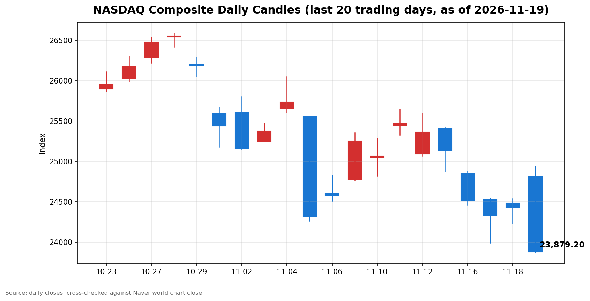

안녕하세요, [한국투자증권](https://securities.koreainvestment.com/main/Main.jsp)에서 [한투-한국투자증권](https://play.google.com/store/apps/details?id=com.truefriend.neosmartarenewal&hl=ko) 개발을 담당하고 있는 way입니다. 
현지시간 11월 19일 목요일, 나스닥은 앤트로픽 상장 첫날 장 초반 강세로 출발했다가 연준 긴축 우려와 반도체 약세가 겹치며 2.25% 급락 마감했습니다. 

## 마감 요약

나스닥 종합은 전일 대비 550.69포인트, 2.25% 하락한 23,879.20으로 마감했습니다. 
다우는 1,101.11포인트, 2.19% 하락한 49,097.06으로 마감하며 5만선을 내줬습니다. 
S&P500은 147.80포인트, 2.02% 하락한 7,175.83으로 마감하며 6거래일 연속 하락했습니다. 
세 지수가 일제히 2% 안팎으로 급락한 날입니다. 
장 초반 나스닥은 앤트로픽 상장 기대감에 1.63%까지 올랐으나, 장중 고가 24,939.62에서 저가 23,870.70까지 1,068.92포인트를 오가는 큰 변동 끝에 하락 마감했습니다. 
오후 12시 56분 스냅샷에서 나스닥이 0.85% 하락했던 것과 비교하면, 오후 들어 낙폭이 2.25%까지 커졌습니다. 
같은 시간 다우는 1.45% 하락에서 2.19% 하락으로, S&P500은 0.96% 하락에서 2.02% 하락으로 낙폭이 확대됐습니다. 
중앙일보 GMC 11월 19일 G브닝은 개장 전 나스닥 100 선물이 2.04% 오르는 등 앤트로픽 데뷔에 대한 기대를 전했으나, 실제 장은 정반대로 흘렀습니다. 
미국 10년물 국채수익률은 하락했습니다. 
달러 강세 속에 금 현물 가격은 1.4% 하락하며 14개월 만에 최저 수준을 기록했습니다. 
비트코인은 6만 2,000달러대까지 하락했습니다. 

## 오늘의 마감 스냅샷

| 지수 | 종가 | 전일 대비 | 등락률 | 전일 종가 | 당일 고가 | 당일 저가 |
| --- | --- | --- | --- | --- | --- | --- |
| 나스닥 종합 | 23,879.20 | -550.69 | -2.25% | 24,429.89 | 24,939.62 | 23,870.70 |
| S&P500 | 7,175.83 | -147.80 | -2.02% | 7,323.63 | 7,411.15 | 7,175.83 |
| 다우 | 49,097.06 | -1,101.11 | -2.19% | 50,198.17 | 확인 필요 | 확인 필요 |

스냅샷 기준 시각은 미국 동부시간 2026년 11월 19일 오후 4시 20분, 한국시간 11월 20일 오전 6시 20분입니다. 
나스닥과 다우 수치는 [네이버 월드 차트](https://finance.naver.com/world/sise.naver?symbol=NAS@IXIC)([나스닥 종합 가격 페이지](https://stock.naver.com/worldstock/index/.IXIC/price))에서 브라우저로 확인한 장마감 값입니다. 
네이버 월드 차트 페이지는 curl 직접 조회로는 수치를 확인할 수 없어 브라우저로 직접 확인했습니다. 
S&P500은 한투 MTS 해외 대시보드 기준이며, 종가 7,175.83과 등락률 2.02% 하락은 당일 보도로도 확인됐습니다. 
S&P500의 당일 고가와 저가는 한투 MTS 장중 시계열 기준 값입니다. 
나스닥 종가 23,879.20은 한투 MTS 교차값과 일치합니다. 
나스닥 거래량은 1,646,696천주입니다. 
다우의 당일 고가와 저가는 확인 필요합니다. 
원·달러 환율은 1,334.10원으로 전일 대비 0.40원, 0.03% 상승했습니다. 

## 차트

최근 20거래일 일봉 차트입니다. 
빨간 봉은 종가가 시가보다 높은 날, 파란 봉은 종가가 시가보다 낮은 날입니다. 

## 원인·촉매 분석

오늘 장의 근본 촉매는 앤트로픽 상장이라는 이벤트성 재료와 연준 긴축 우려라는 구조적 재료가 정반대 방향으로 작용한 결과입니다. 
장 초반에는 상장 기대감이 우위를 점했습니다. 
앤트로픽은 공모가 주당 83달러로 희망 범위를 웃돌았고, 공모와 사모를 합친 조달 규모는 약 1,073억 달러로 역대 최대 수준입니다. 
시초가는 공모가보다 34% 높은 111.50달러에 형성됐고, 장중 시가총액은 2조 달러를 넘어섰습니다. 
나스닥은 장 초반 1.63%까지 오르며 기대감을 반영했습니다. 
그러나 흥분이 식는 속도는 빨랐습니다. 
앤트로픽 주가는 종가 97.17달러로 상승폭을 상당 부분 반납했고, 투자자들이 앤트로픽을 담기 위해 기존 포트폴리오를 조정하면서 매도 압력이 번졌습니다. 
국내 보도에서는 앤트로픽 상장이 자금을 빨아들이는 블랙홀이 됐다는 표현까지 나왔습니다. 
배경에는 연준의 긴축 기조가 자리합니다. 
11월 18일 공개된 10월 FOMC 의사록에서 거의 모든 참석자는 추가 금리인상이 적절하다고 판단했습니다. 
의사록은 인공지능 관련 수요가 인플레이션 위험을 초래하는 중대한 요인이 될 수 있다고 평가했습니다. 
인공지능 관련 부채가 빠르게 증가하고 있으며, 그 상당 부분이 복잡하고 불투명한 금융 구조를 통해 이뤄졌다는 지적도 담겼습니다. 
크리스토퍼 월러 연준 이사는 12월 8일부터 9일까지 열리는 회의에서 기준금리를 0.5%포인트 인상할 필요가 있다고 주장했습니다. 
오스탄 굴스비 시카고 연방준비은행 총재도 12월 0.5%포인트 인상 가능성을 배제하지 않았습니다. 
CME 페드워치 기준 12월 0.25%포인트 인상 확률은 95% 수준으로 집계됐습니다. 
10월 생산자물가지수가 4년 만에 최고치를 기록한 점도 긴축 전환의 배경입니다. 
신규 실업수당 청구 건수는 예상보다 많았습니다. 
금리인상 전망 강화는 성장주 밸류에이션에 부담을 주는 연결고리로 작용했습니다. 
다만 미국 10년물 국채수익률이 하락한 점은 채권 시장이 연준의 매파적 발언을 그대로 따라가지 않았음을 보여줍니다. 
달러 강세는 이어졌고, 금과 비트코인이 동반 약세를 보였습니다. 
지수 간 방향 차이는 크지 않았습니다. 
세 지수가 일제히 2% 안팎으로 내렸다는 점은 개별 종목 재료보다 거시적 부담이 시장 전체를 짓눌렀음을 보여줍니다. 
다만 나스닥의 낙폭이 가장 컸다는 점은 기술주와 반도체에 부담이 집중됐음을 보여줍니다. 
이날 변동성 지수 마감 수치는 확인 필요합니다. 

## 핵심 사건 3가지

첫째, 앤트로픽의 나스닥 상장 첫날입니다. 
인공지능 모델 클로드의 개발사 앤트로픽이 티커 ANT로 나스닥에 데뷔했습니다. 
공모가는 주당 83달러로 희망 범위 70달러에서 78달러를 웃돌았고, 청약 경쟁률은 7배에 달했습니다. 
공모와 사모를 합친 조달 규모는 약 1,073억 달러로 역대 최대 수준입니다. 
시초가는 111.50달러로 공모가보다 34% 높게 형성됐고, 장중 시가총액은 2조 달러를 넘어섰습니다. 
그러나 종가는 97.17달러로 상승폭을 상당 부분 반납했습니다. 
상장 직후 차익 매물이 나왔고, 투자자들이 앤트로픽을 담기 위해 기존 보유 종목을 파는 조정이 나타났습니다. 
중앙일보 GMC 11월 19일 G프터눈과 G브닝도 앤트로픽 상장을 당일 핵심 주제로 다뤘습니다. 
G브닝 작성 시점에는 나스닥 100 선물이 2.04% 오르고 있었으나, 실제 장은 하락 마감으로 반전했습니다. 
상장 첫날의 흥분이 시장 전체의 방향을 바꾸지는 못했습니다. 
앤트로픽 주가의 2일차 흐름은 다음 거래일의 확인 지점이 됩니다. 

둘째, 연준 인사들의 12월 빅스텝 발언과 FOMC 의사록입니다. 
월러 연준 이사는 12월 회의에서 0.5%포인트 인상이 필요하다고 주장했습니다. 
굴스비 시카고 연은 총재는 12월 0.5%포인트 인상 가능성을 배제하지 않았고, 인공지능 투자 열풍이 경제 과열과 인플레이션을 자극할 수 있다고 경고했습니다. 
11월 18일 공개된 10월 FOMC 의사록도 추가 금리인상 필요성을 인정하는 내용이었습니다. 
의사록 공개 이후 시장은 12월 금리인상을 사실상 기정사실로 받아들이는 분위기입니다. 
CME 페드워치 기준 12월 0.25%포인트 인상 확률은 95% 수준입니다. 
관건은 인상 폭입니다. 
50bp 인상 가능성이 9.3% 수준으로 반영된 점은 시장이 빅스텝을 완전히 배제하지 않고 있음을 보여줍니다. 
금리인상 전망 강화는 성장주 밸류에이션을 압박하는 방향으로 작용했습니다. 
달러는 강세를 이어갔고, 금 현물 가격은 1.4% 하락하며 14개월 만에 최저 수준을 기록했습니다. 
연준의 긴축 경로가 시장의 부담으로 남는다는 점이 이날 다시 확인됐습니다. 

셋째, AMD 공매도 보고서와 대중 AI 칩 수출통제 강화입니다. 
헌터브룩 미디어는 오전 10시 27분에 AMD의 중국 수출통제 관련 의혹을 담은 보고서를 냈습니다. 
보고서가 나온 직후 AMD 주가는 장중 한때 11.2%까지 급락했습니다. 
AMD는 7% 급락으로 마감했습니다. 
전일 5.31% 올랐던 AMD가 하루 만에 급반락한 것입니다. 
엔비디아의 중국 판매 논란에서 벗어난 대안으로 평가받던 AMD마저 같은 의심을 받게 되면서 반도체 전반의 투자 심리가 흔들렸습니다. 
같은 날 발효된 미국의 대중 AI 칩 수출통제 강화 조치는 공급망 불확실성을 더 키웠습니다. 
싱가포르 등 5개국으로 향하는 첨단 AI 칩에 대한 허가 요건이 새로 생기면서, 중국 노출이 큰 반도체 기업의 규제 리스크가 다시 부각됐습니다. 
반도체 약세는 나스닥 낙폭이 다우와 S&P500보다 컸던 배경 중 하나입니다. 
규제 리스크가 실적 기대를 압도한 하루였습니다. 

## 지수·섹터 영향 체인

나스닥은 2.25% 하락했고, S&P500은 2.02% 하락했으며, 다우는 2.19% 하락했습니다. 
세 지수가 나란히 2% 안팎으로 내렸다는 점은 충격이 특정 업종에 국한되지 않았음을 보여줍니다. 
기술주는 직격탄을 맞았습니다. 
앤트로픽 상장 첫날의 자금 이동이 기존 기술주 매도로 이어졌고, AMD 보고서가 반도체 전반으로 번졌습니다. 
금리인상 전망 강화는 성장주 밸류에이션을 압박하는 연결고리로 작용했습니다. 
금리가 오르면 미래 이익의 현재가치가 낮아지기 때문에, 성장 기대가 큰 기술주의 부담이 커집니다. 
반도체는 실적 기대와 규제 리스크가 충돌했습니다. 
엔비디아는 전일 호실적에도 2.89% 하락 마감했고, AMD는 수출통제 의혹으로 급락했습니다. 
인공지능 하드웨어 수요 자체가 꺾였다는 신호는 아직 없으나, 규제와 밸류에이션 부담이 수요 기대를 앞지른 하루였습니다. 
금융주는 금리인상 전망에도 불구하고 약세를 보였는데, 이는 긴축이 경기 둔화로 이어질 수 있다는 우려가 반영된 것으로 풀이됩니다. 
에너지는 혼조 흐름을 보였습니다. 
WTI는 0.06% 하락에 그쳤고, 트럼프 대통령의 대이란 결정 관련 발언 이후 방향을 잡지 못했습니다. 
금과 비트코인의 동반 약세는 달러 강세와 금리 상승 전망이 안전자산과 위험자산을 함께 압박했음을 보여줍니다. 
아시아 증시에서는 온도 차가 컸습니다. 
코스피는 1.39% 올랐고 닛케이 225는 0.71% 올랐으나, 대만 가권지수는 4.4% 하락했습니다. 
미국 장 개장 전에는 선물 상승이 아시아 강세를 뒷받침했으나, 미국 장이 반전하면서 그 기대는 꺾였습니다. 

## 다우·S&P500 마감 흐름

다우는 49,097.06으로 마감하며 5만선을 내줬습니다. 
전일 종가 50,198.17에서 1,101.11포인트, 2.19% 하락한 수치입니다. 
오후 12시 56분에는 49,472.69로 1.45% 하락하고 있었으나, 오후 들어 낙폭이 커졌습니다. 
다우의 낙폭이 컸다는 점은 경기 민감주와 금리 민감주가 함께 약세를 보였음을 보여줍니다. 
S&P500은 7,175.83으로 마감하며 6거래일 연속 하락했습니다. 
전일 종가 7,323.63에서 147.80포인트, 2.02% 하락한 수치입니다. 
오후 12시 56분에는 7,253.62로 0.96% 하락하고 있었으나, 오후 들어 낙폭이 두 배 이상으로 커졌습니다. 
S&P500의 6거래일 연속 하락은 조정 국면이 단기 반락이 아니라 이어지는 흐름임을 보여줍니다. 
세 지수 모두 오후 들어 낙폭이 확대됐다는 점은 장 후반 매도 압력이 강했음을 보여줍니다. 

## 단기·중기 전망과 다음 거래일 확인할 시나리오

단기적으로는 하락 흐름의 지속 여부를 가르는 구간에 들어섰습니다. 
나스닥은 당일 저가 23,870.70에서 마감했고, 심리적 지지선인 24,000선을 내줬습니다. 
다음 거래일에는 23,870.70선 방어 여부와 24,000선 회복 여부가 첫 확인 지점이 됩니다. 
당일 고가 24,939.62는 단기 저항 구간으로 작용할 수 있습니다. 
S&P500은 6거래일 연속 하락한 만큼, 반등 시도와 하락 지속을 구분하는 것이 중요합니다. 
12월 FOMC를 둘러싼 연준 인사들의 발언과 CME 페드워치 확률 변화가 다음 확인 지점입니다. 
25bp 인상 확률이 95% 수준에서 유지되는지, 50bp 인상 가능성이 9.3% 수준에서 커지는지가 관건입니다. 
미국 10년물 국채수익률의 방향도 함께 확인해야 합니다. 
수익률이 하락을 이어가면 긴축 부담이 다소 덜어질 수 있고, 반등하면 성장주 압박이 이어질 수 있습니다. 
반도체 규제 후속 소식도 확인 지점입니다. 
AMD 보고서에 대한 회사의 해명과 대중 수출통제 강화 조치의 적용 범위가 다음 거래일의 반도체 흐름을 가를 수 있습니다. 
앤트로픽 주가의 2일차 흐름도 지켜봐야 합니다. 
상장 첫날 상승폭을 반납한 뒤 주가가 안정되는지, 추가 조정이 이어지는지가 AI 섹터 심리의 가늠자가 됩니다. 
중기적으로는 연준의 긴축 경로와 인공지능 투자 수익성 논란이 맞서는 구도가 이어질 전망입니다. 
FOMC 의사록이 인공지능 관련 부채 증가를 지적한 만큼, 인공지능 투자와 금융 안정성 사이의 긴장이 시장의 화두로 남을 수 있습니다. 
지표로는 실업수당 청구 건수와 물가 지표의 추이가 확인 지점입니다. 
리스크 관리 관점에서는 지수 단위에서 변동성 확대 구간이 이어질 수 있음을 염두에 둘 필요가 있습니다. 
당일 1,068.92포인트에 달한 장중 변동폭은 단기 변동성이 커진 상태임을 보여줍니다. 

## 마치며

앤트로픽 상장이라는 역사적 이벤트가 있던 날, 시장은 긴축 우려와 반도체 규제라는 구조적 부담에 더 무게를 뒀습니다. 
다음 거래일에는 23,870선 방어 여부와 연준 발언, 반도체 규제 후속 소식을 확인하며 흐름의 지속 여부를 가려야 합니다. 
이 글은 시장 해설을 목적으로 하며, 특정 종목의 매수나 매도를 권유하지 않습니다. 
