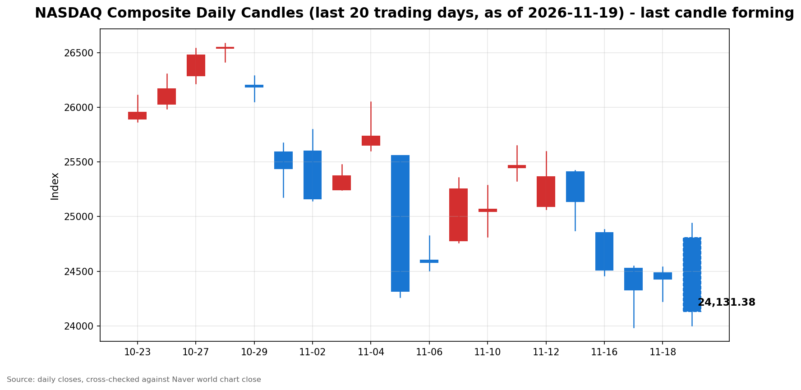

안녕하세요, [한국투자증권](https://securities.koreainvestment.com/main/Main.jsp)에서 [한투-한국투자증권](https://play.google.com/store/apps/details?id=com.truefriend.neosmartarenewal&hl=ko) 개발을 담당하고 있는 way입니다. 
앤트로픽 상장일에 나스닥이 강세로 출발했다가 장중 급반락하며 약세로 돌아섰습니다. 

## 장중 요약

나스닥 종합은 장 초반 앤트로픽 상장 기대감에 1.63%까지 올랐습니다. 
그러나 공매도 보고서가 촉발한 반도체주 급락과 대중 수출통제 강화 소식이 겹치며 상승분을 모두 반납했습니다. 
정오 무렵에는 나스닥이 전일 대비 0.85% 하락했고, 다우는 1.45% 내리며 낙폭이 더 커졌습니다. 
장중 고가에서 저가까지 900포인트가 넘는 큰 변동이 나타났습니다. 
상장일 흥분이 식고 경계 심리가 우위를 점한 장중 흐름입니다. 

## 오늘의 스냅샷

스냅샷 기준 시각은 미국 동부시간 2026년 11월 19일 오후 12시 56분, 한국시간 2026년 11월 20일 오전 2시 56분입니다. 
당일 수치는 장중 형성 중인 값으로, 마감 전에는 계속 변합니다. 

| 지수 | 현재가 | 전일 대비 | 등락률 | 전일 종가 | 장중 고가·저가 |
| --- | --- | --- | --- | --- | --- |
| 나스닥 종합 | 24,223.04 | -206.85 | -0.85% | 24,429.89 | 고가 24,939.62 · 저가 24,005.47 |
| S&P500 | 7,253.62 | -70.01 | -0.96% | 7,323.63 | 고가 7,411.15 · 저가 7,211.13 |
| 다우 | 49,472.69 | -725.48 | -1.45% | 50,198.17 | 확인 필요 |

나스닥 종합과 다우 수치는 [네이버 월드 차트](https://finance.naver.com/world/sise.naver?symbol=NAS@IXIC) 및 [네이버 Npay 증권 나스닥 종합 페이지](https://stock.naver.com/worldstock/index/.IXIC/price)에서 확인한 값입니다. 
S&P500 수치는 한투 MTS 해외 대시보드에서 확인한 값으로, 같은 시각 기준 나스닥 종합 교차값은 24,228.43(-201.46, -0.82%)으로 방향이 일치합니다. 
나스닥 종합의 시가는 24,809.05로, 현재가는 시가 아래에 머물고 있습니다. 
나스닥 선물은 26,941.75로 전일 대비 245.00(-0.90%) 내렸습니다. 
원/달러 환율은 1,333.00원으로 전일 대비 0.70원 내렸습니다(-0.05%). 
미 10년물 국채금리, 달러지수, WTI, 금 선물, VIX 수치는 이번 스냅샷에서 확인되지 않아 확인 필요합니다. 

## 차트

최근 20거래일 일봉 차트입니다. 
빨간 봉은 종가가 시가보다 높은 날, 파란 봉은 종가가 시가보다 낮은 날입니다. 
당일 봉은 형성 중인 봉으로, 마감 전에는 계속 변합니다. 

## 원인·촉매 분석

장 초반 강세의 직접 촉매는 앤트로픽 상장입니다. 
인공지능 모델 클로드의 개발사 앤트로픽이 오늘 나스닥에 티커 ANT로 데뷔합니다. 
공모가는 주당 83달러로 희망 범위 70~78달러를 웃돌았고, 공모와 사모 발행을 합친 조달 규모는 약 1,073억달러로 역대 최대입니다. 
청약 경쟁률은 7배에 달했고, 장외시장에서는 공모가보다 22~26% 높게 출발할 것이라는 관측이 나왔습니다. 
AI 수요에 대한 기대가 다시 살아나며 기술주 전반의 투자 심리를 끌어올렸습니다. 
앤트로픽의 연 환산 매출은 810억달러로 한 달 새 100억달러 늘었습니다. 
구글 등 7개 기업이 주식을 별도로 매입한 점도 수요의 두터움을 보여줍니다. 

반전의 촉매는 반도체를 겨냥한 공매도 보고서입니다. 
헌터브룩 미디어는 오전 10시 27분에 AMD의 중국 수출통제 관련 의혹을 담은 보고서를 냈습니다. 
보고서가 나온 직후 AMD 주가는 장중 한때 11.2%까지 급락했습니다. 
전일 5.31% 올랐던 AMD가 하루 만에 급반락한 것입니다. 
엔비디아의 중국 판매 논란에서 벗어난 대안으로 평가받던 AMD마저 같은 의심을 받게 되면서 반도체 전반의 투자 심리가 흔들렸습니다. 
같은 날 발효된 미국의 대중 AI 칩 수출통제 강화 조치는 공급망 불확실성을 더 키웠습니다. 
싱가포르 등 5개국으로 향하는 첨단 AI 칩에 대한 허가 요건이 새로 생기면서, 중국 노출이 큰 반도체 기업의 규제 리스크가 다시 부각됐습니다. 

배경에는 연준의 긴축 기조가 자리합니다. 
11월 18일 공개된 10월 FOMC 의사록에서 거의 모든 참석자는 추가 금리 인상이 적절하다고 판단했습니다. 
12월 25bp 인상 확률은 CME 페드워치 기준 90.7%로 반영됐습니다. 
10월 생산자물가지수가 4년 만에 최고치를 기록한 점도 긴축 전환의 배경입니다. 
간밤 WTI는 3.7% 내린 배럴당 82.80달러, 미 10년물 금리는 5.06% 수준이었습니다. 
금리 인상 기대는 성장주의 밸류에이션 부담으로 직결돼, 상장 흥분이 식는 속도를 빠르게 만들었습니다. 
상장 당일이라는 이벤트성 재료와 금리·규제라는 구조적 재료가 정반대 방향으로 작용한 장입니다. 

## 핵심 사건 3가지

첫째, 앤트로픽 나스닥 상장입니다. 
오늘 앤트로픽이 나스닥에 상장하며 공모와 사모 발행을 합쳐 약 1,073억달러를 조달했습니다. 
스페이스X의 800억달러를 넘어선 역대 최대 규모입니다. 
공모가 83달러에 청약 경쟁률 7배를 기록했고, 장외시장에서는 공모가보다 22~26% 높게 출발할 것이라는 관측이 나왔습니다. 
아마존은 상장 후 지분 14.7%, 구글은 13.7%를 보유할 것으로 알려졌습니다. 
구글, 엔비디아, AMD, 브로드컴, 마이크론, 마이크로소프트, TSMC 등 7개 기업이 260억달러 규모의 사모 발행에 참여했습니다. 
상장 자체는 AI 수요에 대한 시장의 기대를 확인시켜 줬으나, 첫 거래가 시작되기 전부터 주가가 고점을 찍고 내려오면서 기대감이 실망으로 바뀌는 속도가 빨랐습니다. 
앤트로픽 창업주 7명의 지분 가치는 약 186조원에 달한다는 보도도 나왔습니다. 
역대 최대 상장이라는 상징성이 큰 만큼, 데뷔 첫날의 가격 흐름이 AI 투자 심리의 가늠자가 되고 있습니다. 

둘째, 헌터브룩의 AMD 공매도 보고서입니다. 
헌터브룩 미디어는 11월 19일 오전 10시 27분에 AMD의 중국 문제를 다룬 보고서를 공개했습니다. 
보고서는 미국의 수출 블랙리스트에 오른 중국 서버 업체 IEIT 시스템스가 블랙리스트 등재 이후에도 AMD 펌웨어가 포함된 서버 업데이트를 배포했다고 주장했습니다. 
IEIT는 2025년 3월 미 상무부의 Entity List에 올랐습니다. 
보고서에 따르면 IEIT는 최소 여섯 차례에 걸쳐 블랙리스트 등재 이후 나온 AMD 펌웨어를 업데이트에 넣었고, 가장 최근 업데이트는 2026년 10월 19일에 게시됐습니다. 
헌터브룩 캐피털은 보고서 공개 시점에 AMD에 대한 공매도 포지션을 보유하고 있다고 밝혔습니다. 
AMD 주가는 보고서 직후 한때 11.2% 급락해 470.56달러까지 밀렸고, 오전 11시 21분 기준으로는 493.16달러로 전일 종가 530.14달러 대비 7.0% 내린 상태였습니다. 
다만 헌터브룩 스스로도 조사 결과가 AMD의 수출통제 위반을 입증하지는 않는다고 밝혔습니다. 
AMD는 미국의 수출통제법을 준수하고 있으며 보고서 주장이 자사 관행을 잘못 전하고 있다는 입장을 냈습니다. 
사실 여부와 별개로, 규제 리스크가 실적 기대를 압도하는 구도가 반도체주 전반으로 번졌습니다. 

셋째, 대중 AI 칩 수출통제 강화 조치의 당일 발효입니다. 
미국 상무부의 임시 최종 규칙이 11월 19일 발효됐습니다. 
싱가포르, 말레이시아, 인도네시아, 태국, 브라질로 향하는 첨단 AI 칩과 서버에 대해 허가가 필요해졌습니다. 
미국 본사 기업에 대한 예외는 있으나, 중국 본사 기업에 서비스를 제공하는 데이터센터도 적용 대상에 포함됐습니다. 
블랙리스트 기업의 지분 50% 이상을 보유한 외국 기업으로 규제를 확대하는 계열사 규칙은 2027년 1월 10일까지 유예가 연장됐습니다. 
이 조치는 AMD 보고서와 같은 날 겹치면서 반도체 공급망의 규제 불확실성을 한층 부각시켰습니다. 
엔비디아의 중국 판매 논란에 이어 AMD까지 같은 틀에서 다뤄지면서, AI 칩 기업의 중국 노출 자체가 할인 요인으로 작용하고 있습니다. 
규제의 방향이 완화보다 강화 쪽으로 기울었다는 점이 시장의 심리를 무겁게 누르고 있습니다. 

## 지수·섹터 영향 체인

반도체가 직접적인 타격 지점입니다. 
AMD 보고서가 반도체 섹터 전반의 규제 리스크를 다시 소환했습니다. 
엔비디아는 전날 호실적에도 주가가 하락하며 AI 투자 심리에 균열을 남긴 상태였습니다. 
엔비디아는 전날까지 5거래일 연속 하락했습니다. 
AI 하드웨어 공급망에 속한 기업들은 중국 매출 비중과 규제 노출이 함께 재평가받고 있습니다. 
AMD의 2025 회계연도 중국·홍콩 매출 비중은 22.4%로, 77억5천만달러에 달합니다. 
규제 리스크가 부각될 때 중국 노출이 큰 기업일수록 할인 폭이 커지는 구조입니다. 

금리 경로는 성장주 밸류에이션을 압박합니다. 
연준의 추가 인상 가능성과 12월 인상 확률 90.7%는 미래 현금흐름의 할인율을 높입니다. 
상장 흥분으로 올랐던 기술주가 장중 급반락한 배경에는 이 할인율 부담이 있습니다. 
앤트로픽 상장이라는 호재가 기술주 전반을 끌어올렸으나, 금리라는 구조적 부담이 더 오래 작용했습니다. 

다우의 낙폭이 나스닥보다 큰 점도 주목됩니다. 
다우는 전일 대비 1.45% 내리며 나스닥 0.85%보다 더 크게 떨어졌습니다. 
금리 인상 기대는 경기민감주와 전통 산업주에도 부담으로 작용합니다. 
S&P500은 0.96% 하락하며 두 지수의 중간에 머물렀습니다. 
기술주 중심의 충격이 장중에는 시장 전반의 약세로 확산된 흐름입니다. 

원/달러 환율은 1,333.00원으로 0.05% 내리며 안정된 모습을 보였습니다. 
달러가 크게 오르지 않은 점은 긴축 우려 속에서도 외환시장이 과도하게 흔들리지 않았음을 보여줍니다. 
비트코인이 9천만원 아래로 내려가고 현물 ETF에서 7거래일 연속 자금이 빠져나간 점은 위험자산 전반의 심리 위축과 같은 방향입니다. 

## 다우·S&P500 흐름

다우는 49,472.69로 전일 대비 725.48포인트(-1.45%) 내렸습니다. 
전일 종가는 50,198.17입니다. 
오전에는 0.06% 내리는 데 그쳤으나, 장중 낙폭이 빠르게 확대됐습니다. 
S&P500은 7,253.62로 전일 대비 70.01포인트(-0.96%) 내렸습니다. 
전일 종가는 7,323.63이며, 장중 고가 7,411.15에서 저가 7,211.13까지 200포인트 가까이 움직였습니다. 
세 지수가 모두 하락하며 오전의 차별화는 사라졌습니다. 
나스닥의 낙폭이 상대적으로 작다는 점은 기술주 반락에도 지수 하방이 다우 쪽에서 더 크게 열렸음을 보여줍니다. 

## 오전과 오후 흐름 변화

오전 10시 1분 기준 나스닥은 24,827.18로 전일 대비 1.63% 올랐습니다. 
다우는 0.06% 내리며 엇갈렸고, S&P500은 0.79% 올랐습니다. 
오후 12시 56분 기준 나스닥은 24,223.04로 전일 대비 0.85% 하락했습니다. 
약 3시간 만에 나스닥은 604.14포인트, 2.43%포인트 방향을 바꿨습니다. 
장중 고가 24,939.62에서 현재가까지는 716.58포인트, 2.87% 내려왔습니다. 
다우도 같은 기간 693.42포인트 더 내리며 낙폭을 1.45%까지 키웠습니다. 
S&P500도 127.85포인트 내려가며 상승분을 반납하고 하락 전환했습니다. 
시가 대비로 보면 나스닥은 시가 24,809.05 아래로 내려오며 방향이 완전히 뒤집혔습니다. 
오전의 강세는 상장 이벤트에 기댄 단기 흐름이었고, 오후에는 규제와 금리라는 재료가 우위를 점했습니다. 

## 마감까지 전망과 확인할 시나리오

장중 반락이 일시적 노이즈인지 지속 흐름인지는 마감까지 확인할 재료가 갈라줍니다. 
첫째, 앤트로픽 ANT의 첫 거래 가격 흐름입니다. 
나스닥 개장 경매를 거쳐 형성되는 초가는 AI 투자 심리의 바로미터가 됩니다. 
공모가 83달러 대비 높은 수준에서 안착하면 기술주 심리가 일부 되돌아올 수 있습니다. 
반대로 기대에 못 미치는 출발이면 상장 흥분의 되돌림이 더 이어질 수 있습니다. 

둘째, 나스닥 24,000선 방어 여부입니다. 
장중 저가는 24,005.47로 24,000선에 바짝 다가섰습니다. 
24,000선이 무너지면 심리적 지지선이 사라지며 낙폭이 확대될 수 있습니다. 
반대로 24,000선을 지키고 저가 매수세가 들어오면 낙폭 축소 흐름이 나올 수 있습니다. 
장중 고가 24,939.62와 저가 24,005.47 사이의 900포인트 넘는 변동폭은 마감까지 변동성이 이어질 가능성을 보여줍니다. 

셋째, AMD와 반도체 섹터의 추가 소식입니다. 
AMD의 반박 입장에 대해 규제 당국의 추가 언급이나 후속 보도가 나오는지가 관건입니다. 
수출통제 규칙의 세부 적용 범위가 명확해지면 반도체 섹터의 불확실성이 줄어들 수 있습니다. 
반대로 새로운 의혹이 제기되면 섹터 전반의 약세가 이어질 수 있습니다. 

넷째, 금리 관련 발언과 지표입니다. 
연준 인사들의 발언이 12월 인상 기대를 더 키우는지, 진정시키는지가 성장주 흐름을 좌우합니다. 
국채금리 움직임도 함께 확인할 필요가 있습니다. 
리스크 관리 관점에서는 마감까지 변동성이 큰 구간이 이어질 수 있어, 지수 단위의 방향 전환 신호를 확인할 때까지 신중한 접근이 필요합니다. 

## 마치며

앤트로픽 상장일에 나스닥은 강세로 출발했다가 반도체 규제 리스크와 금리 부담에 밀려 약세로 돌아섰습니다. 
마감까지는 ANT 첫 거래와 24,000선 방어, AMD 관련 후속 소식이 흐름을 가를 것으로 보입니다. 
이 글은 시황 해설을 목적으로 하며, 특정 종목의 매수나 매도를 권유하는 내용이 아닙니다. 
