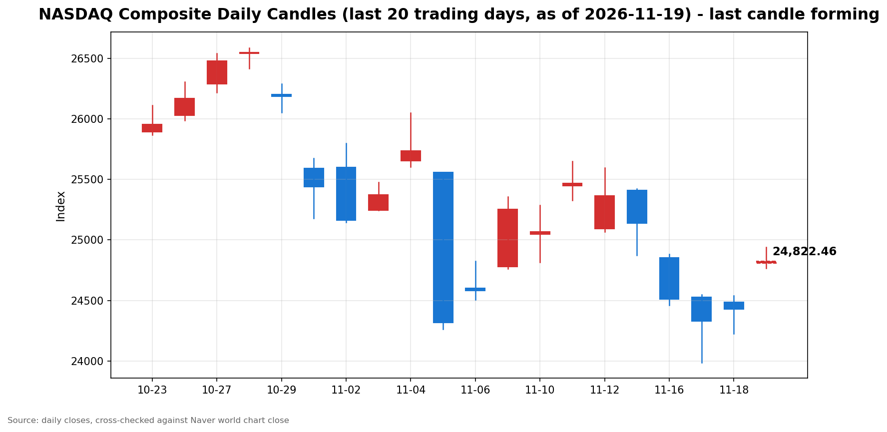

안녕하세요, [한국투자증권](https://securities.koreainvestment.com/main/Main.jsp)에서 [한투-한국투자증권](https://play.google.com/store/apps/details?id=com.truefriend.neosmartarenewal&hl=ko) 개발을 담당하고 있는 way입니다. 
앤트로픽 상장일에 나스닥이 강세로 장을 열었고, 다우는 약보합으로 엇갈렸습니다. 

## 개장 배경

전일인 2026년 11월 18일 나스닥 종합은 24,429.89로 마감했습니다. 
전일 대비 0.42% 오른 수치입니다. 
11월 17일 0.74% 하락 뒤 하루 만에 반등한 흐름이었습니다. 
다만 엔비디아는 호실적에도 주가가 하락하며 AI 투자 심리에 균열을 남겼습니다. 
국내 증시는 11월 19일 코스피 5,137.89로 1.39% 오르며 5,100선을 되찾았습니다. 
코스닥도 3.3% 오르며 강세를 보였습니다. 
외국인은 5거래일째 순매도를 이어갔으나 개인과 기관이 하방을 받쳤습니다. 
오늘 미국 증시의 최대 관심사는 나스닥에 데뷔하는 앤트로픽 상장입니다. 

## 오늘의 스냅샷

스냅샷 기준 시각은 미국 동부시간 2026년 11월 19일 오전 10시 1분, 한국시간 2026년 11월 20일 오전 0시 1분입니다. 
당일 수치는 장중 형성 중인 값으로, 마감 전에는 계속 변합니다. 

| 지수 | 현재가 | 전일 대비 | 등락률 | 전일 종가 | 장중 고가·저가 |
| --- | --- | --- | --- | --- | --- |
| 나스닥 종합 | 24,827.18 | +397.29 | +1.63% | 24,429.89 | 고가 24,939.62 · 저가 24,765.20 |
| S&P500 | 7,381.47 | +57.84 | +0.79% | 7,323.63 | 고가 7,411.15 · 저가 7,381.00 |
| 다우 | 50,166.11 | -32.06 | -0.06% | 50,198.17 | 고가 50,454.81 · 저가 50,137.22 |

나스닥 종합과 다우 수치는 [네이버 월드 차트](https://finance.naver.com/world/sise.naver?symbol=NAS@IXIC) 및 [네이버 Npay 증권 나스닥 종합 페이지](https://stock.naver.com/worldstock/index/.IXIC/price)에서 확인한 값입니다. 
S&P500 수치는 한투 MTS 해외 대시보드에서 확인한 값으로, 같은 시각 기준 나스닥 종합 교차값은 24,808.70(+378.81, +1.55%)으로 방향이 일치합니다. 
나스닥 종합의 시가는 24,809.05로, 현재가는 시가 위에 머물고 있습니다. 
나스닥 선물은 27,719.75로 전일 대비 533.00(+1.96%) 올랐습니다. 
원/달러 환율은 1,329.50원으로 전일 대비 4.20원 내렸습니다(-0.31%). 
미 10년물 국채금리, 달러지수, WTI, 금 선물, VIX 수치는 이번 스냅샷에서 확인되지 않아 확인 필요합니다. 

## 차트

최근 20거래일 일봉 차트입니다. 
빨간 봉은 종가가 시가보다 높은 날, 파란 봉은 종가가 시가보다 낮은 날입니다. 
당일 봉은 형성 중인 봉으로, 마감 전에는 계속 변합니다. 

## 원인·촉매 분석

장 초반 강세의 직접 촉매는 앤트로픽 상장입니다. 
인공지능 모델 클로드의 개발사 앤트로픽이 오늘 나스닥에 티커 ANT로 데뷔합니다. 
공모가는 주당 83달러로 확정됐고, 공모와 사모 발행을 합친 조달 규모는 약 1,073억달러로 역대 최대입니다. 
청약 경쟁률은 7배에 달했고, 장외시장에서는 공모가보다 22~26% 높게 출발할 것이라는 관측이 나왔습니다. 
AI 수요에 대한 기대가 다시 살아나며 기술주 전반의 투자 심리를 끌어올렸습니다. 
앤트로픽의 연 환산 매출은 810억달러로 한 달 새 100억달러 늘었습니다. 
구글 등 7개 기업이 주식을 별도로 매입한 점도 수요의 두터움을 보여줍니다. 
다만 순환금융 구조에서 성장 속도를 유지할 수 있을지는 지켜봐야 할 변수로 거론됩니다. 

반대 방향의 힘은 연준의 긴축 기조입니다. 
11월 18일 공개된 10월 FOMC 의사록에서 거의 모든 참석자는 추가 금리 인상이 적절하다고 판단했습니다. 
일부는 물가 지표가 불리하면 25bp 이상 인상을 고려할 수 있다는 입장도 내놨습니다. 
12월 25bp 인상 확률은 금리선물 시장에 91.1% 반영됐습니다. 
크리스토퍼 월러 연준 이사는 물가 억제를 위해 금리를 대폭 인상해야 한다는 입장을 밝혔습니다. 
지난해 세 차례 단행한 금리인하를 되돌릴 수도 있다는 언급도 나왔습니다. 
뱅크오브아메리카는 연준이 12월과 내년 3월에 두 차례 금리를 올릴 것으로 예상했습니다. 
존 윌리엄스 뉴욕 연은 총재는 극적인 금리인상은 필요 없다며 점진적 대응을 강조했습니다. 
10월 생산자물가지수(PPI)가 4년 만에 최고치를 기록한 점도 긴축 전환의 배경입니다. 

지수 간 방향 차이는 뚜렷합니다. 
나스닥은 1.63% 올랐지만 S&P500은 0.79% 오르는 데 그쳤고, 다우는 0.06% 내렸습니다. 
AI·상장 촉매가 기술주를 끌어올린 반면, 금리 인상 기대는 경기민감·전통 종목에 부담으로 작용한 구도입니다. 
비트코인이 9천만원 아래로 내려가고 현물 ETF에서 7거래일 연속 자금이 빠져나간 점도 긴축 우려가 위험자산 심리에 번지고 있음을 보여줍니다. 
원/달러 환율이 0.31% 내린 것은 달러가 크게 오르지 않으며 긴축 우려 속에서도 외환시장이 안정을 찾고 있음을 보여줍니다. 
트럼프 대통령이 APEC 연설에서 AI 규제가 기술 개발을 저해한다고 경고한 점도 AI 투자 심리에는 우호적인 재료입니다. 

## 핵심 사건 3가지

첫째, 앤트로픽 나스닥 상장입니다. 
오늘 앤트로픽이 나스닥에 상장하며 공모와 사모 발행을 합쳐 약 1,073억달러를 조달했습니다. 
스페이스X의 800억달러를 넘어선 역대 최대 규모입니다. 
공모가 83달러에 청약 경쟁률 7배를 기록했고, 장외시장에서는 공모가보다 22~26% 높게 출발할 것이라는 관측이 나왔습니다. 
상장 전 AI 관련주 수급 부담의 원인이었던 대규모 자금 확충이 마무리되면서, 수급 부담 완화 기대가 커지고 있습니다. 
증권가에서는 상장이 AI 랠리 재개의 계기가 될 수 있다는 전망이 나옵니다. 
다만 블룸버그 오피니언은 앤트로픽의 질주를 주사위 던지기에 비유하며 밸류에이션 검증을 주문했습니다. 
상장 첫날 주가 흐름이 AI 거품론 논쟁의 분기점이 될 전망입니다. 

둘째, 10월 FOMC 의사록 공개와 추가 인상 기조입니다. 
연준이 11월 18일 공개한 10월 27~28일 FOMC 의사록에서 거의 모든 참석자는 추가 금리 인상이 적절하다고 판단했습니다. 
일부는 물가 데이터가 불리하면 25bp 이상 인상도 고려할 수 있다는 입장을 밝혔습니다. 
금리선물 시장에는 12월 25bp 인상 확률이 91.1% 반영됐습니다. 
월러 이사는 지난해 세 차례 인하를 되돌릴 수도 있다고 언급했습니다. 
이는 금리 인하 기대에서 인상 기대로의 전환이 확인된 사건입니다. 
성장주 밸류에이션과 달러, 금 등 자산 가격 전반에 구조적 압력으로 작용합니다. 
다만 윌리엄스 총재의 점진적 대응 발언처럼 인상 속도를 둘러싼 내부 이견도 남아 있습니다. 

셋째, 엔비디아 호실적에도 주가 하락입니다. 
엔비디아는 11월 17일 장 마감 뒤 실적을 발표했으나 주가는 하락했습니다. 
매출 가이던스가 시장의 높은 기대에는 못 미쳤다는 평가가 나왔고, 시간 외 거래에서 4% 가까이 내렸습니다. 
젠슨 황 전 최고경영자(CEO)의 사임 배경과 후속 조사, 후계구도에 대한 설명이 나오지 않은 점도 부담으로 작용했습니다. 
미국 정부의 중국 대상 첨단 반도체 수출 제한도 반도체 업종의 리스크 요인으로 거론됩니다. 
실적 수치 자체는 AI 수요의 지속을 확인시켜줬으나, 경영 불확실성이 주가에는 더 크게 작용한 셈입니다. 
국내 증시에서도 엔비디아 약세 여파로 반도체 대형주가 장 초반 약세를 보인 뒤 반등했습니다. 
실적과 주가의 괴리는 AI 랠리의 신뢰 변수가 경영 리스크로 옮겨가고 있음을 보여줍니다. 

## 지수·섹터 영향 체인

기술·반도체 섹터는 상장 촉매와 경영 리스크가 맞물린 구간입니다. 
앤트로픽 상장이 AI 수요 기대를 되살린 반면, 엔비디아의 CEO 리스크와 중국 수출 통제는 반도체 밸류체인에 부담을 줍니다. 
알리바바는 매출이 예상을 소폭 웃돌았으나 분기 잉여현금흐름이 마이너스 345억위안을 기록하며 AI 투자에 현금이 녹고 있음을 보여줬습니다. 
메타가 연말 보너스를 폐지해 내년 AI 투자금으로 쓰겠다고 밝힌 점도 같은 맥락입니다. 
AI 투자 확대가 지속적 물가 상승 요인이라는 윌리엄스 총재의 언급처럼, AI 지출은 인플레이션 경로와도 연결돼 있습니다. 

금리 경로는 섹터별로 다르게 작용합니다. 
금리 인상 기대는 할인율 상승으로 성장주 밸류에이션에 부담을 줍니다. 
그럼에도 나스닥이 오른 것은 상장이라는 개별 촉매가 금리 부담을 일시적으로 앞선 결과입니다. 
금융 섹터는 금리 상승의 수혜와 경기 둔화 우려 사이에서 방향이 갈립니다. 
무디스가 미 은행 6곳의 등급을 강등한 점도 금융 섹터에는 부담 요인입니다. 
강등 사유는 은행 실패 시 정부 지원에 대한 불확실성이었습니다. 
에너지 섹터 방향은 유가 수치가 확인되지 않아 확인 필요합니다. 

## 다우·S&P500 흐름

다우는 50,166.11로 전일 대비 0.06% 내리며 장을 열었습니다. 
전일 종가는 50,198.17이었습니다. 
시가는 50,432.32였으나 장 초반 266포인트가량 내리며 약세로 돌아섰습니다. 
장중 고가는 50,454.81, 저가는 50,137.22입니다. 
금리 인상 기대와 은행 등급 강등이 전통·경기민감 종목을 눌렀습니다. 
S&P500은 7,381.47로 전일 대비 0.79% 올랐습니다. 
전일 종가는 7,323.63이었습니다. 
기술주 상승이 그 외 섹터 약세를 앞선 결과로 보입니다. 
나스닥과 다우의 엇갈림은 AI·기술 대 경기민감이라는 장 초반의 구도를 보여줍니다. 

## 단기·중기 전망과 장 초반 확인할 시나리오

단기적으로는 상장 촉매의 지속 여부를 가리는 구간입니다. 
앤트로픽 상장 첫날 강세가 AI 랠리 재개로 이어지는지, 하루짜리 이벤트에 그치는지는 장중 움직임으로 가늠해야 합니다. 
연준의 추가 인상 기조가 이어지는 만큼 금리와 달러 움직임도 함께 확인해야 합니다. 

장 초반에 확인할 수치는 다음과 같습니다. 
나스닥이 장중 고가인 24,939.62를 넘어 25,000선에 안착하는지 확인합니다. 
전일 종가인 24,429.89가 지지선으로 작용하는지 확인합니다. 
S&P500이 7,400선에 안착하는지 확인합니다. 
다우가 50,000선을 지키는지 확인합니다. 
오늘 발표될 미국 경제지표도 단기 방향을 가를 변수입니다. 

시나리오는 지수·섹터 단위로 나눠 봅니다. 
앤트로픽 상장 첫날 강세가 이어지면 기술주 중심의 강세가 지속될 수 있습니다. 
상장 차익 실현이 나오고 밸류에이션 부담이 부각되면 장 초반 상승분은 반납될 수 있습니다. 
다우 약세가 심화되면 경기민감주 전반으로 약세가 확산되는지 확인해야 합니다. 
중기적으로는 AI 수요 지속 여부와 금리 경로가 함께 가늠돼야 합니다. 
엔비디아의 후계구도와 중국 수출 통제는 반도체를 둘러싼 구조적 변수로 남아 있습니다. 
트럼프·시진핑·푸틴 3자 정상회담 등 지정학적 변수도 시장의 관심사입니다. 

## 마치며

앤트로픽 상장이라는 대형 촉매가 나스닥을 끌어올리며 장을 열었습니다. 
다만 연준의 추가 인상 기조가 이어지는 만큼, 상승의 지속 여부는 장 초반 주요 가격 레벨과 금리 움직임으로 확인해야 합니다. 
이 글은 교육·해설 목적의 시황 정리이며, 특정 종목의 매수·매도 권유가 아닙니다. 
