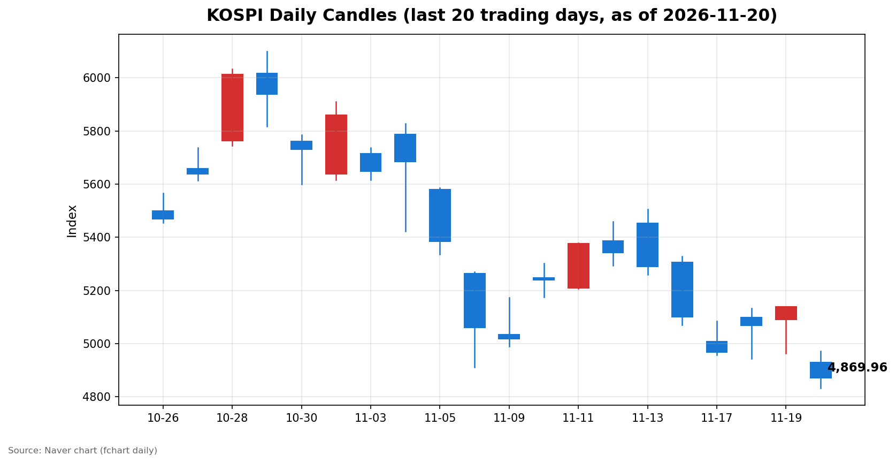
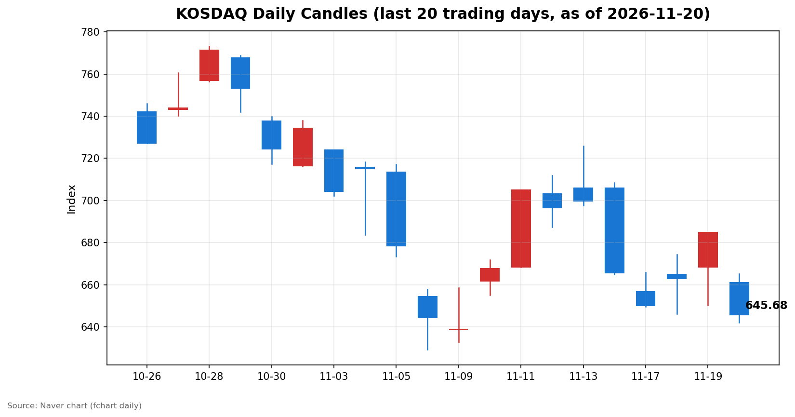

안녕하세요, [한국투자증권](https://securities.koreainvestment.com/main/Main.jsp)에서 [한투-한국투자증권](https://play.google.com/store/apps/details?id=com.truefriend.neosmartarenewal&hl=ko) 개발을 담당하고 있는 way입니다. 
2026년 11월 20일 국내 증시 마감 상황을 정리했습니다. 

## 마감 요약

코스피는 4,869.96으로 전일 대비 267.93포인트, 5.21% 하락했습니다. 
코스닥은 645.68로 전일 대비 39.13포인트, 5.71% 하락했습니다. 
양 지수 모두 5% 넘게 급락하며 유가증권시장과 코스닥시장에서 매도 사이드카가 동시에 발동됐습니다. 
코스피는 1월 16일 이후 최저 수준으로 내려갔고, 5,000선을 내줬습니다. 
외국인과 기관이 코스피에서 2조 원 넘게 순매도했고, 개인이 물량을 받아냈습니다. 
반도체 대형주가 하락을 주도한 반면, 중국발 개방 기대가 있는 여행·엔터·뷰티 테마는 강세를 보였습니다. 

## 오늘의 마감 스냅샷

| 지수 | 종가 | 전일 대비 | 등락률 | 시가 | 고가 | 저가 | 거래량 | 거래대금 |
| --- | --- | --- | --- | --- | --- | --- | --- | --- |
| 코스피 | 4,869.96 | -267.93 | -5.21% | 4,928.51 | 4,971.31 | 4,831.69 | 1억 9,370만 주 | 14조 1,064억 원 |
| 코스닥 | 645.68 | -39.13 | -5.71% | 660.98 | 665.15 | 642.13 | 3억 8,400만 주 | 4조 1,366억 원 |

스냅샷은 네이버 실시간 데이터를 기준으로 하며, 전일 종가는 네이버 실시간 등락률로 역산한 값과 일봉 종가가 일치하는 것을 확인했습니다. 
코스피 전일 종가는 5,137.89, 코스닥 전일 종가는 684.81입니다. 
원·달러 환율은 주간 거래 종가 기준 1,336.2원으로 전일 대비 6.2원 상승했습니다. 
자세한 지수 흐름은 [코스피](https://finance.naver.com/sise/sise_index.naver?code=KOSPI)와 [코스닥](https://finance.naver.com/sise/sise_index.naver?code=KOSDAQ)에서 확인할 수 있습니다. 

## 차트

최근 20거래일 일봉 차트입니다. 
빨간 봉은 종가가 시가보다 높은 날, 파란 봉은 종가가 시가보다 낮은 날입니다. 

## 원인·촉매 분석

오늘 장의 급락은 네 가지 촉매가 겹치며 만들어졌습니다. 
첫째, 미국 기술주 급락이 국내 증시로 전이됐습니다. 
11월 19일 뉴욕 증시는 장 초반 상승분을 모두 반납하고 전강후약으로 마감했습니다. 
나스닥은 2.25% 내린 23,879.20, 다우는 2.19% 내린 40,907.06, S&amp;P 500은 2.02% 내린 7,175.83으로 마감했습니다. 
중앙일보 GMC의 11월 20일자 G모닝 브리핑은 급락의 방아쇠로 앤트로픽 상장 이후 차익실현 매물과 엔비디아 실적 발표를 앞둔 경계심을 지목했습니다. 
S&amp;P 500이 핵심 지지선인 7,300선을 이탈했고, VIX는 장중 28.99까지 치솟았습니다. 
둘째, 인공지능 투자 수익성에 대한 의문이 커졌습니다. 
앤트로픽은 총 1,073억 달러를 조달하며 나스닥에 데뷔했고 공모가 83달러 대비 종가 97.17달러로 무난하게 출발했습니다. 
그러나 인공지능 인프라 투자 규모에 비해 수익성이 충분하지 않을 수 있다는 우려가 확산되며 기술주 전반이 약세를 보였습니다. 
일본 소프트뱅크 주가는 장중 16% 넘게 폭락했고, 아시아 기술주가 일제히 급락했습니다. 
셋째, 미국의 대중 반도체 규제 강화 우려와 AMD를 둘러싼 공매도 리포트가 반도체주에 직접적인 부담으로 작용했습니다. 
AMD는 7.72% 하락했고, 엔비디아는 3.30% 하락했습니다. 
국내에서는 삼성전자가 7.01% 내린 183,100원, SK하이닉스가 5.92% 내린 1,113,000원으로 마감하며 지수 하락을 주도했습니다. 
넷째, 환율과 수급이 하락을 증폭시켰습니다. 
원·달러 환율은 장중 1,340.3원까지 올랐다가 1,336.2원으로 마감했습니다. 
달러 강세와 위험회피 심리가 외국인 매도를 자극했고, 외국인 매도는 다시 환율 상승 압력으로 이어지는 구도가 나타났습니다. 
외국인은 코스피에서 1조 1,335억 원, 기관은 9,508억 원을 순매도했습니다. 
개인은 1조 5,956억 원을 순매수하며 물량을 받아냈지만, 지수 하락을 막지 못했습니다. 
기관 내부에서는 연기금만 845억 원을 순매수했고, 금융투자·투신·사모펀드가 모두 순매도에 나섰습니다. 
외국인과 기관이 함께 파는 구도는 단기 반등의 동력이 약하다는 점을 보여줍니다. 

## 핵심 사건 3가지

### 1. 코스피·코스닥 5%대 급락, 매도 사이드카 동시 발동

코스피와 코스닥이 장중 5% 넘게 급락하며 두 시장에 매도 사이드카가 동시에 발동됐습니다. 
코스닥 매도 사이드카는 오후 1시 28분에 발동됐고, 코스피 매도 사이드카도 장중에 발동됐습니다. 
유가증권시장에서 매도 사이드카가 발동된 것은 11월 6일 이후 10거래일 만입니다. 
발동 시점까지 프로그램 매매는 코스피에서 9,262억 원, 코스닥에서 1,998억 원 순매도를 기록했습니다. 
코스피는 장중 저점 4,831.69까지 내려가 전일 종가 대비 5.96% 하락했고, 종가는 4,869.96으로 1월 16일 이후 최저 수준을 기록했습니다. 
서킷브레이커 발동 기준인 전일 대비 8% 하락에는 도달하지 않았습니다. 
사이드카는 프로그램 매도호가의 효력을 5분간 정지시키는 장치이며, 하락 자체를 멈추게 하는 제도는 아닙니다. 
발동 이후에도 매도세가 이어졌다는 점은 하락의 동력이 프로그램 매매를 넘어섰음을 보여줍니다. 

### 2. 앤트로픽 상장 이후 인공지능 수익성 논란 확산

미국 인공지능 기업 앤트로픽의 나스닥 상장은 역대 최대 규모로 진행됐습니다. 
공모가는 주당 83달러로 확정됐고, 상장 첫날 종가는 97.17달러를 기록했습니다. 
그러나 상장이 인공지능 투자 열기를 되살리기는커녕, 인프라 투자 대비 수익성에 대한 의문을 키우는 계기가 됐습니다. 
앤트로픽 상장 이후 오픈AI의 기업가치와 향후 상장 흥행에 대한 불확실성이 부각됐다는 분석이 나왔습니다. 
시장의 관심은 인공지능 모델 자체보다, 막대한 투자금을 언제 회수할 수 있는지로 옮겨가고 있습니다. 
중앙일보 GMC의 11월 20일자 리포트는 엔비디아의 실적 서프라이즈에도 주가가 3.30% 하락한 현상을 짚었습니다. 
2027년 데이터센터 매출 전망이 월가 기대에 못 미치고, 블랙웰 램프업에 따른 마진 압박 우려가 제기됐다는 설명입니다. 
실적 호조에도 주가가 내리는 구도는 인공지능 사이클의 기대치가 이미 매우 높게 형성돼 있음을 보여줍니다. 
국내 반도체주는 미국 반도체주 하락과 직접 연결돼 있습니다. 
필라델피아 반도체 지수가 4.47% 하락했고, TSMC도 5.43% 내렸습니다. 
국내 반도체 대형주의 급락은 개별 기업 요인보다 글로벌 인공지능 밸류에이션 재평가 흐름의 일부로 해석됩니다. 

### 3. 한국 수출, 사상 첫 연간 1조 달러 돌파

한국의 연간 수출이 11월 19일 사상 처음으로 1조 달러를 넘어섰습니다. 
세계에서 연간 수출 1조 달러를 달성한 국가는 미국, 중국, 독일에 이어 한국이 네 번째입니다. 
누적 수출액은 1조 15억 달러를 기록했고, 1조 달러를 돌파하는 마지막 수출 품목은 반도체였습니다. 
산업통상부와 경제 6단체는 1조 달러 달성을 새로운 출발선으로 삼아, 수출 온기의 경제 전반 확산과 반도체를 이을 성장동력 육성을 과제로 제시했습니다. 
급락장 속에서도 수출 1조 달러는 경제 체력에 대한 구조적 평가를 바꾸는 재료입니다. 
다만 당일 시장에서는 인공지능 우려와 외국인 매도세가 수출 호재를 압도했습니다. 
단기 지수 방향은 수급이 결정하고, 수출 기록은 중기적인 신뢰 요인으로 작용하는 구도입니다. 

## 섹터·테마 영향 체인

오늘 장의 영향 체인은 인공지능 밸류에이션 재평가에서 출발했습니다. 
미국 기술주 약세는 반도체 밸류에이션에 대한 의문으로 이어졌고, 국내 반도체 대형주가 직접 타격을 받았습니다. 
삼성전자와 SK하이닉스의 급락은 코스피 시가총액 상위를 차지하는 비중 때문에 지수 전체를 끌어내렸습니다. 
지수 하락은 프로그램 매도를 자극했고, 매도 사이드카 발동으로 이어졌습니다. 
사이드카 발동 이후에도 외국인 매도가 이어지며 환율이 올랐고, 환율 상승은 다시 외국인 매도 압력을 높이는 순환이 나타났습니다. 
광통신과 통신장비 테마도 약세를 보였습니다. 
북미 데이터센터 수요 확대와 미국의 중국산 규제 기대감에도 불구하고, 대한광통신은 1.96%, 성호전자는 5.94% 하락했습니다. 
2차전지 테마도 약세였습니다. 
LG에너지솔루션은 1.16% 하락했고, 삼성SDI는 3분기 흑자 전환과 ESS 수주 소식에도 하락세를 보였습니다. 
반면 중국발 개방 기대가 있는 테마는 강세를 보였습니다. 
한중 FTA 후속협상 실질 타결과 중국 여행사의 방한 상품 직접 판매 허용 소식이 여행·콘텐츠·항공·엔터테인먼트 테마로 이어졌습니다. 
노랑풍선은 10.63% 올랐고, 제주항공은 2.51% 올랐습니다. 
K팝·엔터테인먼트 테마에서는 에스엠이 3.05% 올랐고, 와이지엔터테인먼트도 상승했습니다. 
K뷰티 테마도 강했습니다. 
삐아는 자기주식 소각 결정에 29.95% 올랐고, 마녀공장은 18.59% 올랐습니다. 
GLP-1·비만치료제 테마에서는 한미약품이 6.75% 올랐습니다. 
M&amp;A·경영권 이슈 테마에서는 한진칼이 9.49% 올랐습니다. 
호반그룹이 한진칼 최대주주로 올라서고 조원태 회장이 추가 매수를 추진하면서 지배구조 변화 가능성이 주목받았습니다. 
시장 전체가 급락하는 가운데서도 재료가 있는 테마로는 자금이 순환했습니다. 
다만 강세 테마의 상승은 지수 하락을 상쇄하기에는 규모가 작았습니다. 

## 최근 5거래일 일봉

| 날짜 | 코스피 시가 | 코스피 고가 | 코스피 저가 | 코스피 종가 | 코스닥 종가 |
| --- | --- | --- | --- | --- | --- |
| 11월 16일 | 5,305.40 | 5,327.99 | 5,069.83 | 5,100.50 | 665.65 |
| 11월 17일 | 5,008.09 | 5,084.06 | 4,957.00 | 4,968.48 | 650.06 |
| 11월 18일 | 5,098.82 | 5,133.14 | 4,943.17 | 5,067.44 | 662.81 |
| 11월 19일 | 5,090.04 | 5,137.89 | 4,963.61 | 5,137.89 | 684.81 |
| 11월 20일 | 4,928.51 | 4,971.31 | 4,831.69 | 4,869.96 | 645.68 |

코스피는 11월 17일 종가 4,968.48을 저점으로 이틀 반등했다가 오늘 급락하며 저점을 다시 밑돌았습니다. 
코스닥도 11월 17일 종가 650.06에서 이틀 반등했다가 오늘 645.68로 저점을 다시 밑돌았습니다. 
코스피는 11월 13일 종가 5,290.53보다 7.95% 낮은 수준입니다. 
코스닥도 같은 기간 699.66보다 7.72% 낮은 수준입니다. 
일주일 사이 하락 폭이 커졌다는 점에서, 단기 반등은 되돌림에 그쳤다고 해석됩니다. 

## 당일 수급

코스피에서는 외국인이 1조 1,335억 원을 순매도했습니다. 
외국인 매도는 11월 19일의 4,085억 원보다 크게 늘었고, 11월 16일과 17일의 1조 원대 매도 규모에 다시 근접했습니다. 
기관도 9,508억 원을 순매도했습니다. 
기관 내부에서는 금융투자가 4,655억 원, 투신이 3,088억 원, 사모펀드가 2,203억 원을 순매도했습니다. 
연기금은 845억 원을 순매수하며 기관 내부에서 유일하게 매수 우위를 보였습니다. 
개인은 1조 5,956억 원을 순매수했고, 기타법인은 4,888억 원을 순매수했습니다. 
개인과 기타법인이 외국인·기관 매도 물량을 받아냈지만, 지수는 5% 넘게 하락했습니다. 
개인 매수세가 하락을 방어하지 못했다는 점은, 하락 국면에서 개인의 매수 여력이 아니라 외국인의 매도 강도가 지수 방향을 결정했음을 보여줍니다. 
코스닥에서는 외국인이 1,711억 원, 기관이 1,080억 원을 순매도했습니다. 
개인은 2,913억 원을 순매수했습니다. 
코스닥 기관 내부에서는 투신이 553억 원, 사모펀드가 449억 원을 순매도했습니다. 
당일 수급은 네이버 시장동향 API 최종값을 기준으로 했습니다. 
수급 수치는 네이버 시장동향 API와 KIS MTS 대시보드의 집계 범위 차이로 일부 언론 보도 수치와 소폭 다를 수 있습니다. 

## 강했던 테마와 흐름

M&amp;A·경영권 이슈 테마가 강세를 보였습니다. 
한진칼은 지배구조 변화 가능성에 9.49% 올랐고, 노랑풍선은 중국인 관광객 유입 기대에 10.63% 올랐습니다. 
K뷰티 테마도 강했습니다. 
삐아는 자기주식 소각 결정에 29.95% 올랐고, 마녀공장은 18.59% 올랐습니다. 
GLP-1·비만치료제 테마에서는 한미약품이 6.75% 올랐습니다. 
에페 초도 물량 조기 소진과 MASH 후보물질의 긍정적 임상 지표가 재료로 거론됐습니다. 
K팝·엔터테인먼트 테마에서는 에스엠이 3.05% 올랐고, 중국 시장 개방 기대가 배경으로 거론됐습니다. 
여행·항공 테마에서는 제주항공이 2.51% 올랐습니다. 
시장 전체로는 대형 반도체주 중심의 하락과 재료 보유 테마의 상승이 뚜렷하게 갈렸습니다. 
코스피 거래대금은 14조 1,064억 원, 코스닥 거래대금은 4조 1,366억 원이었습니다. 

## 단기·중기 전망과 내일 확인할 시나리오

단기적으로는 오늘 급락이 일시적 충격인지 추세 전환인지 구분하는 국면입니다. 
흐름이 이어지려면 미국 증시의 안정이 먼저 확인돼야 합니다. 
다음 거래일에는 미국 금요일 밤 증시 흐름과 필라델피아 반도체 지수의 방향을 확인할 필요가 있습니다. 
외국인 매도 규모가 줄어드는지도 확인할 지점입니다. 
코스피가 당일 고가 4,971.31과 5,000선을 회복하는지, 코스닥이 당일 고가 665.15 위에서 안착하는지도 확인할 가격 레벨입니다. 
반대로 코스피가 장중 저점 4,831.69를 다시 밑돌면 4,800선 하향 이탈 여부를 확인해야 합니다. 
코스닥은 장중 저점 642.13이 단기 지지선으로 작용하는지가 관건입니다. 
원·달러 환율이 1,340원 선 위에서 오르는지, 1,330원대로 되돌리는지도 함께 확인할 필요가 있습니다. 
중기적으로는 인공지능 투자 사이클과 반도체 업황, 환율 방향이 지수 상단을 결정합니다. 
앤트로픽 상장 이후 제기된 인공지능 수익성 논란이 단기 노이즈에 그치는지, 밸류에이션 재평가로 이어지는지가 핵심 변수입니다. 
수출 1조 달러 돌파는 경제 체력에 대한 중기 신뢰 요인으로 작용합니다. 
다만 단기적으로는 수급이 지수 방향을 결정하는 변수라는 점을 유의해야 합니다. 
이 글은 교육·해설 목적의 시장 정리이며, 특정 종목의 매수나 매도를 권유하지 않습니다. 

## 마치며

오늘 국내 증시는 미국 기술주 급락과 인공지능 수익성 논란, 외국인·기관의 동반 매도가 겹치며 양 시장이 5% 넘게 급락했습니다. 
다만 수출 1조 달러 돌파와 중국발 개방 기대처럼 구조적 재료도 함께 확인된 하루였으니, 다음 거래일에는 미국 증시와 외국인 수급, 5,000선 회복 여부를 확인하며 흐름을 지켜볼 필요가 있습니다. 
