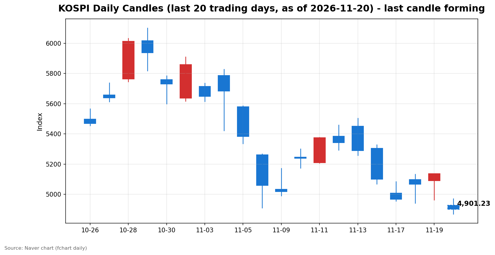
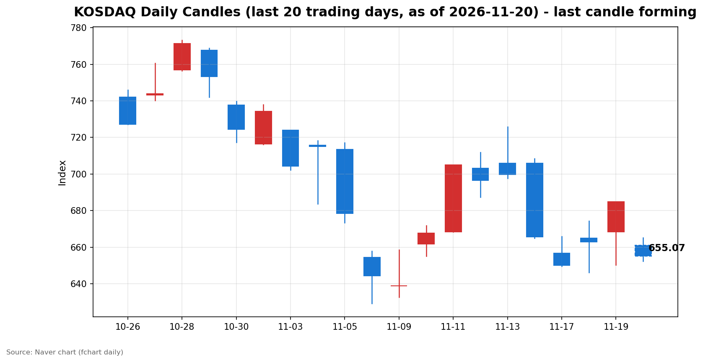

안녕하세요, [한국투자증권](https://securities.koreainvestment.com/main/Main.jsp)에서 [한투-한국투자증권](https://play.google.com/store/apps/details?id=com.truefriend.neosmartarenewal&hl=ko) 개발을 담당하고 있는 way입니다. 
오늘 오전 국내 증시는 간밤 뉴욕증시 급락의 여파로 코스피가 4% 넘게 내리며 4,900선을 내주는 급락 장세를 보였습니다. 

## 오전장 요약

코스피는 전일 종가 5,137.89 대비 4.08% 내린 4,928.51로 개장한 뒤 낙폭을 줄이지 못하고 정오 무렵 4,896.24까지 밀렸습니다. 
장중 저점은 4,871.21로 전일 종가 대비 5.19% 내린 수준이며, 장중 5%대 급락으로 매도 사이드카가 발동됐습니다. 
코스닥도 655.00으로 4.35% 내리며 650선대로 밀렸습니다. 
반도체 대형주가 동반 급락하며 지수 하락을 주도했고, 여행주와 바이오주가 상대적으로 강세를 보이며 낙폭 장세 속에서도 순환매가 나타났습니다. 

## 오늘의 스냅샷

| 지수 | 현재가 | 전일 대비 | 등락률 | 시가 | 고가 | 저가 | 거래량 | 거래대금 | 스냅샷 기준 시각 |
| --- | --- | --- | --- | --- | --- | --- | --- | --- | --- |
| 코스피 | 4,896.24 | -241.65 | -4.70% | 4,928.51 | 4,971.31 | 4,871.21 | 113,129천주 | 7조 4,547억원 | 2026-11-20 12:29 KST |
| 코스닥 | 655.00 | -29.81 | -4.35% | 660.98 | 665.15 | 652.28 | 252,688천주 | 2조 6,543억원 | 2026-11-20 12:29 KST |

전일 종가는 코스피 5,137.89, 코스닥 684.81입니다. 
전일 종가는 네이버 실시간 등락률로 역산한 값과 일치합니다. 
코스피200은 760.74로 4.86% 내렸습니다. 
당일 봉은 형성 중인 봉으로, 마감 전에는 계속 변합니다. 
네이버 차트에서 흐름을 확인할 수 있습니다. [코스피](https://finance.naver.com/sise/sise_index.naver?code=KOSPI), [코스닥](https://finance.naver.com/sise/sise_index.naver?code=KOSDAQ) 

## 차트

최근 20거래일 일봉 차트입니다. 
빨간 봉은 종가가 시가보다 높은 날, 파란 봉은 종가가 시가보다 낮은 날입니다. 
당일 봉은 형성 중인 봉으로, 마감 전에는 계속 변합니다. 

## 원인·촉매 분석

오늘 급락의 직접적인 촉매는 간밤 뉴욕증시의 급락입니다. 
나스닥은 11월 19일 2.25% 내린 23,879.20으로 마감했고, S&P 500은 2.02% 내린 7,175.83으로 6거래일 연속 하락했으며, 다우는 2.19% 내린 49,097.06으로 5만선을 내줬습니다. 
공포지수는 장중 28.99까지 치솟아 3월 31일 이후 최고 수준을 기록했습니다. 
인공지능 기업 앤트로픽이 상장 첫날 17% 넘게 올랐음에도 뉴욕증시가 급락했다는 점이 중요합니다. 
앤트로픽은 공모가 83달러에 시초가 111.50달러로 34% 치솟았다가 종가는 97.17달러로 17.07% 상승에 그쳤고, 시간외 거래에서는 3% 내렸습니다. 
인공지능 밸류에이션에 대한 경계감이 대형 상장 호재를 압도했다는 의미이기 때문입니다. 
인공지능 인프라 투자에 대한 자금 조달 부담이 부각되면서 성장주 밸류에이션 압박이라는 연결고리가 다시 작동했습니다. 
미 10년물 국채금리가 5.05% 부근까지 오른 것도 성장주 밸류에이션에 부담으로 작용했습니다. 
급락은 국내 시장만의 일이 아니었습니다. 
중앙일보 GMC가 전한 오전 시황에서도 동아시아 증시가 개장과 동시에 일제히 급락했다고 보도했습니다. 
오전 10시 기준으로 닛케이225는 4% 넘게, 대만 가권지수는 4% 가까이 하락했습니다. 

국내 시장에서는 반도체 밸류체인이 직접적인 타격을 받았습니다. 
삼성전자는 184,500원으로 6.30% 내렸고, SK하이닉스는 1,111,000원으로 6.09% 내렸습니다. 
두 종목의 동반 급락이 지수 하락의 대부분을 설명합니다. 
미국 반도체지수 하락과 공매도 보고서 여파가 국내 반도체 대형주의 개장 급락으로 연결됐습니다. 

수급 구도도 하락을 키웠습니다. 
11월 19일 코스피는 외국인이 4,086억원을 순매도했음에도 1.39% 올랐는데, 이는 기타법인이 4,526억원을 순매수하고 기관이 120억원을 순매수하며 물량을 받았기 때문입니다. 
외국인의 매도 기조가 이어지는 가운데 국내 수급만으로 지수를 떠받치는 구조는 변동성에 취약했고, 간밤 미국발 악재가 터지자 5,000선 아래에서 개장하는 결과로 이어졌습니다. 
장중에도 외국인과 기관이 동반 순매도하고 개인이 순매수하는 구도가 이어지고 있습니다. 
선물시장에서는 외국인이 순매도하고 기관이 순매수하는 엇갈린 흐름이 나타나고 있습니다. 
장중 수급 수치는 확정치가 아니라 장중 잠정치이므로 오후에 바뀔 수 있습니다. 

구조적인 배경도 있습니다. 
11월 코스피 일평균 거래량은 2.4억주로 3월의 11억800만주 대비 78% 줄었고, 11월 일평균 거래대금은 약 18조4,900억원으로 지난해 12월 이후 가장 적은 수준입니다. 
얇아진 거래 기반 위에서는 외국인 매도세가 겹칠 때 낙폭이 커지기 쉽습니다. 
원·달러 환율은 장 초반 1,335.70원에서 정오 무렵 해외 시세 기준 1,330.97원으로 소폭 내렸습니다. 
환율이 외국인 수급을 추가로 압박하는 방향으로는 움직이지 않고 있습니다. 
다만 달러가 강세 흐름을 이어가는 가운데 환율 방향이 다시 바뀌는지는 확인할 필요가 있습니다. 

오늘 발표된 10월 생산자물가지수는 129.66으로 전월 대비 0.1% 하락하며 석 달 만에 내렸습니다. 
농림수산품이 전월 대비 8.3% 내린 것이 주된 요인이며, 한국은행은 농림수산품 가격 변동이 없었다면 생산자물가는 0.2% 올랐을 것이라고 설명했습니다. 
국내 공급물가지수는 원재료 가격이 7.3% 뛰면서 전월 대비 0.7% 상승했습니다. 
물가 지표 자체는 둔화 신호이나 일시 요인이 크고 원재료 상승 압력이 병존해, 금리 인하 기대를 키우는 재료로 단정하기는 어렵습니다. 

## 전일 수급

11월 19일 코스피 수급은 외국인이 4,086억원을 순매도했고, 기관이 120억원을 순매수했으며, 개인이 560억원을 순매도했고, 기타법인이 4,526억원을 순매수했습니다. 
기관 내부를 보면 금융투자 536억원, 보험 298억원, 투신 791억원이 순매수한 반면 연기금 772억원, 사모 725억원이 순매도해 기관 전체 순매수는 120억원에 그쳤습니다. 
외국인이 파는 물량을 기타법인과 일부 기관이 받으며 지수가 올랐던 구조라, 외국인 매도가 이어질 경우 지수 하방 압력이 커질 수 있는 구도였습니다. 
코스닥은 외국인이 2,162억원을 순매도했고, 기관이 2,257억원을 순매수했으며, 개인이 64억원을 순매도했고, 기타법인이 31억원을 순매도했습니다. 
코스닥에서는 기관이 외국인 매도 물량을 온전히 받아내며 3.32% 상승했으나, 오늘 장에서는 같은 구도가 낙폭 방어로 이어지지 않았습니다. 
전일 수급 수치는 네이버 시장동향 기준이며, 기관은 금융투자·보험·투신·사모·은행·기타금융·연기금 합계입니다. 

## 핵심 사건 3가지

### 1. 앤트로픽 상장 첫날 17% 상승에도 뉴욕증시 2%대 급락

앤트로픽은 공모가가 희망 범위를 상회한 83달러로 결정됐고, 시초가는 111.50달러로 34% 치솟았으나 종가는 97.17달러로 17.07% 상승에 그쳤습니다. 
시간외 거래에서는 3% 내렸습니다. 
그럼에도 나스닥은 2.25% 내렸고, S&P 500은 2.02% 내리며 6거래일 연속 하락했고, 다우는 2.19% 내리며 5만선을 내줬습니다. 
S&P 500 구성 종목 중 460개 이상이 하락했고, 나스닥 시가총액 상위 10개 종목이 모두 내렸습니다. 
인공지능 대어의 흥행이 인공지능 밸류에이션에 대한 시장의 의구심을 식히지 못했다는 점이 중요합니다. 
국내 시장에는 인공지능 밸류에이션 경계감이 그대로 전이됐고, 반도체 대형주 급락으로 이어졌습니다. 

### 2. AMD 공매도 보고서와 반도체주 동반 약세

공매도 기관 헌터브룩은 AMD가 다른 기업들을 통해 중국에 최신 인공지능 칩을 우회 수출했다는 의혹과 재무 불안정 가능성을 이유로 AMD를 공매도했다고 밝혔습니다. 
미국 정부가 중국에 대한 반도체 수출 통제를 강화하는 상황에서 관련 의혹이 투자심리를 위축시켰고, AMD 주가는 7.7% 급락했습니다. 
AMD는 의혹을 부인했으나 주가 하락을 막지 못했습니다. 
규제 강화는 미국 반도체 기업의 중국 매출뿐 아니라 인공지능 산업을 지탱해온 투자 구조에도 부담이 될 수 있다는 우려를 낳고 있습니다. 
캘리포니아주 법무당국이 엔비디아에 대한 조사를 착수했다는 소식도 전해졌습니다. 
첨단 칩과 기밀의 중국 유출 의혹과 투자자 오도 의혹이 조사 대상이라는 보도입니다. 
엔비디아 주가는 3.30% 내렸습니다. 

### 3. 장중 5%대 급락에 매도 사이드카 발동, 10거래일 만

코스피는 장중 5,000선에 이어 4,900선마저 내주며 5% 넘게 급락했고, 매도 사이드카가 발동됐습니다. 
코스피 매도 사이드카는 코스피200 선물 가격이 기준가격 대비 5% 이상 하락한 상태가 1분 이상 지속되면 발동하며, 프로그램 매도호가의 효력이 5분간 정지됩니다. 
코스피 시장에서 매도 사이드카가 발동된 것은 11월 6일 이후 10거래일 만입니다. 
사이드카 발동 이후에도 하락세가 이어지며 코스피는 4,880선도 내줬고, 장중 저점은 4,871.21까지 밀렸습니다. 
사이드카는 프로그램 매도를 일시적으로 멈추는 장치일 뿐이며, 발동 자체가 하락의 바닥을 의미하지는 않습니다. 

## 섹터·테마 영향 체인

반도체·인공지능 밸류체인이 직접적인 타격을 받았습니다. 
미국 반도체지수 하락이 국내 반도체 대형주의 개장 급락으로 연결됐고, 지수 하락의 대부분을 설명합니다. 
인공지능 인프라 투자에 대한 자금 조달 부담이 부각되면서, 성장주 밸류에이션 압박이라는 연결고리가 다시 작동했습니다. 
코스피200이 4.86% 내린 것은 대형주 중심의 하락이었음을 보여줍니다. 

반면 낙폭 장세 속에서도 방어·순환 매수가 나타난 쪽이 있습니다. 
여행 테마는 4.85% 올랐고, 중국 내 한국 여행사의 관광상품 직접 판매 허용 기대가 방한 수요 확대 전망을 키웠습니다. 
노랑풍선은 23.19%, 참좋은여행은 12.26% 올랐습니다. 
바이오시밀러·제약도 강세를 보였습니다. 
알테오젠은 독일 법원이 키트루다SC 판매금지 가처분을 취소해 MSD의 독일 출시가 가능해지면서 5.04% 올랐습니다. 
위탁생산 테마도 0.76% 오르며 상대적으로 선방했습니다. 
은행 테마는 0.20% 오르며 지수 급락 속에서도 약보합 수준을 지켰습니다. 
급락의 충격이 성장주·반도체에 집중되고, 내수·방어 성격의 테마로 자금이 이동하는 순환매 구도입니다. 
중앙일보 GMC 리포트는 엔비디아 쇼크 이후 대체 수혜 기대가 주가에 상당 부분 선반영됐을 수 있다며, 실제 매출·이익 증가로 이어지는지 확인해야 한다고 지적했습니다. 

## 최근 5거래일 일봉

| 날짜 | 코스피 시가 | 코스피 고가 | 코스피 저가 | 코스피 종가 | 코스닥 시가 | 코스닥 고가 | 코스닥 저가 | 코스닥 종가 |
| --- | --- | --- | --- | --- | --- | --- | --- | --- |
| 11월 13일 | 5,452.41 | 5,504.44 | 5,259.09 | 5,290.53 | 705.96 | 725.81 | 697.69 | 699.66 |
| 11월 16일 | 5,305.40 | 5,327.99 | 5,069.83 | 5,100.50 | 705.88 | 708.34 | 664.98 | 665.65 |
| 11월 17일 | 5,008.09 | 5,084.06 | 4,957.00 | 4,968.48 | 656.82 | 665.79 | 649.62 | 650.06 |
| 11월 18일 | 5,098.82 | 5,133.14 | 4,943.17 | 5,067.44 | 664.93 | 674.30 | 646.31 | 662.81 |
| 11월 19일 | 5,090.04 | 5,137.89 | 4,963.61 | 5,137.89 | 668.31 | 684.81 | 650.39 | 684.81 |

11월 19일 코스피 종가는 네이버 실시간 등락률로 역산한 공식 기준가이며, 일봉 스냅샷 수치와는 다를 수 있습니다. 
코스피는 11월 17일 4,968.48까지 밀렸다가 이틀 반등했으나, 오늘 급락으로 11월 17일 저점 아래로 내려갔습니다. 
코스닥은 11월 17일 650.06까지 밀렸다가 이틀 반등했으나, 오늘 655.00으로 다시 650선 부근으로 돌아왔습니다. 

## 오전 강했던 테마와 흐름 변화

오전에는 여행, 웹툰, P2E, 바이오소재, 위탁생산 테마가 강세를 보였습니다. 
여행 테마는 4.85% 올랐고, 웹툰은 2.15%, P2E는 1.32% 올랐습니다. 
바이오시밀러·제약에서는 알테오젠이 5.04% 오르는 등 개별 호재가 있는 종목 중심으로 강세가 나타났습니다. 
경영권 이슈가 있는 한진칼우는 29.99% 올랐고, 오늘 신규 상장한 하나에어로는 43.68% 올랐습니다. 
지수 흐름에서는 시가 대비 방향 전환이 나타나지 않았습니다. 
코스피는 시가 4,928.51에서 출발해 정오 무렵 4,896.24로 더 밀렸고, 개장 당시 3.68%였던 낙폭이 4.70%로 확대됐습니다. 
코스닥도 시가 660.98에서 출발해 655.00으로 밀리며 낙폭이 3.52%에서 4.35%로 확대됐습니다. 
오전 내내 낙폭이 확대되는 흐름이 이어졌고, 장중 저점 부근에서 반등의 실마리는 아직 확인되지 않고 있습니다. 

## 오후 전망과 확인할 시나리오

단기적으로는 낙폭 과대에 따른 기술적 반등과 하락 지속이 갈리는 구간입니다. 
코스피는 장중 저점 4,871.21이 단기 지지 구간으로 작용하는지 확인할 필요가 있습니다. 
이 구간을 지키면 4,900선 회복 시도가 이어질 수 있고, 이탈하면 4,800선 부근까지 하방이 열릴 수 있습니다. 
상방에서는 4,900선 회복 여부와 11월 17일 저점 4,957.00 부근이 저항 구간으로 작용하는지 확인할 필요가 있습니다. 
코스닥은 장중 저점 652.28과 650선 지지 여부, 상방에서는 660선과 당일 고가 665.15 회복 여부가 관전 포인트입니다. 
외국인과 기관의 순매도가 오후에도 이어지는지, 개인의 순매수가 낙폭을 받치는 흐름으로 이어지는지도 확인할 필요가 있습니다. 
원·달러 환율이 1,330원대 초반에서 추가로 움직이는지도 외국인 수급과 함께 지켜봐야 합니다. 
미국 선물과 프리마켓 움직임, 반도체 대형주의 낙폭 축소 여부도 오후 흐름을 가늠하는 단서가 됩니다. 
낙폭이 큰 날에는 장 막판 변동성이 커질 수 있으므로, 지수·섹터 단위의 흐름을 확인하며 리스크 관리 관점에서 접근할 필요가 있습니다. 
이 글은 교육·해설 목적이며 특정 종목의 매수·매도를 권유하지 않습니다. 

## 마치며

간밤 뉴욕증시 급락과 반도체 밸류에이션 경계감이 맞물리며 코스피는 4,900선을 내주고 매도 사이드카까지 발동하는 급락 장세를 보였습니다. 
오후에는 장중 저점 방어 여부와 외국인 수급 방향을 확인하며 변동성에 유의할 필요가 있습니다. 
