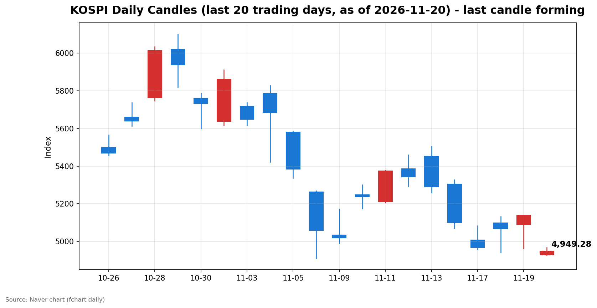
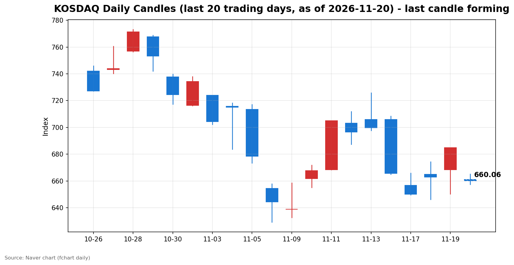

안녕하세요, [한국투자증권](https://securities.koreainvestment.com/main/Main.jsp)에서 [한투-한국투자증권](https://play.google.com/store/apps/details?id=com.truefriend.neosmartarenewal&hl=ko) 개발을 담당하고 있는 way입니다. 
간밤 뉴욕증시가 2% 넘게 급락한 여파로 국내 증시는 11월 20일 장 초반 코스피 5,000선을 내준 채 출발했습니다. 

## 배경: 간밤 미국 증시

간밤 뉴욕증시는 인공지능 기업 앤트로픽의 상장 첫날 흥행에도 불구하고 3대 지수가 일제히 2% 넘게 하락했습니다. 
나스닥 종합지수는 23,879.20으로 전일 대비 550.69포인트, 2.25% 내렸고, 스탠더드앤드푸어스 500지수는 7,175.83으로 2.02% 하락했습니다. 
다우지수도 2.2% 내리며 5만선을 내줬습니다. 
앤트로픽은 공모가 대비 17.1% 오른 채 상장 첫날을 마쳤지만, 상장 30분 만에 시초가 대비 13% 급락하는 등 장중 변동성이 극심했습니다. 
완전희석 기준 시가총액은 약 1조8,000억달러로 글로벌 7위에 올랐고, 공모 규모는 306억달러였습니다. 
중앙일보 GMC의 오늘자 G모닝 브리핑 제목도 하락장 지속을 시사했습니다. 
다만 해당 브리핑 본문은 유료·로그인 벽으로 확인하지 못해 제목 수준에서만 참고했습니다. 
같은 날 엔비디아는 3.3%, 마이크론은 2.1% 내렸고, AMD는 7.7% 급락하며 필라델피아 반도체지수를 2.4% 끌어내렸습니다. 
원·달러 환율은 1,335.70원으로 전일 대비 1.60원, 0.12% 올랐습니다. 

## 오늘의 스냅샷

| 지수 | 현재가 | 전일 대비 | 등락률 | 시가 | 고가 | 저가 | 거래량 | 거래대금 | 스냅샷 기준 시각 |
| --- | --- | --- | --- | --- | --- | --- | --- | --- | --- |
| 코스피 | 4,949.02 | -188.87 | -3.68% | 4,928.51 | 4,969.43 | 4,927.50 | 30,174천주 | 1조 6,151억원 | 2026-11-20 09:28 KST |
| 코스닥 | 660.71 | -24.10 | -3.52% | 660.98 | 665.15 | 657.38 | 92,794천주 | 9,677억원 | 2026-11-20 09:28 KST |

코스피는 4,928.51로 전일 종가 5,137.89 대비 4.08% 내린 채 개장한 뒤 4,949.02까지 낙폭을 소폭 줄였습니다. 
코스닥은 전일 684.81에서 3.32% 올랐던 680선을 하루 만에 내주고 650선대로 밀렸습니다. 
코스피200은 767.88로 3.96% 내렸습니다. 
네이버 차트에서 흐름을 확인할 수 있습니다. [코스피](https://finance.naver.com/sise/sise_index.naver?code=KOSPI), [코스닥](https://finance.naver.com/sise/sise_index.naver?code=KOSDAQ) 

## 차트

최근 20거래일 일봉 차트입니다. 
빨간 봉은 종가가 시가보다 높은 날, 파란 봉은 종가가 시가보다 낮은 날입니다. 
당일 봉은 형성 중인 봉으로, 마감 전에는 계속 변합니다. 

## 원인·촉매 분석

오늘 급락의 직접적인 촉매는 간밤 미국 증시의 반도체·인공지능 관련주 조정입니다. 
앤트로픽 상장이라는 호재성 이벤트가 있었음에도 뉴욕증시가 하락했다는 점이 시장의 심리를 더 위축시켰습니다. 
공모 흥행이 부채를 안고 데이터센터를 짓는 기업들의 자금 조달 여건까지 개선해주지는 못한다는 평가가 나왔고, 인공지능 인프라 투자에 대한 자금 조달 부담과 추가 긴축 우려가 다시 부각됐습니다. 
이는 금리 상승이 성장주 밸류에이션을 압박한다는 기존 연결고리와 같은 방향으로 작용했습니다. 
전일 수급 구도도 하락의 배경을 설명합니다. 
11월 19일 코스피는 외국인이 4,086억원을 순매도했음에도 1.39% 올랐는데, 이는 기타법인이 4,526억원을 순매수하고 기관이 120억원을 순매수하며 물량을 받았기 때문입니다. 
외국인의 매도 기조가 이어지는 가운데 국내 수급만으로 지수를 떠받치는 구조는 변동성에 취약했고, 간밤 미국발 악재가 터지자 5,000선 아래에서 개장하는 결과로 이어졌습니다. 
코스닥은 11월 19일 외국인이 2,162억원을 순매도한 반면 기관이 2,257억원을 순매수하며 3.32% 올랐으나, 오늘은 기관 매수만으로 낙폭을 방어하지 못하는 모습입니다. 

## 핵심 사건 3가지

### 1. 앤트로픽 상장 첫날 17.1% 상승에도 뉴욕증시 2%대 급락

앤트로픽은 11월 19일 뉴욕증시에 역대 최대 규모 기업공개로 상장해 공모가 대비 17.1% 상승한 채 첫날을 마쳤습니다. 
3분기 매출 170억달러, 조정 영업이익률 15%를 기록한 기업용 인공지능 선두 기업의 독립적인 시장가치가 처음으로 평가받은 날이었습니다. 
그러나 뉴욕증시는 개장 초반 상승 출발 뒤 급반락해 나스닥이 2.25%, 스탠더드앤드푸어스 500이 2.02% 내렸습니다. 
앤트로픽의 공모 흥행이 인공지능 인프라 기업들의 자금 조달 부담을 덜어주지 못했고, 차익실현 매물과 수급 부담이 겹쳤다는 해석이 나왔습니다. 
국내 시장에는 인공지능 밸류에이션에 대한 경계감이 그대로 전이됐습니다. 

### 2. AMD 공매도 보고서와 반도체주 동반 약세

공매도 기관 헌터브룩은 AMD가 다른 기업들을 통해 중국에 최신 인공지능 칩을 우회 수출했다는 의혹과 재무 불안정 가능성을 이유로 AMD를 공매도했다고 밝혔습니다. 
미국 정부가 중국에 대한 반도체 수출 통제를 강화하는 상황에서 관련 의혹이 투자심리를 위축시켰고, AMD 주가는 7.7% 급락했습니다. 
엔비디아 3.3%, 마이크론 2.1% 하락으로 이어지며 필라델피아 반도체지수는 2.4% 내렸습니다. 
국내에서는 삼성전자와 SK하이닉스가 장 초반 각각 4%대, 6%대 급락하며 코스피 하락을 주도했습니다. 
한편 캘리포니아주 법무부가 엔비디아의 첨단 칩 대중국 유출 여부와 관련한 조사를 위해 소환장을 발부했다는 보도도 전해졌습니다. 
반도체가 코스피에서 차지하는 비중이 큰 만큼, 미국 반도체주의 조정은 국내 지수에 직접적인 하방 압력으로 작용했습니다. 

### 3. 10월 생산자물가 0.1% 하락, 농림수산품 일시 요인

한국은행이 11월 20일 발표한 10월 생산자물가지수는 129.66으로 전월 대비 0.1% 하락하며 석 달 만에 내렸습니다. 
농림수산품이 농산물 11.8%, 축산물 7.3% 하락으로 전월 대비 8.3% 내린 것이 주된 요인입니다. 
한국은행은 농림수산품 가격 변동이 없었다면 생산자물가는 0.2% 올랐을 것이라며, 원자재 가격 상승분이 시차를 두고 반영되면서 공산품을 중심으로 올랐다고 설명했습니다. 
국내 공급물가지수는 원재료 가격이 7.3% 뛰면서 전월 대비 0.7% 상승했습니다. 
물가 지표 자체는 둔화 신호이나 일시 요인이 크고 원재료 상승 압력이 병존해, 금리 인하 기대를 키우는 재료로 단정하기는 어렵습니다. 

## 섹터·테마 영향 체인

반도체·인공지능 밸류체인이 직접적인 타격을 받았습니다. 
미국 반도체지수 하락이 국내 반도체 대형주의 개장 급락으로 연결됐고, 지수 하락의 대부분을 설명합니다. 
인공지능 인프라 투자에 대한 자금 조달 부담이 부각되면서, 성장주 밸류에이션 압박이라는 연결고리가 다시 작동했습니다. 
반면 장 초반 상승 테마는 웹툰 2.04%, 일자리 0.78%, 은행 0.69% 등 소수에 그쳤습니다. 
은행이 상대적으로 선방한 것은 금리 상승 국면에서 순이자마진에 대한 기대와 방어주 성격이 겹친 결과로 해석됩니다. 
다만 지수 낙폭이 3% 중반대인 상황에서 테마별 상승은 방어적인 성격이 강하고, 시장 전체의 위험 회피 심리가 우세합니다. 
코스피 전기·전자 업종에서는 개장 초반 외국인과 기관이 각각 286억원, 590억원 매도 우위를 보였고 개인이 781억원 매수 우위를 보였습니다. 

## 최근 5거래일 일봉

당일 봉은 형성 중인 봉으로, 마감 전에는 계속 변합니다. 

### 코스피

| 날짜 | 시가 | 고가 | 저가 | 종가 | 거래량 |
| --- | --- | --- | --- | --- | --- |
| 2026-11-16 | 5,305.40 | 5,327.99 | 5,069.83 | 5,100.50 | 221,296천주 |
| 2026-11-17 | 5,008.09 | 5,084.06 | 4,957.00 | 4,968.48 | 193,978천주 |
| 2026-11-18 | 5,098.82 | 5,133.14 | 4,943.17 | 5,067.44 | 219,090천주 |
| 2026-11-19 | 5,090.04 | 5,137.89 | 4,963.61 | 5,137.89 | 195,695천주 |
| 2026-11-20 | 4,928.51 | 4,969.43 | 4,927.50 | 4,949.02 (형성 중) | 30,174천주 |

### 코스닥

| 날짜 | 시가 | 고가 | 저가 | 종가 | 거래량 |
| --- | --- | --- | --- | --- | --- |
| 2026-11-16 | 705.88 | 708.34 | 664.98 | 665.65 | 446,420천주 |
| 2026-11-17 | 656.82 | 665.79 | 649.62 | 650.06 | 467,132천주 |
| 2026-11-18 | 664.93 | 674.30 | 646.31 | 662.81 | 462,804천주 |
| 2026-11-19 | 668.31 | 684.81 | 650.39 | 684.81 | 398,792천주 |
| 2026-11-20 | 660.98 | 665.15 | 657.38 | 660.71 (형성 중) | 92,794천주 |

11월 19일 코스피는 5,137.89로 마감해 5,000선을 회복했으나 하루 만에 다시 내줬습니다. 
11월 16일부터 19일까지 코스피는 5,100.50, 4,968.48, 5,067.44, 5,137.89로 등락을 반복하며 5,000선 부근에서 변동성이 컸습니다. 

## 전일 수급

11월 19일 코스피 수급은 외국인이 4,086억원을 순매도했고, 기관이 120억원을 순매수했으며, 개인이 560억원을 순매도했고, 기타법인이 4,526억원을 순매수했습니다. 
기관 내부를 보면 금융투자 536억원, 보험 298억원, 투신 791억원이 순매수한 반면 연기금 772억원, 사모 725억원이 순매도해 기관 전체 순매수는 120억원에 그쳤습니다. 
외국인이 파는 물량을 기타법인과 일부 기관이 받으며 지수가 올랐던 구조라, 외국인 매도가 이어질 경우 지수 하방 압력이 커질 수 있는 구도였습니다. 
코스닥은 외국인이 2,162억원을 순매도했고, 기관이 2,257억원을 순매수했으며, 개인이 64억원을 순매도했고, 기타법인이 31억원을 순매도했습니다. 
코스닥에서는 기관이 외국인 매도 물량을 온전히 받아내며 3.32% 상승했으나, 오늘 개장에서는 같은 구도가 낙폭 방어로 이어지지 않았습니다. 
전일 수급 수치는 네이버 시장동향 기준이며, 기관은 금융투자·보험·투신·사모·은행·기타금융·연기금 합계입니다. 

## 단기·중기 전망과 확인할 시나리오

단기적으로는 낙폭 과대에 따른 기술적 반등과 하락 지속이 갈리는 구간입니다. 
코스피는 11월 17일 저점 4,957.00과 11월 18일 저점 4,943.17 부근이 단기 지지 구간으로 작용하는지 확인할 필요가 있습니다. 
이 구간을 지키면 5,000선 회복 시도가 이어질 수 있고, 이탈하면 4,900선 부근까지 하방이 열릴 수 있습니다. 
상방에서는 5,000선 회복 여부와 11월 18일 종가 5,067.44, 11월 19일 종가 5,137.89가 저항 구간입니다. 
코스닥은 11월 17일 저점 649.62과 11월 18일 저점 646.31 부근이 지지 구간이며, 상방에서는 680선 회복 여부가 관건입니다. 
중기적으로는 인공지능 밸류에이션 논쟁이 단기 노이즈인지 구조적 재평가인지가 핵심입니다. 
앤트로픽 상장 흥행에도 뉴욕증시가 내렸다는 점은 인공지능 관련주의 밸류에이션 부담이 해소되지 않았음을 보여줍니다. 
다음 주 발표될 미국의 개인소비지출 물가지수 등 물가 지표와 인공지능 관련 기업의 실적·가이던스가 시장의 방향을 가를 변수입니다. 
외국인 순매도 지속 여부도 확인할 수치입니다. 
본 글은 교육·해설 목적이며 특정 종목의 매수·매도 권유나 목표주가 제시가 아닙니다. 

## 장 초반 확인할 점

코스피가 4,943~4,957 구간을 지키는지, 외국인의 순매도 규모가 장 초반과 비교해 확대되는지 확인할 필요가 있습니다. 
삼성전자와 SK하이닉스 등 반도체 대형주의 낙폭이 축소되는지, 은행 등 방어 테마의 상대 강세가 유지되는지도 확인할 지점입니다. 
원·달러 환율이 1,335원대에서 추가로 오르는지도 외국인 수급과 함께 지켜봐야 합니다. 

## 마치며

간밤 뉴욕증시 급락이 국내 증시 개장을 압박하며 코스피는 5,000선을 내준 채 출발했습니다. 
장 초반에는 지지 구간 방어 여부와 외국인 수급 방향을 확인하며 변동성에 유의할 필요가 있습니다. 
