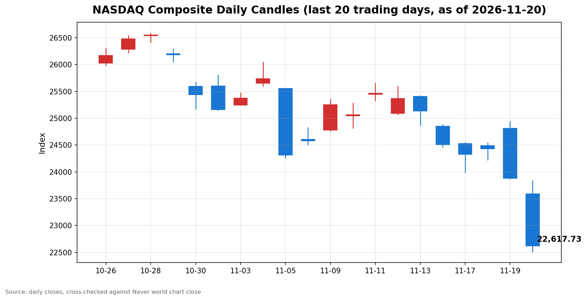

안녕하세요, [한국투자증권](https://securities.koreainvestment.com/main/Main.jsp)에서 [한투-한국투자증권](https://play.google.com/store/apps/details?id=com.truefriend.neosmartarenewal&hl=ko) 개발을 담당하고 있는 way입니다. 
현지시간 11월 20일 금요일, 나스닥은 인공지능 관련주 매도가 장 후반으로 갈수록 거세지며 5.28% 폭락 마감했습니다. 

## 마감 요약

나스닥 종합은 전일 대비 1,261.47포인트, 5.28% 하락한 22,617.73으로 마감했습니다. 
다우는 949.73포인트, 1.93% 하락한 48,147.33으로 마감했습니다. 
S&P500은 265.44포인트, 3.70% 하락한 6,910.39로 마감했습니다. 
나스닥의 1,000포인트가 넘는 하루 하락은 다우존스 마켓 데이터 기준 역대 네 번째입니다. 
S&P500은 7거래일 연속 하락하며, 2020년 2월 이후 가장 긴 연패를 기록했습니다. 
나스닥은 올해 상승분을 모두 반납하고 연초 대비 2% 가까이 하락한 수준으로 내려갔습니다. 
장중 고가 23,837.76에서 저가 22,513.01까지 1,324.75포인트를 오가는 큰 변동 끝에 하락 마감했습니다. 
오후 12시 56분 스냅샷에서 나스닥이 3.70% 하락했던 것과 비교하면, 오후 들어 낙폭이 5.28%까지 커졌습니다. 
같은 시간 S&P500은 2.16% 하락에서 3.70% 하락으로, 다우는 0.69% 하락에서 1.93% 하락으로 낙폭이 확대됐습니다. 
주간 기준으로는 나스닥이 11%, S&P500이 8.8%, 다우가 7% 하락했습니다. 
미국 10년물 국채수익률은 4.91%로 하락하며 안전자산 선호가 나타났습니다. 
변동성 지수는 전일 28.44에서 37.06으로 급등했습니다. 
전 세계 증시가 동반 급락했고, 일본 닛케이 225는 5.06% 하락했습니다. 
국내 증시도 같은 날 코스피가 5.21% 하락한 4,869.96, 코스닥이 5.71% 하락한 645.68으로 마감하며 양 시장 매도 사이드카가 동시에 발동했습니다. 
중앙일보 GMC 11월 20일 G브닝은 아시아장 폭락 이후 미국장도 편치 않을 것으로 전망했고, 실제 장은 그 전망대로 흘렀습니다. 

## 오늘의 마감 스냅샷

| 지수 | 종가 | 전일 대비 | 등락률 | 전일 종가 | 당일 고가 | 당일 저가 |
| --- | --- | --- | --- | --- | --- | --- |
| 나스닥 종합 | 22,617.73 | -1,261.47 | -5.28% | 23,879.20 | 23,837.76 | 22,513.01 |
| S&P500 | 6,910.39 | -265.44 | -3.70% | 7,175.83 | 7,198.67 | 6,882.66 |
| 다우 | 48,147.33 | -949.73 | -1.93% | 49,097.06 | 49,594.90 | 47,998.86 |

스냅샷 기준 시각은 미국 동부시간 2026년 11월 20일 오후 4시 20분, 한국시간 11월 21일 오전 6시 20분입니다. 
나스닥과 다우, S&P500 수치는 [네이버 월드 차트](https://finance.naver.com/world/sise.naver?symbol=NAS@IXIC)([나스닥 종합 가격 페이지](https://stock.naver.com/worldstock/index/.IXIC/price))의 네이버 실시간 API로 확인한 장마감 값입니다. 
네이버 월드 차트 페이지는 자바스크립트 기반이라 curl 직접 조회로는 수치를 확인할 수 없었으나, 같은 네이버 실시간 API 응답에 장마감 상태와 거래 시각이 함께 표시됐습니다. 
나스닥 종가 22,617.73과 등락률 5.28% 하락은 한투 MTS 해외 대시보드 교차값과 일치합니다. 
S&P500 종가 6,910.39와 등락률 3.70% 하락도 한투 MTS 교차값과 일치합니다. 
원·달러 환율은 한투 MTS 기준 1,348.00원으로 전일 대비 13.90원, 1.04% 상승했습니다. 
미국 10년물 국채수익률과 변동성 지수는 Yahoo Finance 일별 데이터를 기준으로 했습니다. 
나스닥의 52주 범위는 최저 20,690.25, 최고 27,722.75입니다. 

## 차트

최근 20거래일 일봉 차트입니다. 
빨간 봉은 종가가 시가보다 높은 날, 파란 봉은 종가가 시가보다 낮은 날입니다. 

## 원인·촉매 분석

오늘 장의 근본 촉매는 인공지능 투자에 대한 신뢰가 무너진 데 있습니다. 
인공지능 관련주는 수 주째 약세를 이어오고 있었고, 앤트로픽 상장이라는 대형 이벤트가 지나간 뒤에도 투자 심리는 회복되지 않았습니다. 
시장에서는 데이터센터 건설 속도 둔화, 인공지능 프로젝트 자금 조달 축소, 기술 관련 이익 성장세 둔화가 함께 거론됐습니다. 
인공지능 투자 수익성에 대한 의문이 밸류에이션 부담으로 이어진 흐름입니다. 
로이터가 미국 증권거래위원회가 엔비디아의 회계 관행을 살펴보고 있다고 보도한 점이 장 후반 매도를 가속한 직접 계기가 됐습니다. 
보도 이후 나스닥은 장중 저점을 새로 쓰며 낙폭을 키웠습니다. 
배경에는 연준의 긴축 기조가 자리합니다. 
11월 18일 공개된 10월 FOMC 의사록에서 거의 모든 참석자는 추가 금리인상이 적절하다고 판단했습니다. 
의사록은 인공지능 관련 수요가 인플레이션 위험을 초래하는 중대한 요인이 될 수 있다고 평가했습니다. 
인공지능 관련 부채가 빠르게 증가하고 있으며, 그 상당 부분이 복잡하고 불투명한 금융 구조를 통해 이뤄졌다는 지적도 담겼습니다. 
크리스토퍼 월러 연준 이사는 12월 회의에서 기준금리를 0.5%포인트 인상할 필요가 있다고 주장했습니다. 
CME 페드워치 기준 12월 0.25%포인트 인상 확률은 95% 수준으로 집계됐습니다. 
금리인상 전망 강화는 성장주 밸류에이션을 압박하는 연결고리로 작용했습니다. 
다만 미국 10년물 국채수익률이 전일 5.05%에서 4.91%로 하락한 점은 채권 시장이 안전자산으로 자금을 옮겼음을 보여줍니다. 
통상 금리 하락은 성장주에 우호적이나, 이날은 금리 하락에도 기술주가 반등하지 못했습니다. 
이는 이번 매도의 원인이 금리보다 인공지능 수익성과 신뢰에 있다는 점을 보여줍니다. 
지수 간 방향 차이는 뚜렷했습니다. 
나스닥이 5.28% 급락한 반면 다우는 1.93% 하락에 그쳤습니다. 
이는 충격이 시장 전체보다 인공지능과 기술주에 집중됐음을 보여줍니다. 
다우와 S&P500이 전 고점 대비 10% 넘게 하락하며 조정 국면에 들어간 점도 함께 확인됐습니다. 

## 핵심 사건 3가지

첫째, 엔비디아 회계 관행에 대한 증권거래위원회 조사 보도입니다. 
로이터는 미국 증권거래위원회가 엔비디아의 회계 관행을 살펴보고 있다고 보도했습니다. 
보도 이후 엔비디아 주가는 14% 급락하며 52주 신저가를 기록했습니다. 
엔비디아는 주간 기준으로도 23% 하락했습니다. 
엔비디아는 인공지능 칩 시장의 중심 기업으로, 회계 투명성에 대한 의문은 인공지능 생태계 전반의 신뢰 문제로 번졌습니다. 
전일 호실적 발표 이후에도 주가가 약세를 이어오던 상황에서, 규제 리스크가 더해진 점이 매도를 키웠습니다. 
엔비디아 최고경영자 사임 이후 회사의 방향성에 대한 불확실성이 남아 있는 점도 배경으로 거론됐습니다. 
조사 보도의 구체적인 내용과 범위는 확인 필요합니다. 

둘째, 앤트로픽 상장 2일차 급락입니다. 
앤트로픽 주가는 상장 둘째 날 9% 안팎 하락한 88.30달러로 마감했습니다. 
장중에는 공모가 83달러에 근접한 83.05달러까지 밀렸다가 반등했습니다. 
상장 첫날 17% 올랐던 상승분의 대부분을 하루 만에 반납한 셈입니다. 
공모와 사모를 합친 조달 규모 약 1,073억 달러로 역대 최대 규모의 상장이었지만, 기대감은 시장 전체로 번지지 않았습니다. 
투자자들은 앤트로픽 상장이 인공지능 투자 열풍의 정점 신호일 수 있다고 받아들였습니다. 
중앙일보 GMC 11월 20일 G브닝도 앤트로픽 주가 하락 이유와 엔비디아에 대한 냉수를 당일 핵심 주제로 다뤘습니다. 
상장 열기가 식자 인공지능 섹터 전반의 밸류에이션 부담이 다시 부각됐습니다. 
앤트로픽 주가의 다음 흐름은 인공지능 섹터 심리의 가늠자가 됩니다. 

셋째, AMD와 메모리 반도체의 동반 급락입니다. 
AMD는 전일 7%대 하락에 이어 이날 12% 급락했습니다. 
헌터브룩 미디어는 AMD의 최신 펌웨어가 미국의 수출통제 대상인 중국 서버업체 제품에 쓰였다는 보도를 냈습니다. 
미국의 대중 AI 칩 수출통제 강화 조치도 같은 날 발효됐습니다. 
메모리와 스토리지 종목도 약세를 면하지 못했습니다. 
마이크론과 시게이트, 웨스턴디지털은 10% 안팎 하락했습니다. 
데이터센터 관련 종목도 동반 약세를 보였습니다. 
코어위브는 12% 하락했고, 어플라이드 디지털은 17% 하락했습니다. 
암 홀딩스는 11% 하락했습니다. 
반도체 약세는 나스닥 낙폭이 다우와 S&P500보다 컸던 배경 중 하나입니다. 
규제 리스크와 수요 둔화 우려가 실적 기대를 압도한 하루였습니다. 

## 지수·섹터 영향 체인

나스닥은 5.28% 하락했고, S&P500은 3.70% 하락했으며, 다우는 1.93% 하락했습니다. 
낙폭의 순서 자체가 충격의 중심이 어디였는지 보여줍니다. 
기술주는 직격탄을 맞았습니다. 
엔비디아와 AMD, 메모리 반도체가 동시에 두 자릿수 하락하며 인공지능 밸류체인의 하드웨어 축이 무너졌습니다. 
인공지능 모델 기업인 앤트로픽의 급락은 소프트웨어와 모델 축의 신뢰도 함께 흔들렸음을 보여줍니다. 
데이터센터 관련 종목의 급락은 인공지능 인프라 투자 둔화 우려가 공급망 전반으로 번졌음을 보여줍니다. 
금리 하락은 성장주 밸류에이션을 떠받쳐야 했으나, 이날은 신뢰 위기가 금리 효과를 압도했습니다. 
금리가 내려가면 미래 이익의 현재가치가 높아지기 때문에 성장주에 우호적입니다. 
그러나 인공지능 투자 수익성 자체에 의문이 제기되면 금리 하락만으로는 매수를 이끌기 어렵습니다. 
금융주는 기술주보다 낙폭이 작았으나, 긴축이 경기 둔화로 이어질 수 있다는 우려에서 자유롭지 않았습니다. 
에너지는 이날 흐름의 중심에서 벗어나 있었습니다. 
유가와 에너지 섹터의 당일 수치는 확인 필요합니다. 
안전자산 선호는 채권으로 향했습니다. 
10년물 국채수익률 하락과 변동성 지수 급등은 투자자들이 위험자산에서 발을 빼고 있음을 보여줍니다. 
아시아 증시에서는 온도 차가 없었습니다. 
닛케이 225가 5.06% 하락했고, 코스피가 5.21%, 코스닥이 5.71% 하락하며 전 세계 증시가 동반 급락했습니다. 
미국 장 개장 전부터 아시아 증시가 급락한 점은 매도가 미국만의 문제가 아니라 전 세계적인 인공지능 재평가 흐름임을 보여줍니다. 

## 다우·S&P500 마감 흐름

다우는 48,147.33으로 마감하며 4만 9,000선을 내줬습니다. 
전일 종가 49,097.06에서 949.73포인트, 1.93% 하락한 수치입니다. 
오후 12시 56분에는 48,759.28로 0.69% 하락하고 있었으나, 오후 들어 낙폭이 세 배 가까이로 커졌습니다. 
다우의 낙폭이 나스닥보다 작았다는 점은 전통 제조업과 경기 민감주의 충격이 상대적으로 제한적이었음을 보여줍니다. 
S&P500은 6,910.39로 마감하며 7거래일 연속 하락했습니다. 
전일 종가 7,175.83에서 265.44포인트, 3.70% 하락한 수치입니다. 
오후 12시 56분에는 7,020.85로 2.16% 하락하고 있었으나, 오후 들어 낙폭이 3.70%까지 커졌습니다. 
S&P500의 7거래일 연속 하락은 2020년 2월 이후 가장 긴 연패입니다. 
세 지수 모두 오후 들어 낙폭이 확대됐다는 점은 장 후반 매도 압력이 강했음을 보여줍니다. 
로이터의 엔비디아 조사 보도가 나온 뒤 매도가 가속됐다는 점도 오후 낙폭 확대와 맞물립니다. 

## 단기·중기 전망과 다음 거래일 확인할 시나리오

단기적으로는 하락 흐름의 지속 여부를 가르는 구간에 들어섰습니다. 
나스닥은 당일 저가 22,513.01에서 22,617.73으로 마감했고, 52주 고점 27,722.75 대비 18% 넘게 내린 수준입니다. 
다음 거래일에는 당일 저가 22,513.01선 방어 여부와 23,000선 회복 여부가 첫 확인 지점이 됩니다. 
당일 고가 23,837.76은 단기 저항 구간으로 작용할 수 있습니다. 
S&P500은 7,000선 아래로 내려갔고, 6,882.66의 당일 저가 방어 여부가 확인 지점입니다. 
변동성 지수가 37.06까지 오른 만큼, 단기 변동성이 큰 구간이 이어질 수 있습니다. 
엔비디아 조사 보도에 대한 회사의 입장과 후속 보도가 다음 거래일의 반도체 흐름을 가를 수 있습니다. 
앤트로픽 주가가 공모가 83달러 부근에서 안정되는지, 추가 조정이 이어지는지도 지켜봐야 합니다. 
미국 10년물 국채수익률이 4.91% 수준에서 추가로 하락하는지, 반등하는지도 함께 확인해야 합니다. 
수익률이 하락을 이어가면 안전자산 선호가 이어지는 신호로, 반등하면 위험자산 매도세가 진정되는 신호로 읽을 수 있습니다. 
12월 FOMC를 둘러싼 연준 인사들의 발언과 CME 페드워치 확률 변화도 다음 확인 지점입니다. 
25bp 인상 확률이 95% 수준에서 유지되는지, 50bp 인상 가능성이 커지는지가 관건입니다. 
중기적으로는 연준의 긴축 경로와 인공지능 투자 수익성 논란이 맞서는 구도가 이어질 전망입니다. 
FOMC 의사록이 인공지능 관련 부채 증가를 지적한 만큼, 인공지능 투자와 금융 안정성 사이의 긴장이 시장의 화두로 남을 수 있습니다. 
지수 단위에서는 하락이 일시적 조정인지, 추세 전환인지 가르는 구간입니다. 
리스크 관리 관점에서는 지수 단위에서 변동성 확대 구간이 이어질 수 있음을 염두에 둘 필요가 있습니다. 
당일 1,324.75포인트에 달한 장중 변동폭은 단기 변동성이 커진 상태임을 보여줍니다. 

## 마치며

인공지능 투자 열풍의 정점을 확인하는 하루였습니다. 
다음 거래일에는 22,513선 방어 여부와 엔비디아 조사 보도 후속 소식, 앤트로픽 주가 흐름을 확인하며 흐름의 지속 여부를 가려야 합니다. 
이 글은 시장 해설을 목적으로 하며, 특정 종목의 매수나 매도를 권유하지 않습니다. 
