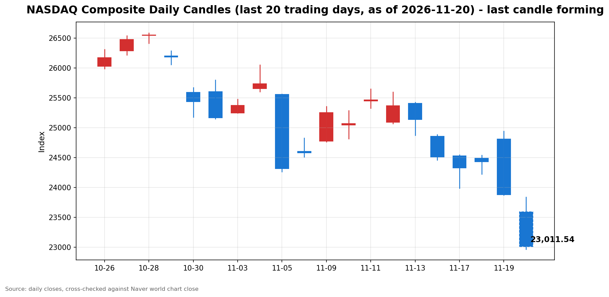

안녕하세요, [한국투자증권](https://securities.koreainvestment.com/main/Main.jsp)에서 [한투-한국투자증권](https://play.google.com/store/apps/details?id=com.truefriend.neosmartarenewal&hl=ko) 개발을 담당하고 있는 way입니다. 
2026년 11월 20일 나스닥 장중 상황을 정리했습니다. 

## 장중 요약

나스닥은 장중 3.7% 급락하며 올해 상승분을 모두 반납했습니다. 
개장 직후 0.72% 하락에 그쳤던 낙폭은 장중으로 갈수록 커졌고, 오후 1시 직전에는 22,994.71까지 밀렸습니다. 
S&P 500도 2.16% 내렸고, 장 초반 0.93% 올랐던 다우도 하락으로 돌아섰습니다. 
앤트로픽 상장 첫날의 열기는 하루 만에 식었고, 엔비디아는 7거래일 연속 하락을 이어갔습니다. 
공포지수는 30을 넘어섰고, 3대 지수는 2025년 4월 이후 최악의 한 주를 향해 가고 있습니다. 

## 오늘의 스냅샷

| 지수 | 현재가 | 전일 대비 | 등락률 | 전일 종가 | 장중 고가 | 장중 저가 |
| --- | --- | --- | --- | --- | --- | --- |
| 나스닥 종합 | 22,994.71 | -884.49 | -3.70% | 23,879.20 | 23,837.76 | 22,967.86 |
| S&P 500 | 7,020.85 | -154.98 | -2.16% | 7,175.83 | 7,198.67 | 7,005.66 |
| 다우 | 48,759.28 | -337.78 | -0.69% | 49,097.06 | 49,594.90 | 48,674.35 |

스냅샷 기준 시각은 미국 동부시간 11월 20일 12시 56분, 한국시간 11월 21일 2시 56분입니다. 
다우와 S&P 500은 같은 시각 전후의 Yahoo Finance 장중 데이터로 교차 확인한 값입니다. 
당일 수치는 형성 중인 값으로, 장중에 계속 변합니다. 
나스닥 종합 시세는 [네이버 월드 차트](https://finance.naver.com/world/sise.naver?symbol=NAS@IXIC)와 [네이버 Npay 증권](https://stock.naver.com/worldstock/index/.IXIC/price)에서 확인할 수 있습니다. 
나스닥 값은 네이버 월드 차트 페이지를 브라우저로 직접 확인했고, 한투 MTS 해외 대시보드 값 22,997.78과 교차 확인했습니다. 
나스닥의 52주 범위는 최저 20,690.25, 최고 27,722.75입니다. 
전일은 3대 지수가 일제히 2% 넘게 하락했습니다. 
나스닥은 550.69포인트 내린 23,879.20, S&P 500은 147.80포인트 내린 7,175.83, 다우는 1,101.11포인트 내린 49,097.06으로 마감했습니다. 

## 차트

최근 20거래일 일봉 차트입니다. 
빨간 봉은 종가가 시가보다 높은 날, 파란 봉은 종가가 시가보다 낮은 날입니다. 
당일 봉은 형성 중인 봉으로, 마감 전에는 계속 변합니다. 

## 원인·촉매 분석

첫째, 금리 하락에도 기술주가 반등하지 못했습니다. 
미 10년물 국채수익률은 11월 19일 5.052%에서 장중 4.948%까지 내렸습니다. 
하루 낙폭은 10.43bp로, 10월 22일 이후 가장 큰 하락입니다. 
통상 금리 하락은 성장주 밸류에이션에 우호적으로 작용합니다. 
그럼에도 나스닥이 3.7% 급락했다는 점은 이번 매도의 원인이 금리보다 인공지능 수익성과 신뢰에 있다는 점을 보여줍니다. 
연준 의사록에서 대다수 위원이 12월 25bp 인상을 예상한다는 매파적 신호가 나온 점도 금리 하락의 안도감을 제한했습니다. 
시장이 반영하는 12월 인상 확률은 96% 수준으로 전해졌습니다. 
둘째, 안전자산조차 동반 하락하며 디레버리징 양상이 나타났습니다. 
달러지수는 103.73으로 0.21% 내렸고, 서부텍사스산원유는 82.59달러로 0.75% 내렸습니다. 
금은 14개월 만에 최저 수준까지 밀렸고, 이번 주 최악의 한 주를 향하고 있습니다. 
위험회피 국면에서는 통상 금이 오르는데, 금까지 내렸다는 점은 자금이 안전자산으로 이동한 것이 아니라 레버리지를 줄이는 매도가 전방위로 퍼졌음을 보여줍니다. 
셋째, 변동성 지표가 공포 구간에 들어섰습니다. 
VIX는 장중 32.1까지 올랐고, 30을 넘긴 것은 수개월 만에 처음입니다. 
전일 종가는 28.44로 15.8% 올랐고, 장중 고가는 28.99였습니다. 
VIX가 30 위에서 유지된다는 점은 시장의 불안이 단기 조정을 넘어섰음을 보여줍니다. 
넷째, 지수 간 낙폭 차이가 매도의 성격을 보여줍니다. 
나스닥은 3.70% 내린 반면 S&P 500은 2.16%, 다우는 0.69% 내렸습니다. 
매도세가 시장 전체가 아니라 인공지능·반도체에 집중되고 있음을 보여주는 흐름입니다. 
다우의 낙폭이 상대적으로 작은 점은 전통 산업·가치주 쪽으로 자금이 이동하는 흐름과 맞물려 있습니다. 

## 핵심 사건 3가지

### 1. 앤트로픽 급락, 구원투수 기대가 매도의 기폭제로 바뀌다

앤트로픽은 상장 첫날 공모가 83달러 대비 17.1% 오른 97.17달러로 마감했습니다. 
첫 거래가는 111.50달러였고, 장중에는 공모가보다 34% 높게 거래되기도 했습니다. 
그러나 20일 장중에는 13% 넘게 급락해 84달러 안팎까지 밀렸고, 고점 대비 낙폭은 25%에 달했습니다. 
개장 전 프리마켓에서 이미 9% 넘게 내렸고, 공모가 83달러에 바짝 다가섰습니다. 
앤트로픽을 사기 위해 인공지능 관련주를 팔았다는 수급 쏠림 분석이 나왔는데, 정작 앤트로픽마저 급락하면서 매도의 근거가 하나 더 늘었습니다. 
중앙일보 GMC의 11월 20일자 G브닝 브리핑 제목도 앤트로픽의 하락을 언급했습니다. 
역대 최대 규모의 상장이 인공지능 투자 열기를 되살리기는커녕, 밸류에이션에 대한 의심을 키우는 계기가 됐습니다. 

### 2. 엔비디아 7거래일 연속 하락, 시가총액 4위로 밀려나다

엔비디아는 장중 7.5% 내린 135.21달러까지 밀렸습니다. 
젠슨 황 전 최고경영자의 사임 발표가 나온 11월 12일 이후 2주 동안 주가는 26% 하락했습니다. 
7거래일 연속 하락은 2008년 이후 가장 긴 주간 하락세를 향하고 있습니다. 
장중에는 알파벳에 밀려 미국 시가총액 4위로 내려앉았고, 시가총액은 3조 4,000억 달러 수준으로 전해졌습니다. 
엔비디아와 연계된 종목으로도 매도가 번졌습니다. 
코히어런트는 15%, 네비우스는 13% 급락했습니다. 
11월 19일에는 캘리포니아주 법무장관이 엔비디아에 소환장을 발부하고 수사에 착수했습니다. 
조사 대상은 첨단 인공지능 칩과 기밀정보의 중국 유출 여부, 관련 위험을 투자자에게 제대로 알렸는지 여부입니다. 
연방 정부 수사도 시작됐고, 투자자 기만 집단소송도 진행 중입니다. 
실적은 예상을 웃돌았지만, 최고경영자 교체와 규제 조사라는 재료가 주가를 짓누르고 있습니다. 

### 3. 전 세계로 번진 매도, 2025년 4월 이후 최악의 한 주

S&P 500은 7거래일 연속 하락을 이어가고 있습니다. 
전일까지 6거래일 연속 하락은 2024년 4월 이후 가장 긴 하락세였습니다. 
나스닥은 올해 상승분을 모두 반납했고, 사상 최고 종가 대비 낙폭은 16%에 달했습니다. 
오늘 장을 앞두고 S&P 500과 다우는 주간 5% 하락, 나스닥은 주간 6% 넘게 하락한 상태였습니다. 
이대로 마감하면 2025년 4월 관세 발표 당시 이후 가장 가파른 주간 하락이 됩니다. 
매도세는 아시아 증시로 먼저 확산됐습니다. 
11월 20일 코스피는 4,869.96으로 5.21% 하락했고, 코스닥은 645.68로 5.71% 하락했습니다. 
유가증권시장과 코스닥시장에서 매도 사이드카가 동시에 발동됐습니다. 
일본 닛케이는 5.06% 내렸고, 대만 증시는 1991년 이후 최악의 한 주를 이어가고 있으며, 홍콩 증시는 약세장에 진입했다는 보도도 나왔습니다. 
중앙일보 GMC의 11월 20일자 G프터눈 브리핑 제목은 아시아 증시가 쑥대밭이 됐다고 전했습니다. 
미국의 인공지능 과잉 투자 공포가 전 세계 증시로 전이된 하루였습니다. 

## 지수·섹터 영향 체인

반도체·인공지능 인프라가 직접적인 타격을 받았습니다. 
엔비디아를 중심으로 한 반도체주가 하락을 주도했고, 그 여파가 기술주 전반의 밸류에이션 재평가로 번졌습니다. 
나스닥 100은 장중 3.81% 내리며 나스닥 종합보다 더 크게 밀렸습니다. 
대형 기술주에 매도가 집중됐음을 보여주는 수치입니다. 
하이퍼스케일러도 약세를 피하지 못했습니다. 
아마존과 마이크로소프트는 장 전 거래에서 2% 넘게 내렸고, 메타는 4.5%, 알파벳은 0.8% 내렸습니다. 
인공지능 인프라 투자 대비 수익성에 대한 의문이 커지면서, 수혜주로 묶였던 종목들이 함께 조정을 받고 있습니다. 
반면 다우는 0.69% 하락에 그치며 상대적으로 선방했습니다. 
장 초반 0.93% 올랐던 다우는 장중 상승분을 반납했지만, 나스닥 대비 낙폭은 3%포인트 이상 작았습니다. 
전통 산업·가치주 쪽으로 자금이 이동하는 흐름이 다우의 낙폭을 제한했습니다. 
다만 다우도 사상 최고 종가 대비 10% 넘게 밀리며 조정 국면에 근접한 상태입니다. 
에너지 섹터에도 유가 하락이 부담으로 작용하고 있습니다. 
서부텍사스산원유는 11월 19일 83.21달러에서 장중 82.59달러로 내렸습니다. 
유가 하락은 수요 둔화 우려와 위험회피 심리가 함께 작용한 결과로 해석됩니다. 
데이터센터를 둘러싼 반대 여론도 인공지능 인프라 투자 심리에 부담 요인입니다. 
민주당의 중간선거 승리 이후 반데이터센터 정서가 확산됐다는 분석도 나왔습니다. 

## 다우·S&P 500 흐름

다우는 전일 2.19% 급락한 뒤 개장에서 0.93% 반등했습니다. 
그러나 장중에는 상승분을 모두 반납하고 48,759.28까지 밀렸습니다. 
장중 고가는 49,594.90, 저가는 48,674.35를 기록했습니다. 
전일 종가 49,097.06 아래에서 거래가 이어지고 있습니다. 
S&P 500은 전일 2.02% 하락한 뒤 개장에서 보합을 보였습니다. 
장중에는 7,020.85까지 밀리며 2.16% 하락했습니다. 
장중 고가는 7,198.67, 저가는 7,005.66을 기록했습니다. 
7,000선에 바짝 다가선 상태라, 해당 선의 방어 여부가 단기 흐름을 가늠하는 기준이 됩니다. 

## 오전과 오후 흐름 변화

오전과 오후 사이에는 방향 전환이 아니라 낙폭 확대가 나타났습니다. 
개장 직후인 10시 07분에는 나스닥이 23,708.45로 0.72% 하락에 그쳤습니다. 
S&P 500은 7,176.08로 보합이었고, 다우는 49,555.61로 0.93% 올랐습니다. 
장중에는 세 지수 모두 하락으로 돌아섰습니다. 
나스닥은 0.72% 하락에서 3.70% 하락으로, S&P 500은 보합에서 2.16% 하락으로, 다우는 0.93% 상승에서 0.69% 하락으로 바뀌었습니다. 
오전의 다우 반등은 오후 들어 완전히 사라졌고, 나스닥의 낙폭은 오전의 5배 수준으로 커졌습니다. 
장 초반의 버팀목이 오후에는 사라진 셈입니다. 
앤트로픽의 낙폭이 커지고 엔비디아가 7% 넘게 밀리면서 오후 들어 매도세가 가속됐습니다. 

## 마감까지 전망과 확인할 시나리오

장중 흐름이 이어지면 나스닥 23,000선 방어 여부가 첫 번째 관전 포인트가 됩니다. 
장중 저가는 22,967.86으로, 이미 23,000선을 밑돈 상태입니다. 
종가가 23,000선 아래에서 마감하면 심리적 부담이 커질 수 있습니다. 
S&P 500은 7,000선이 다음 기준입니다. 
장중 저가 7,005.66에 근접해 있어, 7,000선을 내주면 낙폭이 커질 여지가 있습니다. 
다우는 49,000선 회복 여부와 장중 저가 48,674.35 방어 여부를 함께 봐야 합니다. 
반등 시나리오에서는 VIX가 30 아래로 내려가는지, 10년물 국채수익률이 4.95% 안팎에서 안정되는지가 기준이 됩니다. 
앤트로픽이 공모가 83달러를 지키는지, 엔비디아가 7거래일 연속 하락으로 마감하는지도 확인할 수치입니다. 
주말을 앞두고 변동성이 큰 만큼, 마감까지 지수·섹터 단위의 흐름을 확인하는 것이 중요합니다. 
이 글은 교육·해설 목적의 시장 정리이며, 특정 종목의 매수·매도를 권유하지 않습니다. 

## 마치며

나스닥은 장중 3.7% 급락하며 올해 상승분을 모두 반납했고, 인공지능 매도세는 전 세계 증시로 번졌습니다. 
마감까지는 23,000선과 7,000선 같은 가격 레벨, 그리고 VIX와 앤트로픽의 움직임을 확인해야 합니다. 
