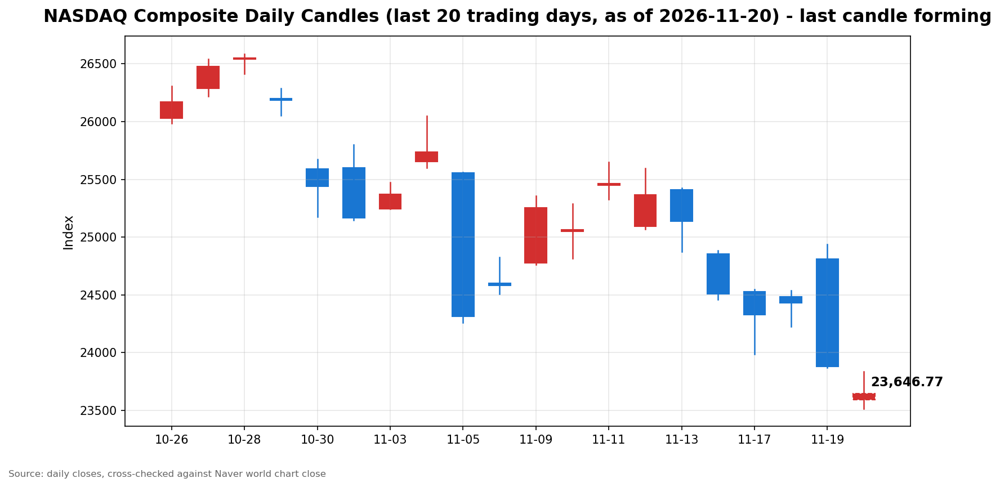

안녕하세요, [한국투자증권](https://securities.koreainvestment.com/main/Main.jsp)에서 [한투-한국투자증권](https://play.google.com/store/apps/details?id=com.truefriend.neosmartarenewal&hl=ko) 개발을 담당하고 있는 way입니다. 
2026년 11월 20일 나스닥 장 오픈 상황을 정리했습니다. 

## 개장 배경

전일인 11월 19일 뉴욕 증시는 3대 지수가 일제히 2% 넘게 하락했습니다. 
나스닥은 550.69포인트 내린 23,879.20으로 마감했고, 등락률은 -2.25%였습니다. 
S&P 500은 147.80포인트 내린 7,175.83으로 마감했고, 등락률은 -2.02%였습니다. 
다우는 1,101.11포인트 내린 49,097.06으로 마감했고, 등락률은 -2.19%였습니다. 
앤트로픽 상장 첫날의 열기가 인공지능 수익성 논란으로 바뀌며 기술주가 매도의 중심에 섰습니다. 
20일 개장에서는 나스닥이 추가 하락하는 가운데 다우가 반등하는 엇갈린 흐름이 나타났습니다. 
중앙일보 GMC 허브에는 11월 20일자로 G모닝·G프터눈·G브닝 브리핑과 GMC 리포트가 게시됐습니다. 
기사 본문은 유료일 수 있어 제목 수준에서만 참고했습니다. 

## 오늘의 스냅샷

| 지수 | 현재가 | 전일 대비 | 등락률 | 전일 종가 | 장중 고가 | 장중 저가 |
| --- | --- | --- | --- | --- | --- | --- |
| 나스닥 종합 | 23,708.45 | -170.75 | -0.72% | 23,879.20 | 23,837.76 | 23,516.45 |
| S&P 500 | 7,176.08 | +0.25 | +0.00% | 7,175.83 | 7,198.67 | 7,133.55 |
| 다우 | 49,555.61 | +458.55 | +0.93% | 49,097.06 | 49,594.90 | 49,025.79 |

스냅샷 기준 시각은 미국 동부시간 11월 20일 10시 07분, 한국시간 11월 21일 0시 07분입니다. 
S&P 500과 다우는 미국 동부시간 10시 09분경 교차 확인한 값입니다. 
당일 수치는 형성 중인 값으로, 장중에 계속 변합니다. 
나스닥 종합 시세는 [네이버 월드 차트](https://finance.naver.com/world/sise.naver?symbol=NAS@IXIC)와 [네이버 Npay 증권](https://stock.naver.com/worldstock/index/.IXIC/price)에서 확인할 수 있습니다. 
나스닥 값은 네이버 월드 차트 페이지를 브라우저로 직접 확인했고, 한투 MTS 해외 대시보드 값과 교차 확인했습니다. 
한투 MTS 해외 대시보드에는 다우가 포함되지 않아, 다우는 Yahoo Finance 장중 데이터로 교차 확인했습니다. 
나스닥의 52주 범위는 최저 20,690.25, 최고 27,722.75입니다. 

## 차트

최근 20거래일 일봉 차트입니다. 
빨간 봉은 종가가 시가보다 높은 날, 파란 봉은 종가가 시가보다 낮은 날입니다. 
당일 봉은 형성 중인 봉으로, 마감 전에는 계속 변합니다. 

## 원인·촉매 분석

첫째, 금리 하락에도 기술주가 반등하지 못했습니다. 
미 10년물 국채수익률은 11월 19일 5.052%에서 20일 장 초반 4.982%로 내렸습니다. 
통상 금리 하락은 성장주 밸류에이션에 우호적으로 작용합니다. 
그럼에도 나스닥이 추가 하락했다는 점은 이번 매도의 원인이 금리보다 인공지능 수익성과 신뢰에 있다는 점을 보여줍니다. 
둘째, 유가와 달러는 위험회피 심리를 가리킵니다. 
서부텍사스산원유는 11월 19일 83.21달러에서 20일 장 초반 81.63달러로 내렸습니다. 
달러지수는 103.74 수준에서 보합을 보였습니다. 
유가 하락은 수요 둔화 우려와 위험회피 심리가 함께 작용한 결과로 해석됩니다. 
셋째, 지수 간 방향 차이가 뚜렷합니다. 
전일에는 3대 지수가 일제히 2% 넘게 하락했습니다. 
개장 직후에는 나스닥만 -0.72%를 기록한 반면 다우는 +0.93%, S&P 500은 +0.00%로 버텼습니다. 
매도세가 시장 전체가 아니라 인공지능·반도체에 집중되고 있음을 보여주는 흐름입니다. 
넷째, 변동성 지표가 높은 수준을 유지했습니다. 
VIX는 11월 19일 장중 28.99까지 올랐습니다. 
S&P 500은 핵심 지지선으로 언급되던 7,300선을 밑돌며 마감했습니다. 

## 핵심 사건 3가지

### 1. 앤트로픽 상장, 기대와 달리 인공지능 수익성 논란의 기폭제가 되다

미국 인공지능 기업 앤트로픽의 나스닥 상장은 역대 최대 규모로 진행됐습니다. 
공모가는 주당 83달러로 확정됐고, 상장 첫날 종가는 97.17달러를 기록했습니다. 
첫날 상승률은 17.1%였습니다. 
그러나 상장이 인공지능 투자 열기를 되살리기는커녕, 인프라 투자 대비 수익성에 대한 의문을 키우는 계기가 됐습니다. 
앤트로픽이 거래를 시작한 직후 주요 지수가 장중 최저 수준으로 떨어졌고, 엔비디아와 마이크론 등 인공지능 관련주가 장 초반 상승분을 반납했습니다. 
중앙일보 GMC의 11월 20일자 G브닝 브리핑 제목은 앤트로픽의 하락을 언급했습니다. 
상장 첫날의 흥행이 이틀째 이어지지 못했다는 점은 인공지능 밸류에이션에 대한 시장의 의심이 깊어졌음을 보여줍니다. 

### 2. 엔비디아를 둘러싼 악재의 중첩

엔비디아는 젠슨 황 전 최고경영자의 사임 발표 이후 주가가 흔들리고 있습니다. 
사임 발표는 11월 12일에 나왔고, 이후 주가는 13% 하락했으며 시가총액은 약 5,000억 달러가 증발했습니다. 
11월 19일에는 캘리포니아주 법무장관이 엔비디아에 소환장을 발부하고 수사에 착수했습니다. 
조사 대상은 첨단 인공지능 칩과 기밀정보의 중국 유출 여부, 관련 위험을 투자자에게 제대로 알렸는지 여부입니다. 
연방 정부 수사도 시작됐고, 투자자 기만 집단소송도 진행 중입니다. 
AMD도 헌터브룩 미디어의 리포트로 타격을 받았습니다. 
해당 리포트는 AMD 펌웨어가 미국 정부의 수출통제 대상 기업과 연계된 서버 제품에 사용되고 있다고 지적했습니다. 
AMD는 11월 19일 7.72% 급락했고, 엔비디아도 같은 날 3.30% 하락했습니다. 
규제와 조사라는 재료가 반도체주에 직접적인 부담으로 작용하고 있습니다. 

### 3. 연준 의장의 인공지능 버블 경고와 아시아로의 전이

케빈 워시 연준 의장은 11월 16일 샌프란시스코 연설에서 인공지능 버블에 대해 재차 경고했습니다. 
대규모 투자 이후 실망스러운 결과가 나올 수 있다는 취지의 발언이었습니다. 
미국의 대중 반도체 추가 규제 우려가 겹치며 매도세는 아시아 증시로 확산됐습니다. 
일본 소프트뱅크 주가는 장중 16% 넘게 폭락하며 아시아 기술주 매도세를 주도했습니다. 
11월 20일 코스피는 4,869.96으로 5.21% 하락했고, 코스닥은 645.68로 5.71% 하락했습니다. 
유가증권시장과 코스닥시장에서 매도 사이드카가 동시에 발동됐습니다. 
대만 증시는 1991년 이후 최악의 한 주를 이어가고 있고, 홍콩 증시는 약세장에 진입했다는 보도도 나왔습니다. 
호주 증시도 광산주 폭락 속에 2022년 이후 최악의 한 주를 보내고 있습니다. 

## 지수·섹터 영향 체인

반도체·인공지능 인프라가 직접적인 타격을 받았습니다. 
엔비디아·AMD를 중심으로 한 반도체주가 하락을 주도했고, 그 여파가 기술주 전반의 밸류에이션 재평가로 번졌습니다. 
금리 하락에도 나스닥이 반등하지 못한 점은 밸류에이션 부담이 금리 요인이 아니라 수익성·신뢰 요인에서 비롯됐음을 보여줍니다. 
타격은 아시아 메모리·반도체로도 전이됐습니다. 
11월 20일 국내 증시에서 삼성전자는 7.01% 내린 183,100원, SK하이닉스는 5.92% 내린 1,113,000원으로 마감했습니다. 
반면 다우의 반등은 매도세가 기술주에 집중되는 가운데 전통 산업·가치주 쪽으로 자금이 이동하는 흐름과 맞물려 있습니다. 
에너지 섹터에도 유가 하락이 부담으로 작용하고 있습니다. 
서부텍사스산원유는 11월 19일 대비 1.9% 내린 81.63달러를 기록했습니다. 
데이터센터를 둘러싼 반대 여론도 인공지능 인프라 투자 심리에 부담 요인입니다. 
호주 넥스트DC가 주거 지역 개발을 중단했다는 보도가 나왔습니다. 

## 다우·S&P 500 흐름

다우는 전일 2.19% 급락한 뒤 개장에서 0.93% 반등했습니다. 
장중 고가는 49,594.90, 저가는 49,025.79를 기록했습니다. 
전일 종가 49,097.06 위에서 거래가 이어지고 있습니다. 
S&P 500은 전일 2.02% 하락한 뒤 개장에서 보합을 보였습니다. 
현재가는 7,176.08로 전일 종가 7,175.83 부근에서 등락하고 있습니다. 
7,300선 아래에 머무르고 있어, 해당 선의 회복 여부가 단기 흐름을 가늠하는 기준이 됩니다. 

## 단기·중기 전망과 장 초반 확인할 시나리오

확인할 가격 레벨은 다음과 같습니다. 
나스닥은 11월 19일 저가 23,870.70을 이미 하회하며 거래되고 있습니다. 
23,500선 방어 여부가 다음 기준이 됩니다. 
S&P 500은 7,300선 회복 여부가 관건입니다. 
VIX가 28.99 수준을 유지하는지도 확인할 필요가 있습니다. 
다우는 전일 종가 49,097.06 위에서 안착하는지가 중요합니다. 
첫 번째 시나리오는 매도 진정입니다. 
반도체주 낙폭이 축소되고 다우의 강세가 확산되면 지수 간 괴리가 축소될 수 있습니다. 
두 번째 시나리오는 조정 연장입니다. 
엔비디아 수사·규제 재료가 확산되거나 앤트로픽 약세가 이어지면 기술주 중심의 조정이 이어질 수 있습니다. 
세 번째 시나리오는 변동성 확대입니다. 
주말을 앞둔 포지션 정리로 장 후반 변동성이 커질 수 있습니다. 
장 초반에는 반도체주 흐름, 10년물 국채수익률 방향, VIX 움직임, 주말 전 수급 변화를 확인할 필요가 있습니다. 
중기적으로는 인공지능 투자 대비 수익성에 대한 의문이 해소되는지, 규제·조사 재료가 추가로 확산되는지가 흐름을 가를 것으로 보입니다. 

## 마치며

나스닥은 전일 급락에 이어 개장에서도 추가 하락하며 인공지능 밸류에이션에 대한 시장의 의심을 그대로 보여주고 있습니다. 
다만 다우의 반등이 보여주듯 매도세가 시장 전체로 확산되는지, 기술주에 머무는지는 장 초반 흐름을 지켜볼 필요가 있습니다. 
이 글은 교육·해설 목적으로 작성됐으며, 특정 종목의 매수·매도 권유가 아닙니다. 
