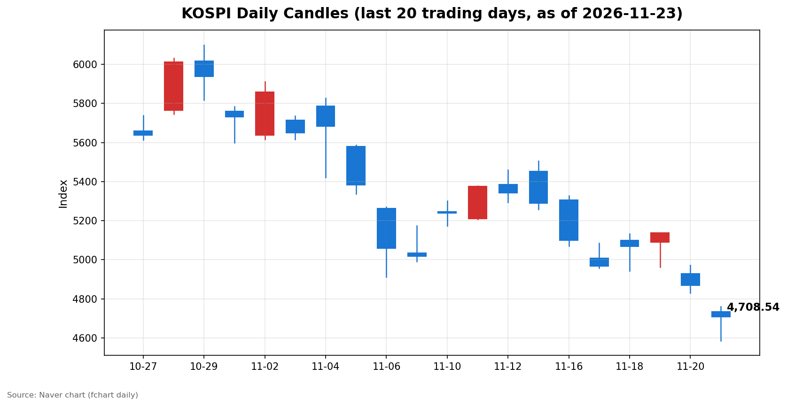
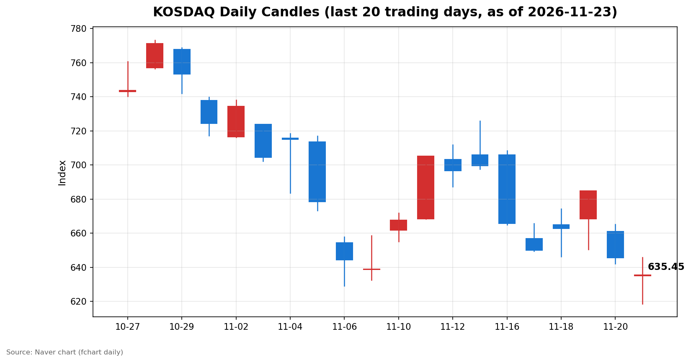

안녕하세요, [한국투자증권](https://securities.koreainvestment.com/main/Main.jsp)에서 [한투-한국투자증권](https://play.google.com/store/apps/details?id=com.truefriend.neosmartarenewal&hl=ko) 개발을 담당하고 있는 way입니다. 
오늘 국내 증시는 미국 증시 급락의 여파로 양 시장이 동반 하락하며 마감했습니다. 

## 마감 요약

코스피는 전 거래일보다 161.42포인트 내린 4,708.54로 마감했습니다. 
등락률은 마이너스 3.31퍼센트입니다. 
코스닥은 10.23포인트 내린 635.45로 마감했습니다. 
등락률은 마이너스 1.58퍼센트입니다. 
매도 사이드카가 지난 20일에 이어 2거래일 연속 발동됐습니다. 
코스피는 장중 4,586.80까지 밀리며 4,600선을 내줬다가 낙폭을 일부 줄여 마감했습니다. 
장중 저가 기준 낙폭은 5.81퍼센트에 달했습니다. 
11월 19일 종가와 비교하면 코스피는 2거래일 동안 8.36퍼센트 하락했습니다. 
11월 4일 연고점 5,683.80과 비교하면 약 17.2퍼센트 낮은 수준입니다. 

## 오늘의 마감 스냅샷

| 지수 | 종가 | 전일 대비 | 등락률 | 시가 | 고가 | 저가 | 거래량 | 거래대금 |
| --- | --- | --- | --- | --- | --- | --- | --- | --- |
| [코스피](https://finance.naver.com/sise/sise_index.naver?code=KOSPI) | 4,708.54 | -161.42 | -3.31% | 4,734.90 | 4,759.88 | 4,586.80 | 207,959천주 | 15조 3,216억 원 |
| [코스닥](https://finance.naver.com/sise/sise_index.naver?code=KOSDAQ) | 635.45 | -10.23 | -1.58% | 634.93 | 645.93 | 618.74 | 375,487천주 | 4조 3,539억 원 |

전일 종가는 코스피 4,869.96, 코스닥 645.68입니다. 
네이버 실시간 수치와 일봉 종가가 일치하며, 전일 종가는 실시간 등락률로 역산한 값과 일봉 전일 종가가 일치합니다. 
수치는 2026년 11월 23일 장 마감 기준입니다. 

## 차트

최근 20거래일 일봉 차트입니다. 
빨간 봉은 종가가 시가보다 높은 날, 파란 봉은 종가가 시가보다 낮은 날입니다. 

## 원인·촉매 분석

오늘 하락의 직접적인 촉매는 지난 금요일 미국 증시의 폭락입니다. 
나스닥 종합지수는 1,261.47포인트 내린 22,617.73으로 마감했습니다. 
등락률은 마이너스 5.28퍼센트이며, 주간 낙폭은 마이너스 10.0퍼센트에 달합니다. 
스탠더드앤드푸어스 500지수는 265.44포인트 내린 6,910.39로 마감했습니다. 
등락률은 마이너스 3.70퍼센트이며, 18개월여 만에 가장 큰 주간 낙폭을 기록했습니다. 
다우존스 산업평균지수는 949.73포인트 내린 48,147.33으로 마감했습니다. 
미국 시장에서는 인공지능 산업의 수익성에 대한 의구심이 확산되며 기술주와 반도체주가 동반 급락했습니다. 
나스닥은 금요일 하락으로 연초 대비 수익률이 마이너스로 전환됐습니다. 
국내 시장에서는 반도체 대형주를 중심으로 매도 압력이 확대됐습니다. 
한국투자증권 MTS 시장 브리핑은 미국발 반도체 수출 규제와 메모리 가격 조정 우려를 약세 요인으로 지적했습니다. 
수급 구도도 하락을 뒷받침했습니다. 
코스피에서 외국인과 개인이 함께 순매도했고, 기관과 기타법인이 매수에 나섰습니다. 
외국인은 이달 들어 지난 금요일까지 코스피에서 약 14조 4천억 원을 순매도한 것으로 보도됐습니다. 
매도 주체가 외국인에 그치지 않고 개인까지 확산됐다는 점이 오늘 장의 특징입니다. 
지난 20일에는 개인이 코스피에서 1조 5,381억 원을 순매수하며 저가 매수에 나섰으나, 오늘은 개인도 3,668억 원을 순매도했습니다. 
매도 사이드카 발동은 변동성이 단기간에 확대되고 있음을 보여주는 신호입니다. 

## 핵심 사건 3가지

첫째, 미국 증시의 금요일 폭락입니다. 
나스닥은 5.28퍼센트 하락했고, 반도체 레버리지 상장지수펀드인 SOXL은 하루에만 31.8퍼센트 폭락했습니다. 
인공지능 투자에 대한 수익성 의구심이 기술주 전반으로 번졌다는 점이 중요합니다. 
단순한 차익 실현이 아니라 성장 스토리의 전제를 다시 묻는 흐름이기 때문입니다. 
이 충격이 주말을 지나 월요일 국내 장의 출발점으로 작용했습니다. 

둘째, 매도 사이드카의 2거래일 연속 발동입니다. 
코스피 매도 사이드카는 지난 20일에 이어 오늘 다시 발동됐습니다. 
2거래일 연속 발동은 지난 5일과 6일에 이어 약 2주 만입니다. 
코스피는 장중 4,586.80까지 밀려 4,600선을 내줬습니다. 
프로그램 매매의 일시 정지 장치가 이틀 연속 가동됐다는 것은 하락 속도가 그만큼 가팔랐다는 의미입니다. 

셋째, 정부의 시장 안정 대책 준비입니다. 
정부는 일요일에 증권시장안정펀드 투입 준비, 기업 자사주 매입 규제 완화, 불법 공매도 감시 강화를 발표했습니다. 
이형일 기획재정부 장관은 가동 여부가 시장 상황에 달렸다고 밝혔습니다. 
증권시장안정펀드는 2020년 4월에 조성된 것으로, 언론에서는 이번 가동 논의를 18년 만의 소환으로 보도하고 있습니다. 
마지막 실제 투입은 2008년 글로벌 금융위기 당시였습니다. 
2020년에는 약 10조 7,600억 원 규모 조성을 발표했으나 실제 매수로는 이어지지 않았습니다. 
다만 구체적인 투입 시점과 규모가 발표되지 않아, 투자자들이 실질적인 내용이 없다고 판단해 매도세를 재개했다는 분석이 나왔습니다. 
씨티그룹은 약 10조 원 규모의 재가동 신호가 변동성 완화에 기여할 수 있다고 분석했습니다. 
금융위원회는 상장사 자사주 1일 취득 한도를 3개월간 확대하기로 했습니다. 
대책이 아직 가동 단계가 아니라 준비 단계라는 점이 시장에 남긴 과제입니다. 
대책 발표에도 불구하고 오늘 지수는 하락 마감했습니다. 

## 섹터·테마 영향 체인

인공지능 수익성 의구심은 미국 기술주에서 출발해 국내 반도체 밸류체인으로 이어졌습니다. 
반도체 대형주의 매도 압력이 커지며 지수 하락을 주도했습니다. 
한국투자증권 MTS 시장 브리핑은 HBM 관련주와 반도체 섹터를 약세의 중심에 놓았습니다. 
다만 반도체 안에서도 흐름은 갈렸습니다. 
기판과 장비 쪽에서는 선별적인 방어가 나타났습니다. 
테스는 5.24퍼센트, 피에스케이홀딩스는 4.37퍼센트, 심텍은 2.41퍼센트, 이수페타시스는 2.16퍼센트 상승했습니다. 
장비와 기판 수요에 대한 개별 기대가 지수 하락과 분리돼 움직인 사례입니다. 
로봇 테마는 오늘 가장 강한 흐름을 보였습니다. 
휴림로봇은 30.00퍼센트 상승해 상한가를 기록했습니다. 
하이젠알앤엠은 6.89퍼센트, 로보티즈는 5.35퍼센트, 엔젤로보틱스는 4.97퍼센트 상승했습니다. 
화장품 쪽으로도 순환매가 나타났다는 것이 한국투자증권 MTS 시장 브리핑의 설명입니다. 
연결고리는 뚜렷합니다. 
인공지능 수익성 우려가 반도체 대형주의 밸류에이션을 압박하고, 그 자금이 실적 기대가 남아 있는 장비·기판과 정책·수주 기대가 있는 로봇 쪽으로 옮겨가는 흐름입니다. 
지수 하락 속에서도 자금이 완전히 이탈한 것이 아니라 업종 안에서 이동했다는 점이 오늘 장의 구조입니다. 

## 최근 5거래일 일봉

### 코스피

| 날짜 | 시가 | 고가 | 저가 | 종가 | 전일 대비 | 등락률 | 거래량 |
| --- | --- | --- | --- | --- | --- | --- | --- |
| 2026-11-17 | 5,008.09 | 5,084.06 | 4,957.00 | 4,968.48 | -132.02 | -2.59% | 193,978천주 |
| 2026-11-18 | 5,098.82 | 5,133.14 | 4,943.17 | 5,067.44 | +98.96 | +1.99% | 219,090천주 |
| 2026-11-19 | 5,090.04 | 5,137.89 | 4,963.61 | 5,137.89 | +70.45 | +1.39% | 195,695천주 |
| 2026-11-20 | 4,928.51 | 4,971.31 | 4,831.69 | 4,869.96 | -267.93 | -5.21% | 206,729천주 |
| 2026-11-23 | 4,734.90 | 4,759.88 | 4,586.80 | 4,708.54 | -161.42 | -3.31% | 207,959천주 |

### 코스닥

| 날짜 | 시가 | 고가 | 저가 | 종가 | 전일 대비 | 등락률 | 거래량 |
| --- | --- | --- | --- | --- | --- | --- | --- |
| 2026-11-17 | 656.82 | 665.79 | 649.62 | 650.06 | -15.59 | -2.34% | 467,132천주 |
| 2026-11-18 | 664.93 | 674.30 | 646.31 | 662.81 | +12.75 | +1.96% | 462,804천주 |
| 2026-11-19 | 668.31 | 684.81 | 650.39 | 684.81 | +22.00 | +3.32% | 398,792천주 |
| 2026-11-20 | 660.98 | 665.15 | 642.13 | 645.68 | -39.13 | -5.71% | 421,847천주 |
| 2026-11-23 | 634.93 | 645.93 | 618.74 | 635.45 | -10.23 | -1.58% | 375,487천주 |

## 당일 수급

코스피에서는 외국인이 2,472억 원, 개인이 3,668억 원을 순매도했습니다. 
기관은 1,872억 원, 기타법인은 4,268억 원을 순매수했습니다. 
기관 안에서는 금융투자가 4,809억 원을 순매수하며 매수를 주도했습니다. 
반면 연기금은 1,577억 원을 순매도했습니다. 
코스닥에서는 외국인이 354억 원, 개인이 1,739억 원을 순매도했습니다. 
기관은 1,975억 원, 기타법인은 118억 원을 순매수했습니다. 
코스닥 기관 매수도 금융투자 1,510억 원이 중심이었습니다. 
구도를 해석하면, 판 쪽은 외국인과 개인이 함께 섰고 받은 쪽은 기관과 기타법인이었습니다. 
외국인의 매도는 지난주부터 이어진 흐름입니다. 
외국인은 11월 17일에 1조 4,190억 원, 11월 20일에 1조 956억 원을 코스피에서 순매도했습니다. 
기관의 매수가 낙폭을 완전히 막지는 못했습니다. 
개인이 지난 20일 저가 매수에서 오늘 매도로 돌아선 점은 투자 심리가 빠르게 위축되고 있음을 보여줍니다. 

## 강했던 테마와 흐름

로봇 테마가 가장 강했습니다. 
휴림로봇의 상한가를 비롯해 하이젠알앤엠, 로보티즈, 엔젤로보틱스가 동반 상승했습니다. 
기판과 장비 쪽도 선별적으로 강했습니다. 
테스, 피에스케이홀딩스, 심텍, 이수페타시스가 지수 하락에도 상승 마감했습니다. 
화장품 쪽 순환매도 한국투자증권 MTS 시장 브리핑에서 언급됐습니다. 
테마별 흐름은 한국투자증권 MTS와 딥서치 뉴스, 중앙일보 GMC 허브의 오늘자 기사와 주간 브리핑 교차 확인을 바탕으로 정리했습니다. 
오늘자 G브닝 브리핑은 확인 시점 기준으로 아직 발행되지 않았습니다. 

## 단기·중기 전망과 내일 확인할 시나리오

단기적으로는 미국 시장의 흐름이 가장 먼저 확인할 변수입니다. 
나스닥이 금요일 폭락 이후 반등하는지, 약세가 이어지는지가 국내 장의 출발점을 정합니다. 
인공지능 수익성 우려가 해소되는지, 새로운 재료가 나오는지도 함께 확인할 필요가 있습니다. 
국내에서는 코스피 4,600선과 당일 저가 4,586.80의 지지 여부를 확인할 필요가 있습니다. 
지난 20일 저가 4,831.69는 이미 무너졌습니다. 
코스닥은 당일 저가 618.74의 지지 여부를 확인할 필요가 있습니다. 
외국인 매도 강도가 이어지는지, 기관의 매수가 지속되는지도 확인할 수치입니다. 
정부의 증권시장안정펀드 가동 여부와 규모도 단기 변수입니다. 
가동 결정이 나오면 시장의 심리적 안전판으로 작용할 수 있으나, 펀드만으로 인공지능 수익성 의구심을 해소하기는 어렵습니다. 
이번 주에는 확인할 경제 지표와 일정이 이어집니다. 
11월 25일에는 미국의 10월 개인소비지출 물가지수와 3분기 국내총생산 잠정치가 발표됩니다. 
근원 개인소비지출 물가지수의 전년 대비 컨센서스는 3.2퍼센트, 3분기 국내총생산 잠정치의 컨센서스는 3.5퍼센트입니다. 
11월 26일에는 한국은행 기준금리 결정이 있습니다. 
올해 마지막 금융통화위원회입니다. 
같은 날 미국 증시는 추수감사절로 휴장합니다. 
중앙일보 GMC 주간 브리핑은 지난 금요일 폭락에도 불구하고 연준이 12월에 금리를 추가 인상할 가능성이 크다고 전했습니다. 
씨티그룹은 코스피가 4,500선까지 내려가면 국민연금이 연말 국내 주식 비중 목표 유지 가정 하에 국내 주식을 17조 원 규모로 추가 매수할 여력이 생길 것으로 추산했습니다. 
중기적으로는 산업연구원의 내년 전망이 참고할 만한 재료입니다. 
산업연구원은 내년 수출이 1조 3,202억 달러, 경제성장률이 3.5퍼센트에 이를 것으로 전망했습니다. 
반도체가 수출을 견인할 것으로 내다봤습니다. 
단기 심리와 중기 펀더멘털 전망 사이에 괴리가 있는 구간입니다. 
흐름이 지속되는지, 일시적 조정인지는 미국 시장의 반등 여부와 외국인 수급의 방향으로 가려질 것으로 보입니다. 

## 마치며

오늘 국내 증시는 미국발 인공지능 수익성 우려와 외국인·개인 동반 매도로 급락하며 마감했습니다. 
내일은 미국 시장의 반등 여부와 증권시장안정펀드 관련 소식, 외국인 수급의 방향을 확인하는 날이 될 것으로 보입니다. 
이 글은 시장 해설을 목적으로 하며, 특정 종목의 매수나 매도를 권유하지 않습니다. 
