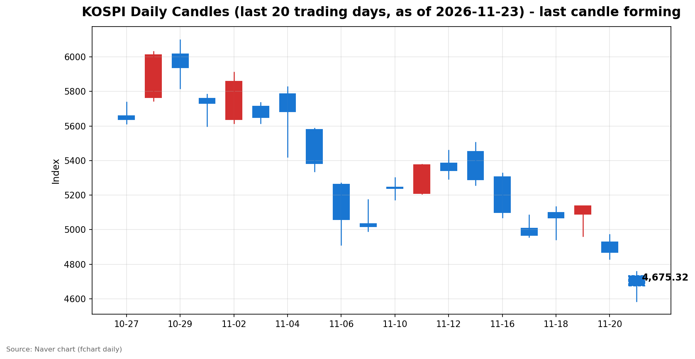
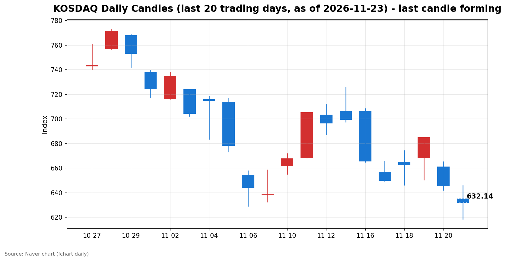

안녕하세요, [한국투자증권](https://securities.koreainvestment.com/main/Main.jsp)에서 [한투-한국투자증권](https://play.google.com/store/apps/details?id=com.truefriend.neosmartarenewal&hl=ko) 개발을 담당하고 있는 way입니다. 
간밤 미국 증시 급락 여파로 국내 증시는 오전 한때 코스피 4,600선을 내줬다가 낙폭을 일부 줄이며 정오를 맞았습니다. 

## 오전장 요약

코스피는 전 거래일보다 4.07% 하락한 4,671.77로 정오 무렵 거래되고 있습니다. 
장 초반 4,759.65까지 올랐던 지수는 오전 11시 43분 무렵 4,590.40까지 밀리며 4,600선을 내줬습니다. 
이후 낙폭을 줄여 4,670선 안팎에서 움직이고 있습니다. 
코스닥도 2.12% 하락한 631.96을 기록하고 있습니다. 
장중 저점은 618.74까지 내려갔습니다. 
지난주 금요일에 이어 오늘도 매도 사이드카가 발동했습니다. 
정부가 주말 사이 증권시장안정펀드 가동 준비에 착수했지만, 오전 장에서는 투매를 막지 못했습니다. 

## 오늘의 스냅샷

| 지수 | 현재가 | 전일 대비 | 등락률 | 시가 | 고가 | 저가 | 거래량 | 거래대금 |
| --- | --- | --- | --- | --- | --- | --- | --- | --- |
| [코스피](https://finance.naver.com/sise/sise_index.naver?code=KOSPI) | 4,671.77 | -198.19 | -4.07% | 4,734.90 | 4,759.65 | 4,586.80 | 13,499만 주 | 9조 4,334억 원 |
| [코스닥](https://finance.naver.com/sise/sise_index.naver?code=KOSDAQ) | 631.96 | -13.72 | -2.12% | 634.93 | 645.93 | 618.74 | 25,565만 주 | 2조 8,243억 원 |

스냅샷 기준 시각은 2026년 11월 23일 오후 12시 29분(KST)입니다. 
전일 종가는 코스피 4,869.96, 코스닥 645.68입니다. 
전일 종가는 네이버 실시간 등락률로 역산한 값과 일봉 종가가 일치합니다. 
당일 봉은 형성 중인 봉으로, 마감 전에는 계속 변합니다. 
원/달러 환율은 1,346원대에서 움직이며 전일보다 높은 수준을 유지하고 있습니다. 

## 차트

최근 20거래일 일봉 차트입니다. 
빨간 봉은 종가가 시가보다 높은 날, 파란 봉은 종가가 시가보다 낮은 날입니다. 
당일 봉은 형성 중인 봉으로, 마감 전에는 계속 변합니다. 

## 원인·촉매 분석

이번 하락의 촉매는 한 가지가 아니라 여러 악재가 겹친 결과입니다. 
가장 직접적인 촉매는 간밤 미국 증시 급락입니다. 
나스닥 종합지수는 22,617.73으로 5.28% 하락했고, 미국 반도체 지수는 10.7% 하락했습니다. 
엔비디아는 하루 만에 14.01% 하락했습니다. 
미국 3대 지수는 기술적 조정 구간에 진입했습니다. 
나스닥100은 10월 6일 고점 대비 19.8% 하락해 약세장 진입에 임박했고, S&P500도 고점 대비 12% 밀렸습니다. 
중앙일보 GMC 허브의 11월 23일자 블룸버그 기사에 따르면 공포지수(VIX)는 36선 부근까지 올랐고, 추세 추종 펀드는 한 달간 약 570억 달러를 순매도했습니다. 
중앙일보 GMC의 11월 20일자 G프터눈 브리핑에 따르면 11월 20일 아시아 증시도 동반 급락했습니다. 
니케이225는 5.06%, 대만 가권지수는 6.23% 하락했습니다. 
미국 10년물 국채 금리는 4.92%까지 올랐고, 자금은 미 국채와 엔 등 안전자산으로 이동했습니다. 
하락의 배경에는 인공지능 투자 수익성에 대한 회의론이 있습니다. 
엔비디아에 대한 미국 증권거래위원회 회계 조사 착수 보도, 앤트로픽 주가 부진, 트럼프 대통령의 해외 데이터센터 건설 금지 발언이 이어졌습니다. 
연준이 인공지능 하방 위험을 언급한 점도 투자 심리를 위축시켰습니다. 
단순한 차익 실현이 아니라 인공지능 투자 지속성 자체에 대한 의구심이 커진 국면입니다. 
국내 수급 구도도 하락을 뒷받침했습니다. 
전 거래일인 11월 20일 외국인은 코스피에서 1조 956억 원, 코스닥에서 1,616억 원을 순매도했습니다. 
기관도 코스피에서 약 9,330억 원, 코스닥에서 약 1,060억 원을 순매도했습니다. 
개인은 코스피에서 1조 5,381억 원, 코스닥에서 2,803억 원을 순매수하며 물량을 받았습니다. 
개인의 저가 매수가 이어졌으나 외국인과 기관의 동반 매도를 막지 못했습니다. 
언론 보도에 따르면 외국인은 6거래일 연속 순매도를 이어갔습니다. 
외국인 매도가 이어지는 가운데 원/달러 환율 상승이 매도 압력을 키우는 요인으로 작용하고 있습니다. 
다만 주말 사이 증안펀드 가동 준비 소식이 전해지며 하방을 방어하려는 신호가 나왔습니다. 
실제 자금 투입 시점과 규모는 아직 정해지지 않았습니다. 
장중 수급 확정치는 아직 나오지 않았으므로, 당일 수급은 확인이 필요합니다. 

## 핵심 사건 3가지

첫째, 간밤 나스닥이 하루 만에 5.28% 하락했습니다. 
미국 반도체 지수는 10.7% 하락했고 엔비디아는 14.01% 하락했습니다. 
월스트리트저널은 11월 22일자 칼럼에서 최근 인공지능 주식 매도세가 2000년 닷컴버블 붕괴와 놀랄 만큼 비슷하다고 지적했습니다. 
엔비디아는 한 주간 23% 하락해 2008년 이후 최악의 주간을 기록했습니다. 
인공지능 투자 수익성에 대한 회의론이 반도체주 투매로 이어진 것입니다. 
국내 반도체 대형주에도 직접적인 하락 압력으로 작용하고 있습니다. 

둘째, 정부가 증권시장안정펀드 가동 준비에 나섰습니다. 
이형일 부총리 겸 재정경제부 장관을 비롯한 F4가 11월 22일 긴급 시장 점검회의를 열고 준비 착수에 합의했습니다. 
증안펀드 규모는 약 10조 7천억 원으로 알려졌으며, 2008년 글로벌 금융위기 이후 18년 만의 가동 준비입니다. 
공매도에 대한 특별 감시도 함께 추진됩니다. 
이 부총리는 펀드 규모는 가동 상황을 보며 검토하겠다고 밝혔습니다. 
과거에도 조성이나 가동 준비 방침 발표 전후로 증시가 단기 저점을 형성한 사례가 있습니다. 
다만 실제 투입 여부와 규모가 확인되기 전까지는 기대감만으로 하락을 막기 어렵습니다. 
오전 장에서 증안펀드 소식에도 코스피가 4,600선을 내준 점이 이를 보여줍니다. 

셋째, 11월 수출이 역대 최대를 기록했습니다. 
11월 1일부터 20일까지 수출은 774억 달러로 같은 기간 기준 역대 최대이며, 전년 동기 대비 101.5% 증가했습니다. 
반도체 수출은 385억 달러로 294.4% 늘며 전체 수출의 절반을 차지했습니다. 
지난 19일에는 연간 누적 수출액이 사상 처음 1조 달러를 돌파했습니다. 
수출 실적 자체는 견조하지만, 시장에서는 실적과 주가의 괴리가 커지고 있습니다. 
반도체 실물 수요가 급증하는데도 주가는 밸류에이션 재평가 속에 하락하고 있습니다. 
이 괴리가 해소되려면 인공지능 투자 수익성에 대한 시장의 의구심이 가라앉아야 합니다. 

## 섹터·테마 영향 체인

반도체 대형주가 가장 직접적인 타격을 받았습니다. 
미국 반도체 지수가 10.7% 하락한 여파가 국내 대형 반도체주에 그대로 전해졌습니다. 
인공지능 하드웨어에 대한 신뢰 훼손이라는 해석이 밸류에이션 전반을 끌어내리고 있습니다. 
다만 수출 데이터가 보여주듯 반도체 실물 수요 자체는 급증하고 있습니다. 
실적과 주가의 괴리는 밸류에이션 조정 국면의 전형적인 모습입니다. 
메모리 관련 테마도 약세를 보였습니다. 
3D낸드 테마는 0.92% 하락했고, 스마트공장 테마는 0.75% 하락했습니다. 
반면 로봇 테마는 1.40% 상승하며 장에서 가장 강한 흐름을 보였습니다. 
휴림로봇이 상한가를 기록했고, 로보티즈와 유일로보틱스도 강세를 보였습니다. 
인공지능·반도체와 직접 연결되지 않은 테마로 자금이 이동하는 순환매 흐름입니다. 
바이오소재 테마도 0.66% 상승했고, 전자상거래 테마는 0.61% 상승했습니다. 
에너지와 전력주는 북미 전력망 수주 기대가 여전합니다. 
LS전선은 미국 뉴욕 초고압 전력망 사업에 7,000억 원 규모 케이블을 공급한다는 소식이 전해졌습니다. 
다만 하락장에서는 개별 호재가 지수 흐름을 바꾸지 못하고 있습니다. 

## 최근 5거래일 일봉

당일 봉은 형성 중인 봉으로, 마감 전에는 계속 변합니다. 

### 코스피

| 날짜 | 시가 | 고가 | 저가 | 종가 | 거래량 |
| --- | --- | --- | --- | --- | --- |
| 11월 16일 | 5,305.40 | 5,327.99 | 5,069.83 | 5,100.50 | 221,296천 주 |
| 11월 17일 | 5,008.09 | 5,084.06 | 4,957.00 | 4,968.48 | 193,978천 주 |
| 11월 18일 | 5,098.82 | 5,133.14 | 4,943.17 | 5,067.44 | 219,090천 주 |
| 11월 19일 | 5,090.04 | 5,137.89 | 4,963.61 | 5,137.89 | 195,695천 주 |
| 11월 20일 | 4,928.51 | 4,971.31 | 4,831.69 | 4,869.96 | 206,729천 주 |
| 11월 23일(형성 중) | 4,734.90 | 4,759.65 | 4,586.80 | 4,671.77 | 134,986천 주 |

### 코스닥

| 날짜 | 시가 | 고가 | 저가 | 종가 | 거래량 |
| --- | --- | --- | --- | --- | --- |
| 11월 16일 | 705.88 | 708.34 | 664.98 | 665.65 | 446,420천 주 |
| 11월 17일 | 656.82 | 665.79 | 649.62 | 650.06 | 467,132천 주 |
| 11월 18일 | 664.93 | 674.30 | 646.31 | 662.81 | 462,804천 주 |
| 11월 19일 | 668.31 | 684.81 | 650.39 | 684.81 | 398,792천 주 |
| 11월 20일 | 660.98 | 665.15 | 642.13 | 645.68 | 421,847천 주 |
| 11월 23일(형성 중) | 634.93 | 645.93 | 618.74 | 631.96 | 255,648천 주 |

## 오전 강했던 테마와 흐름 변화

오전 장에서 가장 강했던 테마는 로봇입니다. 
로봇 테마는 1.40% 상승했고, 테마 내 30개 종목 중 17개가 올랐습니다. 
바이오소재와 전자상거래 테마도 소폭 상승했습니다. 
시가 대비 방향 전환도 뚜렷했습니다. 
코스피는 시가 4,734.90에서 출발해 장 초반 4,759.65까지 올랐으나, 오전 중 4,586.80까지 밀렸습니다. 
시가보다 3% 넘게 낮은 저점을 찍은 뒤 정오 무렵 4,670선 안팎으로 낙폭을 줄였습니다. 
코스닥도 시가 634.93에서 출발해 장 초반 645.93까지 올랐다가 618.74까지 하락했습니다. 
양 지수 모두 장 초반 반등 시도 후 저점을 찍고 낙폭을 축소하는 흐름입니다. 
낙폭 축소가 추세 전환인지, 일시적인 기술적 반등인지는 오후 흐름으로 확인해야 합니다. 

## 오후 전망과 확인할 시나리오

오전 흐름이 오후에도 이어질지, 일시적인 노이즈에 그칠지는 세 가지로 가릴 수 있습니다. 
첫째, 오전 저점의 지지 여부입니다. 
코스피는 장중 저점 4,586.80과 4,600선을, 코스닥은 618.74를 오후에도 지켜야 낙폭 축소 흐름이 이어질 수 있습니다. 
저점을 다시 내주면 하락이 심화될 수 있습니다. 
둘째, 증안펀드 관련 소식입니다. 
실제 자금 투입 시점이나 규모가 확인되면 투자 심리 진정에 도움이 될 수 있습니다. 
반대로 구체적인 소식이 없으면 기대감만으로 하락을 막기 어렵습니다. 
셋째, 미국 시간외 선물과 아시아 증시 흐름입니다. 
간밤 미국 증시 급락이 이어지는지, 아니면 낙폭을 되돌리는지가 오후 국내 증시의 방향을 좌우할 수 있습니다. 
미국 증시는 추수감사절 연휴로 11월 26일 휴장하고 11월 27일 조기 폐장합니다. 
외국인 매매 동향은 장 마감 이후에 확정되므로, 오후에는 외국인 매도 강도가 약해지는지를 함께 확인해야 합니다. 
리스크 관리 관점에서는 지수 단위에서 저점 지지 여부와 변동성 확대 여부를 확인하는 것이 중요합니다. 
특정 종목의 매수나 매도를 권유하는 것이 아닙니다. 

## 마치며

오전 장은 미국발 인공지능 쇼크와 외국인 매도 속에 급락했으나, 저점에서는 낙폭을 일부 줄였습니다. 
오후에는 저점 지지 여부와 증안펀드 관련 소식을 확인하며 변동성에 유의하시기 바랍니다. 
