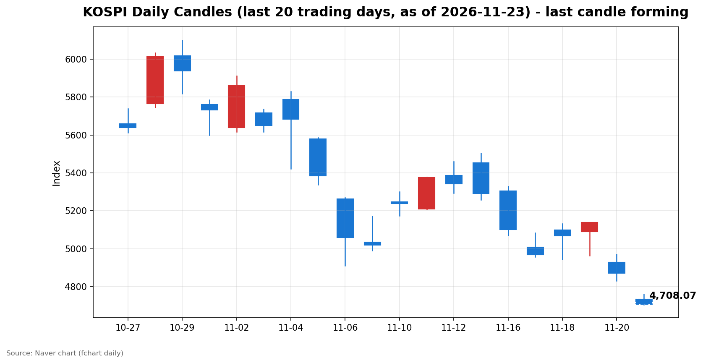
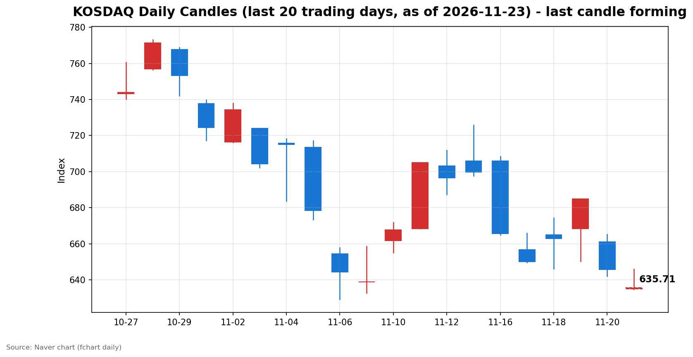

안녕하세요, [한국투자증권](https://securities.koreainvestment.com/main/Main.jsp)에서 [한투-한국투자증권](https://play.google.com/store/apps/details?id=com.truefriend.neosmartarenewal&hl=ko) 개발을 담당하고 있는 way입니다. 
간밤 미국 증시가 큰 폭으로 하락하며 국내 증시도 하락 출발했습니다. 

## 배경

지난주 금요일 미국 증시는 3대 지수가 일제히 기술적 조정 구간에 진입했습니다. 
나스닥 종합지수는 22,617.73으로 5.28% 하락했습니다. 
S&P500 지수도 6,910.39로 3.70% 하락했습니다. 
미국 반도체 지수는 10.7% 하락했고, 엔비디아는 14.01% 하락했습니다. 
중앙일보 GMC의 11월 21일자 G모닝 브리핑은 나스닥100이 하루 5.6% 급락하고 S&P500이 고점 대비 10% 넘게 밀려 공식 조정 국면에 진입했다고 전했습니다. 
나스닥100은 10월 6일 고점 대비 19.8% 하락해 약세장 진입에 임박했습니다. 
자금은 미 국채와 엔, 스위스프랑 등 안전자산으로 이동했고, 미 10년물 금리는 4.92%를 기록했습니다. 
월가에서는 2018년 연말 폭락, 이른바 블랙 크리스마스에 대한 언급이 나왔습니다. 
코스피200 야간선물은 7% 하락했습니다. 
주말 사이 금융당국은 10조 원대 증권시장안정펀드 가동 준비 등 긴급 대책을 논의했습니다. 
증안펀드는 2008년 글로벌 금융위기 이후 18년 만의 가동 준비입니다. 

## 오늘의 스냅샷

| 지수 | 현재가 | 전일 대비 | 등락률 | 시가 | 고가 | 저가 | 거래량 | 거래대금 |
| --- | --- | --- | --- | --- | --- | --- | --- | --- |
| [코스피](https://finance.naver.com/sise/sise_index.naver?code=KOSPI) | 4,713.61 | -156.35 | -3.21% | 4,734.90 | 4,759.65 | 4,706.15 | 3,778만 주 | 2조 8,085억 원 |
| [코스닥](https://finance.naver.com/sise/sise_index.naver?code=KOSDAQ) | 636.08 | -9.60 | -1.49% | 634.93 | 645.93 | 634.70 | 8,145만 주 | 9,213억 원 |

스냅샷 기준 시각은 2026년 11월 23일 오전 9시 28분(KST)입니다. 
전일 종가는 코스피 4,869.96, 코스닥 645.68입니다. 
원/달러 환율은 1,346.00원으로 전일 대비 11.90원 올랐습니다. 

## 차트

최근 20거래일 일봉 차트입니다. 
빨간 봉은 종가가 시가보다 높은 날, 파란 봉은 종가가 시가보다 낮은 날입니다. 
당일 봉은 형성 중인 봉으로, 마감 전에는 계속 변합니다. 

## 원인·촉매 분석

이번 하락의 촉매는 한 가지가 아니라 여러 악재가 겹친 결과입니다. 
미국에서는 엔비디아에 대한 미국 증권거래위원회(SEC)의 회계 조사 착수 보도가 나왔습니다. 
여기에 앤트로픽 주가 부진, 트럼프 대통령의 해외 데이터센터 건설 금지 발언, 젠슨 황 엔비디아 최고경영자의 스캔들과 사임 소식이 이어졌습니다. 
연준이 인공지능(AI) 하방 위험을 언급한 점과 민주당의 중간선거 승리 이후 데이터센터 규제 우려도 투자 심리를 위축시켰습니다. 
시장에서는 이를 AI 하드웨어에 대한 신뢰 훼손으로 해석하고 있습니다. 
단순한 차익 실현이 아니라 AI 투자 지속성 자체에 대한 의구심이 커진 국면입니다. 
국내 수급 구도도 하락을 뒷받침했습니다. 
전 거래일인 11월 20일 외국인은 코스피에서 1조 956억 원, 코스닥에서 1,616억 원을 순매도했습니다. 
기관도 코스피에서 9,334억 원, 코스닥에서 1,069억 원을 순매도했습니다. 
개인은 코스피에서 1조 5,381억 원, 코스닥에서 2,802억 원을 순매수하며 물량을 받았습니다. 
개인의 저가 매수가 이어졌으나 외국인과 기관의 동반 매도를 막지 못했습니다. 
언론 보도에 따르면 외국인은 6거래일 연속 순매도를 이어갔습니다. 
원/달러 환율이 1,346원까지 오른 점도 외국인 매도 압력을 키우는 요인입니다. 
다만 주말 사이 증안펀드 가동 준비 소식이 전해지며 하방을 방어하려는 신호가 나왔습니다. 
실제 자금 투입 시점은 아직 정해지지 않았습니다. 

## 핵심 사건 3가지

첫째, 나스닥이 하루 만에 5.28% 하락했습니다. 
미국 반도체 지수는 10.7% 하락했고 엔비디아는 14.01% 하락했습니다. 
AI 투자 수익성에 대한 회의론이 반도체주 투매로 이어진 것입니다. 
국내 반도체 대형주에도 직접적인 하락 압력으로 작용하고 있습니다. 

둘째, 미국 3대 지수가 고점 대비 10% 하락한 기술적 조정 구간에 진입했습니다. 
월가에서는 2018년 연말 폭락이 재연되는 것 아니냐는 우려가 나왔습니다. 
골드만삭스는 2018년과 같은 경로를 따른다면 추가 하락이 가능하다고 지적했습니다. 
다만 기업 이익과 회사채 시장은 견조하다는 평가도 함께 나왔습니다. 
12월 연방공개시장위원회(FOMC) 결정과 물가 지표가 분수령이 될 전망입니다. 

셋째, 정부가 증안펀드 가동 준비에 나섰습니다. 
2008년 이후 18년 만의 일입니다. 
과거 2020년, 2022년, 2024년에도 실제 자금 집행 없이 조성이나 가동 준비 방침 발표 전후로 증시가 단기 저점을 형성한 사례가 있습니다. 
시장에서는 정부의 시장 안정 의지 자체가 공포를 진정시킬 수 있을지 주목하고 있습니다. 
실제 투입 여부와 규모가 확인되기 전까지는 기대감만으로 하락을 막기 어렵습니다. 

## 섹터·테마 영향 체인

반도체 대형주가 가장 직접적인 타격을 받았습니다. 
D램과 HBM 관련주는 실적 전망 하회와 연말 재고 조정 우려가 겹치며 전반적으로 약세를 보였습니다. 
수출 규제 우려와 외국인 매도세가 겹친 결과입니다. 
다만 AI 기판과 후공정, 장비 쪽에서는 선별 반등이 나타났습니다. 
케이씨텍과 테스 등 장비주는 수주 소식을 바탕으로 장 초반 상승했습니다. 
대형주 약세와 장비주 강세가 엇갈리는 순환매 흐름입니다. 
로봇 테마는 보합권에서 출발했습니다. 
법적 리스크 해소와 실적 개선이 확인된 종목을 중심으로 강세가 나타났습니다. 
2차전지는 3분기 실적 악화와 저가형 LFP 배터리 경쟁 심화로 하락세를 이어갔습니다. 
에너지와 전력주는 북미 전력망 수주 기대가 여전하지만 전 분기 대비 실적 둔화와 현지 규제 우려로 동반 하락했습니다. 
LS전선은 미국 뉴욕 초고압 전력망 사업에 7,000억 원 규모 케이블을 공급한다는 소식이 전해졌습니다. 
테마별로는 바이오소재가 2.97% 상승했고, 주류판매가 1.38%, 선크림이 1.26% 상승했습니다. 
화장품 테마는 0.28% 하락했고, 3D낸드 테마는 0.05% 하락했습니다. 

## 최근 5거래일 일봉

당일 봉은 형성 중인 봉으로, 마감 전에는 계속 변합니다. 

### 코스피

| 날짜 | 시가 | 고가 | 저가 | 종가 | 거래량 |
| --- | --- | --- | --- | --- | --- |
| 11월 16일 | 5,305.40 | 5,327.99 | 5,069.83 | 5,100.50 | 221,296천 주 |
| 11월 17일 | 5,008.09 | 5,084.06 | 4,957.00 | 4,968.48 | 193,978천 주 |
| 11월 18일 | 5,098.82 | 5,133.14 | 4,943.17 | 5,067.44 | 219,090천 주 |
| 11월 19일 | 5,090.04 | 5,137.89 | 4,963.61 | 5,137.89 | 195,695천 주 |
| 11월 20일 | 4,928.51 | 4,971.31 | 4,831.69 | 4,869.96 | 206,729천 주 |
| 11월 23일(형성 중) | 4,734.90 | 4,759.65 | 4,706.15 | 4,711.39 | 37,316천 주 |

### 코스닥

| 날짜 | 시가 | 고가 | 저가 | 종가 | 거래량 |
| --- | --- | --- | --- | --- | --- |
| 11월 16일 | 705.88 | 708.34 | 664.98 | 665.65 | 446,420천 주 |
| 11월 17일 | 656.82 | 665.79 | 649.62 | 650.06 | 467,132천 주 |
| 11월 18일 | 664.93 | 674.30 | 646.31 | 662.81 | 462,804천 주 |
| 11월 19일 | 668.31 | 684.81 | 650.39 | 684.81 | 398,792천 주 |
| 11월 20일 | 660.98 | 665.15 | 642.13 | 645.68 | 421,847천 주 |
| 11월 23일(형성 중) | 634.93 | 645.93 | 634.70 | 635.85 | 80,680천 주 |

## 전일 수급

11월 20일 수급은 외국인과 기관의 동반 매도, 개인의 대규모 순매수 구도였습니다. 
코스피에서 외국인은 1조 956억 원을 순매도했고, 기관은 9,334억 원을 순매도했습니다. 
기관 세부로는 금융투자가 4,477억 원, 투신이 3,089억 원, 사모가 2,203억 원 순매도했습니다. 
연기금은 844억 원 순매수하며 기관 내에서는 다른 움직임을 보였습니다. 
개인은 1조 5,381억 원을 순매수했고, 기타법인은 4,904억 원을 순매수했습니다. 
코스닥에서도 외국인이 1,616억 원, 기관이 1,069억 원을 순매도했고 개인이 2,802억 원을 순매수했습니다. 
개인이 급락장에서 물량을 적극적으로 받았으나 지수는 5.22% 하락했습니다. 
저가 매수세가 유입됐음에도 매도 물량을 소화하지 못한 흐름입니다. 
개인 순매수가 이어지는 가운데 외국인의 매도 강도가 꺾이는지가 반등의 관건입니다. 

## 단기·중기 전망과 확인할 시나리오

단기적으로는 낙폭 과대에 따른 기술적 반등 가능성과 하락 지속 가능성이 함께 열려 있습니다. 
키움증권은 코스피 선행 주가순자산비율(PBR)이 금융위기 당시 저점 수준인 0.8배까지 낮아질 경우를 가정해 최악의 경우 4,200~4,300선까지 하단을 열어둘 필요가 있다고 분석했습니다. 
신한증권은 코스피가 4,500선까지 밀릴 가능성을 언급하면서도 하락의 장기 지속 가능성은 낮다고 봤습니다. 
증권사들의 하방 시나리오는 4,200~4,500선 구간에 분포하고 있습니다. 
확인할 가격 레벨은 코스피 11월 20일 저점 4,831.69와 전일 종가 4,869.96입니다. 
아래로는 4,700선, 위로는 5,000선이 심리적 기준선입니다. 
코스닥은 11월 20일 저점 642.13과 630선이 하방 기준입니다. 
확인할 이벤트는 12월 FOMC 결정과 미국 물가 지표입니다. 
엔비디아 회계 조사 진행 상황과 증안펀드 실제 투입 여부도 확인해야 합니다. 
외국인 수급이 순매수로 전환되는지도 중요한 신호입니다. 
중기적으로는 AI 투자 수익성에 대한 의구심이 해소되는지가 관건입니다. 
AI 하드웨어 수요와 실적이 확인되면 조정은 일시적 노이즈로 끝날 수 있습니다. 
반대로 규제 우려와 회계 조사 불확실성이 이어지면 조정이 길어질 수 있습니다. 

## 장 초반 확인할 점

외국인과 기관의 순매수 전환 여부를 확인합니다. 
증안펀드와 관련한 추가 발표가 있는지 확인합니다. 
나스닥 선물 움직임과 환율 1,350원 돌파 여부를 확인합니다. 
반도체 대형주의 낙폭 축소 여부를 확인합니다. 
코스피 4,700선 방어 여부를 확인합니다. 

## 마치며

간밤 미국 증시의 급락이 국내 증시에도 그대로 이어졌습니다. 
오늘은 낙폭이 어디에서 멈추는지, 그리고 증안펀드 기대감이 실제 수급으로 이어지는지를 확인하는 하루가 될 전망입니다. 
이 글은 교육과 해설을 위한 시황 정리이며, 특정 종목의 매수나 매도를 권유하지 않습니다. 
