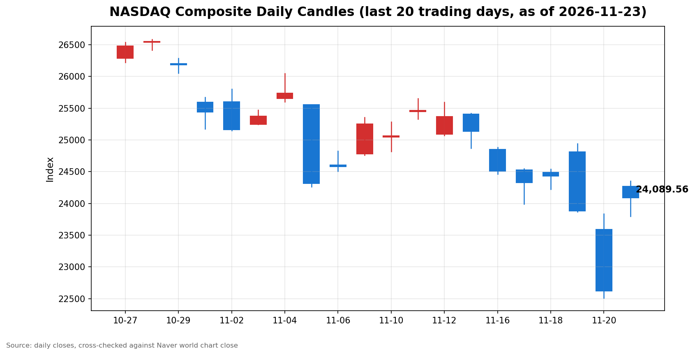

안녕하세요, [한국투자증권](https://securities.koreainvestment.com/main/Main.jsp)에서 [한투-한국투자증권](https://play.google.com/store/apps/details?id=com.truefriend.neosmartarenewal&hl=ko) 개발을 담당하고 있는 way입니다. 
현지시간 11월 23일 월요일, 나스닥은 젠슨 황 엔비디아 최고경영자 복귀 소식에 6.51% 급등하며 마감했습니다. 

## 마감 요약

나스닥 종합은 전일 대비 1,471.83포인트, 6.51% 오른 24,089.56으로 마감했습니다. 
다우는 1,447.98포인트, 3.01% 오른 49,595.31로 마감했습니다. 
S&P500은 326.78포인트, 4.73% 오른 7,237.17로 마감했습니다. 
나스닥의 6.51% 상승은 2025년 4월 이후 가장 큰 하루 상승률입니다. 
지난주 나스닥이 10% 안팎 하락한 뒤 나온 반등으로, 지난주 손실의 절반가량을 되돌렸습니다. 
엔비디아는 31.48% 폭등하며 하루 시가총액이 9,520억 달러 늘었습니다. 
변동성 지수는 전일 35.89에서 26.56으로 하락했습니다. 
미국 10년물 국채수익률은 전일 4.91%와 비슷한 4.92% 수준에서 마감했습니다. 
국내 증시는 미국장 반등 전에 마감해 코스피가 3.31% 하락한 4,708.54, 코스닥이 1.58% 하락한 635.45로 장을 마쳤습니다. 
중앙일보 GMC 11월 23일 G브닝과 G프터눈은 하락장 속 코스피 흐름을 다뤘고, GMC 트렌드는 젠슨 황 복직 결정을 전했습니다. 

## 오늘의 마감 스냅샷

| 지수 | 종가 | 전일 대비 | 등락률 | 전일 종가 | 당일 고가 | 당일 저가 |
| --- | --- | --- | --- | --- | --- | --- |
| 나스닥 종합 | 24,089.56 | +1,471.83 | +6.51% | 22,617.73 | 24,353.65 | 23,794.96 |
| S&P500 | 7,237.17 | +326.78 | +4.73% | 6,910.39 | 7,295.60 | 7,152.66 |
| 다우 | 49,595.31 | +1,447.98 | +3.01% | 48,147.33 | 49,810.26 | 49,033.31 |

스냅샷 기준 시각은 미국 동부시간 2026년 11월 23일 오후 4시 20분, 한국시간 11월 24일 오전 6시 20분입니다. 
나스닥 수치는 [네이버 월드 차트](https://finance.naver.com/world/sise.naver?symbol=NAS@IXIC)([나스닥 종합 가격 페이지](https://stock.naver.com/worldstock/index/.IXIC/price))에서 확인한 장마감 값입니다. 
네이버 월드 차트 페이지는 자바스크립트 기반이라 curl 직접 조회로는 수치를 확인할 수 없었으나, 브라우저로 같은 페이지를 열어 종가와 전일 대비, 등락률, 시가와 고가, 저가를 직접 확인했습니다. 
나스닥 종가 24,089.56과 등락률 6.51% 상승은 Yahoo Finance 일별 데이터와도 일치합니다. 
S&P500과 다우 종가는 Yahoo Finance 일별 데이터를 기준으로 했습니다. 
한투 MTS 해외 대시보드의 나스닥 교차값은 24,136.77로 네이버 공식 종가보다 소폭 높게 나타났고, S&P500 교차값도 7,246.04로 공식 종가보다 소폭 높았습니다. 
스냅샷 시점의 차이로 보이며, 본문 수치는 네이버와 Yahoo Finance가 일치하는 공식 종가를 기준으로 했습니다. 
나스닥의 52주 범위는 최저 20,690.25, 최고 27,722.75입니다. 
원·달러 환율은 한투 MTS 기준 1,344.00원 수준이었습니다. 

## 차트

최근 20거래일 일봉 차트입니다. 
빨간 봉은 종가가 시가보다 높은 날, 파란 봉은 종가가 시가보다 낮은 날입니다. 

## 원인·촉매 분석

오늘 장의 근본 촉매는 젠슨 황의 엔비디아 복귀입니다. 
엔비디아 이사회는 현지시간 23일 오전, 젠슨 황을 사장과 최고경영자, 이사로 즉시 복직시키기로 결정했다고 밝혔습니다. 
젠슨 황은 11일 전 사임한 뒤 이날 복귀했습니다. 
복귀 소식이 전해지자 엔비디아 주가는 31.48% 폭등했고, 인공지능 관련주 전반으로 매수세가 번졌습니다. 
지난주 매도의 중심에 있던 불확실성이 걷히자, 낙폭 과대에 따른 저가 매수세도 함께 들어왔습니다. 
나스닥은 장 시작부터 전일 대비 1,652.02포인트, 7.30% 오른 24,269.75로 개장했습니다. 
개장 직후부터 강한 갭 상승으로 출발했다는 점은 대기 매수세가 두터웠음을 보여줍니다. 
지난주 흐름과 비교하면 방향이 완전히 뒤집혔습니다. 
지난 금요일 나스닥은 5.28% 하락했고, 7거래일 연속 하락하며 주간 기준 10% 안팎의 낙폭을 기록했습니다. 
S&P500도 7거래일 연속 하락하며 2020년 2월 이후 가장 긴 연패를 기록했습니다. 
금리 경로는 이날 반등의 촉매가 아니었습니다. 
미국 10년물 국채수익률은 전일 4.91%에서 4.92%로 거의 움직이지 않았습니다. 
금리가 아니라 인공지능 리더십 불확실성의 해소가 이날 반등을 이끌었다는 점이 뚜렷합니다. 
지수 간 방향 차이는 충격의 중심이 어디였는지 보여줍니다. 
나스닥이 6.51% 오른 반면 S&P500은 4.73%, 다우는 3.01% 올랐습니다. 
기술주와 인공지능 관련주에 충격이 집중됐던 지난주와 같은 구도가, 반등 국면에서도 그대로 나타났습니다. 
중앙일보 GMC 11월 23일 G프터눈은 코스피가 3%대 하락에 그친 점을 두고 두 자릿수 급락 가능성까지 각오했던 장이었다고 전했습니다. 
국내 증시는 미국장 반등 전에 마감했기 때문에 이날 미국장 흐름이 국내 증시에 미치는 영향은 다음 거래일에 확인해야 합니다. 

## 핵심 사건 3가지

첫째, 젠슨 황의 엔비디아 복귀 결정입니다. 
엔비디아 이사회는 만장일치로 젠슨 황의 복직을 결정했고, 효력은 즉시 발생했습니다. 
복귀 소식에 엔비디아 주가는 31.48% 폭등했고, 하루 시가총액은 9,520억 달러 늘었습니다. 
이는 2003년 이후 엔비디아의 가장 큰 하루 상승률입니다. 
나스닥100은 6.6% 오르며 2025년 4월 이후 가장 큰 하루 상승률을 기록했고, 인공지능 랠리로 나스닥100 시가총액이 2조 달러 늘어날 것이라는 전망도 나왔습니다. 
복귀 배경을 둘러싼 보도는 엇갈립니다. 
미국 언론 보도에 따르면 젠슨 황의 사임에는 중국 정보기관과 연계된 것으로 알려진 인물과의 관계, 자사 여성 임원과의 추가 의혹이 거론됐습니다. 
세마포 보도에 따르면 미국 상무부는 싱가포르 기업 메가스피드를 수출통제 명단에 추가할 예정이며, 이 기업이 엔비디아 첨단칩을 중국에 넘겼는지가 의혹의 핵심입니다. 
월스트리트저널 등 보도에 따르면 도널드 트럼프 대통령은 J D 밴스 부통령에게 엔비디아 이사회와 접촉해 상황을 해결하라는 특명을 내렸습니다. 
이들 의혹의 구체적인 사실관계는 확인되지 않았으며, 확정된 사실로 단정하지 않습니다. 
복귀 자체는 이사회 결정으로 확인된 사실이고, 이날 반등의 직접 계기가 됐습니다. 

둘째, 지난주 폭락 뒤 낙폭 과대 반등입니다. 
지난주 나스닥은 10% 안팎 하락했고, 금요일 하루에만 5.28% 떨어졌습니다. 
나스닥은 7거래일 연속 하락하며 2020년 이후 가장 긴 연패를 기록했습니다. 
S&P500은 7,000선 아래로 내려가며 4월 중순 이후 처음으로 7,000선을 밑돌았습니다. 
과도한 낙폭이 쌓인 뒤에는 반등의 기술적 여건이 마련되는 것이 일반적입니다. 
월요일 장은 개장부터 7.30% 갭 상승으로 출발했고, 장중 고가 24,353.65까지 올랐습니다. 
상승 흐름은 장 마감까지 이어졌고, 종가는 장중 고가보다 264.09포인트 낮았습니다. 
AP 통신은 이날 반등으로 지난주 손실의 절반가량을 되돌렸다고 전했습니다. 
모건스탠리는 4월 이후 가장 낙관적인 시각으로 전환했다는 보도도 나왔습니다. 
다만 골드만삭스는 폭락을 저가 매수 기회로 보면서도 투매가 아직 다 나오지 않았다고 평가했습니다. 
낙관과 신중론이 함께 나온 점은 반등의 성격을 가늠하는 재료입니다. 

셋째, 반도체와 메모리, 인공지능 인프라 종목의 동반 급등입니다. 
필라델피아 반도체 지수는 장 초반 15% 올랐습니다. 
메모리 반도체 종목은 20% 안팎 올랐고, 델은 25% 상승했습니다. 
인공지능 서버와 데이터센터 관련 종목도 동반 강세를 보였습니다. 
이는 지난주 반도체 약세가 나스닥 낙폭을 키웠던 흐름의 정반대입니다. 
지난주 AMD와 메모리 종목이 두 자릿수 하락하며 밸류체인의 하드웨어 축이 무너졌던 것과 비교하면, 이날은 같은 축이 반등을 이끌었습니다. 
반면 앤트로픽은 이날도 1%대 하락하며 랠리에서 비켜났습니다. 
앤트로픽은 상장 이틀째였던 지난 금요일 8.5% 하락한 데 이어 이날도 약세를 이어갔습니다. 
인공지능 모델 기업의 약세가 이어진 점은 반등이 하드웨어와 인프라 중심으로 이뤄졌음을 보여줍니다. 

## 지수·섹터 영향 체인

나스닥은 6.51% 올랐고, S&P500은 4.73%, 다우는 3.01% 올랐습니다. 
상승률의 순서 자체가 반등의 중심이 어디였는지 보여줍니다. 
기술주는 직격탄을 맞았던 만큼 반등도 가장 컸습니다. 
엔비디아를 중심으로 반도체와 메모리, 인공지능 인프라 종목이 동반 급등하며 나스닥 상승을 이끌었습니다. 
금리 하락이 성장주를 떠받치는 통상적인 연결고리는 이날 작용하지 않았습니다. 
10년물 국채수익률이 전일과 비슷한 수준에 머물렀기 때문입니다. 
대신 리더십 불확실성 해소가 성장주 밸류에이션을 짓누르던 할인 요인을 걷어낸 하루였습니다. 
금융주는 기술주보다 상승률이 작았으나, 시장 전체의 위험 선호 회복에 함께 올랐습니다. 
에너지는 이날 흐름의 중심에서 벗어나 있었습니다. 
서부텍사스산 원유는 장중 기준 3.70% 하락한 80.86달러 수준이었고, 금 선물은 장중 기준 4.00% 오른 3,667달러 수준이었습니다. 
금값이 위험 선호 회복 국면에서도 오른 점은 안전자산 수요가 완전히 식지 않았음을 보여줍니다. 
아시아 증시에서는 온도 차가 뚜렷했습니다. 
국내 증시는 미국장 반등 전에 마감해 코스피가 3.31%, 코스닥이 1.58% 하락했습니다. 
일본 증시는 이날 휴장이었습니다. 
미국 장 개장 전 아시아 증시가 약했던 점은 반등이 미국 장에서 시작된 흐름임을 보여줍니다. 

## 다우·S&P500 마감 흐름

다우는 49,595.31로 마감하며 4만 9,000선을 회복했습니다. 
전일 종가 48,147.33에서 1,447.98포인트, 3.01% 오른 수치입니다. 
장중 고가는 49,810.26, 저가는 49,033.31이었습니다. 
다우의 상승률이 나스닥보다 작았다는 점은 전통 제조업과 경기 민감주의 반등이 기술주보다 제한적이었음을 보여줍니다. 
S&P500은 7,237.17로 마감하며 7,000선을 되찾았습니다. 
전일 종가 6,910.39에서 326.78포인트, 4.73% 오른 수치입니다. 
장중 고가는 7,295.60, 저가는 7,152.66이었습니다. 
S&P500의 4.73% 상승은 2025년 4월 이후 가장 큰 하루 상승률입니다. 
세 지수 모두 개장 직후 강하게 오른 뒤 장중 고점에서는 일부 되돌림이 나타났습니다. 
나스닥은 장중 고가보다 264.09포인트 낮은 수준에서 마감했습니다. 

## 단기·중기 전망과 다음 거래일 확인할 시나리오

단기적으로는 반등의 지속 여부를 가르는 구간에 들어섰습니다. 
나스닥은 당일 저가 23,794.96에서 24,089.56으로 마감했고, 24,000선을 되찾았습니다. 
다음 거래일에는 24,000선 유지 여부와 당일 저가 23,794.96선 방어 여부가 첫 확인 지점이 됩니다. 
당일 고가 24,353.65는 단기 저항 구간으로 작용할 수 있습니다. 
S&P500은 7,000선을 되찾았고, 7,152.66의 당일 저가 방어 여부가 확인 지점입니다. 
변동성 지수가 35.89에서 26.56으로 내린 만큼, 단기 변동성이 진정되는지 지켜봐야 합니다. 
엔비디아와 관련한 후속 보도가 다음 거래일의 반도체 흐름을 가를 수 있습니다. 
회계 조사 보도에 대한 회사의 입장과 수출통제 명단 관련 후속 소식이 확인 지점입니다. 
앤트로픽 주가가 약세를 이어가는지, 반등에 합류하는지도 지켜봐야 합니다. 
미국 10년물 국채수익률이 4.92% 수준에서 추가로 오르는지, 내리는지도 함께 확인해야 합니다. 
수익률이 오르면 성장주 밸류에이션 부담이 커지는 신호로, 내리면 위험자산 선호가 이어지는 신호로 읽을 수 있습니다. 
추수감사절이 있는 주간이라는 점도 염두에 둬야 합니다. 
미국 증시는 추수감사절인 목요일에 휴장하고, 금요일에는 단축 거래를 합니다. 
연휴를 앞두고 거래량이 줄어들면 변동성이 커질 수 있습니다. 
중기적으로는 인공지능 투자 수익성 논란과 리더십 불확실성 해소가 맞서는 구도가 이어질 전망입니다. 
리더십 불확실성은 걷혔으나, 인공지능 투자 수익성과 수출통제 리스크는 여전히 남아 있습니다. 
지수 단위에서는 반등이 일시적 되돌림인지, 추세 전환인지 가르는 구간입니다. 
리스크 관리 관점에서는 지수 단위에서 변동성 확대 구간이 이어질 수 있음을 염두에 둘 필요가 있습니다. 
당일 558.69포인트에 달한 장중 변동폭은 단기 변동성이 여전히 큰 상태임을 보여줍니다. 

## 마치며

젠슨 황 복귀라는 단일 촉매가 지난주 폭락의 방향을 하루 만에 뒤집은 장이었습니다. 
다음 거래일에는 24,000선 유지 여부와 엔비디아 후속 소식, 앤트로픽 주가 흐름을 확인하며 반등의 지속 여부를 가려야 합니다. 
이 글은 시장 해설을 목적으로 하며, 특정 종목의 매수나 매도를 권유하지 않습니다. 
