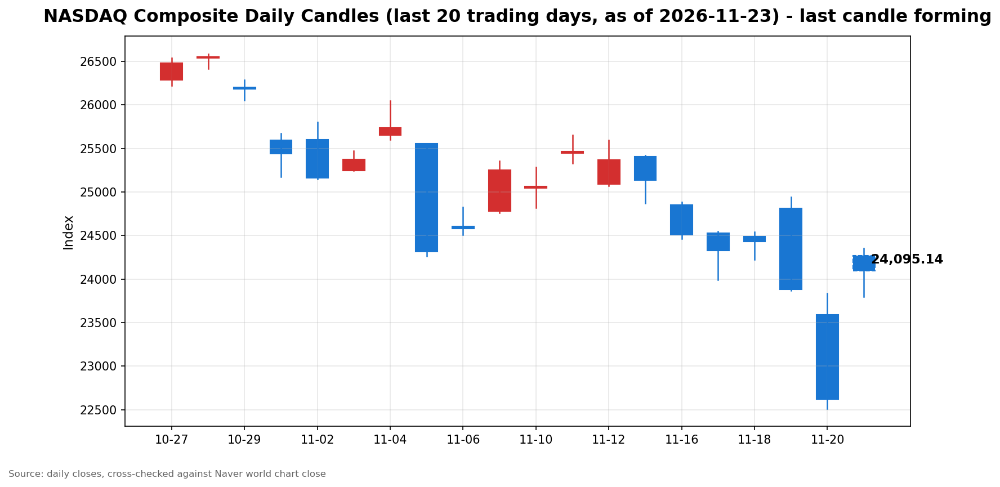

안녕하세요, [한국투자증권](https://securities.koreainvestment.com/main/Main.jsp)에서 [한투-한국투자증권](https://play.google.com/store/apps/details?id=com.truefriend.neosmartarenewal&hl=ko) 개발을 담당하고 있는 way입니다. 
젠슨 황의 엔비디아 복귀 소식에 나스닥이 6% 넘게 반등하며 금요일 급락분을 되돌리고 있습니다. 

## 장중 요약

나스닥 종합지수는 장중 24,114.96으로 전일 대비 6.62% 상승하고 있습니다. 
금요일 5.28% 급락했던 지수가 하루 만에 상승으로 방향을 바꿨습니다. 
S&P500 지수는 4.75%, 다우 지수는 3.04% 오르며 3대 지수가 일제히 반등하고 있습니다. 
엔비디아는 이사회가 젠슨 황 최고경영자(CEO)의 즉시 복직을 만장일치로 의결했다는 소식에 33% 안팎으로 급등하고 있습니다. 
다만 오전 10시 45분 기록한 7.11% 상승에서는 소폭 되돌려, 고점 대비 상승폭이 다소 줄었습니다. 

## 오늘의 스냅샷

| 지수 | 현재가 | 전일 대비 | 등락률 | 전일 종가 | 시가 | 고가 | 저가 |
| --- | --- | --- | --- | --- | --- | --- | --- |
| [나스닥 종합](https://stock.naver.com/worldstock/index/.IXIC/price) | 24,114.96 | +1,497.23 | +6.62% | 22,617.73 | 24,269.75 | 24,353.65 | 23,794.96 |
| S&P500 | 7,238.75 | +328.36 | +4.75% | 6,910.39 | 7,227.41 | 7,295.60 | 7,152.66 |
| 다우 | 49,612.22 | +1,464.89 | +3.04% | 48,147.33 | 49,239.91 | 49,810.26 | 49,033.31 |

스냅샷 기준 시각은 2026년 11월 23일 오후 12시 56분(미국 동부시간), 2026년 11월 24일 오전 2시 56분(한국시간)입니다. 
나스닥 수치는 [네이버 월드 차트](https://finance.naver.com/world/sise.naver?symbol=NAS@IXIC)와 [Npay 증권 나스닥 종합 페이지](https://stock.naver.com/worldstock/index/.IXIC/price) 기준이며, S&P500과 다우의 현재가·전일 대비·등락률도 같은 페이지의 주요 미국 증시 구간에서 확인했습니다. 
한투 MTS 해외 대시보드에서도 나스닥이 6%대 상승, S&P500이 4%대 상승으로 같은 방향을 확인했습니다. 
당일 수치는 형성 중인 값으로, 마감 전에는 계속 변합니다. 
나스닥 거래량은 835,121천주로 집계됐습니다. 
미 10년물 국채수익률은 4.94% 수준이며, 달러 지수는 104.52 수준입니다. 
서부텍사스산 원유(WTI)는 배럴당 81.14달러 수준입니다. 

## 차트

최근 20거래일 일봉 차트입니다. 
빨간 봉은 종가가 시가보다 높은 날, 파란 봉은 종가가 시가보다 낮은 날입니다. 
당일 봉은 형성 중인 봉으로, 마감 전에는 계속 변합니다. 

## 원인·촉매 분석

오늘 반등의 근본 촉매는 엔비디아 리더십 불확실성의 해소입니다. 
젠슨 황 CEO는 11월 12일 사임했고, 이사회는 11월 17일 복귀시킬 뜻이 없다고 밝혔습니다. 
이어 11월 20일에는 엔비디아 회계 조사 소식에 주가가 하루 만에 14.01% 하락했고, 필라델피아 반도체지수는 10.73% 급락했습니다. 
이 불확실성이 AI주 전반의 매도세를 키웠고, 지난주 S&P500은 주간 기준 651포인트(-8.6%) 하락해 역대 최대 주간 포인트 하락을 기록했습니다. 
나스닥은 주간 -10%로 2020년 이후 최악의 한 주를 보냈고, S&P500은 10월 고점 대비 -12%로 조정 구간에 진입했습니다. 
11월 23일 이사회가 만장일치로 황 CEO의 복직을 결정하면서, 11일간 이어진 리더십 공백이 해소됐습니다. 
도널드 트럼프 미국 대통령이 이사회와 직접 대화하며 복귀를 요청했다는 점도 시장의 안도감을 키웠습니다. 
금리 쪽에서는 안전자산 되팔림이 나타났습니다. 
로이터 보도에 따르면 단기 국채수익률은 10bp 올라 4.72%를 기록했습니다. 
중앙일보 GMC의 11월 23일자 G브닝은 12월 FOMC에서 50bp 인상 가능성이 사라지고 25bp 인상 가능성이 93%로 언급됐다고 전했습니다. 
지수 간 상승률 차이는 상승의 성격을 보여줍니다. 
나스닥이 6.62%로 가장 많이 올랐고, S&P500이 4.75%, 다우가 3.04%로 뒤를 이었습니다. 
상승이 기술주와 AI 관련주에 집중됐고, 전통 산업주의 참여는 상대적으로 작았다는 뜻입니다. 

## 핵심 사건 3가지

첫째, 젠슨 황의 엔비디아 CEO 복직입니다. 
엔비디아 이사회는 현지시간 11월 23일 황 CEO를 사장 겸 CEO 및 이사로 즉시 복직시켰다고 발표했습니다. 
의결은 만장일치였고, 이사회는 미국 정부 고위층 의견을 청취한 뒤 국가안보 위험이 없다는 확신을 얻었다고 밝혔습니다. 
트럼프 대통령은 이날 오전 트루스소셜에 이사회가 황 CEO를 다시 기용하기를 바란다는 글을 올렸습니다. 
엔비디아 주가는 개장과 동시에 33% 안팎으로 급등했고, 장중 한때 36%까지 올라 166.01달러를 기록했습니다. 
배런스 보도에 따르면 2003년 5월 이후 가장 큰 일일 상승률입니다. 
나스닥100 지수는 시가총액이 2조달러 넘게 불어났고, 2025년 4월 이후 가장 큰 일일 상승률을 기록하고 있습니다. 
다만 독립 이사 조사위원회의 조사는 계속되고, 국가안보 및 수출통제 위원회 신설과 최고준법감시인 영입 절차가 남아 있어 후속 절차를 지켜봐야 합니다. 
둘째, 지난주 폭락의 되돌림과 저가 매수세입니다. 
S&P500은 지난주 8.6% 하락했고, 나스닥100은 하루 5.6% 하락하며 10월 6일 고점 대비 19.8% 밀려 약세장 진입을 목전에 뒀습니다. 
공포지수로 불리는 VIX는 이날 16.24% 급락해 30.06까지 내려왔습니다. 
모건스탠리는 가장 공격적인 전술적 매수 의견을 냈고, 골드만삭스와 블룸버그는 반등이 추세 회복이 아닐 수 있다며 신중한 입장을 보였습니다. 
같은 날 대만 증시는 공매도 제한 등 5대 시장 안정 대책을 즉시 시행하며 2.16% 상승했습니다. 
셋째, 매크로 일정과 아시아발 안정 조치입니다. 
아시아 금융당국의 시장 안정 조치와 12월 FOMC 인상 폭 축소 기대가 반등의 배경으로 꼽혔습니다. 
10월 미국 개인소비지출(PCE) 물가지수는 수요일 발표될 예정입니다. 
추수감사절 주간으로 뉴욕 증시는 11월 26일 목요일 휴장하고, 11월 27일 금요일 조기 폐장합니다. 
크라우드스트라이크가 지스케일러를 439억달러에 인수한다는 소식도 전해졌습니다. 
반대쪽에서는 일론 머스크 테슬라 최고경영자가 AI 데이터센터 가동 지연을 이유로 2027년 AI 업계에 대규모 자금난이 닥칠 수 있다고 경고했습니다. 
반등의 지속 여부를 가늠할 때 함께 살펴야 할 리스크 요인입니다. 

## 지수·섹터 영향 체인

상승은 반도체와 AI 인프라 관련주가 주도했습니다. 
엔비디아의 33% 안팎 급등을 비롯해 네비우스 그룹은 28%, 델은 24%, 테슬라는 13% 올랐습니다. 
엔비디아의 협력사와 고객사 주가가 함께 오르면서 AI 밸류체인 전반으로 온기가 번졌습니다. 
다우의 상승률이 3.04%로 상대적으로 낮았다는 점은, 상승이 지수 전반이 아니라 기술주에 집중됐다는 뜻입니다. 
채권 시장에서는 안전자산 매도가 나타나 단기 국채수익률이 올랐습니다. 
금리 상승은 성장주 밸류에이션에 부담이 되지만, 이날은 리더십 불확실성 해소 효과가 더 크게 작용했습니다. 
에너지 쪽에서는 서부텍사스산 원유가 배럴당 81.14달러 수준으로 집계됐습니다. 
섹터별 지수의 세부 등락률은 확인되지 않아 확인 필요로 남겨둡니다. 

## 다우·S&P500 흐름

다우 지수는 49,612.22로 3.04% 오르고 있습니다. 
S&P500 지수는 7,238.75로 4.75% 오르며 조정 구간에서 벗어나고 있습니다. 
S&P500은 지난 금요일 3.70% 하락해 7거래일 연속 하락으로 마감한 뒤, 이날 반등으로 흐름을 바꿨습니다. 
로이터와 월스트리트저널 보도에 따르면 S&P500은 조정 영역 탈출을, 나스닥은 2025년 4월 이후 최대 일일 상승률을 기록하고 있습니다. 
다우가 나스닥보다 상승률이 낮다는 점에서, 이날 반등은 경기 민감주보다 기술주의 되돌림 성격이 강합니다. 

## 오전과 오후 흐름 변화

나스닥은 시가 24,269.75로 전일 대비 7.30% 상승하며 출발했습니다. 
오전 10시 45분에는 24,226.37로 7.11% 상승을 기록했습니다. 
오후 12시 56분 현재 24,114.96으로 6.62% 상승 중이어서, 오전 고점 대비 상승폭이 다소 줄었습니다. 
당일 고가는 24,353.65, 저가는 23,794.96입니다. 
시가 대비 방향 전환은 없었고, 상승 흐름은 유지되고 있습니다. 
다만 고점 대비 되돌림이 이어지고 있어 오후 흐름은 상승폭 유지 여부를 확인하는 구간입니다. 

## 마감까지 전망과 확인할 시나리오

확인할 첫 번째 수치는 당일 고가 24,353.65입니다. 
고가를 다시 넘으면 오전의 상승 탄력이 이어지는 흐름으로 볼 수 있습니다. 
확인할 두 번째 수치는 24,000선 유지 여부입니다. 
24,000선을 지키면 금요일 급락분을 되돌린 수준이 유지되는 셈입니다. 
확인할 세 번째 수치는 당일 저가 23,794.96입니다. 
저가를 이탈하면 오후 되돌림이 깊어지는 흐름으로 봐야 합니다. 
11월 18일 종가 24,429.88은 아직 회복하지 못한 수준으로, 마감까지의 상단 참고 지점입니다. 
이벤트 측면에서는 수요일 발표되는 10월 PCE 물가지수가 다음 확인 지점입니다. 
추수감사절 주간 휴장(11월 26일)과 조기 폐장(11월 27일)으로 거래량이 줄어들 수 있어, 단기 변동성이 커질 수 있습니다. 
리스크 요인으로는 엔비디아에 대한 독립 이사 조사위원회의 조사 지속과 AI 업계 자금 조달 우려가 남아 있습니다. 
이 글은 교육·해설 목적의 시황 정리이며, 특정 종목의 매수·매도 권유가 아닙니다. 

## 마치며

젠슨 황의 복귀로 AI주를 짓누르던 불확실성이 걷히며 나스닥이 강한 반등을 보이고 있습니다. 
다만 조사가 계속되고 매크로 일정이 남아 있어, 반등이 추세 회복인지 되돌림인지는 마감 흐름과 수요일 PCE 발표로 확인해야 합니다. 
