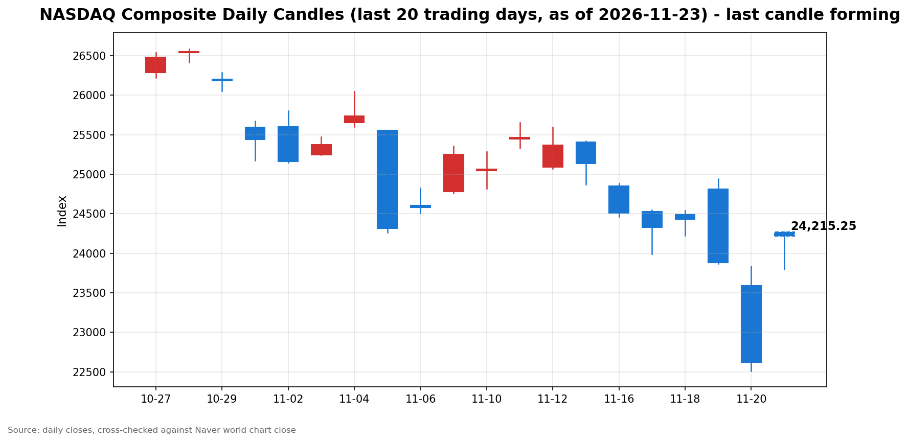

안녕하세요, [한국투자증권](https://securities.koreainvestment.com/main/Main.jsp)에서 [한투-한국투자증권](https://play.google.com/store/apps/details?id=com.truefriend.neosmartarenewal&hl=ko) 개발을 담당하고 있는 way입니다. 
금요일 5.28% 급락했던 나스닥이 월요일 개장과 함께 6% 넘게 반등하고 있습니다. 

## 배경

지난주 금요일 미국 증시는 3대 지수가 일제히 큰 폭으로 하락했습니다. 
나스닥 종합지수는 22,617.73으로 5.28% 하락했고, 반도체 지수는 10.7% 하락했습니다. 
엔비디아는 하루 만에 14.01% 하락했습니다. 
S&P500 지수도 6,910.39로 3.70% 하락해 7거래일 연속 하락했고, 고점 대비 12% 밀리며 기술적 조정 구간에 진입했습니다. 
다우 지수는 48,147.33으로 1.93% 하락했습니다. 
주간으로는 S&P500이 8.6%, 나스닥이 10%, 반도체 지수가 13.2% 하락했습니다. 
중앙일보 GMC의 11월 21일자 G모닝 브리핑은 나스닥100이 하루 5.6% 하락하고, 10월 6일 고점 대비 19.8% 밀려 약세장 진입을 목전에 뒀다고 전했습니다. 
앤트로픽은 상장 첫날 17% 올랐으나, 이틀째 8.5% 하락하며 상승분을 대부분 반납했습니다. 
국내 증시는 금요일 미국 급락을 반영해 오늘 코스피가 4,708.54로 3.31% 하락 마감했습니다. 
장중에는 6%까지 밀렸다가 기관과 자사주 매수에 낙폭을 줄였습니다. 
코스닥은 635.45로 2년 만에 가장 낮은 수준으로 떨어졌습니다. 
대만 증시는 공매도 제한 등 5대 안정 대책을 즉시 시행하며 2.16% 상승했습니다. 
다만 지난 금요일 대만에서는 하루 신용융자 잔고가 490억 대만달러 급감하며 1996년 집계 이후 최대 강제 청산이 터졌습니다. 
한국 정부의 증권시장안정펀드 가동 준비 소식에도 국내 증시의 하락을 막지는 못했습니다. 
주말 사이 나스닥 선물은 2.7%에서 3.6%로 반등 폭을 키웠고, 월요일 정규장에서도 기술주 중심의 강한 반등이 이어지고 있습니다. 
월요일 오전에는 엔비디아 이사회가 사임 11일 만에 젠슨 황을 사장·최고경영자·이사로 만장일치 복직시켰다는 소식도 전해졌습니다. 

## 오늘의 스냅샷

| 지수 | 현재가 | 전일 대비 | 등락률 | 전일 종가 | 시가 | 고가 | 저가 |
| --- | --- | --- | --- | --- | --- | --- | --- |
| [나스닥 종합](https://stock.naver.com/worldstock/index/.IXIC/price) | 24,124.17 | +1,506.43 | +6.66% | 22,617.73 | 24,269.75 | 24,269.75 | 23,794.96 |
| S&P500 | 7,232.47 | +322.08 | +4.66% | 6,910.39 | 7,227.41 | 7,260.17 | 7,152.66 |
| 다우 | 49,497.95 | +1,350.62 | +2.81% | 48,147.33 | 49,239.91 | 49,510.32 | 49,033.31 |

스냅샷 기준 시각은 2026년 11월 23일 오전 10시 3분(미국 동부시간), 2026년 11월 24일 오전 0시 3분(한국시간)입니다. 
나스닥 수치는 [네이버 월드 차트](https://finance.naver.com/world/sise.naver?symbol=NAS@IXIC)와 [Npay 증권 나스닥 종합 페이지](https://stock.naver.com/worldstock/index/.IXIC/price) 기준이며, S&P500과 다우 수치는 야후 파이낸스 기준입니다. 
한투 MTS 해외 대시보드에서도 나스닥이 6%대 상승으로 확인됐습니다. 
당일 수치는 형성 중인 값으로, 마감 전에는 계속 변합니다. 
나스닥 거래량은 434,890천주로 집계됐습니다. 
미 10년물 국채수익률은 4.95% 수준이며, 달러 지수는 104.26 수준입니다. 
서부텍사스산 원유(WTI)는 배럴당 81.07달러로 전일 대비 3% 넘게 하락했습니다. 

## 차트

최근 20거래일 일봉 차트입니다. 
빨간 봉은 종가가 시가보다 높은 날, 파란 봉은 종가가 시가보다 낮은 날입니다. 
당일 봉은 형성 중인 봉으로, 마감 전에는 계속 변합니다. 

## 원인·촉매 분석

금요일 급락의 배경에는 여러 악재가 겹쳤습니다. 
엔비디아에 대한 미국 증권거래위원회(SEC)의 회계 조사 착수 보도가 나왔습니다. 
젠슨 황 최고경영자의 스캔들과 사임 소식, 중국 수출규제 우회 의혹이 이어졌습니다. 
캘리포니아주 법무부도 첨단 칩·기밀 정보의 대중국 유출 여부와 투자자 오도 여부를 조사하기 위해 소환장을 발부했습니다. 
미국 재무장관은 엔비디아가 외부에서 최고경영자를 영입해야 한다고 주장했습니다. 
트럼프 대통령의 해외 데이터센터 건설 금지 발언도 전해졌습니다. 
앤트로픽 상장 이후 주가 부진과 연준의 인공지능 하방 위험 언급도 투자 심리를 위축시켰습니다. 
민주당의 중간선거 승리 이후 데이터센터 규제 우려도 더해졌습니다. 
시장은 이를 단순한 차익 실현이 아니라 AI 투자 지속성 자체에 대한 의구심으로 해석했습니다. 
자금은 미 국채와 엔, 스위스프랑 등 안전자산으로 이동했고, 미 10년물 금리는 금요일 4.92%로 낮아졌습니다. 
월요일 반등에는 두 가지 동력이 함께 작용했습니다. 
첫째, 낙폭 과대에 따른 기술적 되돌림입니다. 
지난주 나스닥은 6년여 만에 최악의 주간 하락률을 기록했고, 주간 낙폭은 10%에 달했습니다. 
프리마켓에서 나스닥100 선물은 3.5% 올랐고, 엔비디아는 9% 안팎 반등했습니다. 
둘째, 젠슨 황 최고경영자의 복직 결정입니다. 
엔비디아 이사회는 사임 11일 만에 황을 사장·최고경영자·이사로 만장일치 복직시켰습니다. 
미 정부 고위층 의견을 받아 국가안보 위험이 없다고 확신했다고 밝혔습니다. 
독립 조사위원회 조사는 계속되며, 국가안보·수출통제 위원회를 신설하고 최고준법감시인을 영입합니다. 
리더십 불확실성이 걷히며 반도체 투매를 이끌던 불안이 일부 가라앉았습니다. 
다만 복직 소식은 장 시작 무렵 전해졌고, 프리마켓 반등이 먼저 시작됐습니다. 
반등이 복직 소식만으로 설명되지는 않으며, 기술적 되돌림의 성격도 함께 있습니다. 
골드만삭스는 미국 증시가 단기 저가매수 기회에 가까워졌다고 평가했습니다. 
다만 투매가 아직 다 나오지 않았고, 헤지펀드는 3주 연속 글로벌 주식을 순매도했다고 경고했습니다. 
모건스탠리는 공격적 매수 의견을 냈고, 골드만삭스는 신중론을 폈습니다. 
미 10년물 금리는 월요일 장 초반 4.95%로 금요일과 비슷한 수준입니다. 
금리가 반등을 주도한 것이 아니라, 기술주 자체의 낙폭 되돌림이 반등을 이끌고 있습니다. 
달러 지수는 104.26으로 소폭 올랐고, 유가는 3% 넘게 하락했습니다. 
금리·달러·유가의 움직임은 반등의 방향과 어긋나지 않으나, 주된 동력은 아닙니다. 

## 핵심 사건 3가지

첫째, 금요일 나스닥이 하루 만에 5.28% 하락했습니다. 
반도체 지수는 10.7% 하락했고, 엔비디아는 14.01% 하락했습니다. 
나스닥100은 고점 대비 19.8% 밀려 약세장 진입을 목전에 뒀습니다. 
S&P500도 고점 대비 12% 밀려 기술적 조정 구간에 진입했습니다. 
주간으로는 S&P500이 651포인트 하락하며 역대 최대 주간 포인트 낙폭을 기록했습니다. 
변동성 지수(VIX)는 지난해 4월 이후 최고치로 올랐습니다. 
월가에서는 2018년 연말 폭락이 재연되는 것 아니냐는 우려가 나왔습니다. 
다만 기업 이익과 회사채 시장은 견조하다는 평가도 함께 나왔습니다. 

둘째, 엔비디아를 둘러싼 리더십·거버넌스 불확실성이 커졌다가 월요일 복직으로 방향이 바뀌었습니다. 
젠슨 황 최고경영자는 11월 12일 사임했습니다. 
중국 정보기관 연루 의혹을 받는 여성과의 관계가 드러난 뒤 자리에서 물러났습니다. 
엔비디아가 미국의 대중국 반도체 수출 규제를 고의로 우회했는지에 대한 조사도 촉구됐습니다. 
미국 당국은 메가스피드가 엔비디아의 첨단 AI 반도체를 중국에 불법 반입하는 데 관여했는지 조사하고 있습니다. 
베선트 재무장관은 엔비디아가 수출 규제를 준수했는지, 경영진이 위반 가능성을 알고도 묵인했는지 확인해야 한다고 주장했습니다. 
월요일 오전 엔비디아 이사회는 사임 11일 만에 황을 만장일치로 복직시켰습니다. 
미 정부 고위층 의견을 받아 국가안보 위험이 없다고 확신했다고 밝혔습니다. 
독립 조사위원회 조사는 계속되며, 국가안보·수출통제 위원회가 신설됩니다. 
리더십 공백은 해소됐으나, 조사와 규제 리스크가 완전히 사라진 것은 아닙니다. 

셋째, 월요일 개장과 함께 강한 반등이 나타났습니다. 
나스닥 선물은 주말 사이 2.7% 반등한 데 이어 개장 전 3.6%까지 올랐습니다. 
프리마켓에서 나스닥100 선물은 3.5%, S&P500 선물은 2.8% 올랐습니다. 
정규장에서는 나스닥이 6.66%까지 올랐고, 엔비디아는 시간외에서 10% 급등했습니다. 
엔비디아는 지난주 23%, 한 달 새 40% 넘게 하락한 뒤 반등하고 있습니다. 
모건스탠리는 공격적 매수 의견을 냈고, 골드만삭스는 신중론을 폈습니다. 
시장은 지난주 급락으로 단기 바닥이 형성됐는지, 추가 하락 여지가 남았는지를 가늠하고 있습니다. 
반등이 추세 전환인지, 하락 과정의 되돌림인지는 아직 확인되지 않았습니다. 

## 지수·섹터 영향 체인

반등의 강도는 금요일 하락의 순서와 같습니다. 
나스닥이 6.66%로 가장 강하게 반등했고, S&P500이 4.66%, 다우가 2.81%로 뒤를 이었습니다. 
금요일 하락폭도 나스닥 5.28%, S&P500 3.70%, 다우 1.93% 순이었습니다. 
기술·반도체 비중이 클수록 하락도 반등도 컸습니다. 
반도체는 금요일 10.7% 하락한 만큼 월요일 반등의 중심에 있습니다. 
다만 연준이 지적한 AI 순환 금융 구조에 대한 우려는 남아 있습니다. 
연준에 따르면 빅테크들의 장기 계약·임대·지급보증에 가려진 잠재적 부채는 3조 달러가 넘습니다. 
코어위브처럼 GPU를 담보로 대규모 자금을 빌려 데이터센터를 확장하는 구조도 시험대에 올랐습니다. 
AI 투자 회수 의구심은 회사채 시장으로 번졌습니다. 
알파벳 5년물 CDS는 사상 최고치를 기록했습니다. 
지난주 S&P500 수익률 꼴찌는 샌디스크 -28.37%, 블룸 에너지 -25.83%, 마이크론 -23.62%였습니다. 
반면 타이슨 푸드 +10.71%, 호멜 푸즈 +6.56% 등 필수소비재는 올랐습니다. 
폭락장 속에서도 크라우드스트라이크의 지스케일러 439억 달러 인수가 확정되는 등 M&A는 이어지고 있습니다. 
에너지 섹터는 유가 하락과 함께 반등에서 소외됐습니다. 
WTI는 배럴당 81.07달러로 3% 넘게 하락했습니다. 
금융·필수소비재 등 경기방어 섹터는 기술주 대비 움직임이 작았습니다. 
국내 증권가에서는 섣부른 바닥 매수를 경계해야 한다는 지적도 나왔습니다. 
금요일 급락의 충격이 컸던 만큼, 반등 하루만으로 추세가 바뀌었다고 보기는 어렵습니다. 

## 다우·S&P500 흐름

다우 지수는 49,497.95로 전일 대비 1,350.62포인트, 2.81% 올랐습니다. 
시가 49,239.91, 고가 49,510.32, 저가 49,033.31을 기록했습니다. 
S&P500 지수는 7,232.47로 전일 대비 322.08포인트, 4.66% 올랐습니다. 
시가 7,227.41, 고가 7,260.17, 저가 7,152.66을 기록했습니다. 
세 지수 모두 금요일 시가를 웃돌며 금요일 하락분을 되돌리고 있습니다. 
나스닥은 금요일 시가 23,592.67을 넘어 24,124.17까지 올랐습니다. 
다우는 기술주 비중이 낮아 반등폭이 가장 작았습니다. 
S&P500은 나스닥과 다우의 중간에서 움직였습니다. 
지수 간 방향 차이는 기술주 중심의 되돌림 장세라는 점을 보여줍니다. 

## 단기·중기 전망과 장 초반 확인할 시나리오

단기적으로 확인할 첫 번째 수준은 24,000선입니다. 
나스닥이 장 초반 24,000선을 지키는지, 다시 내주는지가 반등의 강도를 가늠합니다. 
금요일 고가 23,837.76과 목요일 종가 23,879.20도 되돌림의 기준이 됩니다. 
위쪽에서는 11월 18일 종가 24,429.88이 다음 저항 구간으로 보입니다. 
아래쪽에서는 금요일 종가 22,617.73과 금요일 저가 22,513.01이 지지 구간입니다. 
반등이 유지되면 단기 매도 물량의 되돌림이 이어질 수 있습니다. 
반등이 꺾이면 금요일 저점을 다시 시험하는 흐름이 나올 수 있습니다. 
중기적으로는 12월 연방공개시장위원회(FOMC) 결정과 물가 지표가 분수령이 됩니다. 
11월 25일에는 10월 PCE 물가지수와 3분기 GDP 잠정치가 발표됩니다. 
연준의 추가 금리인상 가능성과 AI 순환 금융에 대한 우려가 남아 있습니다. 
앤트로픽 상장 이후 주가 흐름도 AI 투자심리를 가늠하는 재료입니다. 
모건스탠리와 골드만삭스의 의견이 엇갈리는 만큼, 반등의 지속 여부는 이번 주 지표와 엔비디아 후속 소식으로 확인해야 합니다. 
이번 주는 추수감사절 주간입니다. 
목요일인 11월 26일은 추수감사절로 미국 증시가 휴장하고, 금요일은 조기 마감합니다. 
거래량이 줄어드는 시기에는 변동성이 커질 수 있습니다. 
섣부른 바닥 판단보다는 지수·섹터 단위의 흐름을 확인하며 대응하는 관점이 필요합니다. 

## 마치며

금요일 급락의 충격을 딛고 월요일 나스닥이 강한 반등으로 출발했습니다. 
다만 반등의 성격이 기술적 되돌림에 가까운 만큼, 추세 전환 여부는 장 초반 흐름과 이번 주 일정을 통해 확인이 필요합니다. 
이 글은 시장 해설을 위한 교육 목적의 글이며, 특정 종목의 매수나 매도를 권유하는 내용이 아닙니다. 
