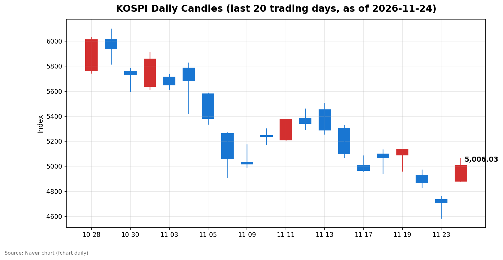
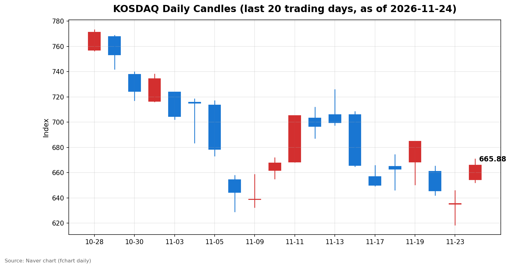

안녕하세요, [한국투자증권](https://securities.koreainvestment.com/main/Main.jsp)에서 [한투-한국투자증권](https://play.google.com/store/apps/details?id=com.truefriend.neosmartarenewal&hl=ko) 개발을 담당하고 있는 way입니다. 
오늘 국내 증시는 젠슨 황 엔비디아 최고경영자 복귀 소식에 힘입어 양 시장이 동반 급등하며 마감했습니다. 

## 마감 요약

코스피는 전 거래일보다 297.49포인트 오른 5,006.03으로 마감했습니다. 
등락률은 플러스 6.32퍼센트입니다. 
코스닥은 30.43포인트 오른 665.88로 마감했습니다. 
등락률은 플러스 4.79퍼센트입니다. 
코스피는 개장 직후 매수 사이드카가 발동되며 5,000선을 되찾았습니다. 
코스피는 장중 5,065.74까지 올랐고, 시가인 4,880.16 아래로는 한 번도 내려가지 않았습니다. 
지난 20일과 23일 이틀 동안 코스피는 8.36퍼센트 하락했으나, 오늘 하루 상승으로 그 낙폭의 대부분을 되돌렸습니다. 
다만 11월 19일 종가 5,137.89와 비교하면 아직 131.86포인트 낮은 수준입니다. 
11월 4일 연고점 5,683.80과 비교하면 약 11.9퍼센트 낮은 수준입니다. 

## 오늘의 마감 스냅샷

| 지수 | 종가 | 전일 대비 | 등락률 | 시가 | 고가 | 저가 | 거래량 | 거래대금 |
| --- | --- | --- | --- | --- | --- | --- | --- | --- |
| [코스피](https://finance.naver.com/sise/sise_index.naver?code=KOSPI) | 5,006.03 | +297.49 | +6.32% | 4,880.16 | 5,065.74 | 4,880.16 | 176,060천주 | 14조 5,589억 원 |
| [코스닥](https://finance.naver.com/sise/sise_index.naver?code=KOSDAQ) | 665.88 | +30.43 | +4.79% | 654.31 | 670.95 | 652.21 | 408,164천주 | 5조 4,032억 원 |

전일 종가는 코스피 4,708.54, 코스닥 635.45입니다. 
네이버 실시간 수치와 일봉 종가가 일치하며, 전일 종가는 실시간 등락률로 역산한 값과 일봉 전일 종가가 일치합니다. 
수치는 2026년 11월 24일 장 마감 기준입니다. 

## 차트

최근 20거래일 일봉 차트입니다. 
빨간 봉은 종가가 시가보다 높은 날, 파란 봉은 종가가 시가보다 낮은 날입니다. 

## 원인·촉매 분석

오늘 급반등의 직접적인 촉매는 젠슨 황 엔비디아 최고경영자의 복귀입니다. 
엔비디아는 지난 밤 미국 시장에서 31.48퍼센트 폭등해 165.05달러로 마감했습니다. 
2003년 이후 최대 일일 상승폭이며, 시가총액은 하루 만에 9,520억 달러 늘었습니다. 
필라델피아반도체지수 구성 종목 30개가 모두 올랐고, 지수는 14퍼센트 상승했습니다. 
델이 20.5퍼센트, 네비우스가 20퍼센트, 마이크론이 19퍼센트, TSMC가 14퍼센트 올랐습니다. 
나스닥 종합지수는 1,471.83포인트 오른 24,089.56으로 마감했습니다. 
등락률은 플러스 6.51퍼센트입니다. 
스탠더드앤드푸어스 500지수는 326.78포인트 오른 7,237.17로 마감했습니다. 
등락률은 플러스 4.73퍼센트입니다. 
인공지능 산업의 수익성에 대한 의구심이 확산되며 급락했던 흐름이 하루 만에 되돌려진 셈입니다. 
국내 시장에서는 반도체 대형주를 중심으로 매수세가 몰렸습니다. 
삼성전자는 18만 9,400원, SK하이닉스는 115만 8,000원에 거래를 마쳤습니다. 
두 종목 모두 전 거래일보다 6.7퍼센트 안팎 올랐습니다. 
수급 구도도 반등을 뒷받침했습니다. 
코스피에서 외국인과 기관이 함께 순매수했고, 개인이 순매도했습니다. 
외국인은 지난 23일 순매도에서 오늘 순매수로 돌아섰습니다. 
코스닥에서도 외국인과 기관이 순매수했고, 개인이 순매도했습니다. 
지난 이틀 동안의 하락 국면에서는 외국인과 개인이 함께 팔았으나, 오늘은 외국인과 기관이 받고 개인이 파는 구도로 바뀌었습니다. 
환율은 반등 국면에서도 비교적 안정적이었습니다. 
원·달러 환율은 1,343.00원으로 전 거래일보다 0.40원 올랐습니다. 
등락률은 플러스 0.03퍼센트에 그쳤습니다. 
지수 급등에도 환율이 크게 흔들리지 않았다는 점은 외국인 매수에 부담이 덜했다는 의미로 읽힙니다. 

## 핵심 사건 3가지

첫째, 젠슨 황 엔비디아 최고경영자의 복귀와 엔비디아의 폭등입니다. 
엔비디아 주가는 하루 만에 31.48퍼센트 올랐습니다. 
지난 20일과 23일 국내 증시의 급락이 인공지능 수익성 의구심에서 출발했다는 점을 감안하면, 이번 반등의 출발점도 같은 지점에 있습니다. 
인공지능 생태계 투자가 지속될 가능성이 다시 커졌다는 기대가 반도체 밸류체인 전반으로 번졌습니다. 
다만 엔비디아와 황 최고경영자에 대한 조사 등 리스크는 여전히 남아 있습니다. 
한 사람의 거취에 시장이 이토록 크게 반응했다는 사실 자체가 변동성의 구조적 원인을 보여줍니다. 

둘째, 매수 사이드카의 발동과 5,000선 탈환입니다. 
코스피는 전 거래일보다 3.64퍼센트 높은 4,880.16에 개장했습니다. 
개장 6분 만인 오전 9시 6분 선물 급등으로 매수 사이드카가 발동되며 단숨에 5,000선을 되찾았습니다. 
코스닥 시장에서도 개장 직후 매수 사이드카가 발동됐습니다. 
지난 20일과 23일에는 매도 사이드카가 이틀 연속 발동됐던 것과 정반대의 장면입니다. 
이틀 만에 매도 사이드카에서 매수 사이드카로 장치가 뒤집혔다는 점이 이번 주 시장의 변동성 크기를 보여줍니다. 

셋째, 정부의 시장 안정 대응입니다. 
이재명 대통령은 오늘 코스피가 5,000선을 회복하자 주가가 널뛰기 같은 모습을 보이고 있다며 금융당국의 대응책을 강도 높게 주문했습니다. 
정부는 지난 일요일 증권시장안정펀드 투입 준비, 기업 자사주 매입 규제 완화, 불법 공매도 감시 강화를 발표한 바 있습니다. 
상장사가 자사주를 직접 매입할 때 하루 동안 취득신고 물량 전체의 매수주문을 낼 수 있는 한시 완화 조치는 내년 2월 23일까지 석 달간 적용됩니다. 
금융감독원과 한국거래소는 불법 공매도에 대한 3개월 집중감시 합동 태스크포스를 가동했습니다. 
대책이 아직 가동 단계가 아니라 준비 단계라는 점은 시장에 남는 과제입니다. 
다만 정책 당국이 변동성 확대에 대응하고 있다는 신호 자체는 투자 심리에 우호적으로 작용했습니다. 

## 섹터·테마 영향 체인

인공지능 기대 회복은 반도체에서 출발해 부품과 장비, 테마 전반으로 번졌습니다. 
한국투자증권 MTS 기준 오늘 가장 강했던 테마는 MLCC로 12.17퍼센트 올랐습니다. 
바이오소재가 11.83퍼센트, 로봇이 11.38퍼센트로 뒤를 이었습니다. 
전기자전거가 9.79퍼센트, 2차전지 생산이 8.12퍼센트 올랐습니다. 
스마트공장이 7.97퍼센트, 유리기판이 7.96퍼센트, 원자력발전소 해체가 7.90퍼센트, 전고체배터리가 7.89퍼센트 올랐습니다. 
로봇 테마의 강세에는 삼성전자의 휴머노이드 사업 강화 소식이 작용했습니다. 
삼성전자는 내년 초 공개를 목표로 휴머노이드를 개발 중입니다. 
삼성전자와 삼성SDS는 경북 구미에 총 19조 원을 투자해 휴머노이드 양산 체계와 로봇 데이터 팩토리, 인공지능 데이터센터 등을 구축할 예정입니다. 
삼성전자는 오늘 2027년 정기 임원 인사에서 부사장 39명, 상무 78명 등 총 131명을 승진 발령했습니다. 
반도체 부문에서만 70명이 발탁됐고, 로봇과 인공지능, 파운드리 분야 인재도 중용됐습니다. 
연결고리는 뚜렷합니다. 
인공지능 수익성 우려가 걷히자 반도체 대형주의 밸류에이션 압박이 풀렸고, 그 온기가 메모리 수요 확대 기대가 있는 MLCC와 유리기판, 데이터센터 전력 수주와 ESS 배터리, 로봇과 스마트공장 같은 정책·수주 기대 테마로 함께 번졌습니다. 
한국투자증권 MTS 시장 브리핑은 로봇이 계약과 양산 기대를 앞세워 주도한 가운데 데이터센터 전력 수주와 ESS 배터리가 동반 강세로 마감했다고 정리했습니다. 
지수 급등 국면에서는 약세 테마가 사실상 없었고, 자금이 업종 안에서 이동한 것이 아니라 시장 전반으로 확산된 하루였습니다. 

## 최근 5거래일 일봉

### 코스피

| 날짜 | 시가 | 고가 | 저가 | 종가 | 전일 대비 | 등락률 | 거래량 |
| --- | --- | --- | --- | --- | --- | --- | --- |
| 2026-11-18 | 5,098.82 | 5,133.14 | 4,943.17 | 5,067.44 | +98.96 | +1.99% | 219,090천주 |
| 2026-11-19 | 5,090.04 | 5,137.89 | 4,963.61 | 5,137.89 | +70.45 | +1.39% | 195,695천주 |
| 2026-11-20 | 4,928.51 | 4,971.31 | 4,831.69 | 4,869.96 | -267.93 | -5.21% | 206,729천주 |
| 2026-11-23 | 4,734.90 | 4,759.88 | 4,586.80 | 4,708.54 | -161.42 | -3.31% | 218,577천주 |
| 2026-11-24 | 4,880.16 | 5,065.74 | 4,880.16 | 5,006.03 | +297.49 | +6.32% | 176,060천주 |

### 코스닥

| 날짜 | 시가 | 고가 | 저가 | 종가 | 전일 대비 | 등락률 | 거래량 |
| --- | --- | --- | --- | --- | --- | --- | --- |
| 2026-11-18 | 664.93 | 674.30 | 646.31 | 662.81 | +12.75 | +1.96% | 462,804천주 |
| 2026-11-19 | 668.31 | 684.81 | 650.39 | 684.81 | +22.00 | +3.32% | 398,792천주 |
| 2026-11-20 | 660.98 | 665.15 | 642.13 | 645.68 | -39.13 | -5.71% | 421,847천주 |
| 2026-11-23 | 634.93 | 645.93 | 618.74 | 635.45 | -10.23 | -1.58% | 405,856천주 |
| 2026-11-24 | 654.31 | 670.95 | 652.21 | 665.88 | +30.43 | +4.79% | 408,164천주 |

## 당일 수급

코스피에서는 외국인이 7,257억 원, 기관이 8,691억 원, 기타법인이 4,483억 원을 순매수했습니다. 
개인은 2조 431억 원을 순매도했습니다. 
기관 안에서는 연기금이 3,024억 원, 금융투자가 2,510억 원, 투신이 2,206억 원, 사모가 1,136억 원을 순매수했습니다. 
코스닥에서는 외국인이 1,179억 원, 기관이 2,070억 원을 순매수했습니다. 
개인은 3,088억 원을 순매도했고, 기타법인은 161억 원을 순매도했습니다. 
코스닥 기관 매수는 금융투자 826억 원과 투신 841억 원이 중심이었습니다. 
구도를 해석하면, 판 쪽은 개인이 홀로 섰고 받은 쪽은 외국인과 기관이었습니다. 
지난 23일에는 외국인과 개인이 함께 순매도했으나, 오늘은 외국인이 순매수로 돌아서며 기관과 함께 개인 매물을 받았습니다. 
외국인의 매수 전환이 하루 만에 이뤄졌다는 점이 오늘 수급의 가장 큰 변화입니다. 
다만 외국인의 매수가 엔비디아 복귀라는 단일 촉매에 반응한 것인지, 추세적인 귀환인지는 내일 이후의 수급으로 확인할 필요가 있습니다. 
수치는 네이버 시장동향 API 기준이며, 한국투자증권 MTS 대시보드의 수급 집계와는 집계 방식 차이로 수치가 다를 수 있습니다. 

## 강했던 테마와 흐름

로봇 테마가 가장 강한 흐름을 보였습니다. 
한국투자증권 MTS 기준 로봇 테마는 11.38퍼센트 올랐고, 소속 종목 30개 가운데 29개가 상승했습니다. 
MLCC 테마는 12.17퍼센트 올랐고, 소속 종목 6개가 모두 상승했습니다. 
유리기판 테마는 7.96퍼센트 올랐고, 소속 종목 10개가 모두 상승했습니다. 
2차전지 생산과 전고체배터리 테마도 각각 8.12퍼센트, 7.89퍼센트 올랐습니다. 
스마트공장과 원자력발전소 해체 테마도 각각 7.97퍼센트, 7.90퍼센트 올랐습니다. 
테마별 흐름은 한국투자증권 MTS와 딥서치 뉴스, 중앙일보 GMC 허브의 오늘자 기사 교차 확인을 바탕으로 정리했습니다. 
오늘자 G브닝 브리핑은 확인 시점 기준으로 아직 발행되지 않았습니다. 
대신 오늘자 G모닝은 젠슨 황 복귀와 엔비디아의 31.48퍼센트 급등을 다뤘고, 오늘자 GMC 리포트는 팔로알토 네트웍스의 45억 달러 규모 자체 인공지능 서버 인프라 구축 계획을 다뤘습니다. 
인공지능 인프라 투자 확대라는 흐름이 반도체 반등과 같은 방향을 가리키고 있습니다. 

## 단기·중기 전망과 내일 확인할 시나리오

단기적으로는 미국 시장의 흐름이 가장 먼저 확인할 변수입니다. 
엔비디아를 비롯한 인공지능 관련주가 오늘 밤에도 강세를 이어가는지, 차익 실현 매물이 나오는지가 국내 장의 출발점을 정합니다. 
국내에서는 코스피 5,000선의 안착 여부가 첫 번째 확인할 수치입니다. 
당일 고가 5,065.74와 11월 19일 종가 5,137.89가 단기 저항 구간으로 보입니다. 
코스닥은 당일 고가 670.95와 11월 19일 종가 684.81의 회복 여부가 확인할 지점입니다. 
외국인 매수가 내일도 이어지는지, 개인의 순매도가 잦아드는지도 확인할 수치입니다. 
이번 주에는 확인할 경제 지표와 일정이 이어집니다. 
11월 25일에는 미국의 10월 개인소비지출 물가지수와 3분기 국내총생산 잠정치가 발표됩니다. 
근원 개인소비지출 물가지수의 전년 대비 컨센서스는 3.2퍼센트, 3분기 국내총생산 잠정치는 3.5퍼센트입니다. 
11월 26일에는 한국은행 기준금리 결정이 있습니다. 
올해 마지막 금융통화위원회입니다. 
같은 날 미국 증시는 추수감사절로 휴장합니다. 
중기적으로는 인공지능 수익성 논쟁이 아직 끝나지 않았다는 점이 남습니다. 
엔비디아에 대한 조사 등 리스크가 여전하고, 한 사람의 거취에 시장이 크게 흔들렸다는 사실은 변동성이 구조적으로 남아 있음을 보여줍니다. 
이번 반등이 흐름의 전환인지 일시적 되돌림인지는 외국인 수급의 지속 여부와 미국 인공지능 관련주의 추가 흐름으로 가려질 것으로 보입니다. 

## 마치며

오늘 국내 증시는 젠슨 황 엔비디아 최고경영자 복귀 소식에 힘입어 매수 사이드카 발동과 함께 5,000선을 되찾으며 급반등했습니다. 
내일은 5,000선 안착 여부와 외국인 수급의 지속, 미국 경제지표를 확인하는 날이 될 것으로 보입니다. 
이 글은 시장 해설을 목적으로 하며, 특정 종목의 매수나 매도를 권유하지 않습니다. 
